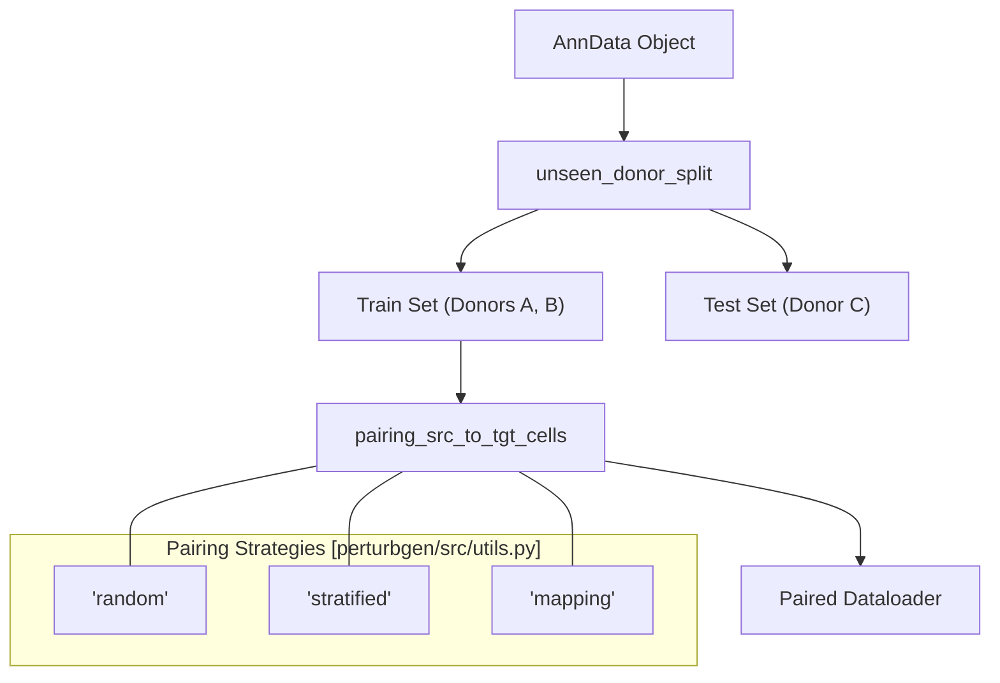
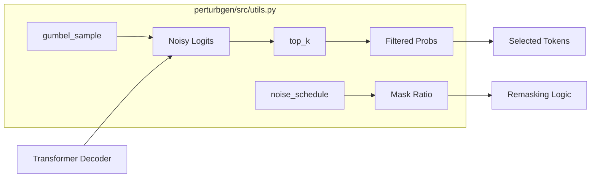
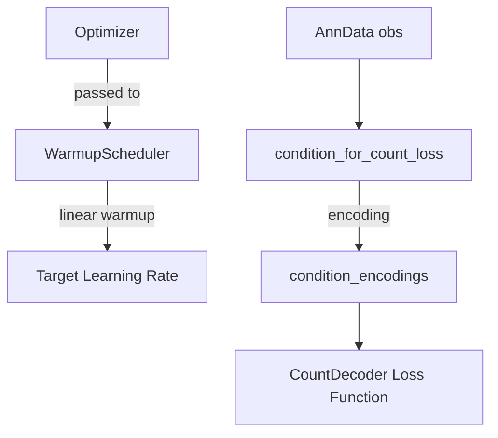

# Core Utility Functions (perturbgen/src/utils.py)

Relevant source files

The following files were used as context for generating this wiki page:

- [perturbgen/Perturb/trainer.py](perturbgen/Perturb/trainer.py)
- [perturbgen/Perturb/transformer.py](perturbgen/Perturb/transformer.py)
- [perturbgen/batch_job_script/cytoimmgen/extrapolation/3_run_train_count_extrapolation.sh](perturbgen/batch_job_script/cytoimmgen/extrapolation/3_run_train_count_extrapolation.sh)
- [perturbgen/run_test.sh](perturbgen/run_test.sh)
- [perturbgen/src/gf_utils.py](perturbgen/src/gf_utils.py)
- [perturbgen/src/utils.py](perturbgen/src/utils.py)

This page documents the shared utility functions and helper classes located in `perturbgen/src/utils.py`. These utilities support the entire PerturbGen lifecycle, including data preprocessing, cell pairing, iterative sequence generation (MaskGIT), attention analysis, and performance evaluation.

## 1. Cell Pairing and Data Splitting

PerturbGen relies on paired source (control) and target (perturbed/time-series) cells for training. The pairing logic ensures that the model learns the delta between biological states.

### `pairing_src_to_tgt_cells`
This function establishes a mapping between source and target cells within an `AnnData` object [perturbgen/src/utils.py:408-410](). It supports three strategies:
*   **Random**: Pairs cells arbitrarily within the dataset.
*   **Stratified**: Ensures pairing occurs within the same biological strata (e.g., cell type).
*   **Mapping**: Uses a predefined mapping if available.

### `unseen_donor_split`
To ensure robust generalization, this function splits data based on donor IDs rather than individual cells [perturbgen/src/utils.py:533-535](). This prevents information leakage when evaluating the model's ability to predict perturbations in novel genetic backgrounds.

**Cell Pairing and Splitting Flow**

Sources: [perturbgen/src/utils.py:408-531](), [perturbgen/src/utils.py:533-580]()

---

## 2. Iterative Generation and Masking

PerturbGen utilizes a MaskGIT-style non-autoregressive generation process. Several utility functions manage the masking schedules and token sampling during inference.

### Mask Schedulers
The `noise_schedule` function implements various mathematical decays to determine the number of tokens to mask at each iteration $t$ [perturbgen/src/utils.py:279-281]().
*   **Linear**: $1 - t/T$
*   **Cosine**: $\cos(\frac{\pi}{2} \cdot \frac{t}{T})$
*   **Power (pow)**: $(1 - t/T)^k$
*   **Logarithmic/Exponential**: Specialized curves for faster or slower convergence [perturbgen/src/utils.py:288-305]().

### Sampling and Filtering
During `generate_sequence` [perturbgen/Perturb/transformer.py:127-186](), the following utilities are invoked:
*   **`gumbel_sample`**: Adds Gumbel noise to logits to introduce controlled randomness during token selection [perturbgen/src/utils.py:321-323]().
*   **`top_k`**: Filters the probability distribution to the top $k$ tokens to prevent sampling from the long tail of low-probability genes [perturbgen/src/utils.py:313-315]().

**Inference Sampling Pipeline**

Sources: [perturbgen/src/utils.py:279-311](), [perturbgen/src/utils.py:313-331](), [perturbgen/Perturb/transformer.py:127-186]()

---

## 3. Embedding and Attention Utilities

These functions facilitate the extraction of biological insights from the transformer's internal representations.

### `mean_nonpadding_embs`
Extracts the hidden states from the encoder and computes the mean embedding across the sequence length, specifically ignoring padding tokens [perturbgen/src/utils.py:245-247](). This is critical for generating a single "cell embedding" or "perturbation embedding" used in downstream clustering [perturbgen/Perturb/transformer.py:183]().

### `aggregate_attn_weights`
Aggregates attention maps across multiple heads and layers [perturbgen/src/utils.py:646-648](). It can perform:
*   **Mean Aggregation**: Average attention across all heads.
*   **Max Aggregation**: Capture the strongest signals.
*   **CLS-Specific Extraction**: Focuses on how the `[CLS]` token attends to specific genes, which is often used as a proxy for gene importance.

Sources: [perturbgen/src/utils.py:245-277](), [perturbgen/src/utils.py:646-708]()

---

## 4. Evaluation and Output Formatting

### `compute_rouge_score`
While ROUGE is typically a text summarization metric, PerturbGen uses it to compare the set of highly expressed genes (tokens) in the predicted sequence versus the ground truth target [perturbgen/src/utils.py:333-335](). It treats the gene sequence as a "document" to measure overlap and order [perturbgen/src/utils.py:355-365]().

### `return_perturbation_adata`
Converts the raw tensor outputs from the `PerturberTrainer` into a standard `AnnData` object [perturbgen/src/utils.py:444-446](). It maps token IDs back to gene names using the `mapping_dict_path` [perturbgen/src/utils.py:465-470]() and populates the `.X` (counts) and `.obsm` (embeddings) slots for visualization in tools like Scanpy.

### `mean_duplicates`
A post-processing utility that aggregates predictions across multiple stochastic generation runs for the same cell, reducing variance in the final simulated expression profile [perturbgen/src/utils.py:582-584]().

**Data Structure Transformation**
| Input Entity | Utility Function | Output Entity |
| :--- | :--- | :--- |
| `torch.Tensor` (IDs) | `return_perturbation_adata` | `ad.AnnData` |
| `ad.AnnData` | `map_ensembl_to_genename` | `ad.AnnData` (with Gene Symbols) |
| `torch.Tensor` (Hidden States) | `mean_nonpadding_embs` | `torch.Tensor` (1D Vector per Cell) |
| `dict` (Predictions) | `mean_duplicates` | `pd.DataFrame` (Aggregated) |

Sources: [perturbgen/src/utils.py:333-365](), [perturbgen/src/utils.py:444-500](), [perturbgen/src/utils.py:582-605](), [perturbgen/src/utils.py:75-99]()

---

## 5. Optimization and Conditioning

### `WarmupScheduler`
A custom learning rate scheduler (`WarmupScheduler`) that performs linear warmup from `initial_lr` to `end_lr` over a specified number of steps (`warmup_steps`), followed by a constant learning rate phase [perturbgen/src/utils.py:30-56]().

### `condition_for_count_loss`
Encodes categorical metadata (e.g., batch, donor, cell type) into integer tensors for the count decoder [perturbgen/src/utils.py:130-194](). It handles multi-key combinations (`conditions_combined`) and creates label encoders on the fly if not provided [perturbgen/src/utils.py:182-194]().

**Code Entity Mapping & Optimization Flow**

Sources: [perturbgen/src/utils.py:30-56](), [perturbgen/src/utils.py:130-194]()

---