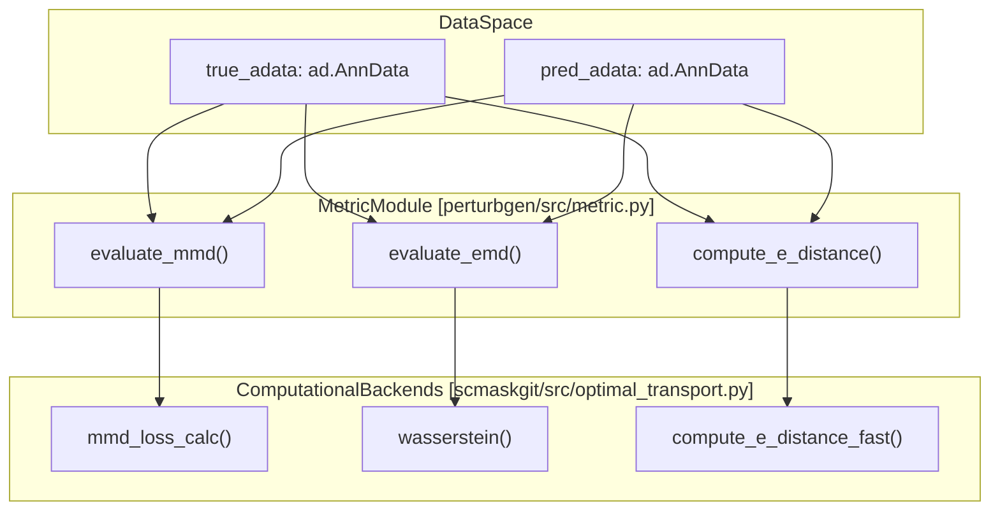
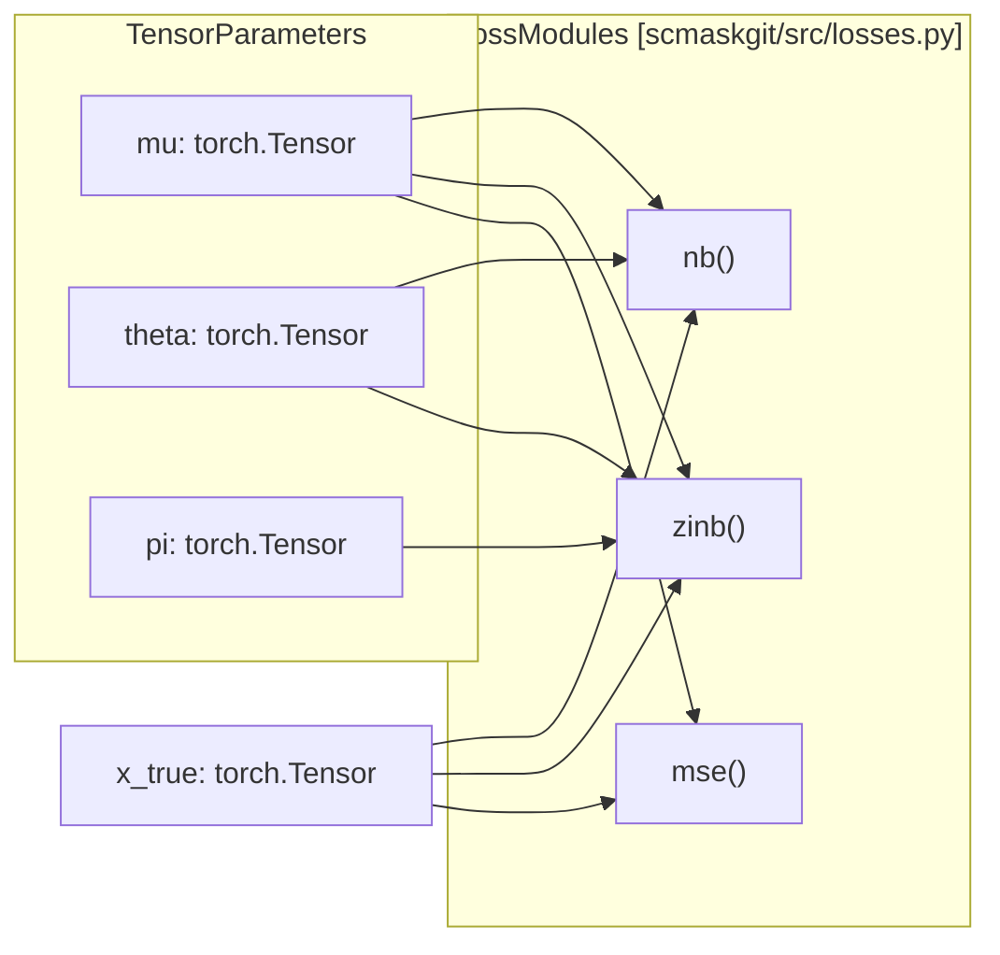

# Evaluation Metrics

Relevant source files

The following files were used as context for generating this wiki page:

- [perturbgen/src/metric.py](perturbgen/src/metric.py)
- [perturbgen/src/mmd.py](perturbgen/src/mmd.py)
- [scmaskgit/src/metric.py](scmaskgit/src/metric.py)
- [scmaskgit/src/mmd.py](scmaskgit/src/mmd.py)
- [scmaskgit/src/optimal_transport.py](scmaskgit/src/optimal_transport.py)
- [scmaskgit/src/utils.py](scmaskgit/src/utils.py)

This page documents the metric modules used across `perturbgen/src` and `scmaskgit/src` to evaluate generative fidelity, distributional shifts, and sequence accuracy [perturbgen/src/metric.py:1-360](), [scmaskgit/src/metric.py:1-288](). These metrics are critical for validating both the masking model (Phase 1) and the count decoder (Phase 2).

## Distributional Metrics

These metrics assess how well the generated cell distributions (in count or embedding space) match the ground truth observations.

### Energy Distance (E-distance)
The Energy Distance is used to measure the statistical distance between two distributions of single-cell samples. PerturbGen implements a fast version using JAX for performance [perturbgen/src/metric.py:32-67]().

*   **Implementation**: It computes pairwise squared Euclidean distances between samples in $X$ and $Y$ via `pairwise_squeuclidean` [perturbgen/src/metric.py:27-30]().
*   **Formula**: $2 \cdot \text{mean}(\text{dist}(X, Y)) - \text{mean}(\text{dist}(X, X)) - \text{mean}(\text{dist}(Y, Y))$ [perturbgen/src/metric.py:46-49]().

Sources: [perturbgen/src/metric.py:27-67]()

### Maximum Mean Discrepancy (MMD)
MMD is used to compare predicted and true gene expression profiles by mapping them to a Reproducing Kernel Hilbert Space (RKHS) [scmaskgit/src/metric.py:54-72](), [perturbgen/src/metric.py:103-126]().

*   **Kernels**: Supports Linear (`linear_mmd2`), Polynomial (`poly_mmd2`) [scmaskgit/src/mmd.py:15-39](), [perturbgen/src/mmd.py:15-39](), and Multi-scale RBF kernels (`gaussian_kernel_matrix`, `mmd_loss_calc`) [scmaskgit/src/metric.py:29-51](), [perturbgen/src/metric.py:78-101]().
*   **Evaluation**: The `evaluate_mmd` function calculates the mean MMD across a range of gamma values (`[2, 1, 0.5, 0.1, 0.01, 0.005]`) to capture differences at multiple scales [perturbgen/src/metric.py:132-195]().
*   **Conditioning**: Metrics can be calculated per-condition (e.g., per perturbation or cell type) if a `condition_key` is provided [perturbgen/src/metric.py:149-173]().

Sources: [perturbgen/src/metric.py:103-195](), [scmaskgit/src/metric.py:54-72](), [perturbgen/src/mmd.py:15-39]()

### Wasserstein / Optimal Transport
The Earth Mover's Distance (EMD) is implemented using `scipy.stats.wasserstein_distance` for 1D gene-wise comparisons via `evaluate_emd` [perturbgen/src/metric.py:198-250](), and a specialized Optimal Transport module for high-dimensional distributions [scmaskgit/src/optimal_transport.py:10-60]().

*   **Gene-wise EMD**: `evaluate_emd` iterates through variables (genes) to compute the average Wasserstein distance between true and predicted counts [perturbgen/src/metric.py:198-250]().
*   **OT Implementation**: The `wasserstein` function in `optimal_transport.py` supports "exact" (`ot.emd2`) and "sinkhorn" (`ot.sinkhorn2`) methods with regularization parameter `reg` [scmaskgit/src/optimal_transport.py:10-60]().

Sources: [perturbgen/src/metric.py:198-250](), [scmaskgit/src/optimal_transport.py:10-60]()

**Metric Data Flow: Bridging AnnData Entities to Metric Backends**

Title: "DistributionalMetricDataFlow"

Sources: [perturbgen/src/metric.py:32-250](), [scmaskgit/src/optimal_transport.py:10-60]()

---

## Correlation, Sequence, and Regression Metrics

These metrics evaluate the precision of gene rankings, sequence overlap, and regression fit between predicted and true states.

### Pearson Correlation of Delta Counts
Measures the linear correlation between predicted gene expression changes ($\Delta$) and true observed changes relative to a control baseline, leveraging `PearsonCorrCoef` [scmaskgit/src/utils.py:26]().

### ROUGE Score for Gene Sequences
Adapted from natural language processing, ROUGE measures token overlap between generated gene token sequences and ground truth sequences, focusing on top-ranked differentially expressed genes or tokens.

### Linear Regression Summary
Provides statistical summaries (such as $R^2$ and slope) evaluating the calibration and scaling agreement between predicted counts or embeddings and ground truth values [scmaskgit/src/metric.py:197-201]().

Sources: [scmaskgit/src/utils.py:26](), [scmaskgit/src/metric.py:197-201]()

---

## Loss Functions as Metrics

During training, several statistical loss functions serve as internal metrics for monitoring model convergence and distribution matching.

| Loss Function | File Path | Purpose |
| :--- | :--- | :--- |
| `mse` | [scmaskgit/src/losses.py:5-24]() | Standard Mean Squared Error for count regression. |
| `nb` | [scmaskgit/src/losses.py:49-89]() | Negative Binomial loss; accounts for overdispersion in scRNA-seq. |
| `zinb` | [scmaskgit/src/losses.py:91-149]() | Zero-Inflated Negative Binomial loss; handles technical dropouts. |

**Loss Implementation Detail**: The `nb` and `zinb` implementations are adapted from `scvi-tools` [scmaskgit/src/losses.py:51-58](). They require mean (`mu`), dispersion (`theta`), and for ZINB, the dropout probability (`pi`).

**Mapping Code Losses to Statistical Entities**

Title: "CountDecoderLossMapping"

Sources: [scmaskgit/src/losses.py:5-149]()

---

## Specialized MMD Implementations

Both `perturbgen/src/mmd.py` and `scmaskgit/src/mmd.py` provide specialized implementations for MMD calculations:

*   **`linear_mmd2`**: Computes linear-time MMD using a linear kernel $K(x,y) = x^T y$ [perturbgen/src/mmd.py:15-19](), [scmaskgit/src/mmd.py:15-19]().
*   **`poly_mmd2`**: Computes MMD using a polynomial kernel $K(x,y) = (\alpha x^T y + c)^d$ [perturbgen/src/mmd.py:26-39](), [scmaskgit/src/mmd.py:26-39]().
*   **`mix_rbf_mmd2`**: Implements a mixture of RBF kernels across multiple bandwidths (`sigma_list`) for robust two-sample testing [perturbgen/src/mmd.py:60-62](), [scmaskgit/src/mmd.py:60-62]().

Sources: [perturbgen/src/mmd.py:1-190](), [scmaskgit/src/mmd.py:1-190]()

---