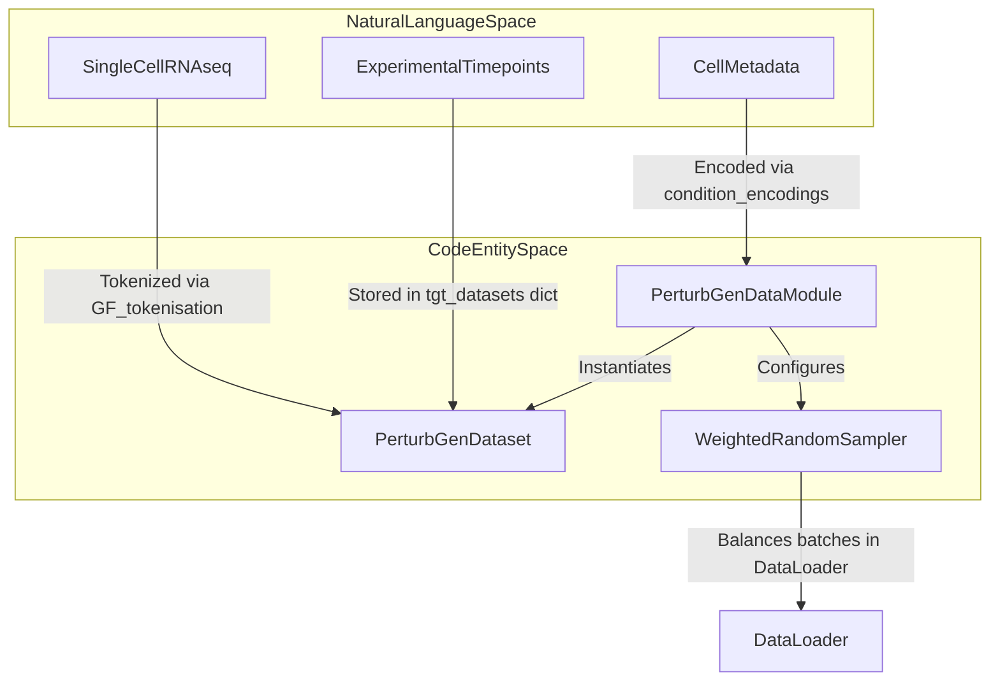
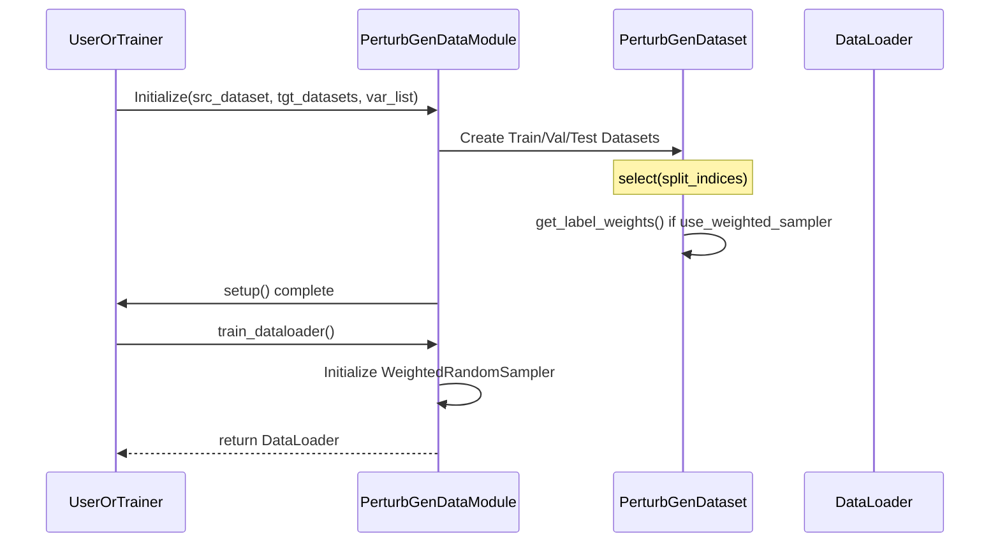

# Data Loading: PerturbGenDataModule and PerturbGenDataset

Relevant source files

The following files were used as context for generating this wiki page:

- [perturbgen/Dataloaders/datamodule.py](perturbgen/Dataloaders/datamodule.py)
- [perturbgen/configs/__init__.py](perturbgen/configs/__init__.py)
- [perturbgen/configs/paths.py](perturbgen/configs/paths.py)
- [perturbgen/pp/GF_tokenisation.py](perturbgen/pp/GF_tokenisation.py)
- [perturbgen/tests/test_perturbation.py](perturbgen/tests/test_perturbation.py)

The PerturbGen data loading pipeline is built on **PyTorch Lightning**, providing a structured way to handle multi-timepoint single-cell data. It manages the transition from tokenized gene sequences and raw count matrices into structured batches suitable for both the masking model (Phase 1) and the count decoder (Phase 2).

Sources: [perturbgen/Dataloaders/datamodule.py:1-183]()

## Core Data Structures

The system relies on two primary classes defined in `perturbgen/Dataloaders/datamodule.py`: `PerturbGenDataset` and `PerturbGenDataModule`.

### PerturbGenDataset
The `PerturbGenDataset` is a standard `torch.utils.data.Dataset` that pairs source (control) cells with target (perturbed/future) cells across multiple timepoints.

**Key Features:**
*   **Multi-Timepoint Support:** It holds a dictionary of target datasets (`tgt_datasets`) indexed by timepoint (e.g., `tgt_dataset_t1`, `tgt_dataset_t2`) [perturbgen/Dataloaders/datamodule.py:38-40]().
*   **Count Integration:** Optionally includes raw or normalized gene counts (`src_counts`, `tgt_counts_dict`) used during the Count Decoder training phase [perturbgen/Dataloaders/datamodule.py:39-40]().
*   **Conditioning:** Stores encoded biological metadata (e.g., cell type, batch) as `conditions` and `conditions_combined` tensors [perturbgen/Dataloaders/datamodule.py:42-43]().

### PerturbGenDataModule
The `PerturbGenDataModule` encapsulates all data-related logic, including splitting, sampling, and DataLoader instantiation.

**Key Responsibilities:**
*   **Data Splitting:** Handles training, validation, and test splits using provided indices [perturbgen/Dataloaders/datamodule.py:170-172]().
*   **Weighted Sampling:** Implements a `WeightedRandomSampler` to address class imbalance (e.g., rare cell types) via label frequency inverse weighting [perturbgen/Dataloaders/datamodule.py:91-125]().

### Data Flow and Entity Mapping

The following diagram illustrates how biological data entities map to the code classes during the loading process.

**Data Entity to Code Mapping**

Sources: [perturbgen/Dataloaders/datamodule.py:22-150](), [perturbgen/Dataloaders/datamodule.py:151-183]()

## Batch Structure and Multi-Timepoint Handling

A single batch produced by the `DataLoader` contains a complex dictionary structure. This allows the model to access source context and multiple target timepoints simultaneously.

| Key | Type | Description |
| :--- | :--- | :--- |
| `src_dataset` | `dict` | Tokenized gene IDs and metadata for the source (T0) cell. |
| `src_counts` | `np.ndarray` | Expression counts for the source cell. |
| `tgt_dataset_t{n}` | `dict` | Tokenized gene IDs for the target cell at timepoint `n`. |
| `tgt_counts_t{n}` | `np.ndarray` | Expression counts for the target cell at timepoint `n`. |
| `conditions` | `torch.Tensor` | Matrix of encoded categorical variables. |
| `conditions_combined` | `torch.Tensor` | Combined index for joint condition modeling. |

The `__getitem__` method in `PerturbGenDataset` iterates through the requested `time_steps` to populate these keys [perturbgen/Dataloaders/datamodule.py:127-145]().

### Token Dictionary and Path Configuration
The mapping of genes to specific integer tokens is governed by the `TOKEN_DICT_PATH` and related paths configured in `perturbgen/configs/paths.py` [perturbgen/configs/paths.py:1-16](). These paths ensure consistency between the pretrained `scmaskgit` encoder, tokenization pipelines (`perturbgen/pp/GF_tokenisation.py`), and the PerturbGen training/validation loops.

Sources: [perturbgen/configs/paths.py:1-16](), [perturbgen/pp/GF_tokenisation.py:182-186]()

## Weighted Sampling Implementation

To ensure the model learns robustly across heterogeneous populations, `PerturbGenDataModule` calculates weights based on metadata frequencies within `PerturbGenDataset.get_label_weights`.

1.  **Label Combination:** Metadata keys (e.g., cell type, timepoint) are joined into a single string label [perturbgen/Dataloaders/datamodule.py:108-112]().
2.  **Frequency Calculation:** The `Counter` utility determines the occurrences of each unique combined label [perturbgen/Dataloaders/datamodule.py:114]().
3.  **Inverse Weighting:** Weights are assigned inversely proportional to frequency (`total_count / count`) [perturbgen/Dataloaders/datamodule.py:120]().
4.  **Sampler Integration:** These weights are returned as a tensor and passed to `WeightedRandomSampler` [perturbgen/Dataloaders/datamodule.py:122-125]().

Sources: [perturbgen/Dataloaders/datamodule.py:91-125]()

## Technical Data Flow

The following diagram details the internal logic of the `PerturbGenDataModule` from initialization to batch generation.

**PerturbGen Data Loading Pipeline**

Sources: [perturbgen/Dataloaders/datamodule.py:91-125](), [perturbgen/Dataloaders/datamodule.py:151-183]()

## Summary of Configuration Parameters

When initializing the `PerturbGenDataModule`, several key parameters control the data behavior:

*   **`max_len`**: The maximum sequence length (number of genes) for the transformer [perturbgen/Dataloaders/datamodule.py:159]().
*   **`pred_tps`**: A list of timepoints the model is expected to predict [perturbgen/Dataloaders/datamodule.py:161]().
*   **`context_tps`**: Timepoints provided as context to the model [perturbgen/Dataloaders/datamodule.py:174]().
*   **`var_list`**: The list of observation columns in the AnnData/Dataset used for conditioning [perturbgen/Dataloaders/datamodule.py:173]().
*   **`use_weighted_sampler`**: Boolean flag to enable frequency-inverse weighting via `WeightedRandomSampler` [perturbgen/Dataloaders/datamodule.py:176]().

Sources: [perturbgen/Dataloaders/datamodule.py:151-177](), [perturbgen/configs/paths.py:1-16]()

---