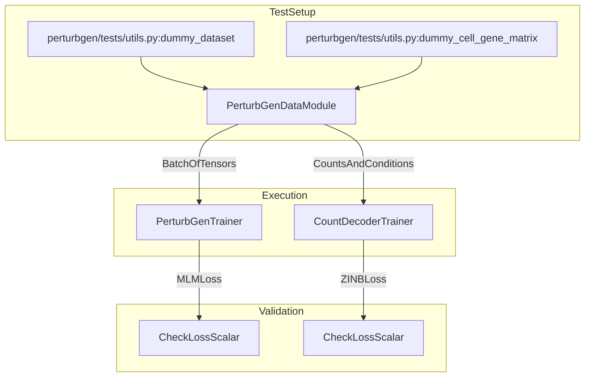
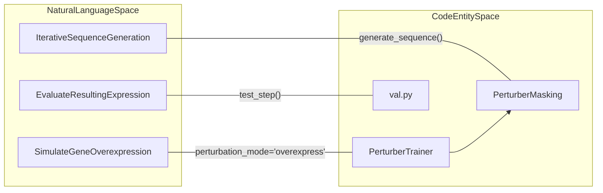
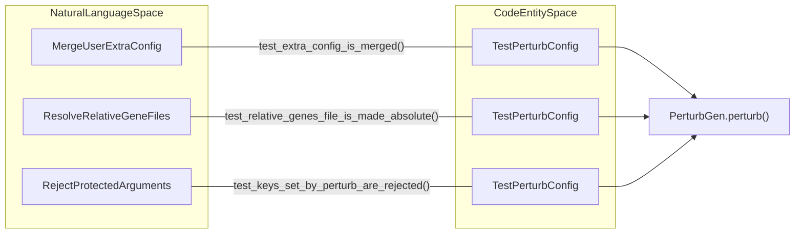

# Test Suite

<details>
<summary>Relevant source files</summary>

The following files were used as context for generating this wiki page:

- [docs/examples/perturbation.ipynb](docs/examples/perturbation.ipynb)
- [perturbgen/Dataloaders/datamodule.py](perturbgen/Dataloaders/datamodule.py)
- [perturbgen/Model/trainer.py](perturbgen/Model/trainer.py)
- [perturbgen/Perturb/val.py](perturbgen/Perturb/val.py)
- [perturbgen/tests/test_api_perturb.py](perturbgen/tests/test_api_perturb.py)
- [perturbgen/tests/test_cellgen_training.py](perturbgen/tests/test_cellgen_training.py)
- [perturbgen/tests/test_perturbation.py](perturbgen/tests/test_perturbation.py)
- [perturbgen/tests/utils.py](perturbgen/tests/utils.py)

</details>


The PerturbGen test suite provides a comprehensive set of automated checks to ensure the integrity of the training loops, the correctness of the iterative generation (MaskGIT) logic, the validation of API configuration builders, and the stability of the data loading pipelines. It utilizes `unittest` and `pytorch_lightning` to perform smoke tests on both the Masking and Count Decoder training phases, functional tests for in silico perturbation simulation, and unit tests for the Python API configuration builder.

## Test Infrastructure and Utilities

The testing framework relies on a set of utility functions and configuration fixtures to generate synthetic single-cell data that mimics the structure of real tokenized datasets and count matrices.

### Dummy Data Generation
The file `perturbgen/tests/utils.py` contains the core fixtures used across all tests:
*   **`dummy_dataset`**: Generates a `datasets.Dataset` object containing `input_ids` (tokens), `cell_type` labels, and `cell_pairing_index`. It supports multi-timepoint generation by returning a dictionary of datasets [perturbgen/tests/utils.py:7-55]().
*   **`dummy_cell_gene_matrix`**: Creates synthetic gene expression matrices using a Poisson distribution. These are used to test the `CountDecoderTrainer` and ZINB/NB/MSE loss calculations [perturbgen/tests/utils.py:57-73]().

```bash
# Run all tests in the suite via unittest discovery
python -m unittest discover perturbgen/tests/
```

Sources: [perturbgen/tests/utils.py:1-73]()

## Training Loop Smoke Tests

The file `perturbgen/tests/test_cellgen_training.py` validates the two primary training phases of PerturbGen. It uses a `TestConfigMixin` to share state between test cases, including mock paths for the pretrained foundation model (`scmaskgit`) [perturbgen/tests/test_cellgen_training.py:49-191]().

### Phase 1: Masking Model Validation
This test ensures that the `PerturbGenTrainer` can successfully execute a training step using the Masked Language Modeling (MLM) objective. It validates:
1.  **Data Flow**: Integration with `PerturbGenDataModule` to fetch tokenized source and target sequences [perturbgen/tests/test_cellgen_training.py:157-170]().
2.  **Forward Pass**: Correct application of the `mask_scheduler` (e.g., "pow", "cosine") and cross-attention between source and target [perturbgen/tests/test_cellgen_training.py:120-136]().

### Phase 2: Count Decoder Validation
This test validates the `CountDecoderTrainer`, focusing on the transition from discrete tokens to continuous expression values.
1.  **Conditioning**: Verifies that batch and cell-type metadata are correctly encoded into tensors for the `CountHead` [perturbgen/tests/test_cellgen_training.py:107-116]().
2.  **Loss Functions**: Validates the stability of "zinb", "nb", or "mse" loss modes during the optimization step [perturbgen/tests/test_cellgen_training.py:146-154]().

### Training Test Architecture
The following diagram illustrates how the test suite initializes the model components for a smoke test.

**Training Test Data Flow**

Sources: [perturbgen/tests/test_cellgen_training.py:49-191](), [perturbgen/Dataloaders/datamodule.py:1-121]()

## In Silico Perturbation Correctness Tests

The `perturbgen/tests/test_perturbation.py` script focuses on inference-time logic, specifically executing `PerturberTrainer` and the iterative generation pipeline.

### Validation of Iterative Generation
The test validates sequence generation and perturbation strategies [perturbgen/tests/test_perturbation.py:101-138](). It checks:
*   **Perturbation Modes**: Verification of 'overexpress', 'mask', 'pad', or 'delete' logic applied to specific genes like `ISG15` [perturbgen/tests/test_perturbation.py:38-39]().
*   **Temperature & Iterations**: Ensures the generation loop runs for the specified number of iterations (e.g., 19) without shape mismatches [perturbgen/tests/test_perturbation.py:93-94]().

### Perturbation System Mapping
This diagram maps the natural language concept of "simulating a perturbation" to the specific code entities involved in the test suite.

**In Silico Perturbation Code Mapping**

Sources: [perturbgen/tests/test_perturbation.py:70-138]()

## Python API Configuration Tests (`test_api_perturb.py`)

The `perturbgen/tests/test_api_perturb.py` script verifies the configuration dictionary construction performed by `PerturbGen.perturb()` prior to launching inference, operating entirely without GPU or large raw data dependencies [perturbgen/tests/test_api_perturb.py:1-104]().

### Key API Validation Rules
*   **Extra Config Merging**: Confirms that user-supplied overrides in `extra_config` (such as `filter_var`, `exclude_src`, or `num_workers`) correctly propagate into the generated YAML configurations [perturbgen/tests/test_api_perturb.py:63-76]().
*   **Path Resolution**: Ensures relative paths (like `perturb_genes_file`) are correctly converted to absolute paths [perturbgen/tests/test_api_perturb.py:83-88]().
*   **API Enforcement**: Asserts that protected core keys (e.g., `n_samples`, `output_dir`, `pred_tps`) controlled directly by `PerturbGen.perturb()` cannot be illegally overwritten via `extra_config`, raising a `ValueError` when violated [perturbgen/tests/test_api_perturb.py:89-95]().

### API Configuration Mapping
This diagram links high-level configuration requirements to the testing code entities in `test_api_perturb.py`.

**API Configuration Code Mapping**

Sources: [perturbgen/tests/test_api_perturb.py:28-102]()

## Summary of Validated Components

| Test File | Target Class/Function | Key Validation Metric |
| :--- | :--- | :--- |
| `test_cellgen_training.py` | `PerturbGenTrainer` | Perplexity / MLM Cross-Entropy Loss |
| `test_cellgen_training.py` | `CountDecoderTrainer` | ZINB / MSE Loss on reconstructed counts |
| `test_perturbation.py` | `PerturberTrainer` | Sequence generation success at `iterations=19` |
| `test_api_perturb.py` | `PerturbGen.perturb()` | Config merging, path resolution, and security checks |
| `utils.py` | `dummy_dataset` | Schema consistency with `PerturbGenDataset` |

Sources: [perturbgen/tests/test_cellgen_training.py:1-191](), [perturbgen/tests/test_perturbation.py:70-138](), [perturbgen/tests/test_api_perturb.py:1-104](), [perturbgen/tests/utils.py:1-73]()

---