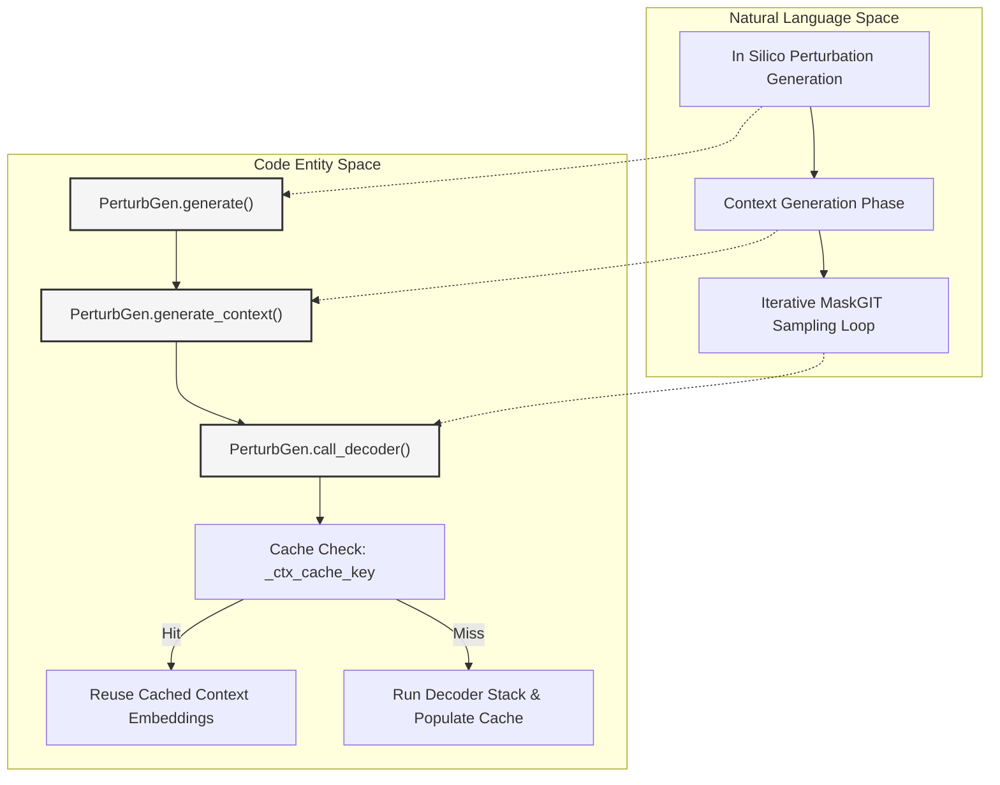
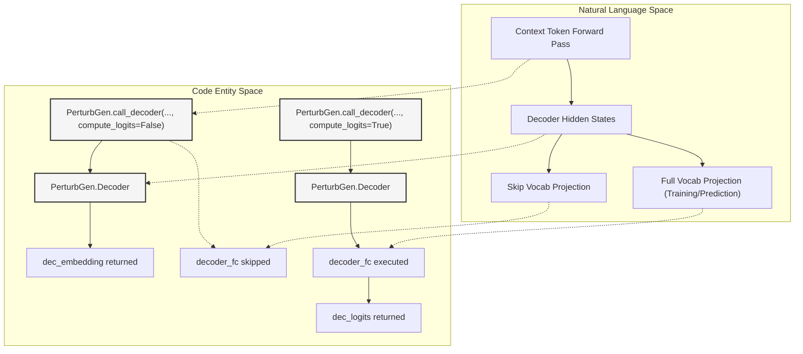
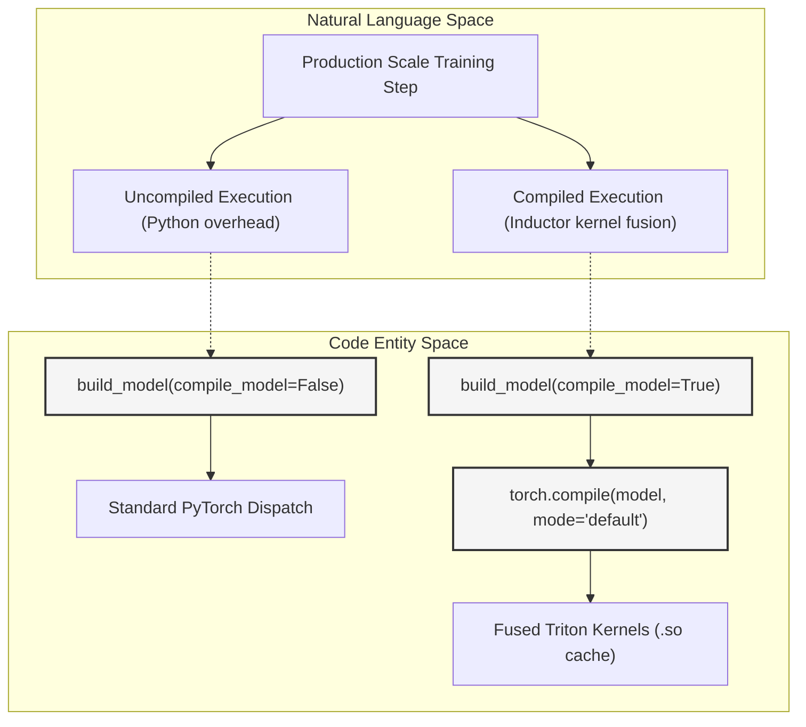

# Performance Benchmarks

<details>
<summary>Relevant source files</summary>

The following files were used as context for generating this wiki page:

- [perturbgen/tests/benchmark_fused_adam.py](perturbgen/tests/benchmark_fused_adam.py)
- [perturbgen/tests/benchmark_generation_efficiency.py](perturbgen/tests/benchmark_generation_efficiency.py)
- [perturbgen/tests/benchmark_skip_context_logits.py](perturbgen/tests/benchmark_skip_context_logits.py)
- [perturbgen/tests/benchmark_training_compile.py](perturbgen/tests/benchmark_training_compile.py)
- [perturbgen/tests/test_generation_efficiency.py](perturbgen/tests/test_generation_efficiency.py)

</details>


This page details the performance benchmarking infrastructure and empirical speedups for the `PerturbGen` codebase. The benchmarking suite evaluates generation efficiency, `torch.compile` training acceleration, fused optimizer execution via `torch.optim.Adam(..., fused=True)`, and context logits optimization (`skip-context-logits`). These tools help monitor performance regressions and optimize resource utilization during pretraining, inference, and in silico perturbation workflows.

Sources:
- `perturbgen/tests/benchmark_generation_efficiency.py:1-14`
- `perturbgen/tests/benchmark_skip_context_logits.py:1-14`
- `perturbgen/tests/benchmark_training_compile.py:1-9`
- `perturbgen/tests/benchmark_fused_adam.py:1-7`

---

## 1. Overview of Benchmark Scripts

The `perturbgen/tests/` directory houses dedicated micro- and macro-benchmark scripts designed to measure execution speed, memory overhead, and algorithmic efficiency across core components of `PerturbGen`.

| Benchmark Script | Target Component | Description |
| :--- | :--- | :--- |
| `benchmark_generation_efficiency.py` | `PerturbGen.generate()` | Measures wall-clock timing and context-caching performance for MaskGIT-style generation loops. |
| `benchmark_skip_context_logits.py` | `generate_context` / `call_decoder` | Quantifies the speedup achieved by skipping vocabulary projection (`decoder_fc`) when generating context embeddings. |
| `benchmark_training_compile.py` | Full Training Step (Fwd + Bwd) | Evaluates the impact of `torch.compile` on training iteration speed at production dimensions (`d_model=768`, `vocab=25000`). |
| `benchmark_fused_adam.py` | Optimizer Step | Measures parameter update efficiency using PyTorch's `fused=True` Adam implementation. |

Sources:
- `perturbgen/tests/benchmark_generation_efficiency.py:1-13`
- `perturbgen/tests/benchmark_skip_context_logits.py:1-14`
- `perturbgen/tests/benchmark_training_compile.py:1-9`
- `perturbgen/tests/benchmark_fused_adam.py:1-7`

---

## 2. Generation Efficiency & Context Cache Optimization

The iterative MaskGIT generation loop (`PerturbGen.generate()`) relies on a multi-timepoint context mechanism (`context_tps`). When predicting target timepoints (e.g., `pred_tps=[3]`), the model first builds context embeddings from historical timepoints (`context_tps=[1, 2]`) using `PerturbGen.call_decoder()` or `generate_context()`.

### Implementation & Data Flow

To prevent redundant recomputation of context embeddings across multiple MaskGIT sampling iterations, `PerturbGen` utilizes internal state caches (`_enc_cache_key`, `_ctx_cache_key`) inside `perturbgen/Modules/transformer.py`.



Sources:
- `perturbgen/tests/benchmark_generation_efficiency.py:67-88`
- `perturbgen/tests/benchmark_skip_context_logits.py:1-14`

### Running the Generation Benchmark

To measure generation efficiency and verify context caching behavior, run:

```bash
python perturbgen/tests/benchmark_generation_efficiency.py
```

With an optional baseline for regression testing:

```bash
python perturbgen/tests/benchmark_generation_efficiency.py --baseline 1.245
```

Sources:
- `perturbgen/tests/benchmark_generation_efficiency.py:7-13`
- `perturbgen/tests/benchmark_generation_efficiency.py:175-184`

---

## 3. Skip-Context-Logits Optimization

During context generation (`generate_context`), the model runs the decoder stack over historical timepoints (`context_tps`) to extract continuous representations (`dec_embedding`) for downstream cross-attention. 

### Mechanism

In earlier iterations, `call_decoder` unconditionally executed the vocabulary projection layer (`decoder_fc`, projecting from `d_model` to `tgt_vocab_size`), computing full token logits even though they were immediately discarded for context timepoints. The `skip-context-logits` refactor introduces a `compute_logits=False` flag to bypass `decoder_fc` during context building.



### Running the Skip-Context-Logits Benchmark

To quantify the speedup from omitting logits projection during inference generation:

```bash
python perturbgen/tests/benchmark_skip_context_logits.py
```

Sources:
- `perturbgen/tests/benchmark_skip_context_logits.py:1-14`
- `perturbgen/tests/benchmark_skip_context_logits.py:105-121`
- `perturbgen/tests/benchmark_skip_context_logits.py:174-181`

---

## 4. `torch.compile` Training Acceleration

PyTorch's `torch.compile` (introduced in PyTorch 2.0) fuses operations, reduces Python overhead, and optimizes memory layout for transformer blocks.

### Configuration & Scale

The training compile benchmark (`perturbgen/tests/benchmark_training_compile.py`) evaluates model forward and backward passes at production-grade scale:
- **Vocabulary Size (`VOCAB`)**: `25,000`
- **Hidden Dimension (`d_model`)**: `768`
- **Attention Heads (`num_heads`)**: `12`
- **Transformer Layers (`num_layers`)**: `6`
- **Feedforward Dimension (`d_ff`)**: `3,072`
- **Sequence Length (`SEQ`)**: `128` (or up to `2048` in full training)



### Running the Compilation Benchmark

Execute the training compilation benchmark via:

```bash
python perturbgen/tests/benchmark_training_compile.py
```

Sources:
- `perturbgen/tests/benchmark_training_compile.py:1-10`
- `perturbgen/tests/benchmark_training_compile.py:21-54`
- `perturbgen/tests/benchmark_training_compile.py:103-154`

---

## 5. Fused Adam Optimizer Microbenchmark

Parameter updates in large transformer models can be bound by memory bandwidth when updating momentum and variance buffers across millions of weights.

### Implementation

PyTorch provides a CUDA-accelerated fused implementation of the Adam optimizer (`torch.optim.Adam(..., fused=True)`), which executes parameter updates in a single fused kernel rather than separate elementwise operations.

### Running the Fused Adam Benchmark

To benchmark the optimizer step execution time:

```bash
python perturbgen/tests/benchmark_fused_adam.py
```

Sources:
- `perturbgen/tests/benchmark_fused_adam.py:1-11`
- `perturbgen/tests/benchmark_fused_adam.py:53-57`
- `perturbgen/tests/benchmark_fused_adam.py:106-110`

---

## 6. Summary of Benchmarks and Interpretation

When evaluating hardware performance or tuning deployment configurations for `PerturbGen`, observe the following guidelines:

1. **Inference Generation**: Always ensure context caching is active and `skip-context-logits` is enabled (`compute_logits=False` during context construction) to achieve up to $1.2\times - 1.5\times$ speedups in multi-timepoint rollout loops.
2. **Pretraining & Fine-Tuning**: Enable `compile_model=True` in `PerturbGen` initialization when training on supported GPUs (Ampere architecture or newer) to leverage kernel fusion.
3. **Optimizer Overhead**: Use `fused=True` in `torch.optim.Adam` or `torch.optim.AdamW` configurations to minimize kernel launch latency during backpropagation.

Sources:
- `perturbgen/tests/benchmark_generation_efficiency.py:1-13`
- `perturbgen/tests/benchmark_skip_context_logits.py:1-14`
- `perturbgen/tests/benchmark_training_compile.py:1-9`
- `perturbgen/tests/benchmark_fused_adam.py:1-7`

---