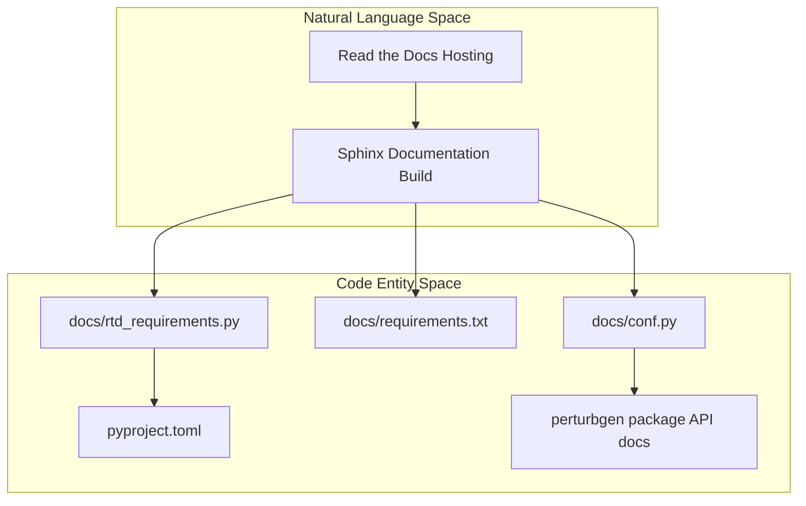
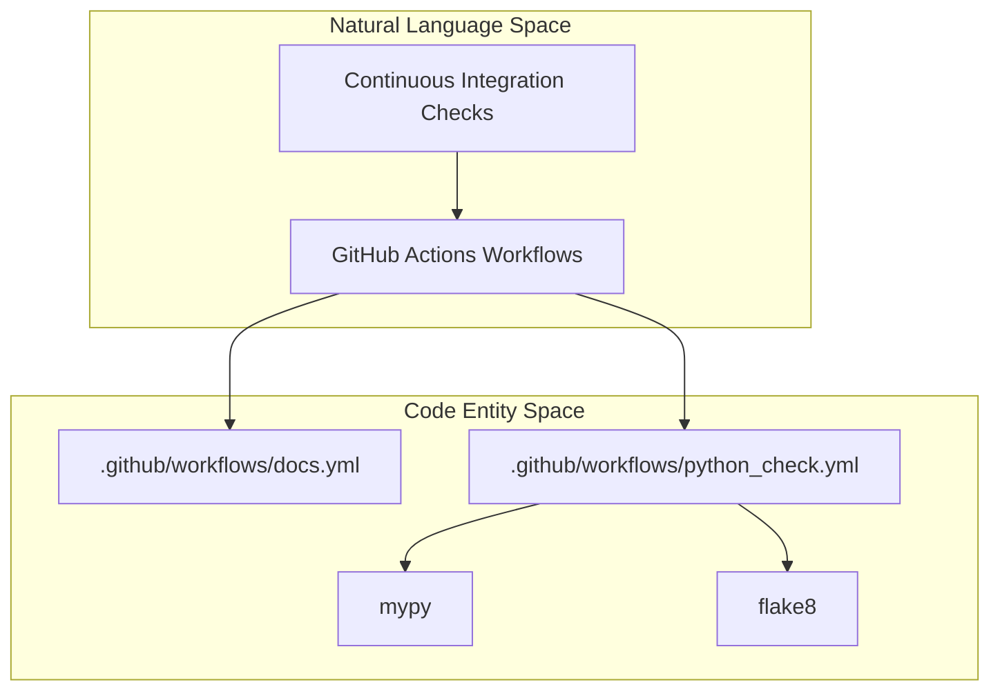

# CI/CD, Documentation Build, and DevOps

Relevant source files

The following files were used as context for generating this wiki page:

- [.github/workflows/docs.yml](.github/workflows/docs.yml)
- [.github/workflows/python_check.yml](.github/workflows/python_check.yml)
- [.pre-commit-config.yaml](.pre-commit-config.yaml)
- [.readthedocs.yaml](.readthedocs.yaml)
- [LICENSE](LICENSE)
- [docs/Makefile](docs/Makefile)
- [docs/apidoc/perturbgen/modules.rst](docs/apidoc/perturbgen/modules.rst)
- [docs/apidoc/perturbgen/perturbgen.pp.rst](docs/apidoc/perturbgen/perturbgen.pp.rst)
- [docs/apidoc/perturbgen/perturbgen.rst](docs/apidoc/perturbgen/perturbgen.rst)
- [docs/conf.py](docs/conf.py)
- [docs/docs-development.rst](docs/docs-development.rst)
- [docs/requirements.txt](docs/requirements.txt)
- [docs/rtd_requirements.py](docs/rtd_requirements.py)
- [mypy.ini](mypy.ini)
- [poetry.lock](poetry.lock)
- [pyproject.toml](pyproject.toml)
- [setup.py](setup.py)

## Purpose and Scope
This page provides a technical overview of the continuous integration and deployment (CI/CD) pipelines, documentation infrastructure, static analysis tools, and DevOps automation used in the PerturbGen repository. The system relies on GitHub Actions for automated testing and doc validation, Read the Docs for hosted documentation, Poetry for dependency management, and custom scripts like `docs/rtd_requirements.py` to handle CPU-only dependency translation for lightweight builds.

---

## Read the Docs Configuration and CPU-Only Translation
Documentation is built and hosted automatically on Read the Docs at `https://perturbgen.readthedocs.io/` [/.readthedocs.yaml:1-4](). 

### Configuration (`.readthedocs.yaml`)
The build environment is provisioned on Ubuntu 24.04 with Python 3.11 and includes system packages such as `libopenmpi-dev` to support `mpi4py` [/.readthedocs.yaml:6-11](). Because GPU wheels (`nvidia-*`, `triton`) consume gigabytes of bandwidth and exceed standard build timeouts, Read the Docs relies on a custom translation script before running Sphinx.

### CPU-Only Dependency Translation (`docs/rtd_requirements.py`)
To isolate CPU-only dependencies for documentation builds, `docs/rtd_requirements.py` parses `pyproject.toml` and separates standard PyPI packages from PyTorch distribution wheels [docs/rtd_requirements.py:1-41]().

Sources: [/.readthedocs.yaml:1-25](), [docs/conf.py:1-55](), [docs/rtd_requirements.py:1-41]()

The translation script executes two main extraction steps during the Read the Docs install phase [/.readthedocs.yaml:17-22]():
1. **PyTorch CPU Index**: Pins `torch`, `torchvision`, and `torchaudio` to the official PyTorch CPU wheel index using `--index-url https://download.pytorch.org/whl/cpu` [/.readthedocs.yaml:20]().
2. **Standard Requirements**: Extracts remaining package pins from `pyproject.toml` while excluding Python version constraints and GPU-specific runtimes (`nvidia-*`, `triton`) [docs/rtd_requirements.py:17-41]().

### Sphinx and MyST-NB Setup (`docs/conf.py`)
Sphinx is configured with extensions supporting autodoc generation, reStructuredText, and MyST Markdown notebook integration [docs/conf.py:21-28]():
- `sphinx.ext.autodoc` and `sphinx.ext.apidoc` automatically generate reference manuals from `perturbgen` source code [docs/conf.py:22-23]().
- `apidoc_modules` targets the `perturbgen` package while excluding internal modules (`Model`, `Modules`, and `configs`) from high-level API listings [docs/conf.py:43-51]().
- `myst_nb` handles Jupyter notebooks with execution mode turned off (`nb_execution_mode = "off"`) so that pre-computed notebook outputs are rendered directly without running live models during documentation builds [docs/conf.py:27](), [docs/conf.py:55]().

Sources: [/.readthedocs.yaml:1-25](), [docs/conf.py:1-55](), [docs/rtd_requirements.py:1-41]()

---

## GitHub Actions Workflows
GitHub Actions provides two primary automation workflows for validating pull requests and pushes to the `main` branch.

Sources: [/.github/workflows/docs.yml:1-47](), [.github/workflows/python_check.yml:1-36]()

### 1. Documentation Validation (`.github/workflows/docs.yml`)
The `Docs` workflow replicates the Read the Docs build pipeline on GitHub runners (`ubuntu-24.04`) for every pull request and push targeting `main` [/.github/workflows/docs.yml:1-22](). 
- Uses `actions/setup-python` with `pip` caching linked to `pyproject.toml` and `docs/requirements.txt` [/.github/workflows/docs.yml:26-32]().
- Installs `libopenmpi-dev` and executes `docs/rtd_requirements.py` to guarantee the CPU-only PyTorch build constraint [/.github/workflows/docs.yml:34-44]().
- Runs `make html` in the `docs/` directory to catch broken links, syntax errors, or Sphinx extension failures prior to merging [/.github/workflows/docs.yml:46-47]().

### 2. Python Quality Checks (`.github/workflows/python_check.yml`)
The `Python package` workflow executes static analysis and linting checks [/.github/workflows/python_check.yml:1-9]():
- **Flake8**: Enforces PEP 8 compliance with a maximum line length of 88, ignoring whitespace formatting warnings (`E203`) and excluding notebook-derived files (`*_nb.py`) [/.github/workflows/python_check.yml:26-28]().
- **MyPy**: Performs static type checking with missing imports ignored [/.github/workflows/python_check.yml:29-32]().
- **Pydocstyle**: Validates docstring formatting standards across source files [/.github/workflows/python_check.yml:33-36]().

Sources: [/.github/workflows/docs.yml:1-47](), [.github/workflows/python_check.yml:1-36]()

---

## Dependency Management and Local DevOps
The project uses Poetry (`pyproject.toml`) for dependency specifications, supporting Python `>=3.11` [pyproject.toml:1-20](). 

### Package Structure and Scripts
- **Project Scripts**: Defines console entry points (`perturbgen = perturbgen.__main__:main`) [pyproject.toml:12-14]().
- **Dependencies**: Comprehensive tracking of scientific computing libraries including `numpy`, `anndata`, `scanpy`, `torch`, `lightning`, and `scvi-tools` [pyproject.toml:19-279]().

Sources: [pyproject.toml:1-279](), [docs/requirements.txt:1-4]()

---