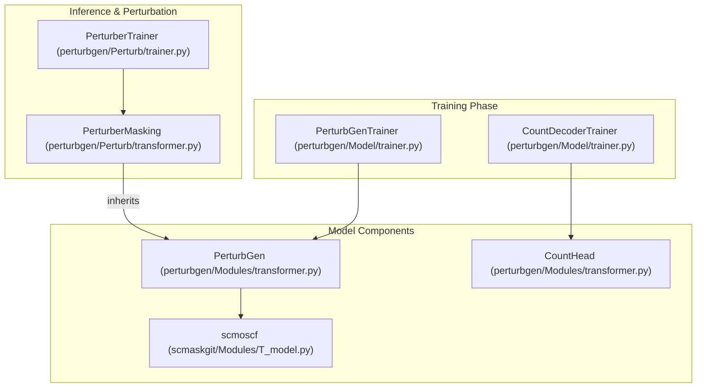
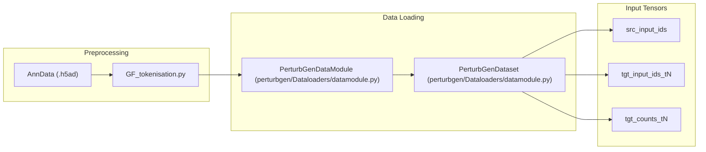

# Glossary

Relevant source files

The following files were used as context for generating this wiki page:

- [README.md](README.md)
- [docs/fig1.png](docs/fig1.png)
- [docs/index.rst](docs/index.rst)
- [perturbgen/Modules/transformer.py](perturbgen/Modules/transformer.py)
- [perturbgen/Perturb/trainer.py](perturbgen/Perturb/trainer.py)
- [perturbgen/Perturb/transformer.py](perturbgen/Perturb/transformer.py)
- [perturbgen/batch_job_script/cytoimmgen/extrapolation/3_run_train_count_extrapolation.sh](perturbgen/batch_job_script/cytoimmgen/extrapolation/3_run_train_count_extrapolation.sh)
- [perturbgen/run_test.sh](perturbgen/run_test.sh)
- [perturbgen/src/utils.py](perturbgen/src/utils.py)
- [requirements.txt](requirements.txt)

This glossary provides definitions for the domain-specific terminology, biological concepts, and architectural components of the PerturbGen codebase.

## Biological and Domain Concepts

### Cellular Trajectory
A sequence of cell states over time, representing processes such as differentiation, disease progression, or response to external stimuli. PerturbGen models these as a sequence-to-sequence problem [docs/index.rst:11-11]().

### In Silico Perturbation
The computational simulation of genetic interventions (e.g., Knockout, Overexpression) by modifying the input gene-token sequences before passing them through the model [docs/index.rst:11-11]().

### Gene Program
Clusters of genes that respond similarly to perturbations. PerturbGen extracts these through gene embedding aggregation across biological covariates [README.md:10-10]().

### PIP (Perturbation-Induced Program)
Clusters of perturbations that exhibit similar transcriptional effects, used to identify established regulators and novel drivers of cell state transitions [README.md:10-10]().

---

## Architectural Jargon

### MaskGIT
A non-autoregressive generation scheme. Unlike standard Transformers that predict tokens left-to-right, MaskGIT uses iterative refinement to fill masked tokens in parallel based on bidirectional context [docs/index.rst:11-11](). Implementation is found in the `generate_sequence` loop [perturbgen/Perturb/transformer.py:126-142]().

### scmaskgit
The foundation model used as the encoder in PerturbGen. It is a 12-layer Transformer pretrained on over 100 million single-cell transcriptomes [README.md:8-8](). It is initialized in the `PerturbGen` class [perturbgen/Modules/transformer.py:18-19]().

### Count Decoder
A phase 2 component consisting of a lightweight MLP and a probabilistic count head (e.g., ZINB or NB) that maps learned embeddings back to gene expression space [docs/index.rst:11-11](). Defined in `CountDecoder` [perturbgen/Modules/transformer.py:1-1]().

### Tokenization (Geneformer-style)
A process where genes are ranked by their normalized expression values within a cell and converted into a sequence of token IDs [docs/index.rst:11-11]().

---

## System Entities and Code Mapping

The following diagrams bridge the gap between high-level concepts and the specific classes and files implementing them.

### Training and Inference Orchestration
This diagram maps the primary Lightning modules and trainers to their roles in the generation and perturbation pipeline.

**Sources:** [perturbgen/Modules/transformer.py:18-19](), [perturbgen/Perturb/trainer.py:25-26](), [perturbgen/Perturb/transformer.py:21-21]()

### Data Flow and Transformation
This diagram tracks how data moves from raw AnnData objects into the Transformer input format.

**Sources:** [perturbgen/src/utils.py:103-127](), [perturbgen/Perturb/transformer.py:30-33]()

---

## Technical Terms and Abbreviations

| Term | Definition | Code Pointer |
| :--- | :--- | :--- |
| **d_model** | The hidden dimension size of the Transformer tokens. | [perturbgen/Modules/transformer.py:37-37]() |
| **pos_encoding_mode** | Method for encoding time and gene position (e.g., `time_pos_sin`, `comb_sin`). | [perturbgen/Modules/transformer.py:43-48]() |
| **mask_scheduler** | Function defining the ratio of tokens to mask over iterations (e.g., `cosine`, `pow`). | [perturbgen/Perturb/transformer.py:28-28]() |
| **ZINB** | Zero-Inflated Negative Binomial; a distribution used in the count head. | [perturbgen/batch_job_script/cytoimmgen/extrapolation/3_run_train_count_extrapolation.sh:54-54]() |
| **ROUGE Score** | Metric adapted from NLP to evaluate the similarity of generated gene sequences. | [perturbgen/Perturb/trainer.py:18-18]() |
| **CLS Token** | Classification token used to represent the global state of a cell. | [perturbgen/Perturb/transformer.py:78-78]() |

Sources: [perturbgen/Modules/transformer.py:37-48](), [perturbgen/Perturb/transformer.py:18-78](), [perturbgen/batch_job_script/cytoimmgen/extrapolation/3_run_train_count_extrapolation.sh:54-54]()

---

## Utility Functions

### Data Handling
*   `pairing_src_to_tgt_cells`: Logic for matching control/source cells to their target counterparts across timepoints.
*   `concat_cond_tokens`: Appends condition embeddings (e.g., batch, cell type) to the gene token sequences [perturbgen/Perturb/trainer.py:19-19]().
*   `map_ensembl_to_genename`: Standardizes gene identifiers for the tokenizer [perturbgen/src/utils.py:103-127]().

### Evaluation
*   `compute_rouge_score`: Computes ROUGE metrics to evaluate sequence generation overlap [perturbgen/Perturb/trainer.py:18-18]().
*   `mean_nonpadding_embs`: Aggregates embeddings while ignoring padding tokens [perturbgen/Modules/transformer.py:28-28]().

Sources: [perturbgen/src/utils.py:103-127](), [perturbgen/Modules/transformer.py:28-28](), [perturbgen/Perturb/trainer.py:18-19]()