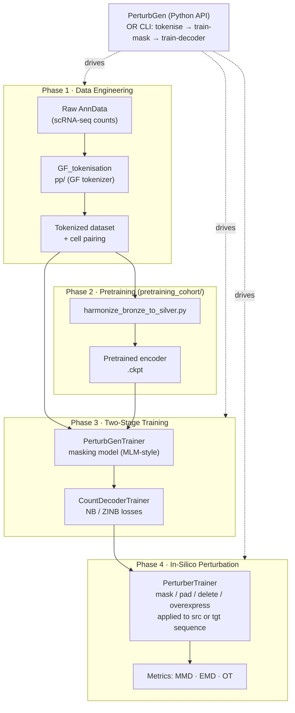

This page is your starting point for the **PerturbGen** repository. In the next few minutes you will learn what PerturbGen is, the biological problem it solves, how the codebase is organized, and which page to read next. No prior experience with the codebase is assumed — links to deeper pages are provided at every step so you can follow the suggested reading path at your own pace.

## What is PerturbGen?

PerturbGen is a **generative foundation model for single-cell biology**. Its goal is to predict how genetic or signaling perturbations reshape transcriptional programs across *cell state transitions* — for example, how a cell that is 90 minutes into an LPS immune response will look at the 6-hour mark if the gene IL1B is knocked out. Formally, the library describes itself as "a generative foundation model for perturbation responses along cellular trajectories," and the docs describe it as "a trajectory-aware, generative transformer" — meaning it treats time, development, or lineage progression as a sequence the model can extrapolate along, rather than predicting responses within a single fixed cell state.

Sources: [perturbgen/__init__.py](perturbgen/__init__.py#L1-L6), [docs/index.rst](docs/index.rst#L6-L14)


The paper behind the project frames the core challenge: predicting how cells transition between states over time, and how perturbations disrupt these transitions — a capability earlier in-silico perturbation methods lack because they cannot predict responses across dynamic cell trajectories. If you use PerturbGen in research, it should be cited via the bioRxiv 2026 paper *"Predicting how perturbations reshape cellular trajectories with PerturbGen."*

Sources: [README.md](README.md#L8-L20), [README.md](README.md#L118-L131)

## What can you do with it?

For a beginner, it helps to translate the research framing into concrete tasks. The project ships with six tutorial notebooks that map directly onto its three documented application areas: predicting gene expression at target states (inference of intermediate and future cell states), extracting gene embeddings aggregated across biological covariates, and discovering learned gene programs. The bundled notebooks cover preprocessing and curation, cell and gene embeddings from a released checkpoint, gene program discovery, end-to-end training plus perturbation via the Python API, in-silico perturbation with a released IL1B model, and post-perturbation analyses.

| Capability | In plain terms | Tutorial notebook |
|---|---|---|
| Preprocessing & curation | Clean raw single-cell data and prepare it for the model | [preprocessing_curation.ipynb](docs/examples/preprocessing_curation.ipynb) |
| Cell & gene embeddings | Extract learned numerical representations of cells and genes | [cell_gene_embeddings.ipynb](docs/examples/cell_gene_embeddings.ipynb) |
| Gene program discovery | Find coordinated groups of genes the model has learned | [gene_program_discovery.ipynb](docs/examples/gene_program_discovery.ipynb) |
| Train & perturb end-to-end | Fine-tune on your data, then perturb a gene in silico | [train_and_perturb.ipynb](docs/examples/train_and_perturb.ipynb) |
| In-silico perturbation | Predict the effect of knocking out or overexpressing genes | [perturbation.ipynb](docs/examples/perturbation.ipynb) |
| Post-perturbation analyses | Compare predicted vs. real responses with statistical metrics | [post_perturbation_analyses.ipynb](docs/examples/post_perturbation_analyses.ipynb) |

Sources: [README.md](README.md#L16-L20), [README.md](README.md#L93-L101)

## Repository at a glance

The repository is organized as **three concentric layers**, which is the single most useful mental model for navigating the code. The outer layer (`perturbgen/`) is the user-facing application; the inner engine (`scmaskgit/`) contains the core masked-generative transformer the application builds on; and `pretraining_cohort/` holds the data engineering pipeline that produced the pretrained encoder checkpoint.

```
Perturbgen/
├── perturbgen/          ← APPLICATION layer: API, CLI, trainers, tokenization
│   ├── model.py         ← scvi-tools-style Python API (PerturbGen, tokenize)
│   ├── __main__.py      ← `perturbgen` CLI (click-based)
│   ├── pp/              ← Geneformer-style tokenization
│   ├── Model/           ← masking model + count decoder (LightningModules)
│   ├── Perturb/         ← perturbation trainers and transformer variants
│   ├── src/             ← losses, metrics (MMD/EMD/OT), utilities
│   └── configs/         ← path management and sweep configs
├── scmaskgit/           ← CORE ENGINE: masked generative transformer
│   ├── Modules/T_model.py  ← time-aware transformer (timm-derived)
│   └── train.py, val.py    ← standalone pretraining entry points
├── pretraining_cohort/  ← DATA ENGINEERING: harmonization → tokenization → ckpt
├── docs/                ← Sphinx docs + tutorial notebooks
└── tests/               ← API, generation, and benchmark tests
```

Sources: [docs/index.rst](docs/index.rst#L31-L39), [perturbgen/model.py](perturbgen/model.py#L1-L12)

Each directory has a well-defined responsibility, summarized below. Note the deliberate duplication between `perturbgen/src/` and `scmaskgit/src/` (shared losses and metrics) — the application layer reuses the engine's utilities while adding perturbation-specific logic on top.

| Path | Role | Beginner relevance |
|---|---|---|
| `perturbgen/model.py` | High-level API wrapping training and perturbation in one `PerturbGen` object | **Start here** — everything a notebook user needs |
| `perturbgen/__main__.py` | CLI with four commands in workflow order | Alternative to notebooks |
| `perturbgen/pp/` | Geneformer-style tokenization, packaged vocab dictionaries | Input format for the model |
| `perturbgen/Model/trainer.py` | `PerturbGenTrainer` (masking) and `CountDecoderTrainer` (counts) | The two training stages |
| `perturbgen/Perturb/` | `PerturberTrainer` and transformer variants for in-silico edits | Where perturbation happens |
| `perturbgen/src/metric.py` | Distribution distances: MMD, EMD, optimal transport, RAGOU/Rouge scores | How predictions are judged |
| `scmaskgit/Modules/T_model.py` | ~1,300-line transformer with time-aware positional encodings | Deep dive (page 6 & 8) |
| `pretraining_cohort/` | Bronze→silver harmonization, tokenization, median calculation | Where the pretrained encoder comes from |

Sources: [perturbgen/Model/trainer.py](perturbgen/Model/trainer.py#L50-L52), [perturbgen/src/metric.py](perturbgen/src/metric.py#L1-L25)

## Architecture in one diagram

The workflow has four phases. First, raw AnnData (single-cell expression matrices) is **tokenized** into discrete gene tokens using Geneformer-style rank-based encodings. Second, a pretrained **masking model** — a transformer trained with masked-language-modeling-style objectives — learns cellular state representations. Third, a **count decoder** is trained to translate latent states back into gene expression counts using negative binomial / zero-inflated negative binomial losses. Finally, the perturbation machinery edits token sequences in silico and decodes the predicted outcome. The following diagram shows how the code modules realize this pipeline:



Prerequisite reading for the diagram: the "masking model" is a transformer whose positional encodings are **time-aware** — sinusoidal encodings indexed by biological time point, available in modes such as `time_pos_sin`, `comb_sin`, `sin_learnt`, and `time_pos_learnt` — which is what enables interpolation and extrapolation along a trajectory. The perturbation step reuses the count decoder with four edit modes (`mask`, `pad`, `delete`, `overexpress`) that can be applied to either the source or target sequence.

Sources: [scmaskgit/Modules/T_model.py](scmaskgit/Modules/T_model.py#L1-L15), [scmaskgit/Modules/T_model.py](scmaskgit/Modules/T_model.py#L43-L80), [perturbgen/Perturb/trainer.py](perturbgen/Perturb/trainer.py#L19-L38), [perturbgen/Model/trainer.py](perturbgen/Model/trainer.py#L64-L77)

## Two ways to drive the pipeline

You can accomplish everything through either the **Python API** or the **CLI** — they wrap the same underlying entry points, and the API explicitly avoids shelling out to CLI scripts ("everything runs in process"). The API centers on one object with a scvi-tools-style lifecycle: construct → train two stages → save/load → perturb. The CLI mirrors the same flow as four ordered commands.

| Aspect | Python API (`perturbgen.model`) | CLI (`perturbgen` command) |
|---|---|---|
| Entry point | `pg.PerturbGen(...)`, `pg.tokenize(...)` | `perturbgen <command>` (click group) |
| Preprocess | `tokenize(adata_path, dataset, ...)` | `perturbgen tokenise` |
| Train masking stage | `model.train_masking(output_dir=...)` | `perturbgen train-mask` |
| Train count decoder | `model.train_count(output_dir=..., masking_ckpt=...)` | `perturbgen train-decoder` |
| Extract embeddings | via `val.py` entry points | `perturbgen extract-embedding` |
| Perturb | `model.perturb(genes=["ENSG..."], mode="knockout", where="source")` | via `Perturb/val.py` flows |
| Best for | Notebooks, iterative analysis | Batch jobs, headless clusters |

The API's `perturb()` accepts friendly mode aliases — `"knockout"`/`"mask"`, `"overexpress"`, `"delete"`, `"pad"` — and a `where` argument (`"source"`/`"target"`) that maps onto the internal `perturbation_sequence` (`src`/`tgt`) parameter. Tokenization is deliberately a separate, idempotent step: re-running it is a fast no-op unless you pass `overwrite=True`.

Sources: [perturbgen/model.py](perturbgen/model.py#L13-L23), [perturbgen/model.py](perturbgen/model.py#L55-L66), [perturbgen/model.py](perturbgen/model.py#L88-L120), [perturbgen/__main__.py](perturbgen/__main__.py#L42-L89)

## Key facts before you start

A few operational details matter a lot for a first successful run. **Training requires a CUDA GPU** (preprocessing, tokenization, and inference run on CPU with ≥32 GB RAM recommended). At the tutorial default batch size of 64, the masking model peaks at ~13.8 GB and the count decoder at ~15.8 GB of GPU memory, so 24 GB GPUs (RTX 3090/4090) are the practical floor; the code automatically uses all visible GPUs with DDP, and DeepSpeed (ZeRO stage 2) is available to reduce per-GPU memory. Experiment logging goes to Weights & Biases and is **offline by default** so runs never hang on authentication. The default model configuration for the masking trainer is a 25,000-token vocabulary with `d_model=256`, 8 heads, and `mlm_probability=0.15`.

> [!TIP]
> Do **not** rely on `git lfs pull` for the pretrained checkpoint — the repository warns it may fail with a 403 bandwidth error. Download the `.ckpt` from the Hugging Face repo ([lotfollahi-lab/PerturbGen](https://huggingface.co/lotfollahi-lab/PerturbGen/tree/main)) and place it in `pretraining_cohort/` keeping its filename; training then finds the encoder automatically with no `--encoder_path` flag needed.

> [!TIP]
> If training hits an out-of-memory (OOM) error on a 16 GB GPU, lower `--batch_size` (CLI) or `batch_size=` (Python API) — but keep 64 if you want to reproduce paper results exactly.

Sources: [README.md](README.md#L35-L52), [README.md](README.md#L55-L70), [README.md](README.md#L83-L90), [perturbgen/Model/trainer.py](perturbgen/Model/trainer.py#L77-L90), [perturbgen/train.py](perturbgen/train.py#L62-L75)

## Suggested reading path

The documentation catalog is arranged from hands-on to conceptual. For a beginner, the recommended progression is: get it installed, run one tutorial notebook, and only then descend into the Deep Dive section. Each page below builds directly on concepts introduced on this Overview page.

| Step | Page | Why read it next |
|---|---|---|
| 1 | [Quick Start](2-quick-start) | Run your first tokenization → training → perturbation loop |
| 2 | [Installation and Hardware Requirements](3-installation-and-hardware-requirements) | Poetry setup, GPU sizing, memory tables in full detail |
| 3 | [Tutorial Notebooks Walkthrough](4-tutorial-notebooks-walkthrough) | Guided tour of the six notebooks in `docs/examples/` |
| 4 | [Architecture Overview](5-architecture-overview) | The full module map behind the diagram above |
| 5 | [scMASKGIT Masked Generative Encoder](6-scmaskgit-masked-generative-encoder) | How the core transformer actually works |
| 6 | [In Silico Perturbation Modes](10-in-silico-perturbation-modes) | Deep dive on `mask` / `pad` / `delete` / `overexpress` |

If you instead prefer to skim by topic: model internals live under *Model Design* (pages 6–9), perturbation and analysis under pages 10–13, data engineering under pages 14–16, and training operations under pages 17–20.
