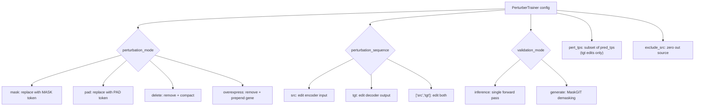
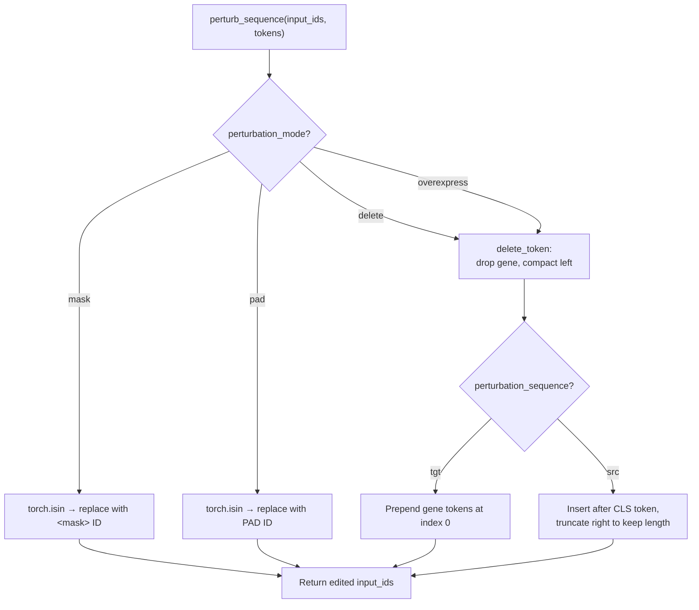
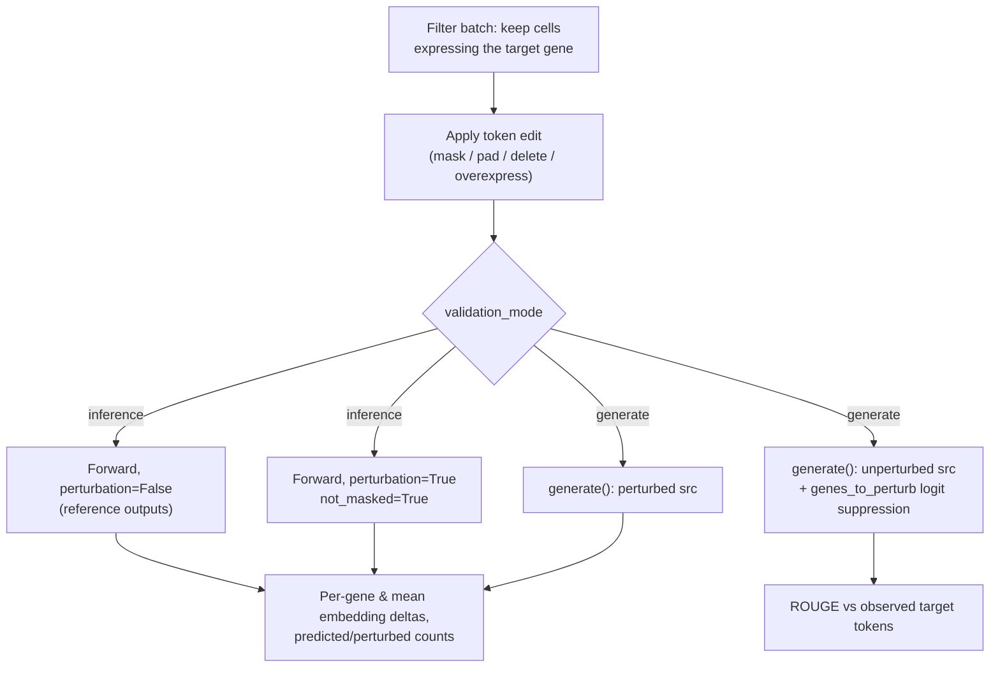

This page explains how PerturbGen simulates genetic perturbations computationally — the core mechanism by which a pretrained model predicts how cell states respond to gene knockouts or overexpression without ever running a wet-lab experiment. The system is organized around two orthogonal axes — **what happens to the gene's tokens** (`perturbation_mode`) and **where in the input/output structure the edit is applied** (`perturbation_sequence`) — combined with a choice of decoding strategy (`validation_mode`). All logic lives in three files: the `PerturberTrainer` orchestration layer, the `PerturberMasking` generative wrapper, and the `PerturbGen.perturb()` high-level API.

Sources: [trainer.py](perturbgen/Perturb/trainer.py#L25-L45), [model.py](perturbgen/model.py#L486-L503), [transformer.py](perturbgen/Perturb/transformer.py#L21-L43)

## The Perturbation Configuration Space

Every in-silico perturbation run is fully specified by the constructor arguments of `PerturberTrainer`. The two mandatory axes are `perturbation_mode` (one of `mask`, `pad`, `delete`, `overexpress`) and `perturbation_sequence` (`src` or `tgt`); if `validation_mode` is provided but either axis is missing, initialization fails immediately with an explicit error. Two additional controls refine the edit: `pert_tps` restricts the edit to specific predicted time steps (validated as a subset of `pred_tps`), and `exclude_src` replaces the entire source sequence with zeros to study target-side effects in isolation.

Sources: [trainer.py](perturbgen/Perturb/trainer.py#L46-L59), [trainer.py](perturbgen/Perturb/trainer.py#L139-L147), [trainer.py](perturbgen/Perturb/trainer.py#L368-L370)

Genes can be specified either by name (`genes_to_perturb`) or directly by token ID (`src_tokens_to_perturb` / `tgt_tokens_to_perturb`). Gene names are resolved through two pickled mapping dictionaries: `mapping_dict_path` yields `gene → target-row-ID`, and `tokenid_to_rowid_path` additionally yields `gene → original Geneformer token ID` for the source sequence. Both resolved token sets are registered as non-persistent buffers (`src_pert_tokens`, `tgt_pert_tokens`) so they automatically follow the model's device. The constructor prints a summary banner of the full perturbation configuration at startup, which is useful for verifying sweep jobs.

Sources: [trainer.py](perturbgen/Perturb/trainer.py#L62-L86), [trainer.py](perturbgen/Perturb/trainer.py#L87-L137), [trainer.py](perturbgen/Perturb/trainer.py#L150-L157)

The diagram above maps the full decision space: a perturbation run picks one operation per axis. Note that `perturbation_sequence` is checked with membership tests (`'src' in perturbation_sequence`), so passing a list like `['src', 'tgt']` applies the edit to both sequences simultaneously.

Sources: [trainer.py](perturbgen/Perturb/trainer.py#L87-L119), [delete_fcgr3a.yaml](perturbgen/configs/eval/HSPC/delete_fcgr3a.yaml#L44-L45)

## Token-Level Mechanics of the Four Modes

All four modes converge on a single dispatch point, `perturb_sequence(input_ids, token_to_perturb, replace_token, perturbation_mode, perturbation_sequence)`. The `mask` and `pad` modes are replacement operations: `torch.isin` builds a boolean mask over positions holding the perturbed gene's token, and those positions are overwritten in-place — with the learned `<mask>` token ID for `mask`, or the padding ID for `pad`. Because `mask` needs the vocabulary's `<mask>` entry, this mode additionally requires the mapping dictionary to be loaded; the forward pass raises a targeted error otherwise.

Sources: [trainer.py](perturbgen/Perturb/trainer.py#L269-L279), [trainer.py](perturbgen/Perturb/trainer.py#L305-L328)

The `delete` and `overexpress` modes share a prefix: `delete_token` removes all occurrences of the perturbed gene and compacts the remaining non-padding tokens to the left, preserving sequence contiguity. `overexpress` then continues in one of two ways depending on the sequence: for target sequences, the gene's tokens are **prepended** at position 0; for source sequences, they are inserted **after the first token** (the CLS position), so the sequence occupies its original length via right truncation.

Sources: [trainer.py](perturbgen/Perturb/trainer.py#L242-L267), [trainer.py](perturbgen/Perturb/trainer.py#L280-L303)

| Mode | Token operation | Sequence length after edit | Modeling semantics | Cells retained in batch |
|---|---|---|---|---|
| `mask` | Gene token → `<mask>` token | Unchanged | Knockout signal via the mask token the model was pretrained to decode from | Only cells expressing the gene |
| `pad` | Gene token → `<pad>` token | Unchanged | Knockout without the mask-token prior; masked-position conventions bypassed | Only cells expressing the gene |
| `delete` | Gene token removed, sequence compacted | Shortened | Hard ablation; no trace of the gene in context | Only cells expressing the gene |
| `overexpress` | Gene removed, then prepended at sequence head | Preserved (via truncation) | Forced expression regardless of baseline | **All cells** |

Sources: [trainer.py](perturbgen/Perturb/trainer.py#L459-L501), [trainer.py](perturbgen/Perturb/trainer.py#L269-L303)

> [!TIP]
> Choosing `mask` over `pad` matters: the masking model was pretrained to predict tokens hidden behind the `<mask>` ID, so `mask` keeps the perturbed sequence on-distribution for the encoder, while `pad` tests a distribution-shifted input — a useful ablation pair when auditing knockout robustness.

## Source vs Target: Where the Edit Lands

The `src` sequence is the encoder's input — the observed reference cell state — while each `tgt_input_ids_t{i}` sequence is the decoder's input representing a future time point. In `forward`, the replace token is resolved once per mode (`<mask>` ID or pad ID) and then the edit is applied per time step: if `pert_tps` is set, only those time steps' target sequences are edited; otherwise the edit hits every predicted time step. Condition tokens (e.g., cell-type embeddings produced by `concat_cond_tokens`) are concatenated *after* perturbation, so conditioning metadata is never perturbed.

Sources: [trainer.py](perturbgen/Perturb/trainer.py#L305-L388), [trainer.py](perturbgen/Perturb/trainer.py#L359-L366)

The two axes answer different biological questions. A **source-side** edit (`perturbation_sequence: ['src']`) asks "what happens downstream if the reference state changes?" — the edit propagates through the encoder into every predicted time step, which is why released configs pair it with `exclude_src: false`. A **target-side** edit (`perturbation_sequence: ['tgt']`, combined with `pert_tps`) asks "what if this gene were disrupted specifically at time point t?" — one concrete example config perturbs the target at `pert_tps: [1]` out of predicted time points `[1, 2, 3]`, with `exclude_src: true` isolating the target pathway entirely.

Sources: [mask_src_inference_perturbation_IL1B.yaml](perturbgen/configs/eval/LPS/mask_src_inference_perturbation_IL1B.yaml#L33-L38), [delete_fcgr3a.yaml](perturbgen/configs/eval/HSPC/delete_fcgr3a.yaml#L38-L55)

## Validation Modes: Single-Pass Inference vs Iterative Generation

The `validation_mode` axis selects how the model decodes the perturbed state. In **`inference`** mode, `test_step` runs the model twice over the filtered batch: once with `perturbation=False` (the unperturbed reference) and once with `perturbation=True`; the latter is a single forward pass with `not_masked=True`, meaning the (edited but complete) target tokens are decoded directly — no generative loop. The count decoder, when enabled, additionally draws count predictions (`compute_count_loss` with `n_samples` samples averaged).

Sources: [trainer.py](perturbgen/Perturb/trainer.py#L512-L521), [trainer.py](perturbgen/Perturb/trainer.py#L390-L429)

In **`generate`** mode, the decoder instead reconstructs target sequences from scratch via `PerturberMasking.generate`: every target position starts as `<mask>`, and a MaskGIT-style loop of `iterations` (default 18, documented as the MaskGIT optimum) progressively demasks tokens. Each iteration samples a mask ratio from the configured noise schedule (`uniform`, `pow`, `cosine`, `log`, `exp`), remasks the lowest-confidence positions, predicts all masked positions in parallel, ranks candidates by confidence (`1 − softmax probability`), and anneals the Gumbel-sampling temperature linearly toward zero. Sampling is filtered by `topk_filter_thres` (default 0.9), and previously demasked tokens are frozen (`can_remask_prev_masked=False` by default).

Sources: [transformer.py](perturbgen/Perturb/transformer.py#L30-L124), [transformer.py](perturbgen/Perturb/transformer.py#L197-L263), [trainer.py](perturbgen/Perturb/trainer.py#L522-L546)

> [!TIP]
> Generation is *guided*: on every demasking iteration, the logits for the perturbed gene's vocabulary entries are explicitly set to `−finfo.max` (`logits[:, :, genes_to_perturb] = max_neg_value`), so a knocked-out gene can never be re-sampled back into existence by the generative model — the edit is enforced, not merely suggested.

| Dimension | `validation_mode: inference` | `validation_mode: generate` |
|---|---|---|
| Target decoding | Single forward pass on edited tokens (`not_masked=True`) | Full MaskGIT demasking from all-mask init |
| Reference arm | Forward pass on unperturbed batch | `generate()` on unperturbed source (with gene suppression active) |
| Extra sampling params | None | `temperature` (2.0–3.0 range advised), `iterations`, `topk_filter_thres`, `mask_scheduler` |
| Sequence-level metric | Embedding/count comparisons | ROUGE-1 at lengths 25/100/max against observed tokens |
| Used by high-level API | **Always** (hard-coded) | CLI/config only |

Sources: [trainer.py](perturbgen/Perturb/trainer.py#L522-L561), [model.py](perturbgen/model.py#L513-L518), [transformer.py](perturbgen/Perturb/transformer.py#L36-L39)

The diagram summarizes the dual-arm structure: both modes always compare a perturbed arm against an unperturbed arm; they differ in whether each arm is *decoded* (inference) or *generated* (MaskGIT). This comparison pipeline feeds the metric dictionary described below.

Sources: [trainer.py](perturbgen/Perturb/trainer.py#L457-L566)

## Cell Filtering and Embedding Realignment

For `mask`, `pad`, and `delete`, `test_step` filters the batch before any forward pass: it checks whether the perturbed gene's token appears in the source sequence, the target sequences (at `pert_tps`), or both, and drops cells with zero occurrences. This is a correctness requirement, not an optimization — perturbing a token that isn't present would produce a meaningless "unperturbed" arm. The consequence is important for experiment design: **a source knockout requires the gene to be expressed in the source state**, otherwise every cell is filtered out and the run produces nothing, as documented in the API docstring.

Sources: [trainer.py](perturbgen/Perturb/trainer.py#L459-L504), [model.py](perturbgen/model.py#L539-L541)

`overexpress` deliberately skips this filter and keeps all cells, since forced expression does not presuppose baseline expression. After the forward pass, `delete` and `overexpress` require one more piece of bookkeeping: because those modes change token positions, `dec_embedding` tensors of the true and perturbed arms are no longer column-aligned. The code builds a cross-sequence match mask (`true_ids` vs `perturbed_ids` via argmax matching) to realign embeddings position-by-position; for `overexpress`, the prepended gene tokens are first overwritten with the pad ID so comparisons exclude the artificially inserted positions.

Sources: [trainer.py](perturbgen/Perturb/trainer.py#L492-L496), [trainer.py](perturbgen/Perturb/trainer.py#L568-L598)

> [!TIP]
> When interpreting overexpression results, remember the comparison is fair by construction: the `len(tgt_pert_tokens)` prepended positions are masked out of `perturbed_ids` *before* embedding realignment, so reported deltas reflect downstream transcriptional response, not the artificial token insert itself.

## Running Perturbations: API, CLI, and Configs

The high-level entry point is `PerturbGen.perturb(genes, mode, where, ...)`. It translates user-facing aliases into the underlying trainer vocabulary — `"knockout"` maps to the `mask` mode via `_MODE_ALIASES`, and `"source"`/`"target"` map to `src`/`tgt` via `_WHERE_ALIASES` — then assembles the full YAML config consumed by `perturbgen/Perturb/val.py` and invokes it in-process. Two guardrails are enforced: target-side knockout/delete/pad runs must pass `pert_tps`, and a trained count-decoder checkpoint must be available (via `count_ckpt` or a prior `train_count()` call).

Sources: [model.py](perturbgen/model.py#L57-L66), [model.py](perturbgen/model.py#L486-L575), [test_api_perturb.py](perturbgen/tests/test_api_perturb.py#L42-L61)

| `perturb()` parameter | Type / default | Effect |
|---|---|---|
| `genes` | `Sequence[str]` | Gene names (e.g., Ensembl IDs) to perturb; `[]` allowed with `perturb_genes_file` |
| `mode` | `"knockout"` (default) | Alias for `mask`; also `"overexpress"`, `"delete"`, `"pad"` |
| `where` | `"source"` (default) | `"src"` edits the encoder input; `"target"`/`"tgt"` edits decoded time points |
| `pert_tps` | `None` | Target time points to edit; **required** when `where="target"` with non-overexpress modes |
| `n_samples` | `3` | Count-decoder draws per cell, averaged into predicted counts |
| `context_mode` | `False` | Keeps the decoder from attending to observed cells of other time points during perturbation |
| `extra_config` | `None` | Escape hatch: `{section: {key: value}}` for `data`/`trainer`/`datamodule`/`model` options the API doesn't expose; keys the API already manages are rejected |

Sources: [model.py](perturbgen/model.py#L486-L542), [model.py](perturbgen/model.py#L543-L575), [test_api_perturb.py](perturbgen/tests/test_api_perturb.py#L63-L100)

Two API behaviors deserve attention. First, `perturb()` always runs `validation_mode="inference"`; passing non-default `temperature`/`iterations` triggers a warning because those only configure MaskGIT generation — the parameters are retained purely for backward compatibility. Second, `extra_config` supports cluster-targeted perturbation: passing `{"data": {"perturb_genes_file": ..., "perturb_colname": ..., "perturb_cluster": [...]}}` with `genes=[]` perturbs all genes assigned to the given cluster in a precomputed gene-embedding CSV; the file path is made absolute automatically to survive the entry point's working-directory change.

Sources: [model.py](perturbgen/model.py#L513-L563), [model.py](perturbgen/model.py#L524-L557)

The standalone CLI (`perturbgen/Perturb/val.py`) reads the same config schema and adds batch-operations conveniences: it loads a CSV of candidate genes and filters by cluster membership, intersects genes with the mapping dictionary, **resumes interrupted runs by skipping genes whose output file (pattern `adata_g{gene}_ssrc`) already exists**, normalizes/log-transforms target AnnData when `loss_mode` is `mse`, and auto-selects mixed precision (`bf16-mixed` on A100/H100, `16-mixed` otherwise, `32` on CPU). Released configs follow the naming convention `{mode}_{sequence}_{validation_mode}_perturbation_{GENE}.yaml` — e.g., `mask_src_inference_perturbation_IL1B.yaml` knocks out IL1B (`ENSG00000125538`) in the source sequence with the count decoder enabled (`loss_mode: zinb`, `n_samples: 2`).

Sources: [val.py](perturbgen/Perturb/val.py#L31-L38), [val.py](perturbgen/Perturb/val.py#L67-L132), [val.py](perturbgen/Perturb/val.py#L102-L146), [mask_src_inference_perturbation_IL1B.yaml](perturbgen/configs/eval/LPS/mask_src_inference_perturbation_IL1B.yaml#L19-L50)

## What a Perturbation Run Reports

Each `test_step` accumulates a metric dictionary comparing the perturbed arm to the reference arm: mean and per-gene cosine similarity of decoder embeddings, `delta_probs` and `delta_gene_probs` (token-level probability shifts), Wasserstein distance between count distributions, plus paired tensors of true vs. perturbed CLS embeddings, gene-mean embeddings, background embeddings, and observed/predicted/perturbed counts. In generate mode, ROUGE-1 scores at sequence lengths 25, 100, and `max_seq_length` quantify how faithfully free generation reconstructs the observed transcriptome.

Sources: [trainer.py](perturbgen/Perturb/trainer.py#L200-L224), [trainer.py](perturbgen/Perturb/trainer.py#L547-L561)

Per-gene predicted AnnData objects are written under the configured `output_dir`, one file per perturbed gene. Downstream — differential expression on these h5ads, or distributional evaluation of count predictions — belongs to the analysis layer rather than the perturbation mechanics themselves.

Sources: [val.py](perturbgen/Perturb/val.py#L102-L122), [trainer.py](perturbgen/Perturb/trainer.py#L15-L22)

## Where to Go Next

- To understand *why* the `<mask>` token and the MaskGIT demasking loop behave as they do, read [scMASKGIT Masked Generative Encoder](6-scmaskgit-masked-generative-encoder) and [Two-Stage Masking and Count Decoder Training](7-two-stage-masking-and-count-decoder-training).
- For the interpretation of `delta_probs`, Wasserstein distances, and count distributions, continue to [Evaluation Metrics: MMD, EMD, Optimal Transport](13-evaluation-metrics-mmd-emd-optimal-transport).
- For the full parameter surface of `PerturbGen.perturb()` and `tokenize()`, see [Python API Reference](21-python-api-reference); for YAML-driven batch perturbation workflows, see [CLI Command Reference](22-cli-command-reference) and [Configuration System and Path Management](17-configuration-system-and-path-management).
- For an end-to-end worked example — tokenization, training, then running `perturb()` in a notebook — follow [Tutorial Notebooks Walkthrough](4-tutorial-notebooks-walkthrough).