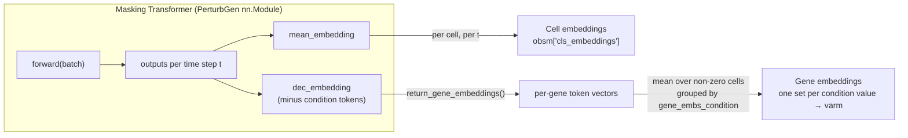
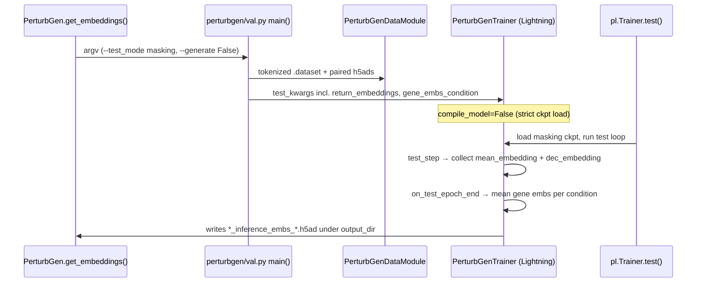
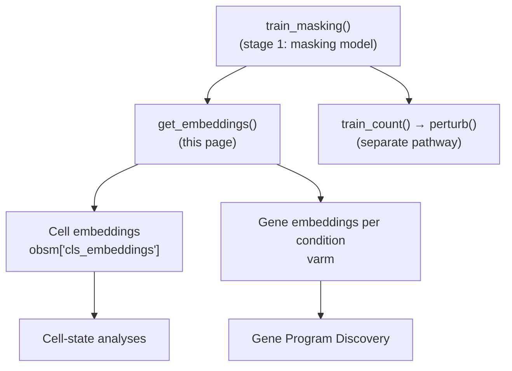

This page covers how PerturbGen extracts **cell embeddings** (a fixed-length vector per cell) and **time-resolved **gene embeddings** (one vector per gene per condition) from a trained masking model. It documents the high-level `PerturbGen.get_embeddings()` API, the validation pipeline it triggers, and the internal mechanics that turn transformer hidden states into AnnData files ready for downstream analyses such as gene program discovery. Throughout, we follow the released LPS embedding workflow from `docs/examples/cell_gene_embeddings.ipynb` as the canonical example.

Sources: [cell_gene_embeddings.ipynb](docs/examples/cell_gene_embeddings.ipynb#L8-L13), [model.py](perturbgen/model.py#L382-L398)

## What Gets Extracted: Two Embedding Families

PerturbGen's masking model is a transformer that processes tokenized gene-expression sequences; the embedding extraction step exposes its internal representations without running generative sampling. **Cell embeddings** are the pooled sequence representations (`outputs[t]['mean_embedding']`) collected per cell per time point — they summarize each cell's identity and state in a single `d_model`-dimensional vector. **Gene embeddings** are derived from the decoder-side token embeddings (`outputs[t]['dec_embedding']`), excluding any classifier-free-guidance condition tokens, and are averaged across all cells in which a gene is non-padded/non-zero, grouped by a conditioning variable such as `time_after_LPS`. This yields one gene-embedding matrix per unique condition value, enabling trajectory-aware gene geometry analyses.

Sources: [trainer.py](perturbgen/Model/trainer.py#L433-L446), [trainer.py](perturbgen/Model/trainer.py#L501-L511), [cell_gene_embeddings.ipynb](docs/examples/cell_gene_embeddings.ipynb#L85-L88)

The conceptual relationship between the model internals and the two embedding families is summarized below:



Sources: [trainer.py](perturbgen/Model/trainer.py#L405-L446), [cell_gene_embeddings.ipynb](docs/examples/cell_gene_embeddings.ipynb#L85-L88)

## High-Level API: `PerturbGen.get_embeddings()`

The public entry point follows the library's scvi-tools-style in-process API: `import perturbgen as pg; model = pg.PerturbGen(...)`, then call `model.get_embeddings(...)`. The method requires only a **masking checkpoint** — the count decoder is not needed for embedding extraction — and returns the output directory containing the embedding AnnData files. Two validation rules are enforced before anything runs: a masking checkpoint must exist (from `train_masking()` or passed explicitly as `masking_ckpt=`), and `return_gene_embs=True` requires `gene_embs_condition` to name an `obs` column whose values define the gene-embedding groups.

Sources: [model.py](perturbgen/model.py#L1-L27), [model.py](perturbgen/model.py#L382-L411), [__init__.py](perturbgen/__init__.py#L3-L5)

| Parameter | Type | Default | Purpose |
|---|---|---|---|
| `output_dir` | `str` | `"embeddings"` | Directory where embedding AnnData files are written |
| `masking_ckpt` | `str \| None` | `None` | Path to the masking checkpoint; defaults to the one stored by `train_masking()` |
| `return_cell_embs` | `bool` | `True` | Extract pooled per-cell embeddings |
| `return_gene_embs` | `bool` | `True` | Extract per-gene embeddings (requires `gene_embs_condition`) |
| `gene_embs_condition` | `str \| None` | `None` | `obs` column whose unique values define one gene-embedding set each (e.g. `time_after_LPS`) |
| `batch_size` | `int` | `64` | DataLoader batch size for the test pass |
| `n_workers` | `int` | `4` | DataLoader workers |

Sources: [model.py](perturbgen/model.py#L382-L398)

The canonical usage, from the released-checkpoint notebook, downloads both the checkpoint and the exact tokenized dataset it was trained on — token IDs are defined by the tokenization, so a checkpoint must be paired with its training data — and then extracts both embedding families in one call:

```python
model = pg.PerturbGen(
    TOKENIZED_DIR, source="normal", n_hvg=2000,
    n_layers=6, d_ff=32, d_model=768,
    pred_tps=[1, 2, 3],
    var_list=["cell_type_harmonized", "cell_pairing_index", "time_after_LPS"],
    cond_list=["time_after_LPS"],
    mask_scheduler="cosine", context_mode=True,
    max_len=797, tgt_vocab_size=2002,
)
EMB_DIR = model.get_embeddings(
    output_dir=EMB_DIR,
    masking_ckpt=MASKING_CKPT,
    return_cell_embs=True,
    return_gene_embs=True,
    gene_embs_condition="time_after_LPS",
)
```

Sources: [cell_gene_embeddings.ipynb](docs/examples/cell_gene_embeddings.ipynb#L31-L47), [cell_gene_embeddings.ipynb](docs/examples/cell_gene_embeddings.ipynb#L66-L77), [cell_gene_embeddings.ipynb](docs/examples/cell_gene_embeddings.ipynb#L97-L104)

## Execution Pipeline: From API Call to AnnData on Disk

Internally, `get_embeddings()` does not reimplement inference; it assembles a CLI-style argument vector and invokes `perturbgen.val.main(argv)` **in process** (with the caller's working directory preserved, since `val.py` changes to the repo root on import). The critical flags it sets are `--test_mode masking`, `--split False`, `--return_embeddings`, `--return_gene_embs`, `--generate False`, plus notebook-safety switches: `--single_device True` (avoids DDP, which cannot launch inside a Jupyter kernel) and `--wandb_mode disabled` (avoids a headless `wandb.init()` hang). Model architecture hyperparameters (`d_model`, `num_layers`, `d_ff`, `pred_tps`, `cond_list`, `mask_scheduler`, `pos_encoding_mode`) and data paths are forwarded from the model's stored hparams and paths.

Sources: [model.py](perturbgen/model.py#L412-L458), [val.py](perturbgen/val.py#L29-L30)

The orchestration then flows through the Lightning module system:



Sources: [model.py](perturbgen/model.py#L454-L458), [val.py](perturbgen/val.py#L565-L607), [val.py](perturbgen/val.py#L724-L740)

Two implementation details in `val.py` matter for reproducibility. First, for masking mode the trainer is instantiated with `gene_names` taken from the target AnnData's `var['gene_name']`, and a `conditions` directory is prepared for the per-condition gene-embedding outputs. Second, the module is deliberately built **uncompiled** (`compile_model=False`): checkpoints are saved with `torch.compile`'s `._orig_mod.` prefix stripped, so they only load cleanly under Lightning's strict `ckpt_path` load into an uncompiled module — numerically identical, but a prerequisite for checkpoint compatibility.

Sources: [val.py](perturbgen/val.py#L590-L607), [trainer.py](perturbgen/Model/trainer.py#L61-L72)

## Inside the Trainer: `test_step` and Epoch-End Aggregation

Within `PerturbGenTrainer`, `test_step` runs one forward pass per batch (`generate=False` here, so observed target tokens are decoded directly — no MaskGIT iterative sampling). For each predicted time step `t`, three things happen: (1) if `return_gene_embs`, `return_gene_embeddings()` maps the decoder token embeddings (sliced past the condition tokens with `[:, cond_length:, :]`) back to genes using the `gene_to_rowid` mapping, optionally restricted to marker genes; (2) the per-condition accumulators `sum_gene_embs[condition]` and `count_gene_embs[condition]` are updated by masking cells to each condition value of `gene_embs_condition` and summing non-zero token positions; and (3) pooled cell embeddings (`mean_embedding`), true counts, cell indices, and all `var_list` metadata are appended to `test_dict`.

> [!TIP]
> Despite the key name, the cell embedding stored under `cls_embeddings` is actually `outputs[t]['mean_embedding']` — the padding-aware mean-pooled sequence representation, not a dedicated CLS token. Code reading checkpoints should not assume a literal classification-token vector.

Sources: [trainer.py](perturbgen/Model/trainer.py#L405-L431), [trainer.py](perturbgen/Model/trainer.py#L436-L485), [trainer.py](perturbgen/Model/trainer.py#L501-L511), [trainer.py](perturbgen/Model/trainer.py#L43)

At `on_test_epoch_end`, the gene-embedding accumulators are finalized as a **non-zero mean** — each gene's vector is `sum / count` where `count` tallies only positions where the gene's token embedding was non-zero, and positions with zero count are left at zero. `return_prediction_adata()` then serializes everything into AnnData file(s) named `{date}_inference_embs_t{pred_tps}_{encoder}_m{mask_scheduler}` under `output_dir`. In the released workflow, these files carry cell embeddings in `obsm["cls_embeddings"]` and the per-condition gene embeddings in `varm`, which is exactly the format consumed by the gene program discovery notebook.

Sources: [trainer.py](perturbgen/Model/trainer.py#L513-L560), [cell_gene_embeddings.ipynb](docs/examples/cell_gene_embeddings.ipynb#L85-L88)

| Output artifact | Content | AnnData location | Granularity |
|---|---|---|---|
| `obsm["cls_embeddings"]` | Pooled per-cell vectors (`mean_embedding`) | Cell-level | One vector per cell per predicted time point |
| `varm` (per condition) | Averaged gene token embeddings | Gene-level | `n_genes × d_model` per unique value of `gene_embs_condition` |
| `obs` metadata | `var_list` columns + `batch` + `cell_idx` | Cell-level | Preserved for downstream grouping/plots |

Sources: [trainer.py](perturbgen/Model/trainer.py#L501-L511), [trainer.py](perturbgen/Model/trainer.py#L535-L560), [cell_gene_embeddings.ipynb](docs/examples/cell_gene_embeddings.ipynb#L85-L88)

## Practical Constraints and Troubleshooting

| Constraint | Consequence if violated | Where enforced |
|---|---|---|
| Masking checkpoint required | `ValueError` directing you to `train_masking()` or `masking_ckpt=` | [model.py](perturbgen/model.py#L400-L404) |
| `gene_embs_condition` set when `return_gene_embs=True` | `ValueError` explaining gene embeddings are extracted per unique value of the column | [model.py](perturbgen/model.py#L405-L411) |
| Checkpoint paired with its training tokenization | Token IDs mismatch → meaningless embeddings | [cell_gene_embeddings.ipynb](docs/examples/cell_gene_embeddings.ipynb#L19-L23) |
| Model dims must match checkpoint (`max_len`, `tgt_vocab_size`, `d_model`, ...) | Strict state-dict load failure | [cell_gene_embeddings.ipynb](docs/examples/cell_gene_embeddings.ipynb#L54-L57) |
| Uncompiled module for inference | Compiled checkpoints only load into uncompiled modules (prefix-stripped state dicts) | [val.py](perturbgen/val.py#L602-L606), [trainer.py](perturbgen/Model/trainer.py#L61-L72) |
| Notebooks must use `single_device=True` / `wandb_mode=disabled` | DDP cannot launch in a Jupyter kernel; `wandb.init()` hangs headless | [model.py](perturbgen/model.py#L420-L421), [val.py](perturbgen/val.py#L674-L677) |
| CPU fallback supported | `accelerator='gpu' if torch.cuda.is_available() else 'cpu'` | [val.py](perturbgen/val.py#L700-L701) |

Sources: [model.py](perturbgen/model.py#L400-L421), [val.py](perturbgen/val.py#L602-L606)

> [!TIP]
> The released embedding-analysis checkpoint on Hugging Face (`lps/embedding/20250714_2311_..._pos_sin_m_cosine_tp_1-2-3_s_0-epoch=07.ckpt`) already encodes the manuscript settings — `normal` source, targets 90 min / 6 h / 10 h, cosine masking scheduler, time conditioning — so reproducing the paper's embeddings is purely an inference exercise with no training.

Sources: [cell_gene_embeddings.ipynb](docs/examples/cell_gene_embeddings.ipynb#L38-L46), [cell_gene_embeddings.ipynb](docs/examples/cell_gene_embeddings.ipynb#L54-L57)

## Where Embeddings Fit in the Larger Workflow

Embedding extraction sits between training and analysis: it consumes the stage-1 masking model and produces the artifacts consumed by downstream discovery. The notebook explicitly hands off its `EMB_DIR` to `gene_program_discovery`, which mines the per-condition gene embeddings for programs. Note that only `train_masking` (stage 1) is needed — `train_count` and the perturbation modes operate on a separate pathway.



Sources: [model.py](perturbgen/model.py#L382-L398), [cell_gene_embeddings.ipynb](docs/examples/cell_gene_embeddings.ipynb#L46), [cell_gene_embeddings.ipynb](docs/examples/cell_gene_embeddings.ipynb#L110-L112)

## Next Steps

- Turn the extracted gene embeddings into interpretable programs: [Gene Program Discovery](12-gene-program-discovery)
- Understand the model whose hidden states you are extracting: [scMASKGIT Masked Generative Encoder](6-scmaskgit-masked-generative-encoder) and [Time-Aware Positional Encoding](8-time-aware-positional-encoding)
- Train your own masking checkpoint before extracting embeddings: [Two-Stage Masking and Count Decoder Training](7-two-stage-masking-and-count-decoder-training)
- Download released checkpoints and tokenized datasets: [Pretrained Checkpoints and Hugging Face Assets](23-pretrained-checkpoints-and-hugging-face-assets)
- Apply interventions instead of passive extraction: [In Silico Perturbation Modes](10-in-silico-perturbation-modes)
