Gene program discovery in PerturbGen treats the model's learned **gene embeddings** as a de novo representation of gene function: genes whose embeddings cluster together in latent space are interpreted as *gene programs* — coordinated biological functions that can serve as candidate targets for downstream perturbation studies. This page walks through the complete workflow implemented in `docs/examples/gene_program_discovery.ipynb`: loading the embedding AnnData produced by the upstream extraction step, re-shaping gene embeddings into a gene-as-observation matrix, clustering them with Leiden, annotating clusters via enrichment analysis, and validating programs by scoring them back in the original cell space.

Sources: [gene_program_discovery.ipynb](/docs/examples/gene_program_discovery.ipynb#L10-L21)

## Conceptual Model: From Embeddings to Programs

The workflow rests on a single representational insight: PerturbGen's masking encoder produces one 768-dimensional embedding per gene **per timepoint**, conditioned on the cellular context (time-aware positional encoding, see [Time-Aware Positional Encoding](8-time-aware-positional-encoding)). If a gene's embedding encodes its functional role in that context, then proximity in embedding space should encode functional similarity. The discovery pipeline therefore reuses the standard single-cell toolkit in an inverted geometry — instead of cells as observations, **genes become observations** and embedding coordinates become features:

```mermaid
flowchart LR
    A["Trained masking<br/>model checkpoint"] --> B["get_embeddings()<br/>per-timepoint extraction"]
    B --> C["AnnData<br/>n_obs = cells × timepoints<br/>varm: gene embeddings<br/>obsm: cls_embeddings"]
    C --> D["Transpose & stack<br/>gene-timepoint = observation<br/>768-dim vector = features"]
    D --> E["QC: drop all-zero vectors"]
    E --> F["neighbors + UMAP"]
    F --> G["Leiden clustering<br/>cluster = gene program"]
    G --> H["Enrichr annotation<br/>GO / Reactome"]
    H --> I["score_genes()<br/>program score in cell space"]
    I --> J["Biological validation<br/>cell-type & timepoint stratification"]
```



Each Mermaid node maps to a concrete code step documented below; read the diagram left-to-right as the data's transformation chain, from model weights to biological annotation.

Sources: [gene_program_discovery.ipynb](/docs/examples/gene_program_discovery.ipynb#L10-L21), [gene_program_discovery.ipynb](/docs/examples/gene_program_discovery.ipynb#L335-L336)

## Prerequisite: The Embedding Artifact

Gene program discovery is downstream of the embedding extraction covered in [Cell and Gene Embedding Extraction](11-cell-and-gene-embedding-extraction). The `PerturbGen.get_embeddings()` API wraps `perturbgen/val.py` with `--test_mode masking --return_embeddings --return_gene_embs`, requiring a trained masking checkpoint and — critically for this page — a `gene_embs_condition` column: **gene embeddings are extracted per unique value of that column** (e.g. `gene_embs_condition='time_after_LPS'` yields one embedding matrix per LPS timepoint).

Sources: [model.py](/perturbgen/model.py#L382-L458), [model.py](/perturbgen/model.py#L399-L411), [val.py](/perturbgen/val.py#L86-L97)

The resulting AnnData has a dual layout that the discovery notebook exploits. The notebook loads the latest `*inference_embs*.h5ad` from the extraction output directory:

| AnnData slot | Contents | Role in program discovery |
|---|---|---|
| `obs` | `cell_pairing_index`, `time_after_LPS`, `cell_type_harmonized`, `batch`, `cell_idx` | Context metadata for the cells |
| `var` | `token_id` (one row per gene, Ensembl IDs as index) | Keyed against the original dataset for symbol mapping |
| `obsm['cls_embeddings']` | Cell embeddings (average of that cell's gene embeddings) | Cell-space UMAP baseline |
| `varm['<timepoint>']` | Per-gene embedding matrix for each conditioned timepoint (`90m_LPS`, `6h_LPS`, `10h_LPS`) | **Raw material for program discovery** |

In the LPS example the object contains 69,433 cell observations × 2,000 genes with three timepoint-conditioned gene embedding matrices in `varm`.

Sources: [gene_program_discovery.ipynb](/docs/examples/gene_program_discovery.ipynb#L66-L77), [gene_program_discovery.ipynb](/docs/examples/gene_program_discovery.ipynb#L91-L105)

## Step-by-Step Workflow

### 1. Cell-Embedding Baseline and Gene Symbol Mapping

Before touching gene embeddings, the notebook establishes two reference points. First, it builds a neighborhood graph and UMAP directly on `cls_embeddings` (`sc.pp.neighbors(adata, use_rep='cls_embeddings')`) so downstream program scores can be interpreted against the embedding-derived cell landscape. Second, it loads the **original full dataset** (`adata_full`) for two purposes: mapping the Ensembl gene IDs in the embedding object to readable gene symbols (`adata.var['gene_symbol'] = adata.var.index.map(adata_full.var['gene_symbol-0'])`), and providing a normalized/log-transformed expression UMAP for optional visual comparison.

Sources: [gene_program_discovery.ipynb](/docs/examples/gene_program_discovery.ipynb#L112-L140), [gene_program_discovery.ipynb](/docs/examples/gene_program_discovery.ipynb#L163-L166), [gene_program_discovery.ipynb](/docs/examples/gene_program_discovery.ipynb#L317-L328)

> [!TIP]
> The gene embedding AnnData stores Ensembl IDs because tokens are keyed to the Geneformer vocabulary (see [Geneformer-Style Gene Tokenization](9-geneformer-style-gene-tokenization)). The symbol lookup must come from the *original* h5ad, not from any derived object — the embedding object never carries `gene_symbol` itself.

### 2. Transposing the Geometry: Genes as Observations

The pivotal transformation stacks the `varm` matrices across timepoints into a new AnnData where each row is a **gene–timepoint pair** named `f"{g}_{tp}"`, and `X` is the vertically concatenated 768-dimensional embedding vectors:

```python
gene_symbols = adata.var['gene_symbol'].values
timepoints = list(adata.varm.keys())
all_embeddings, obs_names, obs_timepoints, obs_genes = [], [], [], []

for tp in timepoints:
    embedding = adata.varm[tp]
    all_embeddings.append(embedding)
    obs_names.extend([f"{g}_{tp}" for g in gene_symbols])
    obs_genes.extend(gene_symbols)
    obs_timepoints.extend([tp] * len(gene_symbols))

new_adata = ad.AnnData(X=np.vstack(all_embeddings),
                       obs=pd.DataFrame({"gene_symbol": obs_genes,
                                         "timepoint": obs_timepoints},
                                        index=obs_names))
```

This inversion is what makes the standard scanpy pipeline (`neighbors` → `umap` → `leiden`) applicable to gene embeddings without modification.

Sources: [gene_program_discovery.ipynb](/docs/examples/gene_program_discovery.ipynb#L335-L369)

### 3. QC: All-Zero Vectors

Some gene–timepoint pairs produce embedding vectors that are identically zero (37 in the example run). These carry no positional information and distort graph construction, so they are detected with `(new_adata.X == 0).all(axis=1)` and removed before clustering.

Sources: [gene_program_discovery.ipynb](/docs/examples/gene_program_discovery.ipynb#L376-L411)

### 4. Latent-Space Visualization and Leiden Clustering

With clean vectors, the notebook computes `sc.pp.neighbors(new_adata)` and `sc.tl.umap(new_adata)`, then colors the UMAP by `timepoint` to check whether embeddings organize by time. **Gene programs are identified by applying Leiden clustering to the gene embedding space** — `sc.tl.leiden(new_adata, resolution=1, key_added='r1')` — with each resulting cluster representing a coherent program. Resolution 1 is the notebook's default starting point; adjust it to control program granularity.

Sources: [gene_program_discovery.ipynb](/docs/examples/gene_program_discovery.ipynb#L418-L433), [gene_program_discovery.ipynb](/docs/examples/gene_program_discovery.ipynb#L459-L490)

### 5. Annotating Programs with Enrichment Analysis

Cluster annotation uses `gseapy.enrichr` against `GO_Biological_Process_2025` and `Reactome_Pathways_2024` for `organism='Human'` with `cutoff=0.5`, keeping the top 5 terms per cluster sorted by Adjusted P-value:

| Parameter | Value | Purpose |
|---|---|---|
| `gene_sets` | `GO_Biological_Process_2025`, `Reactome_Pathways_2024` | Two complementary ontologies: process-level and pathway-level |
| `organism` | `Human` | Gene symbol namespace |
| `cutoff` | `0.5` | Adjusted P-value inclusion threshold |
| Output | Top 5 terms per cluster | Stored in a `results[cluster]` dict |

The notebook's worked example finds cluster 6 dominated by interleukins and chemokines and annotates it **cytokine signaling** — the notebook recommends predefined gene sets as guidance for annotating programs generally.

Sources: [gene_program_discovery.ipynb](/docs/examples/gene_program_discovery.ipynb#L497-L525), [gene_program_discovery.ipynb](/docs/examples/gene_program_discovery.ipynb#L531-L533)

### 6. Closing the Loop: Scoring Programs in Cell Space

Discovery only becomes useful when the program maps back onto cells. The notebook selects cluster 6's gene symbols, intersects them with `adata_full.var_names` (after re-keying `var_names` to gene IDs), and computes a z-score signature with `sc.tl.score_genes(adata_full, gene_list=genes_present, score_name='Cytokine Signaling')`. Clusters are then mapped to mechanism-of-action labels via a `cluster_map` dict into a `MoA` column, defaulting unmapped clusters to `'Others'`.

Sources: [gene_program_discovery.ipynb](/docs/examples/gene_program_discovery.ipynb#L531-L561), [gene_program_discovery.ipynb](/docs/examples/gene_program_discovery.ipynb#L570-L575)

The validation visuals follow directly: a highlighted UMAP of the gene embedding space with program genes circled and labeled (IL1RN, IL1B, PTX3, IL32, IL7R, CXCL8, CXCL3, CXCL9 via seaborn + `adjust_text`), a boxplot of the program score stratified by harmonized cell type, and — since the cytokine program was strongly myeloid-enriched — a subset to CD14+/CD16+ monocytes and dendritic cells to trace the program score across LPS timepoints (`90m`, `6h`, `10h`, `normal`).

Sources: [gene_program_discovery.ipynb](/docs/examples/gene_program_discovery.ipynb#L610-L677), [gene_program_discovery.ipynb](/docs/examples/gene_program_discovery.ipynb#L684-L761), [gene_program_discovery.ipynb](/docs/examples/gene_program_discovery.ipynb#L768-L799)

## Workflow Parameters at a Glance

| Stage | Function / Call | Key parameters | Effect |
|---|---|---|---|
| Extraction (upstream) | `PerturbGen.get_embeddings()` | `gene_embs_condition='time_after_LPS'` | One gene embedding matrix per timepoint in `varm` |
| Re-shaping | manual `varm` stacking | — | Gene-timepoint pairs as obs; 768-dim features |
| QC | boolean mask on `X` | — | Removes 37 all-zero vectors in example |
| Graph | `sc.pp.neighbors(new_adata)` | defaults | Graph over embedding space |
| Clustering | `sc.tl.leiden(..., resolution=1, key_added='r1')` | `resolution` | Granularity of programs |
| Annotation | `gp.enrichr(...)` | `gene_sets`, `organism`, `cutoff=0.5` | Biological labels per program |
| Scoring | `sc.tl.score_genes(adata_full, ...)` | `gene_list`, `score_name` | Z-score program activity per cell |

Sources: [model.py](/perturbgen/model.py#L405-L411), [gene_program_discovery.ipynb](/docs/examples/gene_program_discovery.ipynb#L489-L491), [gene_program_discovery.ipynb](/docs/examples/gene_program_discovery.ipynb#L510-L525)

> [!TIP]
> Gene embeddings are timepoint-conditioned by construction, so every gene appears once per extracted condition (e.g. three rows per gene for the LPS cohort). Leiden therefore clusters *gene-timepoint* units: a gene that shifts context between 90m and 10h can legitimately appear in different programs — treat the `timepoint` covariate as part of the program identity, not noise.

## Where to Go Next

This pipeline consumes artifacts built in [Cell and Gene Embedding Extraction](11-cell-and-gene-embedding-extraction) and shares its latent space with [In Silico Perturbation Modes](10-in-silico-perturbation-modes) — a natural follow-up is perturbing the candidate target genes your programs nominate and measuring the effect with [Evaluation Metrics: MMD, EMD, Optimal Transport](13-evaluation-metrics-mmd-emd-optimal-transport). For the full runnable version of every snippet on this page, see [Tutorial Notebooks Walkthrough](4-tutorial-notebooks-walkthrough); for the embedding API signatures, see [Python API Reference](21-python-api-reference).
