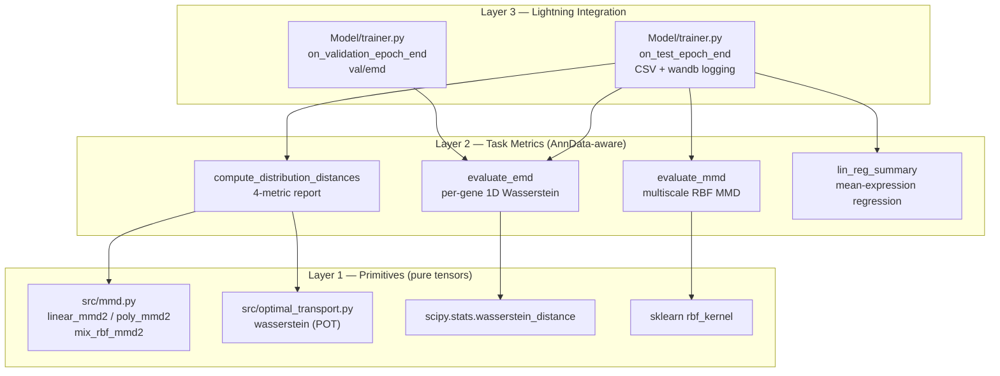
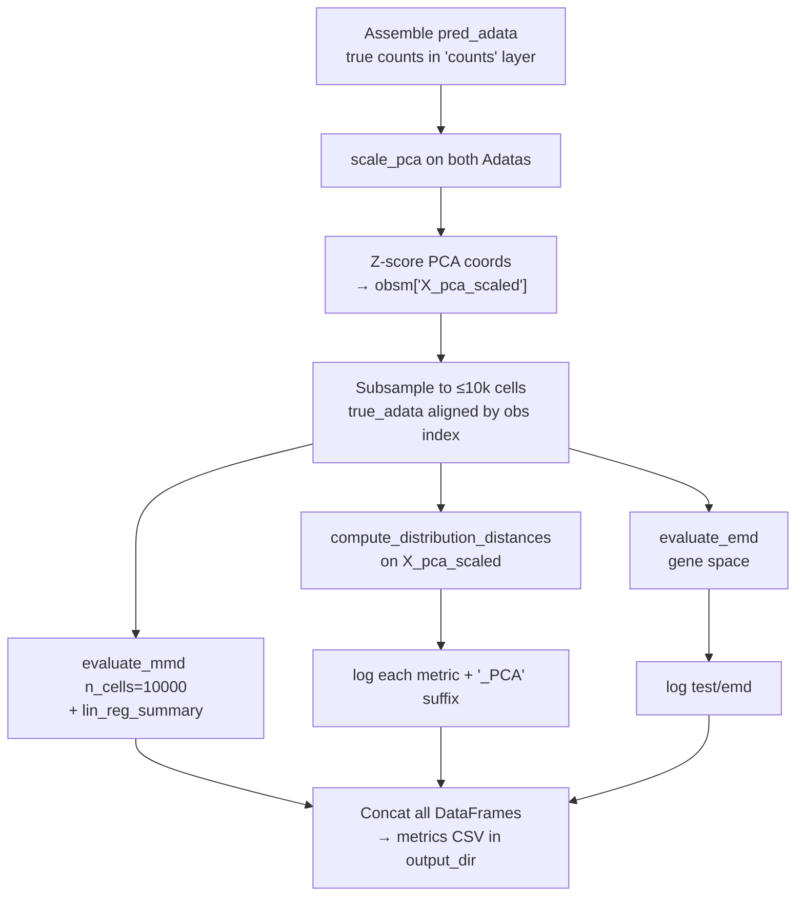

Perturbgen validates in-silico perturbation predictions by comparing **distributions**, not individual cells. Because a generative model can produce a valid cell state through many different trajectories, deterministic per-cell losses (MSE) are insufficient to certify that predicted populations match true perturbed populations. This page explains the three distributional evaluation families — **Maximum Mean Discrepancy (MMD)**, **Earth Mover's Distance (EMD)**, and **Optimal Transport (OT) Wasserstein distances** — covering their mathematical foundations, the exact code paths that implement them, and how they are orchestrated inside the PyTorch Lightning evaluation hooks. All implementations are adapted from proven sources: the [conditional-flow-matching](https://github.com/atong01/conditional-flow-matching) project for the primitive solvers, CPA for AnnData-aware MMD/EMD, CellFlow for energy distance, and CFGen for the aggregate distribution-distance report.

## Metric Architecture: A Three-Layer Design

The evaluation stack follows a strict separation of concerns that mirrors how the rest of the codebase separates primitives from orchestration. At the bottom, `perturbgen/src/mmd.py` and `perturbgen/src/optimal_transport.py` contain pure tensor mathematics with no domain assumptions — kernel functions and OT solvers that operate on raw tensors. The middle layer, `perturbgen/src/metric.py`, lifts these primitives into single-cell semantics: it understands `AnnData` objects, condition keys, differentially expressed gene (DEG) subsets, and sparse matrix handling. The top layer is the Lightning integration in `perturbgen/Model/trainer.py`, where preprocessing (PCA projection, z-scoring, seeded subsampling), logging, and CSV persistence happen inside `on_validation_epoch_end` and `on_test_epoch_end` hooks.

This layering has a practical consequence: you can reuse the primitives for novel evaluations (e.g., comparing latent embeddings) without touching AnnData plumbing, while the task layer guarantees consistent per-condition decomposition and DEG-focused analysis across all metrics.

Sources: [mmd.py](perturbgen/src/mmd.py#L1-L190), [optimal_transport.py](perturbgen/src/optimal_transport.py#L1-L62), [metric.py](perturbgen/src/metric.py#L1-L40), [Model/trainer.py](perturbgen/Model/trainer.py#L29-L35)

## Maximum Mean Discrepancy (MMD)

MMD is a kernel two-sample test statistic (Gretton et al., 2012): it measures the distance between **mean embeddings** of two distributions in a reproducing kernel Hilbert space. Formally, MMD² = E[k(x, x′)] + E[k(y, y′)] − 2·E[k(x, y)], which equals zero if and only if the two distributions coincide. Perturbgen implements three complementary MMD estimators, each selected for a different evaluation regime.

### Primitive estimators (`src/mmd.py`)

The file adapted from conditional-flow-matching provides a **linear-time MMD** (`linear_mmd2`), which exploits the identity h(z_i, z_j) = [f(x_i) − f(y_i)]ᵀ[f(x_j) − f(y_j)] for a linear kernel — useful when evaluating very large sample counts where quadratic kernel matrices are prohibitive. The **polynomial MMD** (`poly_mmd2`) computes (α·f(x)ᵀf(y) + c)^d with d=2 by default, again in linear time. The full quadratic estimators (`mix_rbf_mmd2`, `_mmd2`) build an explicit Gaussian RBF kernel matrix over the concatenated samples, supporting both **biased** (divide by m²) and **unbiased** (drop diagonal, divide by m(m−1)) estimators; `mix_rbf_mmd2_and_ratio` additionally normalizes by a closed-form variance estimate, producing a scale-free test statistic.

Sources: [mmd.py](perturbgen/src/mmd.py#L12-L30), [mmd.py](perturbgen/src/mmd.py#L40-L58), [mmd.py](perturbgen/src/mmd.py#L80-L82), [mmd.py](perturbgen/src/mmd.py#L126-L190)

### Multiscale RBF MMD on AnnData (`metric.py`)

The primary MMD used in Perturbgen reports is `mmd_loss_calc`, which uses scikit-learn's `rbf_kernel` with a single bandwidth gamma and applies the **unbiased diagonal-removal correction**: `sum_Kxx = (ΣK_xx − Σdiag) / (n(n−1))`, analogously for `K_yy`, with `K_xy` averaged directly. Removing the diagonal is critical for unbiasedness — self-similarity terms (k(x_i, x_i) = 1) otherwise bias the statistic toward zero, which would understate distributional mismatch in small-cell-count perturbation conditions.

The orchestration function `evaluate_mmd` wraps this into a **multiscale** estimate: it averages MMD across bandwidths `gammas = [2, 1, 0.5, 0.1, 0.01, 0.005]`, spanning both coarse (large-scale mean shifts) and fine (local variance changes) structure. The function supports three dimensions of analysis: (1) per-condition evaluation by looping over `condition_key` values and computing MMD separately for each perturbation; (2) DEG-focused evaluation via `de_genes_dict`, computing a restricted `mmd_deg` on differentially expressed genes only; and (3) sample-size control through `n_cells`, which subsamples the true AnnData and aligns `pred_adata` to the same cell indices before computing — required for a valid two-sample comparison. Sparse matrices are densified (`X.toarray()`) since `rbf_kernel` requires dense input.

> [!TIP]
> The `mmd_deg` call inside `evaluate_mmd` passes DEG-restricted tensors to `mmd_loss_calc` **without** an explicit `gamma` argument in the DEG branch — verify the default behavior matches your bandwidth expectation before comparing `mmd` and `mmd_deg` columns numerically; they may use different kernel scales.

Sources: [metric.py](perturbgen/src/metric.py#L101-L135), [metric.py](perturbgen/src/metric.py#L139-L198), [mmd.py](perturbgen/src/mmd.py#L134-L161)

## Earth Mover's Distance (EMD): Per-Gene Marginals

In Perturbgen's nomenclature, **EMD** refers to the 1D Wasserstein-1 distance computed independently per gene. Rather than comparing the joint cell × gene distribution, `evaluate_emd` loops over every gene column `i` and calls `scipy.stats.wasserstein_distance(true_X[:, i], pred_X[:, i])`, then reports the **mean across genes**. This measures how well the model reproduces each gene's marginal expression distribution — the shape of the histogram of counts for, say, *B2M* across the cell population — which captures distributional properties (variance, multimodality, tail behavior) that a mean-only metric like `lin_reg_summary` cannot.

Like `evaluate_mmd`, the AnnData-aware variant supports per-condition decomposition (`emd` per condition) and a DEG-restricted variant (`emd_deg` computed only on DE gene columns). The tensor-native sibling `compute_emd(pred_counts, true_counts)` performs the identical per-column loop on raw `torch.Tensor` batches, detaching and moving to CPU first — this is the variant invoked during **validation** for cheap, in-loop monitoring. Both densify sparse inputs defensively inside the loop.

> [!TIP]
> EMD per gene is computed on the **raw count/expression space**, not PCA space — so `test/emd` (logged during testing) reflects gene-space fidelity, while the `*_PCA` distribution distances reflect embedding-space fidelity. Comparing them diagnoses *where* the model's error lives: good PCA scores with poor gene-space EMD indicate accurate global structure but noisy per-gene marginals.

Sources: [metric.py](perturbgen/src/metric.py#L199-L249), [metric.py](perturbgen/src/metric.py#L252-L266)

## Optimal Transport: Joint-Space Wasserstein Distances

The `wasserstein` function in `src/optimal_transport.py` computes the true **p-Wasserstein distance** between two multivariate samples using the POT (Python Optimal Transport) library. It solves the discrete OT problem with **uniform marginals** (`ot.unif`), a cost matrix built from pairwise Euclidean distances (`torch.cdist`), and offers two solvers:

| Solver | `method` | Algorithm | Trade-off | Key parameter |
|---|---|---|---|---|
| Exact | `"exact"` or `None` | `ot.emd2` — linear program | Exact solution; super-cubic worst-case complexity; `numItermax=1e7`, `numThreads='max'` | — |
| Entropic | `"sinkhorn"` | `ot.sinkhorn2` — entropic regularization | Approximate; fast, GPU-friendly scaling behavior | `reg=0.05` (entropy weight) |

The `power` argument (restricted to 1 or 2) selects the transport cost exponent: the function squares the cost matrix for `power=2` and takes the square root of the LP result afterward (since `emd2` returns squared cost sums for a squared cost matrix). Multi-dimensional inputs with dim > 2 are flattened to [n_samples, −1], making the function agnostic to whether you compare raw expression, PCA coordinates, or latent embeddings.

The aggregate report function `compute_distribution_distances` (adapted from CFGen) combines this OT solver with the linear/poly MMD primitives into a single four-metric dictionary — `1-Wasserstein`, `2-Wasserstein`, `Linear_MMD`, `Poly_MMD` — computed in one pass. Because `linear_mmd2` computes `f_of_X − f_of_Y` element-wise, the function **clips both tensors to `min_size`** (the smaller of the two batch sizes) before calling the MMD primitives; misaligned sample counts would otherwise raise shape errors.

Sources: [optimal_transport.py](perturbgen/src/optimal_transport.py#L13-L62), [metric.py](perturbgen/src/metric.py#L327-L361)

### Related: Energy Distance

`metric.py` also ships `compute_e_distance` and a JAX-jitted variant `compute_e_distance_fast` (adapted from CellFlow), computing the energy distance `2δ − σ_X − σ_Y` from pairwise squared Euclidean statistics. This provides a fast, kernel-free alternative to MMD with similar sensitivity to distributional shape; the JAX `@jax.jit` decorator makes it suitable for batched, repeated evaluation in sweep pipelines.

Sources: [metric.py](perturbgen/src/metric.py#L20-L62)

## Execution Pipeline: Where Metrics Run in Lightning

The metrics are wired into two Lightning hooks on `PerturbGenTrainer` (inherited by `CountDecoderTrainer` and `PerturberTrainer`). During **validation**, only the lightweight EMD runs: `on_validation_epoch_end` concatenates accumulated true/prediction count tensors across batches, subsamples to at most 10,000 cells using a **seeded generator** (`torch.Generator().manual_seed(42)`), and logs `val/emd` with `sync_dist=True` for correct aggregation under DDP.

During **testing** (`on_test_epoch_end`, generation mode), the full battery executes in a fixed preprocessing order:

The PCA-space computation deserves attention: both predicted and true data are independently PCA-projected via `scale_pca`, then each coordinate matrix is z-scored `(coords − mean) / std` before `compute_distribution_distances` runs the four OT/MMD metrics on the scaled coordinates. Results are logged with a `_PCA` suffix (e.g., `1-Wasserstein_PCA`). The non-generative test path (direct count prediction without the masked iterative decoding loop) skips all distribution metrics and persists only `lin_reg_summary` to `test_metrics.csv` — distribution metrics require *sampled* populations to be meaningful.

The entry point for perturbation-specific evaluation is `perturbgen/Perturb/val.py`, which loads a YAML config (e.g., `configs/eval/HSPC/mask_src_inference_perturbation_B2M.yaml`), constructs a `PerturberTrainer` (which inherits the full metric pipeline from `CountDecoderTrainer`), and invokes `trainer.test(...)` — the hook above then executes automatically. Config-driven knobs such as `output_dir` determine where the timestamped metrics CSV lands.

> [!TIP]
> The 10,000-cell cap appears twice with different mechanisms: validation uses `torch.randint` with an explicit seeded generator (reproducible across DDP ranks), while testing uses `sc.pp.subsample` (which respects the global numpy seed set by `evaluate_mmd`'s `np.random.seed(seed)`). If you need bitwise-reproducible metric CSVs, pin both seeds and keep cell counts below the cap.

Sources: [Model/trainer.py](perturbgen/Model/trainer.py#L1075-L1102), [Model/trainer.py](perturbgen/Model/trainer.py#L1209-L1280), [Model/trainer.py](perturbgen/Model/trainer.py#L1282-L1302), [Perturb/val.py](perturbgen/Perturb/val.py#L219-L282), [Perturb/trainer.py](perturbgen/Perturb/trainer.py#L18-L19)

## Metric Comparison Matrix

| Metric | Function | Comparison space | Granularity | Library/backend | Provenance | Reported as |
|---|---|---|---|---|---|---|
| Linear MMD | `linear_mmd2` | Joint (cells × features), linear kernel | Whole population | PyTorch | conditional-flow-matching | `Linear_MMD_PCA` |
| Polynomial MMD | `poly_mmd2` | Joint, poly kernel (d=2) | Whole population | PyTorch | conditional-flow-matching | `Poly_MMD_PCA` |
| Multiscale RBF MMD | `evaluate_mmd` | Joint, 6 RBF bandwidths | Per condition (+DEG variant) | scikit-learn `rbf_kernel` | CPA | `mmd`, `mmd_deg` |
| 1D Wasserstein / EMD | `evaluate_emd` | Per-gene marginal (1D) | Mean over genes, per condition | `scipy.stats.wasserstein_distance` | CPA | `emd`, `emd_deg`, `test/emd` |
| Batch EMD | `compute_emd` | Per-gene marginal (1D) | Mean over genes | scipy (tensor-native) | — | `val/emd` |
| W₁ / W₂ (joint OT) | `wasserstein` via `compute_distribution_distances` | Joint (cells × features) | Whole population | POT (`ot.emd2` / `ot.sinkhorn2`) | CFGen | `1/2-Wasserstein_PCA` |
| Energy distance | `compute_e_distance(_fast)` | Joint, pairwise squared distances | Whole population | JAX (jitted) | CellFlow (Peidli 2024) | (utility, not logged by default) |
| Linear regression | `lin_reg_summary` | Per-gene mean expressions | Population (gene vector) | `scipy.stats.linregress` | — | slope, R², RMSE |

## Interpreting the Metrics Together

Each metric answers a different question about perturbation fidelity, and they are deliberately complementary. **MMD** (joint space) asks: "are the predicted and true populations indistinguishable as multivariate distributions under a kernel?" — it is sensitive to covariance structure and higher moments, and the multiscale bandwidths make it robust to both global shifts and local density changes. **Wasserstein (OT)** asks: "what is the minimum cost of transporting predicted cells onto true cells?" — it carries geometric meaning and is well-behaved for distributions with disjoint support (a known MMD failure mode with narrow kernels). **EMD** (per gene) asks: "does each gene's marginal expression profile match?" — it isolates per-gene fidelity that joint metrics can wash out when errors are anti-correlated across genes. The companion `lin_reg_summary` (slope ≈ 1, R², RMSE on per-gene mean expressions) anchors the distributional metrics with an interpretable, mean-focused reference point.

For advanced users extending the suite: new metrics should follow the established contract observed in `metric.py` — accept `AnnData` (or tensors), densify sparse inputs, support `condition_key` decomposition, and return a `pd.DataFrame` indexed by condition — so the DataFrame concatenation in `on_test_epoch_end` and the CSV/wandb persistence work without modification.

Sources: [metric.py](perturbgen/src/metric.py#L269-L324), [Model/trainer.py](perturbgen/Model/trainer.py#L1246-L1280)

## Next Steps

- To understand how the predictions feeding these metrics are produced (masked iterative decoding vs. direct inference), see [In Silico Perturbation Modes](10-in-silico-perturbation-modes).
- For the exhaustive benchmark suite that exercises these metrics end-to-end, see [Test and Benchmark Suite](26-test-and-benchmark-suite).
- To customize where metric CSVs and checkpoints are written, see [Configuration System and Path Management](17-configuration-system-and-path-management).
- Metric values are also surfaced to experiment tracking; for wandb integration details, see [Experiment Tracking with Weights and Biases](20-experiment-tracking-with-weights-and-biases).
- For the architectural context in which these evaluations sit (two-stage masking/count decoder), see [Architecture Overview](5-architecture-overview).