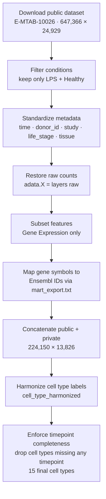
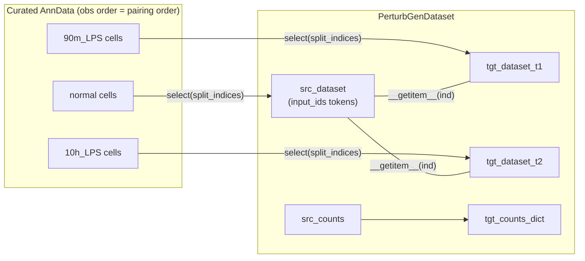

This page documents the two data-engineering foundations that make PerturbGen's supervised perturbation training possible: **data curation** (transforming heterogeneous raw scRNA-seq datasets into a harmonized, model-ready AnnData object) and **cell pairing** (the index-aligned linkage between control "source" cells and perturbed "target" cells across multiple time points). Curation is demonstrated end-to-end in the LPS preprocessing notebook, while pairing is implemented in the `PerturbGenDataset`/`PerturbGenDataModule` classes that every training and evaluation job consumes. Together they enforce a strict contract: for every cell index `i`, the model must always receive the same donor's baseline state and that same donor's perturbed states at each modeled time step.

## The Curation Workflow: From Public Repositories to a Unified Cohort

The curation notebook `preprocessing_curation.ipynb` prepares the LPS (lipopolysaccharide stimulation) dataset by merging a public cohort with a private one, then harmonizing metadata so both cohorts can be trained on jointly. The notebook's stated purpose is "the preparation of LPS datasets, including both public and private sources, and demonstrates how to merge them for training the PerturbGen model" [preprocessing_curation.ipynb](docs/examples/preprocessing_curation.ipynb#L8-L17).

The complete pipeline proceeds in seven stages, each removing one source of heterogeneity:

### Stage 1 — Acquisition and Condition Filtering

The public cohort is downloaded from the EBI Biostudies archive (study E-MTAB-10026, file `covid_portal_210320_with_raw.h5ad`, ~7.19 GB), yielding an AnnData object of 647,366 cells × 24,929 genes with rich `obs` fields including `sample_id`, `Status`, `full_clustering`, and `Collection_Day` [preprocessing_curation.ipynb](docs/examples/preprocessing_curation.ipynb#L54-L77), [preprocessing_curation.ipynb](docs/examples/preprocessing_curation.ipynb#L128-L131).

Before any pairing logic can run, the cohort must be restricted to cells relevant to the perturbation experiment. The notebook inspects the available conditions via `value_counts()` — revealing `Covid` (527,286), `Healthy` (97,039), `Non_covid` (15,157), and `LPS` (7,884) cells — extracts the patient IDs belonging to LPS and Healthy donors, then subsets the AnnData with `adata.obs['Status'].isin(['LPS','Healthy'])`. This isolates the stimulated cells and their matched unperturbed donors while discarding unrelated disease cohorts [preprocessing_curation.ipynb](docs/examples/preprocessing_curation.ipynb#L179-L218).

### Stage 2 — Metadata Standardization

PerturbGen's training configuration references cells by *predictable* obs keys, so the notebook normalizes five metadata dimensions into a common schema:

| Obs field | Curation action | Purpose |
|---|---|---|
| `time_after_LPS` | `nan` → `'normal'`, suffixed values → `'90m_LPS'`, `'10h_LPS'`; cast to ordered `Categorical` | Time-step keys drive `tgt_dataset_t{t}` lookup |
| `donor_id` | Copied from `patient_id` | Donor identity for condition encodings |
| `study` | Hardcoded cohort tag (e.g. `'Public_Emily2021'`) | Batch/condition covariate at merge time |
| `development_stage` | Age intervals mapped to ordered life stages (`Adult`, `Old`, ...) | Harmonized covariate across cohorts |
| `tissue` | Constant `'blood'` | Consistent tissue annotation |

The time column is the most critical: unperturbed cells carry `nan` timestamps, which are relabeled `'normal'` so every cell carries a valid categorical time key, ordered as `['normal', '90m_LPS', '10h_LPS']` [preprocessing_curation.ipynb](docs/examples/preprocessing_curation.ipynb#L225-L253), [preprocessing_curation.ipynb](docs/examples/preprocessing_curation.ipynb#L286-L298). Life-stage harmonization uses an explicit mapping dictionary that collapses six age intervals into an ordered categorical, and the tissue field is assigned wholesale [preprocessing_curation.ipynb](docs/examples/preprocessing_curation.ipynb#L352-L379).

### Stage 3 — Raw Counts Restoration and Feature Subsetting

Two invariants matter downstream: (1) the model operates on **raw counts**, not normalized values, and (2) only gene expression modalities are tokenized. The notebook therefore overwrites the processed matrix with the raw layer — `adata.X = adata.layers['raw'].copy()` — and verifies the maximum count is an untransformed float value [preprocessing_curation.ipynb](docs/examples/preprocessing_curation.ipynb#L388-L411). It then subsets the `var` axis to features where `feature_types == 'Gene Expression'`, excluding antibody-capture or other modalities present in multiome-style public releases [preprocessing_curation.ipynb](docs/examples/preprocessing_curation.ipynb#L453-L455).

> [!TIP]
> The gene-symbol → Ensembl-ID mapping file `mart_export.txt` is **pinned inside the repository** at `docs/examples/reference/mart_export.txt` (Ensembl BioMart, GRCh38.p14, 86,368 genes) rather than fetched at runtime. Because symbol-to-ID mappings drift between Ensembl releases, regenerating this file from a different release would match a different gene set and silently change which genes are retained — the checked-in file guarantees byte-identical gene matching with the tutorial.

This mapping is loaded with `pd.read_csv("reference/mart_export.txt")` and used to annotate `ensembl_id` per gene [preprocessing_curation.ipynb](docs/examples/preprocessing_curation.ipynb#L463-L478).

### Stage 4 — Cohort Merging and Cell Type Harmonization

After the private cohort receives identical metadata treatment, both cohorts are concatenated into a single AnnData: `adata = adata1.concatenate(adata2)`, producing **224,150 cells × 13,826 genes**. The merged time-point distribution becomes `normal` (148,742), `6h_LPS` (43,810), `10h_LPS` (20,890), and `90m_LPS` (10,708) — note the private cohort contributes a `6h` time point absent from the public one [preprocessing_curation.ipynb](docs/examples/preprocessing_curation.ipynb#L2004-L2056).

Merging exposes the central curation problem: the merged `cell_type` field contains **~60 distinct raw labels** that describe overlapping populations under different naming conventions (e.g., `CD14mono`, `CD14_mono`, `CD83_CD14_mono`, `CD14mono_M1`, `Int.mono` all denote CD14 monocytes) [preprocessing_curation.ipynb](docs/examples/preprocessing_curation.ipynb#L2069-L2140). The notebook resolves this with an explicit `cell_type_mapping` dictionary that projects every raw label onto a canonical vocabulary — collapsing monocytes, CD4 T cell subtypes, CD8 subtypes, NK subsets, B cell subsets, and plasma cell variants into 20 canonical classes — and writes the result to a new `cell_type_harmonized` obs column, falling back to the raw label for unmapped entries [preprocessing_curation.ipynb](docs/examples/preprocessing_curation.ipynb#L2177-L2254).

### Stage 5 — Timepoint Completeness Enforcement

Because the model predicts a perturbation response *per cell type per time step*, a cell type observed in only a subset of time points cannot contribute complete training pairs. The notebook runs a group-by check — for each harmonized cell type, it collects the set of observed time points and verifies that the full time-point universe is a subset. Five cell types fail the check (`ASDC`, `HSC_CD38pos`, `HSC_Erythroid`, `ILC1_3`, `Red_Blood_Cell`) and are explicitly removed, leaving **15 fully-paired cell types** spanning 224,150 curated cells [preprocessing_curation.ipynb](docs/examples/preprocessing_curation.ipynb#L2271-L2290), [preprocessing_curation.ipynb](docs/examples/preprocessing_curation.ipynb#L2315-L2356).

This completeness check is the curation-side twin of the pairing invariant described below: it guarantees every (cell type, time step) combination has both control and perturbed cells available for index-aligned pairing.

## The Cell Pairing Architecture: Index-Aligned src/tgt Tensors

Cell pairing in PerturbGen is **positional, not identity-based**. The `PerturbGenDataset` stores a source dataset (control/baseline cells) and a dictionary of target datasets keyed by time step — `tgt_dataset_t1`, `tgt_dataset_t2`, ... — and asserts that row `i` of the source corresponds to row `i` of every target. The constructor's split logic applies the *same* `split_indices` to source and all targets (`self.src_dataset.select(split_indices)` and per-time-step `select`), so subsetting for train/val/test preserves the alignment [datamodule.py](perturbgen/Dataloaders/datamodule.py#L22-L79).

Two integrity mechanisms enforce this contract at runtime. First, a **length invariant** warns when `src` and `tgt` differ in size and clamps iteration length to the minimum — `self.dataset_length = min(src_len, tgt_len)` — preventing silent index-out-of-range errors when a cohort has asymmetric coverage [datamodule.py](perturbgen/Dataloaders/datamodule.py#L80-L89). Second, `__getitem__` returns the source and *all* target time steps for a single index in one dict (`src_dataset[ind]` plus `tgt_dataset_t{t}[ind]` for each modeled time step), so a training sample is always a complete paired tuple, never an unpaired fragment [datamodule.py](perturbgen/Dataloaders/datamodule.py#L127-L148).

**Time steps** define how many targets pair with each source. The `PerturbGenDataModule` exposes three complementary settings: `pred_tps` (the time steps the model is trained to predict, e.g. `[1, 2]`), `context_tps` (additional observed time steps usable as conditioning context at test time), and `n_total_tps` (the universe of time points in the cohort) [datamodule.py](perturbgen/Dataloaders/datamodule.py#L151-L227). During test-stage setup, the dataset includes `pred_tps + context_tps` — with an explicit comment that this restriction exists "to avoid data leakage" — so evaluation never loads target states the model is not supposed to have seen [datamodule.py](perturbgen/Dataloaders/datamodule.py#L272-L293).

## Conditioning, Balanced Sampling, and Batch Assembly

Pairing alone is not enough when cohorts are imbalanced — the merged LPS cohort has 148,742 control cells but only ~10,700 at the rarest perturbation time point. The dataset computes **inverse-frequency label weights** from one or more `sampling_keys` (arbitrary obs columns, e.g. cell type + time point), combining the weight tensors of source and each target time step by element-wise mean, and the training dataloader feeds these into a `WeightedRandomSampler` (with replacement, seeded for reproducibility) instead of naive shuffling [datamodule.py](perturbgen/Dataloaders/datamodule.py#L91-L125), [datamodule.py](perturbgen/Dataloaders/datamodule.py#L295-L313).

The `collate` function then assembles model-ready tensors from each paired tuple, performing four transformations worth knowing when debugging shape mismatches:

| Collate output key | Transformation | Detail |
|---|---|---|
| `src_input_ids` | Pad token sequences to `max_len` (default 2048) via `pad_tensor_list` with `<pad>` token ID | Length also records true per-cell length in `src_length` |
| `tgt_input_ids_t{t}` | Strip `<cls>` and `<eos>` tokens from target sequences | Explicitly does *not* assume CLS is the first token |
| `tgt_counts_t{t}` | Concatenate per-cell raw counts (dense-ifying CSR matrices if needed) | Feeds the count decoder objective |
| `tgt_size_factor_t{t}` | Row sums of the target count matrix | Library size factor computed once per sample |

Condition tensors (`conditions`, `conditions_combined`) ride alongside when `condition_encodings` are supplied, carrying the donor/batch covariates curated in Stage 2 into the model [datamodule.py](perturbgen/Dataloaders/datamodule.py#L331-L398).

> [!TIP]
> The dense conversion of sparse CSR matrices happens **once per sample** in collate — the code deliberately reuses a single `_dense` array to derive both the counts tensor and the size factor, halving the sparse-to-dense cost on the hot path. If you extend the collate function, preserve this reuse pattern; recomputing `.toarray()` per derived tensor is the most common performance regression in custom dataloaders here.

## How Curation and Pairing Meet

The two halves of this page connect through **obs ordering**. The curation notebook's final `adata_filtered` (224,150 cells, 15 harmonized cell types, complete across all four time points) is later tokenized so that, for every donor, the `normal` row index matches the `90m/6h/10h` rows' indices in the derived `src`/`tgt` Hugging Face datasets. Every curation operation that reorders or filters cells therefore has pairing consequences:

| Curation decision | Pairing consequence if skipped |
|---|---|
| Ordered categorical time keys | Time-step dict lookup (`tgt_dataset_t{t}`) has no canonical keys |
| Cell type harmonization | Weighted sampling groups fragments into near-duplicate strata |
| Timepoint completeness filtering | `dataset_length = min(src_len, tgt_len)` silently drops real cells |
| Raw counts restoration | `tgt_size_factor_t{t}` sums log-normalized values, corrupting the count decoder |
| Pinned Ensembl mapping | Token vocabulary mismatch between cohorts breaks joint training |

Sources: [preprocessing_curation.ipynb](docs/examples/preprocessing_curation.ipynb#L2271-L2356), [datamodule.py](perturbgen/Dataloaders/datamodule.py#L80-L89), [datamodule.py](perturbgen/Dataloaders/datamodule.py#L331-L398)

## Where to Go Next

- To see how curated, paired cells are converted into the token sequences consumed by `src_dataset`/`tgt_datasets`, continue to [Geneformer-Style Gene Tokenization](9-geneformer-style-gene-tokenization).
- For how the paired `tgt_counts_t{t}` tensors supervise the generative objective, see [Two-Stage Masking and Count Decoder Training](7-two-stage-masking-and-count-decoder-training).
- For the analogous bronze→silver harmonization applied to the *pretraining* cohort (a batch-oriented script pipeline, distinct from this notebook workflow), see [Pretraining Cohort Harmonization Pipeline](15-pretraining-cohort-harmonization-pipeline).
- For the on-disk format of the tokenized outputs of this workflow, see [Tokenized Dataset Layout](16-tokenized-dataset-layout).