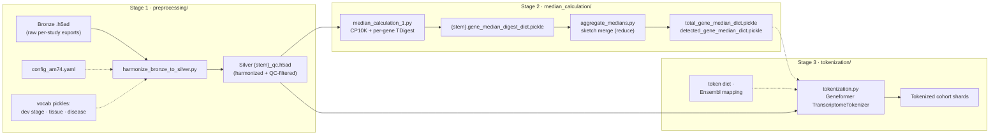
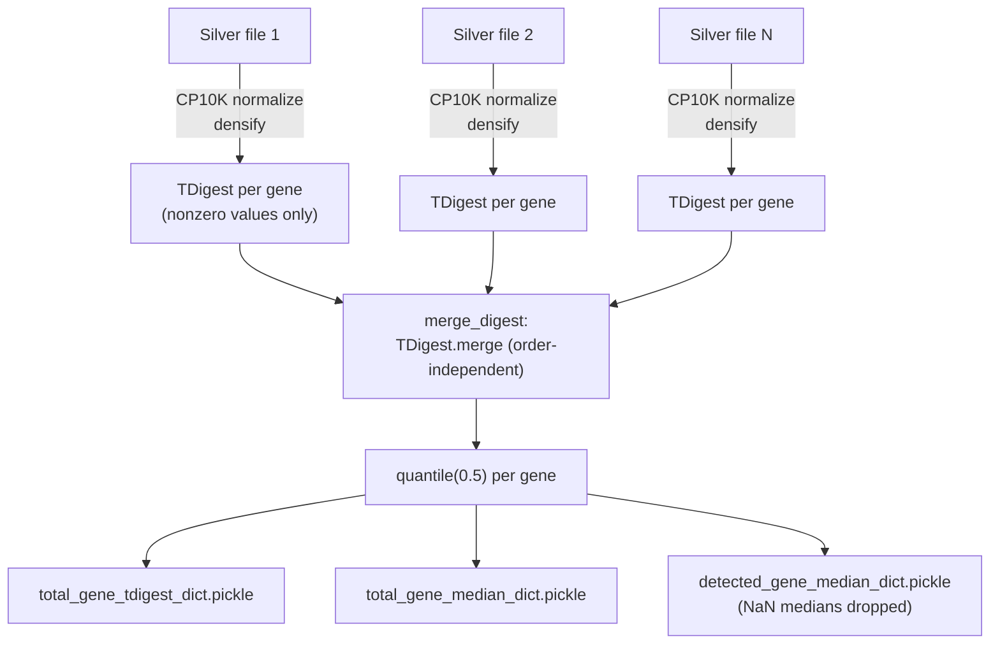
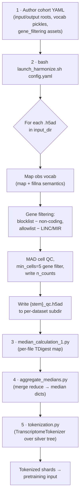

This page documents the standalone data-engineering pipeline that lives under `pretraining_cohort/` in the repository root. Its purpose is to convert a heterogeneous collection of raw, per-study `.h5ad` datasets (the **bronze tier**) into a vocabulary-harmonized, quality-controlled **silver tier**, then derive cohort-wide per-gene median expression statistics, and finally produce Geneformer-format tokenized datasets ready for large-scale pretraining. Unlike the model code in `perturbgen/`, these scripts are cohort-scoped infrastructure: they are parameterized by one YAML config (stage 1) or by hardcoded NFS paths edited per cohort (stages 2–3). This page covers the architecture, per-stage mechanics, execution walkthrough, and the artifacts the pipeline emits; it does not cover how the model consumes those artifacts.

## Pipeline Architecture at a Glance

The directory layout encodes the pipeline topology directly: each subdirectory is one stage, and each stage consumes the previous stage's output convention. Stage 1 writes one subdirectory per input dataset under a shared output root; stages 2 and 3 then recursively discover those files with `os.walk`. To read the following diagram: solid arrows are data flow between tiers, dashed arrows are reference assets (mapping pickles, dictionaries) that feed a stage without being transformed by it.



The three stages are deliberately decoupled on disk: there is no orchestrator script that runs all three, and each stage is idempotent over its inputs. This makes the pipeline resumable — a failed dataset can be re-harmonized without recomputing medians for the rest of the cohort.

Sources: [harmonize_bronze_to_silver.py](pretraining_cohort/preprocessing/harmonize_bronze_to_silver.py#L206-L212), [median_calculation_1.py](pretraining_cohort/median_calculation/median_calculation_1.py#L10-L14), [aggregate_medians.py](pretraining_cohort/median_calculation/aggregate_medians.py#L53-L55), [tokenization.py](pretraining_cohort/tokenization/tokenization.py#L23-L42)

## Stage 1: Bronze → Silver Harmonization

### Configuration Contract

Stage 1 is the only config-driven stage. `harmonize_bronze_to_silver.py` declares a required `--config_file` CLI argument, loads it with `yaml.safe_load`, and reads every behavioral knob from that mapping. The shipped example, `config_am74.yaml`, defines the full contract: input/output roots, three vocabulary-mapping pickles, an optional exclusion switch, and a nested `gene_filtering` block.

| Config key | Type | Role |
|---|---|---|
| `input_dir` | path | Flat directory of bronze `.h5ad` files to process |
| `output_base_dir` | path | Silver-tier root; one subdirectory is created per dataset |
| `dev_stage_map` / `tissue_map` / `disease_map` | pickle paths | Obs-column vocabulary maps applied via `Series.map` |
| `excluded_file` + `do_exclude_file` | str + bool | Opt-in skip of a single named file |
| `gene_filtering.remove_ensembl_txt` | CSV path | Ensembl IDs to unconditionally drop (e.g., non-coding) |
| `gene_filtering.ensembl_mapping_dict` | pickle path | Gene-name dictionary; LINC/MIR entries pruned, remainder kept |

All paths in the shipped config are absolute NFS paths (`/nfs/team361/...`), which reflects that this stage runs on the lab's cluster storage rather than against repo-relative paths.

Sources: [harmonize_bronze_to_silver.py](pretraining_cohort/preprocessing/harmonize_bronze_to_silver.py#L13-L15), [harmonize_bronze_to_silver.py](pretraining_cohort/preprocessing/harmonize_bronze_to_silver.py#L206-L212), [config_am74.yaml](pretraining_cohort/preprocessing/config_am74.yaml#L1-L11)

### Metadata Vocabulary Harmonization

The core harmonization problem at cohort scale is vocabulary drift: each source study annotates `development_stage`, `tissue`, and `disease` with its own ontology terms. The pipeline resolves this by dictionary remapping rather than hard-coded rules — the three pickles loaded in `harmonize_dataset` are lookup tables from raw terms to canonical ones. The remapping semantics are **map-then-fillna**: unmatched values fall through to their original strings rather than being dropped, so no cell is lost to a stale dictionary, and provenance is preserved by writing canonical values into `trace_*` columns while `tissue` is overwritten in place.

| `obs` column | Origin | Transformation | Fallback |
|---|---|---|---|
| `trace_dev_stage` | `development_stage` | `map(dev_stage_map)` | Original value via `fillna` |
| `tissue` | `tissue` | `map(tissue_map)`, in place | Original value via `fillna` |
| `trace_disease` | `disease` | `map(disease_map)` | `"unknown"` if the column is absent entirely |
| `study` | Filename stem | Literal string assignment | — |

The `study` column derived from the filename is what makes the silver tier self-documenting at the cell level: every downstream analysis can attribute a cell to its source dataset without external manifests. Note that if a dataset lacks a `disease` column the script logs a warning and stamps `trace_disease="unknown"` — the harmonized schema is total, not optional.

Sources: [harmonize_bronze_to_silver.py](pretraining_cohort/preprocessing/harmonize_bronze_to_silver.py#L147-L165), [harmonize_bronze_to_silver.py](pretraining_cohort/preprocessing/harmonize_bronze_to_silver.py#L171-L192), [harmonize_bronze_to_silver.py](pretraining_cohort/preprocessing/harmonize_bronze_to_silver.py#L194-L198)

### Gene Filtering Strategy

Gene-space unification uses two independent masks applied sequentially inside `perform_qc` when the `gene_filtering` config block is present. The first mask is a **blocklist**: a CSV of Ensembl "Gene stable ID" values (non-coding and low-quality loci) is loaded into a set and subtracted from `var['ensembl_id']`. The second mask is an **allowlist**: the Ensembl mapping dictionary (the same `ensembl_mapping_dict_gc95M` family shipped in `perturbgen/pp/`) is filtered to drop keys beginning with `LINC` or `MIR`, and only genes whose `feature_name` survives that filter are retained. Only after both masks pass is the gene universe aligned with the token dictionary used in stage 3 — a dataset whose genes are not in this intersection would tokenize with missing tokens.

> [!TIP]
> The two masks are complementary, not redundant: the blocklist removes unwanted Ensembl IDs even when a gene *name* maps, while the allowlist removes genes with no mapping at all. Editing `remove_ensembl_txt` is the supported extension point for cohort-specific exclusions without touching code.

Sources: [harmonize_bronze_to_silver.py](pretraining_cohort/preprocessing/harmonize_bronze_to_silver.py#L47-L49), [harmonize_bronze_to_silver.py](pretraining_cohort/preprocessing/harmonize_bronze_to_silver.py#L51-L79)

### Raw-Count Provenance and Cell-Level QC

Before QC, the script repairs count provenance with a heuristic: if `adata.X.max() < 50`, the matrix is assumed to be normalized, and the script attempts to restore raw counts first from `adata.raw.X`, then from `adata.layers["counts"]`. QC annotation flags mitochondrial, ribosomal, and hemoglobin genes by `feature_name` prefixes (`MT-`, `RPS`/`RPL`, `^HB[^(P)]`), then `sc.pp.calculate_qc_metrics` computes the per-cell statistics that the outlier gates consume. Outlier detection is **median-absolute-deviation (MAD) based** rather than fixed-threshold based, implemented as a local `is_outlier` closure over `scipy.stats.median_abs_deviation` — this makes the gates adaptive to each dataset's count distribution, which is essential when the cohort mixes 10x, SS2, and other protocols.

| QC gate | Metric(s) | Threshold | Action |
|---|---|---|---|
| Provenance repair | `X.max()` | `< 50` → restore `raw.X` or `layers["counts"]` | Guarantees raw counts downstream |
| General outlier | `log1p_total_counts`, `log1p_n_genes_by_counts`, `pct_counts_in_top_20_genes` | ±5 MADs (any metric) | Drop cell |
| Mitochondrial outlier | `pct_counts_mt` | ±4 MADs or absolute > 20% | Drop cell |
| Sparse genes | Cells expressing gene | `min_cells=5` | Drop gene |
| Post-QC bookkeeping | Row sums of final `X` | — | Written to `obs['n_counts']` |

Two details matter operationally. First, the mitochondrial gate combines a statistical test with a hard 20% ceiling, so dead cells are removed even in datasets with tight distributions. Second, if a dataset lacks `feature_name`, mt/ribo/hb flags are silently set to `False` and their metrics become uninformative — the warning is printed but processing continues. After filtering, the surviving matrix is written as `{stem}_qc.h5ad` into a per-dataset subdirectory of `output_base_dir`, and `del adata; gc.collect()` bounds peak memory between datasets.

> [!TIP]
> The raw-counts check is silent-degradation tolerant: a bronze file with neither `raw` nor a `counts` layer proceeds with whatever is in `X`, and the only signal is the log line `"No raw or counts layer found"`. When auditing a new cohort, grep the harmonization logs for that string — such files will corrupt the median statistics of stage 2.

Sources: [harmonize_bronze_to_silver.py](pretraining_cohort/preprocessing/harmonize_bronze_to_silver.py#L32-L49), [harmonize_bronze_to_silver.py](pretraining_cohort/preprocessing/harmonize_bronze_to_silver.py#L81-L103), [harmonize_bronze_to_silver.py](pretraining_cohort/preprocessing/harmonize_bronze_to_silver.py#L105-L144), [harmonize_bronze_to_silver.py](pretraining_cohort/preprocessing/harmonize_bronze_to_silver.py#L200-L203)

### Launching Harmonization

`launch_harmonize.sh` is the cluster entry point. It takes the config path as its first positional argument, activates the `scanpy` conda environment from the `cellgen` environment-modules system for a hardcoded list of users, then invokes the harmonization script. Because the interpreter path inside the script is an absolute NFS path, running it elsewhere requires editing that line — the script is infrastructure-coupled by design, not portable.

```bash
bash pretraining_cohort/preprocessing/launch_harmonize.sh /path/to/config_am74.yaml
```

Sources: [launch_harmonize.sh](pretraining_cohort/preprocessing/launch_harmonize.sh#L1-L16)

## Stage 2: Cohort-Wide Median Statistics via Mergeable TDigests

Stage 2 answers a question stage 3 depends on: *for each gene, what is the median scaled expression across the entire cohort?* Computing this naively would require either holding every dataset's expression matrix in memory or a two-pass sort. The implementation instead uses **t-digests** (`crick.tdigest.TDigest`) — mergeable quantile sketches that approximate arbitrary quantiles (including the median) with bounded memory. This splits stage 2 into an embarrassingly parallel map and a cheap serial reduce, mirroring the map-reduce pattern: `median_calculation_1.py` produces one sketch dictionary per input file, and `aggregate_medians.py` merges all of them.



Sources: [median_calculation_1.py](pretraining_cohort/median_calculation/median_calculation_1.py#L1-L14), [aggregate_medians.py](pretraining_cohort/median_calculation/aggregate_medians.py#L5-L37)

### Map Step: Per-File Sketch Construction

`median_calculation_1.py` walks the silver-tier tree recursively, and for each `.h5ad`: reads the gene identifiers from `var['ensembl_id']`, densifies the (possibly sparse) expression matrix, and normalizes per cell to counts-per-10k using the `n_counts` column that stage 1 wrote to `obs` — this is why stage 1's bookkeeping column is a hard dependency of stage 2. For each gene column it extracts the non-zero values as `float32` and updates a dedicated TDigest; zero-valued entries are excluded so that the median reflects the expression distribution of *detected* cells, not the sparsity pattern. Each file yields `{stem}.gene_median_digest_dict.pickle` mapping Ensembl ID → sketch. Every file is wrapped in try/except/finally with `gc.collect()`, so one corrupt file cannot abort the cohort scan.

Sources: [median_calculation_1.py](pretraining_cohort/median_calculation/median_calculation_1.py#L16-L33), [median_calculation_1.py](pretraining_cohort/median_calculation/median_calculation_1.py#L35-L47), [median_calculation_1.py](pretraining_cohort/median_calculation/median_calculation_1.py#L48-L63)

### Reduce Step: Aggregation and Median Extraction

`aggregate_medians.py` walks the sketch output directory, merges every per-gene sketch into a running total (sketches are order-independent, so traversal order does not affect results), and emits three pickles in a single pass: the merged sketch dictionary itself, the extracted medians via `quantile(0.5)`, and a *detected-genes* dictionary that filters out `NaN` medians — a gene whose median is `NaN` was never observed with a non-zero value anywhere in the cohort and is therefore not detectable. Unlike stage 1, both scripts of stage 2 are constants-driven: input and output directories are hardcoded at module level and are edited per cohort rather than passed on the command line.

| Artifact | Producer | Content |
|---|---|---|
| `{stem}.gene_median_digest_dict.pickle` | `median_calculation_1.py` | Per-gene TDigest (CP10K, non-zero values) |
| `total_gene_tdigest_dict.pickle` | `aggregate_medians.py` | Cohort-merged sketches (reusable for other quantiles) |
| `total_gene_median_dict.pickle` | `aggregate_medians.py` | `quantile(0.5)` per gene — the normalization vocabulary |
| `detected_gene_median_dict.pickle` | `aggregate_medians.py` | Median dict with `NaN` entries removed |

> [!TIP]
> Because the reduce step is a pure merge of persisted sketches, the map step can be distributed across any number of workers or rerun incrementally as new studies arrive — just point `merge_all_tdigests` at a directory containing all sketch pickles. There is no global pass over the cohort; adding a dataset never invalidates previously computed sketches.

Sources: [aggregate_medians.py](pretraining_cohort/median_calculation/aggregate_medians.py#L18-L37), [aggregate_medians.py](pretraining_cohort/median_calculation/aggregate_medians.py#L39-L50), [aggregate_medians.py](pretraining_cohort/median_calculation/aggregate_medians.py#L53-L61)

## Stage 3: Geneformer Tokenization of the Silver Cohort

Stage 3 delegates to Geneformer's `TranscriptomeTokenizer` rather than reimplementing rank-value encoding — the pipeline's job here is wiring: supplying the cohort-specific median dictionary from stage 2, the token dictionary, and the Ensembl mapping file, and carrying the harmonized metadata through. The tokenizer is constructed with custom attributes `{"tissue": "tissue", "disease": "disease"}` — exactly the `obs` columns stage 1 harmonized — so the silver-tier annotations propagate into the tokenized dataset records. The context size is set to `model_input_size=4096` with 32 worker processes, and HF `datasets` caching is disabled globally and the cache directory is force-removed after every file to prevent cache growth while iterating a large cohort.

| Parameter | Value | Purpose |
|---|---|---|
| Custom attributes | `tissue`, `disease` | Harmonized `obs` columns carried into tokenized records |
| `model_input_size` | `4096` | Maximum genes per rank-encoded cell transcript |
| `gene_median_file` | Stage-2 median pickle | Per-gene normalization references |
| `token_dictionary_file` | Cohort token dict | Gene → token-ID vocabulary |
| `gene_mapping_file` | Ensembl mapping dict | Gene-name/ID alignment |
| `nproc` | `32` | Parallel tokenization workers |
| `use_generator` | `True` | Streaming write, no full in-memory dataset |

The mechanics of what the tokenizer does with these inputs — rank-value encoding, median scaling, attribute embedding — belong to the tokenization design itself; see [Geneformer-Style Gene Tokenization](9-geneformer-style-gene-tokenization) for that treatment, and [Tokenized Dataset Layout](16-tokenized-dataset-layout) for the on-disk format these shards take. Each file is tokenized in its own try/except so a failure is logged and skipped rather than aborting the cohort.

Sources: [tokenization.py](pretraining_cohort/tokenization/tokenization.py#L4-L11), [tokenization.py](pretraining_cohort/tokenization/tokenization.py#L13-L21), [tokenization.py](pretraining_cohort/tokenization/tokenization.py#L27-L42)

## End-to-End Execution Walkthrough

A full cohort pass runs the three stages in strict order — stage 2's medians must exist before stage 3 constructs its tokenizer, and stage 3 reads the silver files stage 1 wrote. The following flowchart is the operational checklist; each numbered node is one command or one edited-constants deployment.



Operationally, the stages differ in how they are parameterized, and this asymmetry is intentional: stage 1 is fully config-driven for cohort portability, while stages 2 and 3 pin their artifact paths at the top of each script — you edit constants once per cohort deployment.

| Aspect | Stage 1 | Stage 2 | Stage 3 |
|---|---|---|---|
| Parameterization | YAML config file | Hardcoded module constants | Hardcoded module constants |
| Traversal | `os.listdir` (flat bronze dir) | `os.walk` (recursive silver tree) | `os.walk` (recursive silver tree) |
| Failure policy | Per-file `try/except` + `gc` | Per-file `try/except` + `gc` | Per-file `try/except` + cache wipe |
| Primary output | `{stem}_qc.h5ad` per dataset | Sketch and median pickles | Tokenized dataset shards |
| Execution entry | `launch_harmonize.sh` | `python median_calculation_1.py` then `aggregate_medians.py` | `python tokenization.py` |

Sources: [config_am74.yaml](pretraining_cohort/preprocessing/config_am74.yaml#L1-L11), [launch_harmonize.sh](pretraining_cohort/preprocessing/launch_harmonize.sh#L1-L16), [harmonize_bronze_to_silver.py](pretraining_cohort/preprocessing/harmonize_bronze_to_silver.py#L158-L165), [median_calculation_1.py](pretraining_cohort/median_calculation/median_calculation_1.py#L17-L19), [tokenization.py](pretraining_cohort/tokenization/tokenization.py#L27-L42)

## Design Rationale: Why Map-Reduce and Dictionary Remapping

Two architectural choices dominate this pipeline, and both are consequences of cohort scale. First, **vocabulary unification is data, not code**: dev-stage, tissue, and disease harmonization are pickle lookup tables rather than if/else chains, so adapting the pipeline to a new cohort means shipping new pickles — the code path never changes. The `fillna`-preserving semantics mean dictionaries can be incomplete without cell loss. Second, **all cohort-wide statistics flow through mergeable sketches**: the median — a global statistic — is computed as a merge of per-file sketches, giving stage 2 the same resumability and incremental-growth properties as the rest of the pipeline.

| Concern | Naive approach | This pipeline's approach |
|---|---|---|
| Ontology drift across studies | Per-study normalization code | Pickle vocab maps + `trace_*` provenance columns |
| Cohort-wide median | Global sort or two passes over all matrices | Mergeable TDigests: parallel map, O(1)-memory-per-gene reduce |
| Undetected genes | Median = 0 or error | `NaN` filter → `detected_gene_median_dict` |
| One bad input file | Pipeline abort | Per-file `try/except` isolation, cohort continues |
| Memory pressure | Load whole cohort | Per-dataset lifecycle with `del` + `gc.collect()` |
| Count provenance | Trust `X` | `X.max() < 50` heuristic with `raw.X` / `counts` layer fallback |

Sources: [harmonize_bronze_to_silver.py](pretraining_cohort/preprocessing/harmonize_bronze_to_silver.py#L171-L192), [median_calculation_1.py](pretraining_cohort/median_calculation/median_calculation_1.py#L35-L47), [aggregate_medians.py](pretraining_cohort/median_calculation/aggregate_medians.py#L39-L50)

## Pipeline Outputs and Downstream Assets

Stage 2's artifact triple — a median dictionary, a token dictionary, and an Ensembl mapping dictionary — is exactly the class of assets the package itself ships for inference and training in `perturbgen/pp/` (`gene_median_dict_gftokens_gc95M.pkl`, `token_dict_gftokens_gc95M.pkl`, `ensembl_mapping_dict_gc95M.pkl`). In other words, this pipeline is the upstream factory for the normalization vocabulary the model consumes; running it against a new cohort yields a new vocabulary without changing any model code. The tokenized cohort produced by stage 3 is the pretraining input — the training checkpoint stored at the root of `pretraining_cohort/` (a masked-generative pretraining run on the `cellgen` cohort) is the downstream consumer this pipeline was built to feed. For how these assets are consumed at training time, continue to [Tokenized Dataset Layout](16-tokenized-dataset-layout) and [Pretrained Checkpoints and Hugging Face Assets](23-pretrained-checkpoints-and-hugging-face-assets); for the upstream curation that decides *which* studies enter the bronze tier, see [Cell Pairing and Data Curation](14-cell-pairing-and-data-curation).
