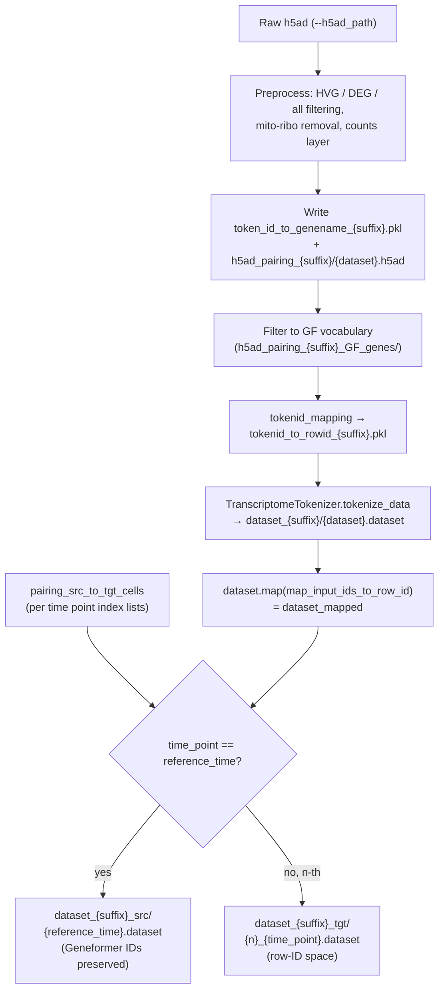
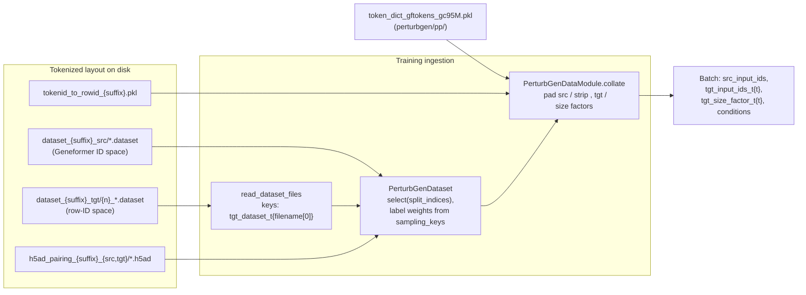

This page documents the **on-disk contract** between PerturbGen's tokenization pipelines and its training stack: the storage format of tokenized corpora, the schema of an individual tokenized cell, the pickle artifact registry shipped with the package, the directory naming conventions produced by `GF_tokenisation.py`, and the loading contracts that `train.py` and `PerturbGenDataModule` depend on. This is a layout-focused deep dive: the tokenization algorithm itself is covered in [Geneformer-Style Gene Tokenization](9-geneformer-style-gene-tokenization), cell pairing logic in [Cell Pairing and Data Curation](14-cell-pairing-and-data-curation), upstream cohort preparation in [Pretraining Cohort Harmonization Pipeline](15-pretraining-cohort-harmonization-pipeline), and path management internals in [Configuration System and Path Management](17-configuration-system-and-path-management).

Sources: [tokenizer.py](perturbgen/pp/tokenizer.py#L400-L435), [GF_tokenisation.py](perturbgen/pp/GF_tokenisation.py#L213-L528), [datamodule.py](perturbgen/Dataloaders/datamodule.py#L331-L399)

## Storage Format: Hugging Face `datasets` Directories

Every tokenized corpus in PerturbGen persists as a **`.dataset` directory** in Hugging Face `datasets` (Arrow) format, written by `Dataset.save_to_disk`. The `TranscriptomeTokenizer.tokenize_data` method terminates by resolving `(output_directory / output_prefix).with_suffix(".dataset")` and calling `save_to_disk` on it, so each output is a self-contained, memory-mappable directory rather than a single file. The pretraining cohort script follows the same convention at scale: it walks every `h5ad` under the harmonized input tree, tokenizes each with `use_generator=True`, and calls `disable_caching()` plus explicit cache cleanup after each file so that no intermediate Arrow cache accumulates on disk.

| Schema column | Type | Presence | Content |
|---|---|---|---|
| `input_ids` | `Sequence(int)` | Always | Rank-coded gene token sequence (see next section) |
| `length` | `int` | Always | Final sequence length after truncation and special-token insertion |
| `input_ids_uncropped` / `length_uncropped` | `Sequence(int)` / `int` | Only if `keep_uncropped_input_ids=True` | Sequence before truncation to `model_input_size` |
| Custom metadata (e.g. `tissue`, `disease`, `Time_point`, `cell_pairing_index`) | Scalar per cell | If `custom_attr_name_dict` supplied | Cell-level attributes carried from `obs` into dataset columns |

Sources: [tokenizer.py](perturbgen/pp/tokenizer.py#L400-L435), [tokenizer.py](perturbgen/pp/tokenizer.py#L632-L685), [tokenization.py](pretraining_cohort/tokenization/tokenization.py#L22-L42)

The schema is constructed in `create_dataset`: a `dict` of `{"input_ids": tokenized_cells}` merged with the metadata columns, converted via `Dataset.from_dict` (or `from_generator` for memory-bounded tokenization), then passed through a `format_cell_features` map that truncates and stamps `length`. Because consumers load these directories with `load_from_disk` and index them per-cell (`dataset[ind]` returning a dict of columns), the Arrow layout gives the datamodule zero-copy random access to individual cells, which is what makes index-based train/val/test splitting cheap.

Sources: [tokenizer.py](perturbgen/pp/tokenizer.py#L632-L685), [datamodule.py](perturbgen/Dataloaders/datamodule.py#L59-L84)

## Anatomy of a Token Record Sequence

Each `input_ids` entry is a **rank-value encoding**: the cell's raw counts are normalized per-cell to a target sum of 10,000 and divided by per-gene median expression values (`X_view / n_counts * target_sum / norm_factor_vector`), masked to detected genes only, and the surviving gene tokens are sorted **descending by median-scaled expression** via `rank_genes` (`np.argsort(-gene_vector)`). Position in the sequence therefore encodes relative expression magnitude, while the token ID itself encodes gene identity — the two axes the transformer consumes separately.

Sources: [tokenizer.py](perturbgen/pp/tokenizer.py#L526-L532), [tokenizer.py](perturbgen/pp/tokenizer.py#L603-L613)

> [!TIP]
> The sort is the semantic payload: `input_ids[0]` (after the CLS token) is the *most-expressed* gene, not a fixed gene. Any downstream code that assumes positional gene identity (e.g. positional embeddings, per-position decoders) must not treat indices as gene slots — the perturbation decoder instead remaps token IDs to a stable row space via `tokenid_to_rowid` (see below).

For the **95M model series**, the layout includes special tokens: `create_dataset` truncates the ranked sequence to `model_input_size - 2`, then inserts `<cls>` at position 0 and `<eos>` at the end, with `special_token=True` validated against the token dictionary at tokenizer construction. For the **30M series**, no special tokens are added and truncation is to the full `model_input_size`. The datamodule independently re-derives these IDs from the shipped token dictionary (`gene_token_dict.get('<pad>')`, `<cls>`, `<eos>`) so that collation never hardcodes numeric IDs.

| Setting | 95M series | 30M series |
|---|---|---|
| `special_token` | `True` (adds `<cls>` … `<eos>`) | `False` |
| `model_input_size` | 4096 | 2048 |
| Truncation before specials | `input_size - 2` | `input_size` |
| Vocabulary | `token_dict_gftokens_gc95M.pkl` | separate 30M dictionary |

Sources: [tokenizer.py](perturbgen/pp/tokenizer.py#L663-L678), [tokenizer.py](perturbgen/pp/tokenizer.py#L360-L376), [tokenizer.py](perturbgen/pp/tokenizer.py#L319-L324), [datamodule.py](perturbgen/Dataloaders/datamodule.py#L200-L203)

## Artifact Registry: Pickles Shipped in `perturbgen/pp/`

Three pickle dictionaries are versioned inside the package and serve as the **default vocabulary assets** for both tokenization tracks. `perturbgen/pp/__init__.py` resolves them to absolute paths at import time, and both the tokenizer defaults and `configs/paths.py` point at these constants — meaning the token-ID space of any `.dataset` directory is pinned to the dictionary that produced it.

| File | Key → Value structure | Role |
|---|---|---|
| `token_dict_gftokens_gc95M.pkl` | Ensembl ID → token ID (incl. `<pad>`, `<cls>`, `<eos>`) | Vocabulary; source of special-token IDs |
| `gene_median_dict_gftokens_gc95M.pkl` | Ensembl ID → median expression | Normalization factors for rank encoding |
| `ensembl_mapping_dict_gc95M.pkl` | Ensembl ID → collapsed Ensembl ID | Gene-ID collapse during `sum_ensembl_ids` |

Sources: [pp/\_\_init\_\_.py](perturbgen/pp/__init__.py#L1-L7), [tokenizer.py](perturbgen/pp/tokenizer.py#L293-L305), [paths.py](perturbgen/configs/paths.py#L8-L11)

## On-Disk Directory Contract for Perturbation Datasets

`GF_tokenisation.py` materializes a fully self-describing directory tree under `{TOKENIZED_DIR}/{dataset}/` (by default `ROOT/T_perturb/tokenized_data/`). All layout names are parameterized by a **gene-filtering suffix** — `{n_hvg}_{gene_filtering_mode}` (e.g. `2000_hvg`) or `all` — so that multiple tokenization variants of the same dataset coexist side by side without collision.

```text
T_perturb/tokenized_data/{dataset}/
├── token_id_to_genename_{suffix}.pkl        # token ID → gene name (decoder label space)
├── tokenid_to_rowid_{suffix}.pkl            # token ID → compact row ID (decoder input space)
├── h5ad_pairing_{suffix}/
│   └── {dataset}.h5ad                       # full adata with cell_pairing_index obs column
├── h5ad_pairing_{suffix}_GF_genes/
│   └── {dataset}.h5ad                       # Geneformer-vocabulary-filtered adata (tokenizer input)
├── h5ad_pairing_{suffix}_src/
│   └── {reference_time}.h5ad                # e.g. "Day 00-03.h5ad"
├── h5ad_pairing_{suffix}_tgt/
│   └── {1..n}_{time_point}.h5ad             # enumerated target time points
├── dataset_{suffix}/
│   └── {dataset}.dataset                    # full tokenized corpus (pre-pairing)
├── dataset_{suffix}_src/
│   └── {reference_time}.dataset             # source-state cells
└── dataset_{suffix}_tgt/
    └── {1..n}_{time_point}.dataset          # target-state cells, paired to src
```

Sources: [GF_tokenisation.py](perturbgen/pp/GF_tokenisation.py#L220-L224), [GF_tokenisation.py](perturbgen/pp/GF_tokenisation.py#L301-L330), [GF_tokenisation.py](perturbgen/pp/GF_tokenisation.py#L408-L429), [GF_tokenisation.py](perturbgen/pp/GF_tokenisation.py#L498-L528)

Two asymmetries in the split layout are load-bearing. First, the **source dataset keeps raw Geneformer token IDs** when `src_mode='Geneformer'` — the comment in the code states Geneformer needs the initial token IDs to extract correct embeddings — whereas **target datasets are always written from the row-ID-mapped dataset** produced by `dataset.map(map_input_ids_to_row_id, ...)`. Second, when `src_mode='Transformer'`, the row-ID-mapped source is instead written into an `h5ad_pairing_{suffix}_src_transformer` directory. Time-point pairing itself (`pairing_src_to_tgt_cells` over `time_obs` with a `reference_time` control state) is detailed in [Cell Pairing and Data Curation](14-cell-pairing-and-data-curation).

Sources: [GF_tokenisation.py](perturbgen/pp/GF_tokenisation.py#L482-L528)

> [!TIP]
> The target enumeration is a parsing contract, not cosmetic decoration: `read_dataset_files` derives the time-step key from `filename[0]` (`f'tgt_dataset_t{filename[0]}'`), so the leading digit in `1_Day 06-09.dataset` becomes the `t` in `tgt_dataset_t1`. Renaming or re-prefixing target files silently corrupts time-step assignment at training time — treat the enumeration digits as immutable.

Sources: [utils.py](perturbgen/src/utils.py#L86-L100)

The full layout-generation flow, from raw `h5ad` to the paired `_src`/`_tgt` split:



Sources: [GF_tokenisation.py](perturbgen/pp/GF_tokenisation.py#L401-L459), [GF_tokenisation.py](perturbgen/pp/GF_tokenisation.py#L482-L528)

## Path Conventions and CLI Wiring

`configs/paths.py` defines the layout's root constants and **creates the directories at import time** (`mkdir(parents=True, exist_ok=True)`), so any module importing `TOKENIZED_DIR` triggers directory materialization. The file also documents the expected workspace shape (`T_perturb/` containing `data/`, `perturbgen/`, `res/`, `tokenized_data/`) and pins the pretrained encoder checkpoint path shipped in `pretraining_cohort/`.

| Constant | Resolved value | Purpose |
|---|---|---|
| `ROOT` | 3 levels above `paths.py` | Workspace root (`os.chdir(ROOT)` in entry points) |
| `DATA_DIR` | `ROOT/data` | Raw/intermediate h5ad inputs |
| `TOKENIZED_DIR` | `ROOT/T_perturb/tokenized_data` | Root of all `.dataset`/`.pkl` layout trees |
| `RESULTS_DIR` | `ROOT/T_perturb/res` | Experiment outputs |
| `GENE_MEDIAN_PATH` / `TOKEN_DICT_PATH` / `GENE_MAPPING_PATH` | `REPO_DIR/perturbgen/pp/*.pkl` | Default vocabulary assets |

Sources: [paths.py](perturbgen/configs/paths.py#L1-L35)

`train.py`'s argument defaults point directly at this layout and double as executable documentation of the naming contract: `--src_dataset ./T_perturb/tokenized_data/eb/dataset_hvg_src/Day 00-03.dataset`, `--tgt_dataset_folder ./T_perturb/tokenized_data/eb/dataset_hvg_tgt`, with the h5ad counterparts under `h5ad_pairing_hvg_{src,tgt}`. The `--tokenid_to_rowid_path` argument additionally implements a **derivation heuristic**: if omitted, it is derived from `--mapping_dict_path` by replacing the substring `token_id_to_genename` with `tokenid_to_rowid` — exactly the naming convention the layout guarantees — and fails loudly if the heuristic cannot apply. Note that the default example paths use the bare suffix `hvg` while the generator emits `{n_hvg}_{mode}`; when wiring runs manually, the suffix you pass must match what `GF_tokenisation.py` actually produced.

Sources: [train.py](perturbgen/train.py#L106-L145), [train.py](perturbgen/train.py#L31-L57), [paths.py](perturbgen/configs/paths.py#L19-L34)

## From Disk to Batch: Consumption Contracts

At training time the layout is consumed in three hops. `read_dataset_files(directory, file_type)` scans a `_tgt` folder and keys each entry as `tgt_dataset_t{filename[0]}` (h5ad files become `tgt_h5ad_t{n}`), yielding the `DatasetDict` shape the datamodule expects. `PerturbGenDataset` then holds a `src_dataset` plus one `tgt_dataset_t{t}` per modeled time point, applies splits by `select(split_indices)` (index-aligned across src, tgt, counts, and conditions), computes inverse-frequency label weights from metadata columns (`sampling_keys`) for the `WeightedRandomSampler`, and asserts src/tgt length alignment.

Sources: [utils.py](perturbgen/src/utils.py#L86-L100), [datamodule.py](perturbgen/Dataloaders/datamodule.py#L31-L84), [datamodule.py](perturbgen/Dataloaders/datamodule.py#L113-L152), [datamodule.py](perturbgen/Dataloaders/datamodule.py#L231-L293)

The final hop is `collate`, which converts the Arrow records into padded tensors while enforcing the special-token protocol in the opposite direction of tokenization: source sequences are padded with `<pad>` to the batch's dynamic maximum via `pad_tensor_list` (bounded by `max_len=2048`), whereas **target sequences have `<cls>` and `<eos>` explicitly filtered out** (by ID, not by position — the code does not assume CLS is first) before length re-computation. Count matrices (dense or CSR) are densified once per sample and reused to derive size factors (`tgt_counts.sum(axis=1)`), producing the complete batch dictionary below.

| Batch key | Producer logic | Content |
|---|---|---|
| `src_input_ids`, `src_length` | `pad_tensor_list` with `<pad>` ID, dynamic batch max | Padded source token sequences |
| `src_counts` | CSR densify + `torch.cat` | Raw source count matrix |
| `batch`, `combined_batch` | condition encodings | Categorical condition tensors |
| `tgt_input_ids_t{t}`, `tgt_length_t{t}` | `<cls>`/`<eos>` stripped by ID | Row-space target sequences |
| `tgt_counts_t{t}`, `tgt_size_factor_t{t}` | one densify, sum along axis | Target counts + library size factors |

Sources: [datamodule.py](perturbgen/Dataloaders/datamodule.py#L331-L399), [gf_utils.py](perturbgen/src/gf_utils.py#L35-L62), [datamodule.py](perturbgen/Dataloaders/datamodule.py#L295-L313)

The complete interaction between layout assets and the training stack:



Sources: [datamodule.py](perturbgen/Dataloaders/datamodule.py#L175-L226), [utils.py](perturbgen/src/utils.py#L86-L100), [datamodule.py](perturbgen/Dataloaders/datamodule.py#L331-L399), [pp/\_\_init\_\_.py](perturbgen/pp/__init__.py#L1-L7)

For the pretraining cohort, the layout is simpler — one flat `{file_prefix}.dataset` per harmonized h5ad written into a single output directory — since masked pretraining consumes cells without src/tgt pairing. The pairing split described above applies specifically to perturbation fine-tuning datasets.

Sources: [tokenization.py](pretraining_cohort/tokenization/tokenization.py#L29-L42)

## Where to Go Next

To understand *why* sequences are rank-encoded and how `<cls>`/`<eos>` interact with the encoder, continue to [Geneformer-Style Gene Tokenization](9-geneformer-style-gene-tokenization) and [Time-Aware Positional Encoding](8-time-aware-positional-encoding). For how cell pairings determine which cells land in `_src` versus `_tgt`, see [Cell Pairing and Data Curation](14-cell-pairing-and-data-curation); for the upstream harmonized h5ad inputs this layout consumes, see [Pretraining Cohort Harmonization Pipeline](15-pretraining-cohort-harmonization-pipeline). The resolution mechanics of `ROOT` and the checkpoint constants are expanded in [Configuration System and Path Management](17-configuration-system-and-path-management), and the end-to-end invocation of this layout in practice is covered in [CLI Command Reference](22-cli-command-reference).