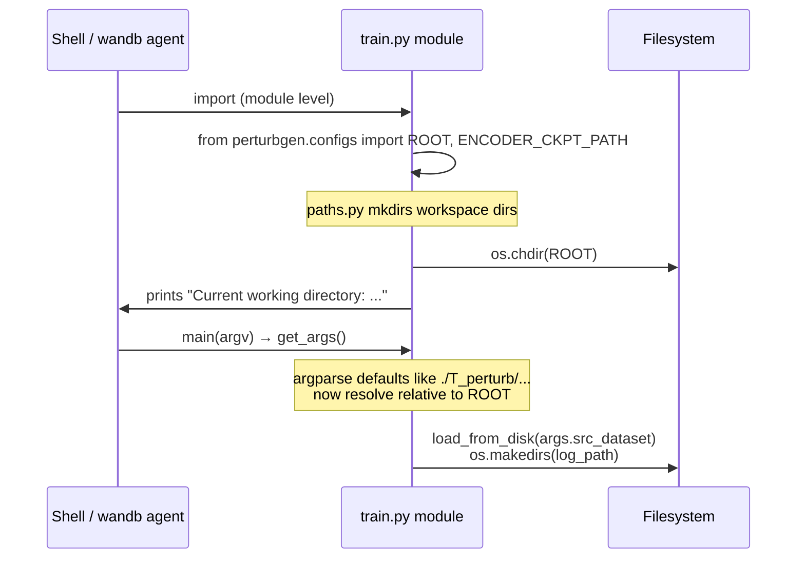

PerturbGen deliberately avoids a monolithic configuration framework such as Hydra. Instead, it distributes configuration across three cooperating layers: a **static path registry** compiled into Python at import time, a **CLI argument layer** with environment-variable fallbacks, and **two YAML config families** consumed by different entry points. Understanding how these layers anchor paths to different roots is essential before launching training, sweeps, or perturbation job arrays, because a file path that resolves correctly in one context may silently point elsewhere in another.

## Architecture Overview: Three Path Anchors

The configuration system resolves paths through three distinct anchoring strategies, each serving a different mobility requirement. The static registry anchors to the module file location (immune to working-directory changes), the runtime layer re-anchors the process working directory to the repository parent, and the shell layer anchors to cluster-specific absolute paths. All three converge on the same workspace convention: a `T_perturb/` directory sitting beside the cloned repository.

```mermaid
flowchart TB
    subgraph static["Layer 1: Static Registry (__file__-anchored)"]
        PP["perturbgen/configs/paths.py<br/>ROOT = parents[3]<br/>REPO_DIR = parents[2]"]
        INIT["configs/__init__.py<br/>re-exports all symbols"]
    end

    subgraph runtime["Layer 2: Runtime Anchoring (cwd-anchored)"]
        TRAIN["train.py<br/>os.chdir(ROOT)"]
        VALP["Perturb/val.py<br/>os.chdir(ROOT)"]
    end

    subgraph yaml["Layer 3: YAML Config Families"]
        SWEEP["configs/sweep/*.yaml<br/>W&B sweep schema"]
        EVAL["configs/eval/&lt;cohort&gt;/*.yaml<br/>data/trainer/datamodule/model"]
        PRE["preprocessing/config_am74.yaml<br/>flat key-value"]
    end

    subgraph shell["Layer 4: Shell Orchestration"]
        LSF["batch_job_script/*.sh<br/>BSUB directives + WANDB_DIR"]
        AGENT["run_sweep.sh<br/>wandb agent"]
        SED["sed s/&#123;&#123;PERTURBED_GENE&#125;&#125;/.../g"]
    end

    PP --> INIT
    INIT --> TRAIN
    INIT --> VALP
    PP -->|"ENCODER_CKPT_PATH default"| TRAIN
    AGENT -->|"reads sweep YAML, launches"| SWEEP
    SWEEP -->|"program: → train.py"| TRAIN
    LSF -->|"--config tmp.yaml"| VALP
    SED -->|"templates"| EVAL
    EVAL -->|"yaml.safe_load"| VALP
    TRAIN -.->|"relative paths resolve<br/>against ROOT after chdir"| WS["ROOT/T_perturb/<br/>tokenized_data/, res/, logs/"]
    VALP -.-> WS
```

The registry is the only layer that survives arbitrary working directories; everything else depends on the `chdir` or on absolute cluster paths written directly into YAML files.

Sources: [paths.py](perturbgen/configs/paths.py#L1-L35), [__init__.py](perturbgen/configs/__init__.py#L1-L13), [train.py](perturbgen/train.py#L15-L28), [val.py](perturbgen/Perturb/val.py#L13-L24), [mask_src_inference_perturbation_jobarray.yaml](perturbgen/configs/eval/HSPC/mask_src_inference_perturbation_jobarray.yaml#L1-L59), [sweep-hspc-masking.yaml](perturbgen/configs/sweep/sweep-hspc-masking.yaml#L1-L62)

## The Static Path Registry: `configs/paths.py`

The registry resolves every path from the module's own file location using `Path(__file__).resolve().parents[N]`, which makes it immune to working-directory changes. Two anchor levels are defined: `ROOT` (three levels up — the directory *containing* the cloned repository) and `REPO_DIR` (two levels up — the repository itself). From these, two groups of paths derive: **shipped defaults** bundled with the repository (the tokenization pickles in `perturbgen/pp/` and the pretrained encoder checkpoint in `pretraining_cohort/`), and **workspace paths** under `ROOT/T_perturb/` where generated data, results, and tokenized datasets live.

| Symbol | Value | Anchored to | Purpose |
|---|---|---|---|
| `ROOT` | `parents[3]` | Directory containing the repo | Workspace root for data/res outputs |
| `REPO_DIR` | `parents[2]` | The repository itself | Locating shipped assets |
| `PP_DIR` | `REPO_DIR/perturbgen/pp` | Repository | Preprocessing asset bundle |
| `GENE_MEDIAN_PATH` | `PP_DIR/gene_median_dict_gftokens_gc95M.pkl` | Repository | Gene median expression values |
| `TOKEN_DICT_PATH` | `PP_DIR/token_dict_gftokens_gc95M.pkl` | Repository | Token vocabulary |
| `GENE_MAPPING_PATH` | `PP_DIR/ensembl_mapping_dict_gc95M.pkl` | Repository | Ensembl ID mapping |
| `ENCODER_CKPT_PATH` | `REPO_DIR/pretraining_cohort/<timestamped>.ckpt` | Repository | Shipped pretrained encoder |
| `PROJECT_DIR` | `ROOT/T_perturb` | Workspace | Project namespace |
| `DATA_DIR` | `ROOT/data` | Workspace | Raw data landing zone |
| `RESULTS_DIR` | `PROJECT_DIR/res` | Workspace | Run outputs |
| `TOKENIZED_DIR` | `PROJECT_DIR/tokenized_data` | Workspace | Tokenized dataset layout |

Sources: [paths.py](perturbgen/configs/paths.py#L3-L16), [paths.py](perturbgen/configs/paths.py#L25-L30)

The registry has **two import-time side effects** that intermediate developers must be aware of. First, the three workspace directories are created unconditionally at import (`mkdir(parents=True, exist_ok=True)`), meaning merely importing `perturbgen.configs` writes to the filesystem beside the repository — this is what guarantees the workspace skeleton exists before any entry point runs. Second, because `ROOT` assumes the `repo-and-workspace-siblings` layout documented in the file's comment block (`T_perturb/` beside `perturbgen/`), cloning the repo into an unexpected nesting depth will resolve `ROOT` to the wrong directory with no error at import time. The registry is re-exported through `configs/__init__.py`, so downstream code imports once with `from perturbgen.configs import ROOT, ENCODER_CKPT_PATH` rather than reaching into `paths` directly.

Sources: [paths.py](perturbgen/configs/paths.py#L17-L35), [__init__.py](perturbgen/configs/__init__.py#L1-L13)

## Working-Directory Anchoring: The `os.chdir(ROOT)` Contract

Both major entry points — `train.py` and `Perturb/val.py` — execute `os.chdir(ROOT)` at **module level** (not inside `main()`), printing the resulting working directory for traceability. This is the load-bearing trick that makes relative paths work: every path written as `./T_perturb/...` or `T_perturb/...` in CLI defaults and YAML configs resolves against `ROOT` regardless of where Python was launched. The practical consequence is that the entire configuration surface is only coherent *because* of this side effect; running either module as a library import in a notebook (the in-process API path) will also relocate the notebook's working directory.

The evaluation entry point applies the identical pattern (`os.chdir(ROOT)` at module scope), so eval YAMLs containing bare `T_perturb/...` relative paths resolve consistently even when the job array script's own `-cwd` points elsewhere. When debugging path failures, always compare the printed working directory against where the config's relative paths actually sit — a mismatch between the two is the root cause of most "file not found" errors in this codebase.

Sources: [train.py](perturbgen/train.py#L15-L28), [val.py](perturbgen/Perturb/val.py#L23-L24), [train.py](perturbgen/train.py#L60-L61)

## CLI Argument Layer: Defaults, Env-Vars, and Path Derivation

`get_args()` in `train.py` defines the full training surface via argparse, and its defaults encode the workspace convention: `--output_dir` points to `./T_perturb/perturbgen/plt/res/cytoimmgen/pbmc_median`, and the four data-path arguments point to EB-dataset defaults under `./T_perturb/tokenized_data/eb/`. These defaults are relative and therefore only meaningful after the `chdir`. The only true environment-variable integration lives in the Weights & Biases arguments: `--wandb_mode`, `--wandb_entity`, and `--wandb_project` each use `os.environ.get('WANDB_MODE', ...)` as their default, so cluster shell scripts control logging behavior without touching the training command line.

| Argument | Default | Resolution anchor |
|---|---|---|
| `--output_dir` | `./T_perturb/perturbgen/plt/res/cytoimmgen/pbmc_median` | cwd (= ROOT post-chdir) |
| `--src_dataset` / `--tgt_dataset_folder` | `./T_perturb/tokenized_data/eb/...` | cwd (= ROOT post-chdir) |
| `--mapping_dict_path` | `None` (required — fails loudly) | caller-provided |
| `--encoder_path` | `str(ENCODER_CKPT_PATH)` | `__file__`-anchored registry |
| `--wandb_mode` | `WANDB_MODE` env var, else `offline` | environment |
| `--wandb_entity` / `--wandb_project` | env vars, else `None` / `perturbgen` | environment |

Sources: [train.py](perturbgen/train.py#L81-L135), [train.py](perturbgen/train.py#L168-L194), [train.py](perturbgen/train.py#L291-L296)

One path is never given directly but *derived*: the token-to-row mapping. `_resolve_tokenid_to_rowid_path()` implements a naming-convention heuristic — if `--tokenid_to_rowid_path` is omitted, the code rewrites `token_id_to_genename` to `tokenid_to_rowid` inside the `--mapping_dict_path` string. Critically, the heuristic **fails loudly** rather than silently: if the mapping path does not contain the expected substring, it raises a `ValueError` with an actionable message, and if neither argument is given it refuses to proceed. This design trades convenience for safety — follow the `tokenid_to_rowid` / `token_id_to_genename` file-pair naming convention from tokenization, or pass both paths explicitly.

Sources: [train.py](perturbgen/train.py#L31-L57)

## YAML Config Family 1: W&B Sweep Configs

The files in `configs/sweep/` follow the **Weights & Biases sweep schema**, not a framework-internal format. Three keys identify them as W&B configs: `method: grid` (search strategy), `metric: {goal, name}` (the monitored objective, here `val/perplexity_epoch`), and `program:` — the absolute path to `train.py` that `wandb agent` will execute. The `parameters:` block mixes two value shapes: `value:` pins a fixed setting (data paths, `train_mode`, epochs), while `values:` lists the grid axes (e.g., `num_layers: [4, 6]` crossed with three `cellgen_lr` × three `cellgen_wd` values → 18 runs per sweep file). Because the sweep parameters are injected as CLI flags into `train.py`, every key here must match an argparse argument name exactly.

| Key | Role | Example |
|---|---|---|
| `method` | W&B search strategy | `grid` |
| `metric.name` | Objective monitored | `val/perplexity_epoch` |
| `parameters.<arg>.value` | Fixed CLI value | `train_mode: masking` |
| `parameters.<arg>.values` | Grid axis | `cellgen_lr: [0.0001, 0.00001, 0.001]` |
| `program` | Entry point executed by the agent | absolute cluster path to `train.py` |
| `project` | W&B project receiving runs | `ttransformer_sweep` |

The sweep configs hardcode both absolute cluster paths (in `program:`) and relative workspace paths (in data parameters), which means a sweep file is tied to both a specific cluster mount and the `chdir`-anchored workspace layout. Eight ready-made sweep files cover the four cohorts (HSPC, LPS, EB, cytoimmgen) × the two training modes (masking, count), plus a generation sweep.

Sources: [sweep-hspc-masking.yaml](perturbgen/configs/sweep/sweep-hspc-masking.yaml#L1-L62), [run_sweep.sh](perturbgen/run_sweep.sh#L20-L25)

## YAML Config Family 2: Nested Eval Configs with Template Placeholders

Evaluation configs use a **four-section nested schema** (`data:`, `trainer:`, `datamodule:`, `model:`) parsed by `Perturb/val.py` via `yaml.safe_load`. Unlike sweeps, these are consumed internally: `val.py` takes a single `--config` argument whose default points at an HSPC perturbation config, then reads dataset paths from `config['data']`, model and perturbation settings from `config['trainer']`, and precision from `config['model']`. The HSPC job-array variant demonstrates the system's one templating mechanism: the `genes_to_perturb` list contains the literal placeholder `{{PERTURBED_GENE}}`, which is substituted per job before parsing.

| Section | Contents | Consumed by |
|---|---|---|
| `data:` | src/tgt dataset + adata paths, optional `perturb_genes_file` | val.py data loading |
| `trainer:` | vocab size, architecture dims, `perturbation_mode`, `genes_to_perturb`, `output_dir`, checkpoint path | PerturberTrainer construction |
| `datamodule:` | batch size, workers, `max_len`, `var_list` | PerturbGenDataModule |
| `model:` | `precision`, `ckpt_masking_path` | Lightning Trainer precision strategy |

Sources: [mask_src_inference_perturbation_jobarray.yaml](perturbgen/configs/eval/HSPC/mask_src_inference_perturbation_jobarray.yaml#L1-L59), [val.py](perturbgen/Perturb/val.py#L31-L52), [val.py](perturbgen/Perturb/val.py#L128-L146)

## Template-Based Config Generation in Job Arrays

The `{{PERTURBED_GENE}}` placeholder is resolved by shell tooling, not Python. The HSPC job-array script reads gene *N* (from `LSB_JOBINDEX`) out of a gene list file, applies `sed "s/{{PERTURBED_GENE}}/${PERTURBED_GENE}/g"` to write a per-job temporary YAML, invokes `val.py --config $TMP_CONFIG_PATH`, and registers a `trap` on exit to delete the temporary file. This produces one config per perturbed gene without storing hundreds of YAML files — the config files in the repository are templates, and the materialized variants are ephemeral artifacts of the batch system.

```mermaid
flowchart LR
    A["LSB job array<br/>index 1..N"] --> B["sed -n INDEXp<br/>test_100M.txt"]
    B --> C{"gene empty?"}
    C -->|yes| X["exit 1 with error"]
    C -->|no| D["sed s/&#123;&#123;PERTURBED_GENE&#125;&#125;/GENE/g<br/>→ TMP_CONFIG yaml"]
    D --> E["val.py --config TMP"]
    E --> F{"output file for<br/>gene already exists?"}
    F -->|yes| G["skip gene<br/>(idempotent resume)"]
    F -->|no| H["run perturbation inference"]
    H --> I["trap EXIT: rm TMP_CONFIG"]
```

Evaluation is additionally **idempotent at the config level**: `val.py` lists the contents of `config['trainer']['output_dir']`, regex-matches filenames against each pending gene (`adata_g<gene>_ssrc`), and removes already-completed genes from the work list before running. Combined with the per-job templating, this makes re-submitting an interrupted job array safe — completed perturbations are skipped automatically.

Sources: [3_perturb_job_array.sh](perturbgen/batch_job_script/hspc/3_perturb_job_array.sh#L24-L44), [val.py](perturbgen/Perturb/val.py#L102-L127)

## Self-Describing Artifact Naming

Configuration state is also encoded *into* artifact names, so results remain interpretable without side-channel metadata. `train.py` composes a timestamped `run_id` (`%Y%m%d_%H%M_cellgen`) plus a hyperparameter signature into every checkpoint filename — masking runs embed `lr`, `wd`, `batch_size`, positional-encoding mode, mask scheduler, predicted timepoints, and seed (e.g., the shipped `20250709_1223_cellgen_train_masking_lr_5e-05_wd_1e-06_batch_64_ptime_pos_sin_m_pow_tp_1-2-3_s_42-epoch=00.ckpt`). The `ENCODER_CKPT_PATH` registry entry demonstrates why: the checkpoint's full provenance is recoverable from its name alone. Checkpoints land in `os.path.join(args.output_dir, 'checkpoints')`, while logs go to `<log_dir>/<run_id>` under the current working directory, and resume behavior dispatches on extension — a `.bin` file is loaded as a raw state dict with `strict=False`, anything else is treated as a Lightning `.ckpt` and passed to `trainer.fit(ckpt_path=...)`.

Sources: [train.py](perturbgen/train.py#L574-L602), [train.py](perturbgen/train.py#L610-L638), [train.py](perturbgen/train.py#L692-L713), [paths.py](perturbgen/configs/paths.py#L12-L16)

## The Preprocessing Pipeline Config

The pretraining harmonization pipeline uses a deliberately simpler, **flat YAML schema** with absolute cluster paths: `input_dir` and `output_base_dir` define the bronze→silver transformation endpoints, three pickle dictionaries (`dev_stage_map`, `tissue_map`, `disease_map`) provide ontology mappings, and a `gene_filtering:` block points to the non-coding-gene exclusion list and the Ensembl mapping dictionary. There is no `{{...}}` templating, no nesting, and no `chdir` involvement — every path must be absolute, making this config self-contained and portable across job submission directories. The contrast with the eval configs is a useful illustration of the codebase's philosophy: flat schema where the pipeline is a single script, nested schema where many subsystems must be parameterized at once.

Sources: [config_am74.yaml](pretraining_cohort/preprocessing/config_am74.yaml#L1-L11)

## Configuration Format Taxonomy: Comparison

| Property | Path registry (`paths.py`) | CLI defaults (`train.py`) | Sweep YAMLs | Eval YAMLs | Preprocessing YAML |
|---|---|---|---|---|---|
| Format | Python module | argparse | W&B sweep schema | Nested YAML (4 sections) | Flat YAML |
| Path anchoring | `__file__` (cwd-independent) | cwd after `chdir(ROOT)` | absolute `program:` + relative params | relative to cwd (= ROOT) | absolute cluster paths |
| Consumer | `from perturbgen.configs import ...` | `main(argv)` | `wandb agent` → launches `train.py` | `Perturb/val.py --config` | `harmonize_bronze_to_silver.py` |
| Templating | none | env-var defaults | none | `{{PERTURBED_GENE}}` via `sed` | none |
| Side effects | mkdir workspace dirs | chdir process cwd | none (W&B runtime) | none | none |
| Portability | portable (repo-relative) | portable (workspace-relative) | cluster-bound | workspace-bound | cluster-bound |

Sources: [paths.py](perturbgen/configs/paths.py#L1-L35), [train.py](perturbgen/train.py#L60-L135), [sweep-hspc-masking.yaml](perturbgen/configs/sweep/sweep-hspc-masking.yaml#L1-L62), [mask_src_inference_perturbation_jobarray.yaml](perturbgen/configs/eval/HSPC/mask_src_inference_perturbation_jobarray.yaml#L1-L59), [config_am74.yaml](pretraining_cohort/preprocessing/config_am74.yaml#L1-L11)

## Practical Failure Modes and Their Root Causes

Three misconfigurations account for most path failures in practice. First, **wrong `ROOT` resolution**: if the repository is nested deeper or shallower than the expected `T_perturb/` sibling layout, `parents[3]` silently points at the wrong tree — the symptom is `chdir` succeeding but all relative paths missing; the fix is to restore the documented sibling layout or edit `paths.py` anchors. Second, **env-var leakage**: `WANDB_MODE` unset defaults runs to `offline`, which is safe for laptops but means sweeps appear to run without logging to the W&B project; cluster scripts like `run_sweep.sh` also redirect artifacts with `export WANDB_DIR=$cwd/wandb`, so wandb files land beside the script's working directory, not inside the repo. Third, **breaking the naming heuristic**: renaming `token_id_to_genename_*.pkl` without its `tokenid_to_rowid_*` twin trips the derivation check — either restore the convention or pass `--tokenid_to_rowid_path` explicitly.

> [!TIP]
> Because `train.py` and `Perturb/val.py` both `chdir` at import time, importing either module inside a long-running notebook session permanently changes the session's working directory. The in-process API accounts for this — but if you import these modules manually, capture any relative paths you care about *before* the import.

> [!TIP]
> The eval YAMLs' `encoder_path` shows the system's escape hatch for infrastructure drift: sweep files and eval configs may carry **different absolute cluster checkpoints**. When reusing a config on a new cluster, audit every absolute path (`program:`, `encoder_path:`, preprocessing YAML entries) — the repository-shipped `ENCODER_CKPT_PATH` is the only path guaranteed to exist after a fresh clone.

Sources: [paths.py](perturbgen/configs/paths.py#L3-L6), [train.py](perturbgen/train.py#L27-L28), [train.py](perturbgen/train.py#L168-L194), [run_sweep.sh](perturbgen/run_sweep.sh#L18-L24), [train.py](perturbgen/train.py#L31-L57), [mask_src_inference_perturbation_jobarray.yaml](perturbgen/configs/eval/HSPC/mask_src_inference_perturbation_jobarray.yaml#L20-L20)

## Where to Go Next

To see these configs in motion during actual hyperparameter searches, continue with [Hyperparameter Sweeps and Batch Jobs](18-hyperparameter-sweeps-and-batch-jobs), which covers the `wandb agent` workflow and LSF job-array mechanics in depth. For how the paths registered here feed multi-GPU execution, see [Distributed Training with DDP and DeepSpeed](19-distributed-training-with-ddp-and-deepspeed), and for how the W&B arguments configured by environment variables surface in experiment tracking, see [Experiment Tracking with Weights and Biases](20-experiment-tracking-with-weights-and-biases). The workspace directories this system creates (`tokenized_data/`, `res/`) are documented structurally in [Tokenized Dataset Layout](16-tokenized-dataset-layout).