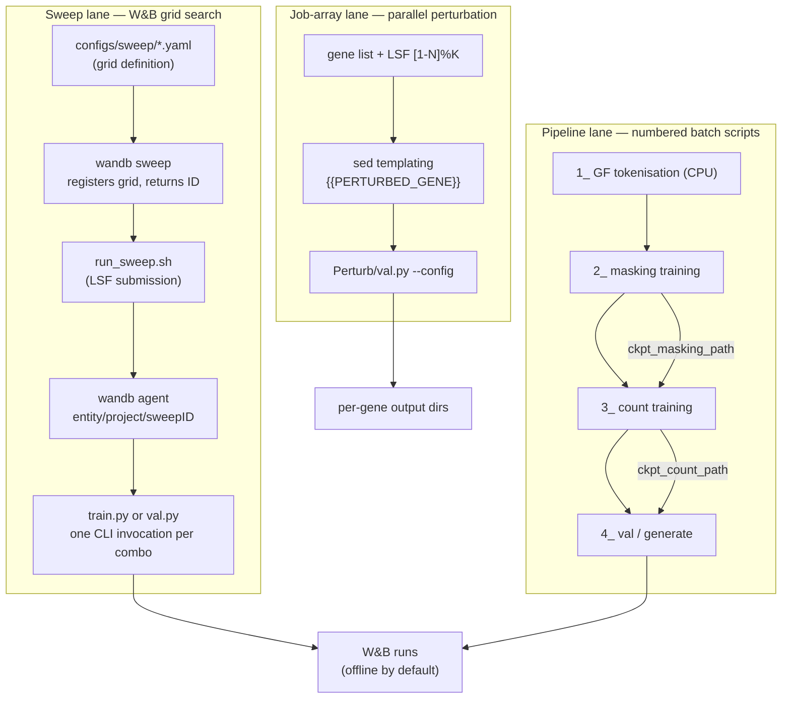
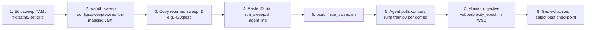

This page documents the execution-operations layer of PerturbGen: how model training, generation, and in-silico perturbation workloads are scaled across the LSF HPC cluster. The repository provides three complementary orchestration mechanisms — **Weights & Biases sweep agents** for hyperparameter grid search, **numbered sequential batch scripts** for end-to-end dataset pipelines, and **LSF job arrays** for massively parallel per-gene perturbation. All three converge on the same two entry points (`train.py` and `Perturb/val.py`), which is the central design invariant of this layer.

Sources: [run_sweep.sh](perturbgen/run_sweep.sh#L22-L26), [train.py](perturbgen/train.py#L60-L68), [Perturb/val.py](perturbgen/Perturb/val.py#L31-L38)

## Orchestration Architecture

The sweep and batch infrastructure forms three independent execution lanes that share the same parameter vocabulary and the same W&B logging substrate. Before reading the diagram: solid boxes are files or commands in the repository, dashed arrows are checkpoint hand-offs between pipeline stages, and the three labeled groups correspond to the three mechanisms detailed in later sections.



The sweep lane is for exploration — it varies learning rates, weight decays, and architecture widths to minimize a validation metric. The pipeline lane is for production — it runs the four canonical stages per dataset with curated, fixed hyperparameters, chaining checkpoints between stages. The job-array lane is for evaluation scale-out — it fans one hand-written perturbation config across thousands of genes. Because all lanes invoke the same Python entry points, a hyperparameter combination discovered in a sweep can be promoted verbatim into a batch script.

Sources: [run_sweep.sh](perturbgen/run_sweep.sh#L1-L26), [2_run_train_masking_GF_frozen_interpolation.sh](perturbgen/batch_job_script/eb/interpolation/2_run_train_masking_GF_frozen_interpolation.sh#L41-L67), [3_perturb_job_array.sh](perturbgen/batch_job_script/hspc/3_perturb_job_array.sh#L24-L41)

| Mechanism | Launcher | Entry point | Config artifact | Parameter passing | Primary use case |
|---|---|---|---|---|---|
| W&B sweep | `run_sweep.sh` (LSF) | `program:` field → `train.py` / `val.py` | `perturbgen/configs/sweep/*.yaml` | Agent-generated CLI flags from grid combos | Grid search over LR/WD/architecture |
| Sequential pipeline | Numbered scripts in `batch_job_script/<dataset>/` | `train.py` / `val.py` | Inline CLI flags | Explicit flags per stage | Curated training runs per dataset |
| Job array | `3_perturb_job_array*.sh` (LSF) | `Perturb/val.py --config` | Templated eval YAML | `sed` substitution of `{{PERTURBED_GENE}}` | Per-gene in-silico perturbation at scale |

Sources: [run_sweep.sh](perturbgen/run_sweep.sh#L20-L26), [3_run_train_count_interpolation.sh](perturbgen/batch_job_script/eb/interpolation/3_run_train_count_interpolation.sh#L37-L42), [3_perturb_job_array.sh](perturbgen/batch_job_script/hspc/3_perturb_job_array.sh#L29-L44), [sweep-lps-masking.yaml](perturbgen/configs/sweep/sweep-lps-masking.yaml#L73-L74)

## W&B Sweep Configuration Anatomy

Each file in `perturbgen/configs/sweep/` follows the native W&B sweep schema, extended with a `program` key that tells the agent which Python script to drive. The schema has a strict two-tier structure: global search properties (`method`, `metric`, `name`), and a `parameters` block whose keys must exactly match the argparse flag names of the target program, minus the leading `--`.

Sources: [sweep-lps-masking.yaml](perturbgen/configs/sweep/sweep-lps-masking.yaml#L1-L74), [train.py](perturbgen/train.py#L60-L341)

| Field | Role | Example from `sweep-lps-masking.yaml` |
|---|---|---|
| `method` | Search strategy | `grid` (line 2) |
| `metric.name` / `metric.goal` | Sweep objective | `val/perplexity_epoch`, `minimize` (lines 3–5) |
| `name` | Sweep display name in W&B UI | `tune_masking_lps` (line 6) |
| `parameters.<key>.value` | **Fixed** parameter — passed identically to every run | `train_mode: 'masking'` (lines 8–9) |
| `parameters.<key>.values` | **Swept** parameter — grid axis; combos form the cartesian product | `d_ff: [32, 64]` (lines 42–43) |
| `program` | Python entry point the agent invokes | `.../perturbgen/train.py` (line 73) |
| `project` | Target W&B project | `ttransformer_sweep` (line 74) |

A critical semantic distinction governs the `parameters` block: `value` pins a parameter, while `values` expands it into a grid axis. Every key declared in the block is transmitted to the program as a CLI flag on every run — fixed values included — so the sweep config is a complete, self-contained argv specification, not a partial override.

> [!TIP]
> The sweep YAML ↔ argparse mapping is a hard contract: a parameter key that does not match a flag in `train.py`'s `get_args()` will make the agent's invocation fail. Note the cautionary example in `sweep-hspc-masking.yaml`, where `num_layers` uses `value: [4, 6]` instead of `values` — under W&B semantics this fixes the parameter to a single list literal rather than expanding it into two grid points.

Sources: [sweep-hspc-masking.yaml](perturbgen/configs/sweep/sweep-hspc-masking.yaml#L38-L47), [sweep-lps-masking.yaml](perturbgen/configs/sweep/sweep-lps-masking.yaml#L7-L65)

## Sweep Inventory

Eight sweep configs cover the dataset × training-stage matrix. File names encode the dataset and the stage (`masking` = encoder pretraining on masked sequences, `count` = count-decoder fine-tuning, `generate` = sampling-parameter tuning). The `program` field confirms that stage sweeps target `train.py` while generation sweeps target `val.py`.

Sources: [sweep-lps-masking.yaml](perturbgen/configs/sweep/sweep-lps-masking.yaml#L73), [sweep-cyto-count.yaml](perturbgen/configs/sweep/sweep-cyto-count.yaml#L53), [sweep-generate.yaml](perturbgen/configs/sweep/sweep-generate.yaml#L55)

| Config file | Dataset | Stage (from name) | Verified objective | Verified swept axes |
|---|---|---|---|---|
| `sweep-lps-masking.yaml` | LPS | masking | `val/perplexity_epoch` ↓ | `d_ff` [2] × `cellgen_lr` [4] × `cellgen_wd` [3] → **24 runs** |
| `sweep-cyto-count.yaml` | cytoimmgen | count | `val/mse_epoch` ↓ | `count_dropout` [2] × `count_lr` [3] × `batch_size` [2] → **12 runs** |
| `sweep-hspc-masking.yaml` | HSPC | masking | `val/perplexity_epoch` ↓ | `cellgen_lr` [3] × `cellgen_wd` [3] → **9 runs** |
| `sweep-generate.yaml` | cytoimmgen | generation (`val.py`) | `test/emd` ↓ | `mask_scheduler` [3] × `temperature` [4] → **12 runs** |
| `sweep-lps-count.yaml` | LPS | count | — | — |
| `sweep-cyto-masking.yaml` | cytoimmgen | masking | — | — |
| `sweep-eb-count.yaml` | EB | count | — | — |
| `sweep-eb-masking.yaml` | EB | masking | — | — |

Two structural observations from the verified configs: first, the generation sweep is the only one targeting `val.py`, and it tunes **sampling** hyperparameters (`mask_scheduler`, `temperature`) against a distributional metric (`test/emd`) rather than training hyperparameters. Second, sweep configs embed fixed absolute paths to frozen encoder checkpoints (e.g., the `scmaskgit` foundation checkpoint in `encoder_path`), so sweeps fine-tune downstream modules on top of a fixed pretrained encoder.

Sources: [sweep-generate.yaml](perturbgen/configs/sweep/sweep-generate.yaml#L7-L54), [sweep-lps-masking.yaml](perturbgen/configs/sweep/sweep-lps-masking.yaml#L43-L57), [sweep-cyto-count.yaml](perturbgen/configs/sweep/sweep-cyto-count.yaml#L44-L52), [sweep-lps-masking.yaml](perturbgen/configs/sweep/sweep-lps-masking.yaml#L48-L49)

## Launching a Sweep on the LSF Cluster

Launching a sweep is a two-artifact workflow: the YAML defines *what* to search, and `run_sweep.sh` defines *where* the agent executes. The script is an LSF job wrapper whose payload is a single `wandb agent` command bound to an entity/project/sweep-ID triple.



The `run_sweep.sh` resource profile is deliberately heavyweight — 4 exclusive GPUs (`#BSUB -gpu 'mode=exclusive_process:num=4'`), 8 CPU cores, 50 GB RAM on the `gpu-lotfollahi` queue — because the sweep agent serializes full training runs on that allocation. The script performs three setup actions before the payload: loading CUDA 12.1.1 via `module load`, activating the shared conda environment, and exporting `WANDB_DIR=$cwd/wandb` so run artifacts land inside the working directory rather than a home-directory default.

Sources: [run_sweep.sh](perturbgen/run_sweep.sh#L1-L26)

The agent line itself — `wandb agent lotfollahi/ttransformer_sweep/42vqfszc` — requires a manual paste of the sweep ID returned by the `wandb sweep` registration command (the inline comment `#paste wandb with sweep id` marks this as an intentional manual step). The sweep ID shown corresponds to the LPS masking sweep per the output-file naming (`%J_lps_sweep.out`); when sweeping a different config, both the agent line and the ID must be replaced.

Sources: [run_sweep.sh](perturbgen/run_sweep.sh#L7-L8), [run_sweep.sh](perturbgen/run_sweep.sh#L22-L25)

### How the agent reaches the training code

For every grid combination, the agent constructs one CLI invocation of `program` with `--key value` pairs derived from the `parameters` block. This means boolean-typed flags arrive as strings, which `train.py` handles through its `str2bool` converter (used for `--split`, `--context_mode`, `--use_weighted_sampler`). Logging behavior during sweeps is governed by the same flags as interactive use: `--wandb_mode` defaults to the `WANDB_MODE` environment variable, falling back to `offline` — a deliberate safety choice, as the help text notes offline runs "never hang on authentication" on headless compute nodes and can be uploaded later with `wandb sync`.

Sources: [train.py](perturbgen/train.py#L153-L179), [train.py](perturbgen/train.py#L621-L638)

## The Sequential Batch Job Pipeline

The `batch_job_script/` directory implements the four-stage lifecycle per dataset using a numeric-prefix convention that makes the execution order legible from filenames. Stage 1 is CPU-bound data engineering; stages 2–4 are GPU-bound and chain checkpoints forward.

Sources: [1_run_GF_tokenisation.sh](perturbgen/batch_job_script/cytoimmgen/1_run_GF_tokenisation.sh#L1-L42), [4_run_val_generate_interpolation.sh](perturbgen/batch_job_script/eb/interpolation/4_run_val_generate_interpolation.sh#L40-L74)

| Stage prefix | Operation | Entry point | Compute profile | Hands off via |
|---|---|---|---|---|
| `1_` | Geneformer-style tokenisation + cell pairing | `pp/GF_tokenisation.py` | CPU queue, 150 GB RAM | Tokenized `.dataset`/`.h5ad` folders |
| `2_` | Masking encoder training | `train.py --train_mode masking` | GPU queue, 2 exclusive GPUs | `--ckpt_masking_path` → stage 3 |
| `3_` | Count decoder training | `train.py --train_mode count` | GPU queue, 2 exclusive GPUs | `--ckpt_count_path` → stage 4 |
| `4_` | Generative validation | `val.py --generate True` | GPU queue, 1 GPU | Downstream analysis |

Sources: [1_run_GF_tokenisation.sh](perturbgen/batch_job_script/cytoimmgen/1_run_GF_tokenisation.sh#L3-L11), [2_run_train_masking_GF_frozen_interpolation.sh](perturbgen/batch_job_script/eb/interpolation/2_run_train_masking_GF_frozen_interpolation.sh#L3-L4), [3_run_train_count_interpolation.sh](perturbgen/batch_job_script/eb/interpolation/3_run_train_count_interpolation.sh#L2-L3), [4_run_val_generate_interpolation.sh](perturbgen/batch_job_script/eb/interpolation/4_run_val_generate_interpolation.sh#L2-L3)

Dataset directories specialize this template:

| Directory | Layout |
|---|---|
| `cytoimmgen/`, `eb/` | `1_` tokenisation + `interpolation/` and `extrapolation/` subdirectories, each holding stages `2_/3_/4_` |
| `lps/` | `1_`, a single `2_` masking script (90 min timepoint), `interpolation/` + `extrapolation/` stage sets, and a standalone `4_perturb.sh` |
| `hspc/` | `1_`, `2.1_/2.2_` masking/count variants (all-TF vs inter-TF timepoints), `2.3_` gene-embedding extraction, `3_perturb*` (single + three job-array variants), `4_` plotting, DEG computation |
| `sko/` | `1_` tokenisation in full and 5k-gene variants, `2_/2.1_` masking + cosine-similarity validation, `3_` count training |

Sources: [repo structure under batch_job_script/](perturbgen/batch_job_script), [2_run_train_masking_Encoder_90min.sh](perturbgen/batch_job_script/lps/2_run_train_masking_Encoder_90min.sh), [3_perturb_job_array_gpuparallel.sh](perturbgen/batch_job_script/hspc/3_perturb_job_array_gpuparallel.sh#L24)

The interpolation/extrapolation split mirrors the temporal generalization regimes: interpolation scripts pair, for example, EB `Day 00-03` source data with predicted timepoints `--pred_tps 1 2 4` (`--split False`), whereas validation scripts then generate with `--context_tps 1 2 4 --pred_tps 3` for held-out timepoints. For a deeper treatment of these modes see [In Silico Perturbation Modes](10-in-silico-perturbation-modes).

Sources: [2_run_train_masking_GF_frozen_interpolation.sh](perturbgen/batch_job_script/eb/interpolation/2_run_train_masking_GF_frozen_interpolation.sh#L46-L58), [4_run_val_generate_interpolation.sh](perturbgen/batch_job_script/eb/interpolation/4_run_val_generate_interpolation.sh#L61-L62)

### Checkpoint chaining in practice

The EB interpolation sequence demonstrates the hand-off contract concretely. Stage 2 writes checkpoints into `$RES_DIR/$RES_NAME/checkpoints/`; stage 3 then references the selected masking checkpoint explicitly via `--ckpt_masking_path 'T_perturb/res/eb/interpolation/checkpoints/20250828_2043_cellgen_train_masking_..._tp_1-2-4_s_100-epoch=49.ckpt'`; stage 4 references the count checkpoint via `--ckpt_count_path`. Because `train.py`'s `main()` returns the metric-best checkpoint path (`best_model_path`, monitored as `val/perplexity` for masking or `val/mse` for count), callers can select the correct masking checkpoint for the count stage programmatically instead of guessing by epoch.

Sources: [3_run_train_count_interpolation.sh](perturbgen/batch_job_script/eb/interpolation/3_run_train_count_interpolation.sh#L37-L42), [4_run_val_generate_interpolation.sh](perturbgen/batch_job_script/eb/interpolation/4_run_val_generate_interpolation.sh#L46), [train.py](perturbgen/train.py#L590-L619), [train.py](perturbgen/train.py#L721-L727)

## Sweep Configs vs Batch Scripts: Same Contract, Two Representations

Because sweeps and batch scripts target the same argparse surface, the identical hyperparameter vocabulary appears in both representations. The comparison below maps fixed values from the LPS masking sweep against the EB interpolation masking script — note how the sweep declares a *distribution* over parameters the batch script pins to single values:

| Parameter | `sweep-lps-masking.yaml` (sweep representation) | EB masking batch script (pinned representation) |
|---|---|---|
| Training mode | `train_mode: value: 'masking'` | `--train_mode masking` |
| Epochs | `epochs: value: 10` | `--epochs 50` |
| Batch size | `batch_size: value: 64` | `--batch_size 64` |
| Learning rate | `cellgen_lr: values: [0.00001, 0.00005, 0.0001, 0.0005]` | `--cellgen_lr 0.001` |
| Weight decay | `cellgen_wd: values: [0.00005, 0.0001, 0.0005]` | `--cellgen_wd 0.0001` |
| Feed-forward dim | `d_ff: values: [32, 64]` | `--d_ff 32` |
| Positional encoding | `pos_encoding_mode: value: 'time_pos_sin'` | `--pos_encoding_mode time_pos_sin` |
| Mask scheduler | `mask_scheduler: value: 'pow'` | `--mask_scheduler 'pow'` |
| Frozen encoder | `encoder_path: value: <foundation ckpt>` | `--encoder_path "<foundation ckpt>"` |

Sources: [sweep-lps-masking.yaml](perturbgen/configs/sweep/sweep-lps-masking.yaml#L8-L61), [2_run_train_masking_GF_frozen_interpolation.sh](perturbgen/batch_job_script/eb/interpolation/2_run_train_masking_GF_frozen_interpolation.sh#L42-L67)

This equivalence is the promotion path for sweep results: take the winning combination from the W&B UI, substitute its values into the corresponding `--flags` of a batch script, and resubmit with more epochs for the production run (note the epochs bump from 10 in the sweep to 50 in the pipeline script).

## Job Arrays for Per-Gene Perturbation Sweeps

The HSPC perturbation scripts scale one hand-written evaluation config into hundreds or thousands of isolated runs using LSF job arrays. The mechanism: LSF expands an array notation into indexed jobs, each job reads its gene assignment from a shared gene list file by line number, and `sed` templates that gene into a temporary copy of the YAML config.

```mermaid
flowchart TD
    J1["bsub &lt; 3_perturb_job_array.sh"] --> J2["LSF expands [1-6]%4:<br/>6 jobs, max 4 concurrent"]
    J2 --> J3["Per job: sed -n LSB_JOBINDEX p<br/>reads gene N from test_100M.txt"]
    J3 --> J4{"Gene string non-empty?"}
    J4 -- "no" --> J5["Error to stderr, exit 1"]
    J4 -- "yes" --> J6["sed 's/&#123;&#123;PERTURBED_GENE&#125;&#125;/gene/g'<br/>→ temp YAML named gene + LSB_JOBID"]
    J6 --> J7["Perturb/val.py --config temp.yaml"]
    J7 --> J8["trap on EXIT: rm temp.yaml"]
```



Three implementation details make this pattern robust under concurrency. The job-name directive `#BSUB -J hspc_perturb_cluster_[1-6]%4` declares both the array range and the throttling (`%4` = at most four concurrent jobs), with `%I` in the log filenames distinguishing per-index stdout/stderr. The temporary config path embeds `$LSB_JOBID` — the unique LSF job identifier — so simultaneous jobs writing configs for the same gene can never collide. Finally, `trap "rm -f $TMP_CONFIG_PATH" EXIT` guarantees temp-file cleanup even when `val.py` fails, keeping the config directory free of thousands of stale per-gene YAMLs.

Sources: [3_perturb_job_array.sh](perturbgen/batch_job_script/hspc/3_perturb_job_array.sh#L4-L9), [3_perturb_job_array.sh](perturbgen/batch_job_script/hspc/3_perturb_job_array.sh#L24-L44)

The templated config itself is a structured YAML with `data` / `trainer` / `datamodule` / `model` sections; the placeholder sits under `trainer.genes_to_perturb` with `perturbation_mode: 'mask'` and `validation_mode: 'inference'`:

```yaml
perturbation_mode: 'mask'
genes_to_perturb:
  - {{PERTURBED_GENE}}
validation_mode: 'inference'
```

Sources: [mask_src_inference_perturbation_jobarray.yaml](perturbgen/configs/eval/HSPC/mask_src_inference_perturbation_jobarray.yaml#L23-L26)

The scale ceiling is demonstrated by the GPU-parallel variant: `3_perturb_job_array_gpuparallel.sh` requests the `gpu-parallel` queue and declares `#BSUB -J hspc_perturb_cluster_[1-4700]%16` — 4,700 single-GPU jobs throttled to 16 concurrent, drawing genes from `default_rest_genes.txt` instead of the TF-focused list. The array-range constant and the gene-list file must be kept in sync; the empty-gene guard in each script fails fast with a non-zero exit when the job index overshoots the list.

> [!TIP]
> The gene-list + `sed`-template + `$LSB_JOBID`-suffixed temp-file + `trap`-cleanup quartet is a reusable pattern for any embarrassingly parallel config sweep — it converts one YAML into N isolated runs without touching Python code, and is the cluster-native alternative to W&B sweeps when the varied parameter is a data artifact (a gene) rather than a training hyperparameter.

Sources: [3_perturb_job_array_gpuparallel.sh](perturbgen/batch_job_script/hspc/3_perturb_job_array_gpuparallel.sh#L2-L4), [3_perturb_job_array_gpuparallel.sh](perturbgen/batch_job_script/hspc/3_perturb_job_array_gpuparallel.sh#L24-L44), [3_perturb_job_array.sh](perturbgen/batch_job_script/hspc/3_perturb_job_array.sh#L34-L37)

## LSF Directive Reference

All submission scripts share the same BSUB vocabulary. `%J` expands to the LSF job ID and `%I` to the array job index in log paths.

| Directive | Meaning | Representative values |
|---|---|---|
| `-q` | Queue / partition | `gpu-lotfollahi`, `gpu-normal`, `gpu-parallel`, `normal` (CPU), `cpu-interactive` |
| `-gpu` | GPU allocation mode | `'mode=exclusive_process:num=4'` (sweeps), `num=2` (training), `num=1` (generation/array jobs) |
| `-n` | CPU cores | 4–8 |
| `-G` | Billing group | `team361`, `cellulargenetics-priority` |
| `-cwd` | Working directory at job start | `/lustre/scratch126/cellgen/lotfollahi/kl11/T_perturb/perturbgen` |
| `-o` / `-e` | stdout / stderr capture | `logs/sweep/%J_lps_sweep.out`, `..._%J_%I.err` (arrays) |
| `-M` + `-R` | Memory limit (MB) + resource selection | 20000 (training), 50000 (sweeps/perturb), 150000 (tokenisation) |
| `-J` | Job name; array spec with throttle | `lps_sweep`, `hspc_perturb_cluster_[1-4700]%16` |

Sources: [run_sweep.sh](perturbgen/run_sweep.sh#L1-L11), [1_run_GF_tokenisation.sh](perturbgen/batch_job_script/cytoimmgen/1_run_GF_tokenisation.sh#L3-L11), [3_perturb_job_array_gpuparallel.sh](perturbgen/batch_job_script/hspc/3_perturb_job_array_gpuparallel.sh#L1-L11), [run_test.sh](perturbgen/run_test.sh#L2-L10)

A companion script, `run_test.sh`, applies the same LSF conventions to the CPU-interactive queue to run the `unittest` test suite on the cluster (`python -m unittest discover .../perturbgen/tests/`), confirming the batch-script pattern covers non-training workloads too. For the test suite itself see [Test and Benchmark Suite](26-test-and-benchmark-suite).

Sources: [run_test.sh](perturbgen/run_test.sh#L20-L24)

## Parameter Flow into the Training Entry Point

`train.py` exposes roughly sixty argparse flags through `get_args()`, grouped as follows. The batch scripts and sweep agents are both clients of this single surface — there is no separate sweep-specific API.

| Group | Representative flags | Notes |
|---|---|---|
| Pipeline control | `--train_mode`, `--split`, `--splitting_mode`, `--output_dir` | `masking` vs `count`; splits: `random`/`stratified`/`unseen_cond` |
| Data locations | `--src_dataset`, `--tgt_dataset_folder`, `--src_adata`, `--tgt_adata_folder`, `--mapping_dict_path`, `--tokenid_to_rowid_path` | Point at the tokenized layout produced by stage 1 |
| Optimisation (swept axes) | `--cellgen_lr`, `--cellgen_wd`, `--count_lr`, `--count_wd`, `--count_dropout`, `--batch_size`, `--epochs` | The variables sweeps vary |
| Architecture | `--d_model`, `--num_layers`, `--d_ff`, `--pos_encoding_mode`, `--mask_scheduler`, `--encoder`, `--encoder_path` | Encoder checkpoint defaults to the repo-shipped pretrained model |
| Logging | `--wandb_mode`, `--wandb_entity`, `--wandb_project`, `--log_dir` | Each falls back to `WANDB_*` env vars |
| Distributed | `--parallel_distribution`, `--num_node`, `--single_device` | `ddp` (default) or `deepspeed` |
| Generation-time | `--temperature`, `--iterations`, `--n_samples`, `--context_tps` | Consumed by `val.py` in stage 4 |

Sources: [train.py](perturbgen/train.py#L60-L341)

Run identification is fully deterministic from hyperparameters: each run builds a `run_id` from a timestamp, and the checkpoint filename template embeds the training mode, learning rate, weight decay, batch size, positional-encoding mode, mask scheduler, predicted timepoints, and seed — for example `20250828_2043_cellgen_train_masking_lr_0.001_wd_0.0001_batch_64_ptime_pos_sin_m_pow_tp_1-2-4_s_100-epoch=49.ckpt`. On multi-GPU runs (`torch.cuda.device_count() > 1`) a 6-character UUID suffix disambiguates W&B run names across DDP ranks. When `--wandb_mode disabled` is set, the code skips `wandb.init()` entirely by passing `logger=False` to the Lightning Trainer.

Sources: [train.py](perturbgen/train.py#L574-L576), [train.py](perturbgen/train.py#L583-L619), [train.py](perturbgen/train.py#L622-L638), [3_run_train_count_interpolation.sh](perturbgen/batch_job_script/eb/interpolation/3_run_train_count_interpolation.sh#L42)

Multi-GPU behavior is automatic: with more than one visible GPU the Trainer selects `devices=-1` and the strategy chosen by `--parallel_distribution` (`DDPStrategy` or `DeepSpeedStrategy` at stage 2); with one GPU or `--single_device True`, it falls back to a notebook-safe single-device strategy. The in-process API sets `--single_device` because multi-process strategies cannot launch inside an interactive Jupyter kernel — the batch scripts are the supported route to multi-GPU. Distribution internals are covered in [Distributed Training with DDP and DeepSpeed](19-distributed-training-with-ddp-and-deepspeed); W&B tracking specifics in [Experiment Tracking with Weights and Biases](20-experiment-tracking-with-weights-and-biases).

Sources: [train.py](perturbgen/train.py#L656-L688), [train.py](perturbgen/train.py#L148-L152)

## Troubleshooting

| Symptom | Root cause | Fix |
|---|---|---|
| `ValueError: Dataset ... has out of bounds token ids` | Auto-detected `max_len` / vocab smaller than the tokenized data | Pass explicit `--max_len` / `--tgt_vocab_size` overrides (they are offsets applied before the model adds condition/+50 and +100 margins) |
| `Could not derive the tokenid_to_rowid path from --mapping_dict_path` | Mapping pickle does not follow the `token_id_to_genename` naming convention | Pass `--tokenid_to_rowid_path` explicitly |
| Sweep agent launches nothing, or runs the wrong config | Stale sweep ID hardcoded in `run_sweep.sh` | Re-run `wandb sweep` on your edited YAML and paste the fresh ID into the agent line |
| `wandb.init()` hangs on a compute node | Online-mode authentication on a headless host | Keep the default offline mode; upload later with `wandb sync`, or set `--wandb_mode disabled` |
| Duplicate/missing configs during job arrays | Concurrent array jobs overwriting shared files | Keep the `$LSB_JOBID` suffix in temp config names and the `trap ... EXIT` cleanup |
| Array job fails immediately with "does not correspond to a valid gene" | `LSB_JOBINDEX` exceeds gene-list length | Align the `[1-N]` array range with the gene-list line count |
| DDP/DeepSpeed fails when training from a notebook | Multi-process strategies cannot spawn inside an interactive kernel | Set `--single_device True` (the in-process API does this); use batch scripts for multi-GPU |

Sources: [train.py](perturbgen/train.py#L31-L57), [train.py](perturbgen/train.py#L368-L392), [run_sweep.sh](perturbgen/run_sweep.sh#L23-L25), [train.py](perturbgen/train.py#L168-L179), [3_perturb_job_array.sh](perturbgen/batch_job_script/hspc/3_perturb_job_array.sh#L30-L44), [train.py](perturbgen/train.py#L666-L674)

Note that `train.py` mutates the process working directory at import time (`os.chdir(ROOT)`, where `ROOT` is derived from the config package location) and auto-creates the `T_perturb/res` and `T_perturb/tokenized_data` layout — so relative paths inside sweep YAMLs and batch scripts resolve against that root regardless of where LSF starts the job. Path derivation details are covered in [Configuration System and Path Management](17-configuration-system-and-path-management).

Sources: [train.py](perturbgen/train.py#L27-L28), [configs/paths.py](perturbgen/configs/paths.py#L3-L35)

## Where to Go Next

The natural reading progression from this page: [Configuration System and Path Management](17-configuration-system-and-path-management) explains the `ROOT`/`ENCODER_CKPT_PATH` defaults that batch scripts rely on; [Experiment Tracking with Weights and Biases](20-experiment-tracking-with-weights-and-biases) details what the sweep agent's runs record; [Distributed Training with DDP and DeepSpeed](19-distributed-training-with-ddp-and-deepspeed) covers the strategy layer selected by `--parallel_distribution`; [Tokenized Dataset Layout](16-tokenized-dataset-layout) describes the artifacts stage-1 jobs produce; [In Silico Perturbation Modes](10-in-silico-perturbation-modes) explains what the job-array scripts execute; and the complete flag inventory lives in [CLI Command Reference](22-cli-command-reference).