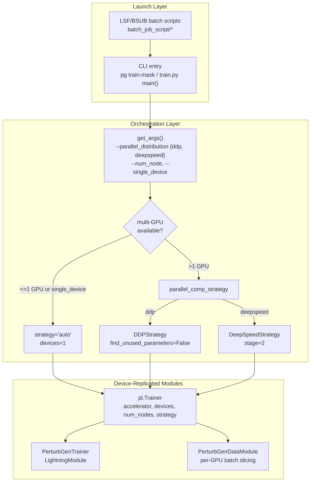
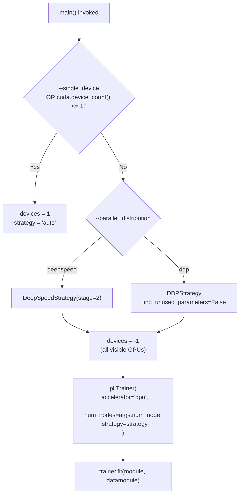

PerturbGen's training workloads — a 107M-parameter masked generative encoder plus a count decoder — are trained with PyTorch Lightning's strategy abstraction, which lets the same training script transparently scale from a single GPU to multi-GPU and multi-node clusters. This page documents the two distributed backends exposed by the repository (**DDP** and **DeepSpeed ZeRO Stage 2**), the exact strategy-selection logic embedded in `perturbgen/train.py`, the batch-size arithmetic that keeps the global batch invariant across device counts, and the operational launch path via LSF/BSUB batch scripts used in production cohorts.

## Architectural Position of Distributed Training

Distributed training in PerturbGen is not a separate subsystem — it is a **strategy selection layer** injected into the Lightning `Trainer` at the end of `main()` in `train.py`. Both the fine-tuning stack (`perturbgen/`) and the encoder pretraining stack (`scmaskgit/`) follow the same decomposition: a `LightningModule` (`PerturbGenTrainer` / `CellGenTrainer`), a `LightningDataModule` (`PerturbGenDataModule` / `CellGenDataModule`), and a strategy object passed to `pl.Trainer`. The strategy is the only component that varies between DDP and DeepSpeed; gradient synchronization, process spawning, and optimizer state sharding are fully delegated to Lightning.



The pretraining stack in `scmaskgit/train.py` follows an identical pattern but is **DDP-only**: its import line leaves `DeepSpeedStrategy` commented out, and it hard-codes `DDPStrategy(find_unused_parameters=True)` with `precision='bf16-mixed'` in the Trainer. This reflects the historical split: the frozen Geneformer-style encoder is pretrained once with DDP + bf16 mixed precision, then fine-tuned within PerturbGen where DeepSpeed becomes available as an option.

Sources: [train.py](/perturbgen/train.py#L13-L14), [scmaskgit/train.py](/scmaskgit/train.py#L16-L17), [Model/trainer.py](/perturbgen/Model/trainer.py#L75-L127)

## Strategy Selection Logic

The entire distributed configuration converges on one CLI argument and one guard condition. `--parallel_distribution` accepts `ddp` or `deepspeed` (default `ddp`), but the choice only takes effect when more than one CUDA device is visible; otherwise the code deliberately degrades to Lightning's `auto` strategy on a single device.



The two strategy constructors differ in one consequential flag. The fine-tuning stack uses `find_unused_parameters=False` — the PerturbGen model's parameters all participate in every forward pass under the masking objective, so disabling the unused-parameter scan removes DDP's overhead. The pretraining stack in `scmaskgit/train.py` uses `find_unused_parameters=True`, tolerating frozen or conditionally-executed encoder components during foundation-model training. This asymmetry is deliberate and should be preserved when extending either stack.

| Aspect | `perturbgen/train.py` | `scmaskgit/train.py` |
|---|---|---|
| Available strategies | DDP + DeepSpeed (stage 2) | DDP only (DeepSpeed commented out) |
| `find_unused_parameters` | `False` | `True` |
| Precision | Managed via `set_float32_matmul_precision` on A100/H100 | `precision='bf16-mixed'` in Trainer |
| Device selection | `devices=1` fallback, else `devices=-1` | `devices=-1` if CUDA else `0` |
| Multi-GPU guard | `device_count() > 1` and not `--single_device` | `device_count() > 1` else `'auto'` |

Sources: [train.py](/perturbgen/train.py#L656-L688), [train.py](/perturbgen/train.py#L69-L74), [scmaskgit/train.py](/scmaskgit/train.py#L417-L432), [Model/trainer.py](/perturbgen/Model/trainer.py#L49-L58)

## DeepSpeed ZeRO Stage 2 Configuration

Selecting `--parallel_distribution deepspeed` instantiates `DeepSpeedStrategy(stage=2)`. At ZeRO stage 2, **optimizer states and gradients are partitioned across data-parallel ranks** while parameters remain replicated on every GPU — a memory/communication trade-off suited to PerturbGen's 768-dimensional, ~25k-vocabulary transformer, where parameter replication is affordable but Adam's first/second moment buffers double the per-GPU footprint. No external `deepspeed_config` JSON is committed to the repository; the strategy relies on Lightning's defaults for everything beyond the stage parameter.

Two secondary artifacts confirm the DeepSpeed integration path. First, `scmaskgit/train.py` retains a commented-out import of `convert_zero_checkpoint_to_fp32_state_dict` — the standard utility for converting ZeRO-sharded checkpoints into a single fp32 file loadable outside DeepSpeed ranks — indicating the conversion step is required after stage-2 runs. Second, `perturbgen/tests/benchmark_fused_adam.py` microbenchmarks fused versus non-fused Adam `step()` latency using production shapes (`vocab=25000`, `d_model=768`), quantifying exactly the optimizer-step savings that motivate ZeRO's fused-optimizer path on A100/H100-class hardware.

| ZeRO Stage | Parameter Sharding | Gradient Sharding | Optimizer State Sharding | Relevance Here |
|---|---|---|---|---|
| 1 | ✗ | ✗ | ✓ | Not used |
| **2** (selected) | ✗ | ✓ | ✓ | `DeepSpeedStrategy(stage=2)` in train.py |
| 3 | ✓ | ✓ | ✓ | Not exposed; checkpoint conversion mandatory |

Sources: [train.py](/perturbgen/train.py#L659-L662), [scmaskgit/train.py](/scmaskgit/train.py#L32-L34), [benchmark_fused_adam.py](/perturbgen/tests/benchmark_fused_adam.py#L1-L7)

## Global Batch Size Invariance

PerturbGen preserves the **global effective batch** across device counts by dividing the user-specified `--batch_size` by the number of visible GPUs before constructing the DataModule:

```python
# train.py, pre-dataloaders
gpu_number = max(torch.cuda.device_count(), 1)
per_gpu_batch_size = args.batch_size // gpu_number
```

The same arithmetic appears verbatim in `scmaskgit/train.py`, making the invariant stack-wide. Two practical consequences follow. First, `--batch_size 64` on a 4×A100 node yields `per_gpu_batch_size=16` per DDP rank — a documented LPS production run used `--max_len 797 --tgt_vocab_size 2002` at batch 64, and checkpoint filenames embed the *global* batch value (`batch_{args.batch_size}`), not the per-rank value. Second, because floor division is used, device counts that do not divide the batch evenly (e.g., batch 50 across 4 GPUs) silently drop samples per step; keep `--batch_size` a multiple of the target GPU count. The DataModule additionally pins memory, enables persistent workers, and sets `prefetch_factor=4` to keep GPU ranks fed while they stall on gradient all-reduce barriers.

Sources: [train.py](/perturbgen/train.py#L538-L559), [scmaskgit/train.py](/scmaskgit/train.py#L333-L349), [Dataloaders/datamodule.py](/perturbgen/Dataloaders/datamodule.py#L189-L197)

## Multi-Node and Cluster Launch Path

Multi-node execution is configured through `--num_node` (passed directly as `num_nodes` to the Lightning Trainer) and launched through LSF `BSUB` scripts under `perturbgen/batch_job_script/`. A representative production script for the LPS cohort interpolation run requests **4 exclusive-process NVIDIA A100 80GB GPUs**, splits 4 CPU cores per host (`span[ptile=4]`), loads CUDA 12.1.1, and invokes `train.py` with `--num_node 1`. The single-node case requires no additional networking configuration because Lightning's DDP launch handles rank discovery from the scheduler's environment.

```bash
#BSUB -gpu 'mode=exclusive_process:num=4:gmodel=NVIDIAA100_SXM4_80GB'
#BSUB -n 4
#BSUB -R "span[ptile=4]"
module load cuda-12.1.1
python3 .../perturbgen/train.py --train_mode masking ... --batch_size 64 --num_node 1
```

For multi-node jobs, raise both the `-n`/`-gpu` directives per host and `--num_node`; Lightning expects `MASTER_ADDR`/`MASTER_PORT`-capable scheduling, which LSF's GPU queues provide when all ranks land on hosts with the same interconnect. Note that WandB run names gain a UUID suffix whenever `torch.cuda.device_count() > 1` — this prevents checkpoint/log collisions between replicated ranks under [Experiment Tracking with Weights and Biases](20-experiment-tracking-with-weights-and-biases).

| Resource | BSUB Directive | Production Value |
|---|---|---|
| GPUs | `-gpu 'mode=exclusive_process:num=N:gmodel=...'` | 4 × A100 SXM4 80GB |
| CPU cores | `-n` + `-R "span[ptile=4]"` | 4 (one per GPU) |
| CUDA runtime | `module load` | cuda-12.1.1 |
| Memory | `-M` / `-R 'select[mem>...]'` | 50000 MB |
| Nodes | `--num_node` (CLI) | 1 (single-node default) |

Sources: [batch_job_script/lps/interpolation/2_run_train_masking_Encoder_interpolation.sh](/perturbgen/batch_job_script/lps/interpolation/2_run_train_masking_Encoder_interpolation.sh#L3-L16), [batch_job_script/lps/interpolation/2_run_train_masking_Encoder_interpolation.sh](/perturbgen/batch_job_script/lps/interpolation/2_run_train_masking_Encoder_interpolation.sh#L33-L63), [train.py](/perturbgen/train.py#L628-L630), [train.py](/perturbgen/train.py#L683-L688)

## Single-GPU and Notebook-Safe Fallback

Distributed launchers spawn processes, which is incompatible with an already-running Jupyter kernel. `train.py` therefore exposes `--single_device`: when set — or when only one CUDA device is visible — the Trainer runs with `devices=1, strategy='auto'`, bypassing DDP/DeepSpeed process groups entirely. The in-process Python API (`pg.train_*`) sets this flag programmatically; multi-GPU training must go through the CLI/batch-script path. Relatedly, `--compile` (default on) torch-compiles the masking model for throughput, but the API disables it because compilation can stall or deadlock inside an interactive kernel — the resulting model is numerically identical either way.

Sources: [train.py](/perturbgen/train.py#L148-L158), [train.py](/perturbgen/train.py#L666-L674)

## torch.compile Interop with Checkpoint Resume

Under DDP, Lightning wraps the compiled module, and `torch.compile` renames state-dict keys with a `._orig_mod.` prefix. PerturbGen handles the resulting asymmetry explicitly: `PerturbGenTrainer.on_save_checkpoint` strips the prefix so checkpoints are portable, while `_restore_compiled_keys` re-inserts it on load **only when the live module is compiled** — guaranteeing strict key matching for `trainer.fit(ckpt_path=...)` and `load_from_checkpoint` regardless of whether the resuming process uses the same `--compile` setting as the original run. When porting checkpoints between a DeepSpeed run and a DDP or single-device run, perform the ZeRO→fp32 conversion first; this prefix logic operates purely on the Lightning `state_dict` layer above that.

Sources: [Model/trainer.py](/perturbgen/Model/trainer.py#L61-L72), [Model/trainer.py](/perturbgen/Model/trainer.py#L123)

## Distributed Data Loading Considerations

`PerturbGenDataModule` deliberately does **not** attach a `DistributedSampler` itself: Lightning injects per-rank sharding automatically for `DataLoader`s returned by `train_dataloader`/`val_dataloader`. The module's own responsibilities are the performance knobs that matter under DDP — `pin_memory=True`, `persistent_workers=True` when `num_workers > 0`, and `prefetch_factor=4`. When `--use_weighted_sampler` is enabled, a `WeightedRandomSampler` with a fixed-seed generator replaces shuffling (and sets `shuffle=False`); under DDP each rank draws from the same weighted distribution while Lightning ensures disjoint sample routing, so class-rebalancing semantics are preserved without manual rank-aware sampling code.

Sources: [Dataloaders/datamodule.py](/perturbgen/Dataloaders/datamodule.py#L189-L197), [Dataloaders/datamodule.py](/perturbgen/Dataloaders/datamodule.py#L295-L313), [train.py](/perturbgen/train.py#L328-L333)

## Operational Troubleshooting Matrix

| Symptom | Root Cause | Verified Fix in Codebase |
|---|---|---|
| Hang at startup inside Jupyter | Multi-process DDP/DeepSpeed cannot launch in an interactive kernel | Set `--single_device True` or use batch scripts (`train.py` comment, L148-L152) |
| CUDA OOM at ZeRO stage 2 | Optimizer states sharded, parameters replicated | Expected at stage 2; stage-3 not exposed — reduce `--d_model`/`--num_layers` instead |
| Strict-load failure on resume | `._orig_mod.` prefix mismatch after `torch.compile` | Handled by `_restore_compiled_keys` (`Model/trainer.py` L61-L72) |
| Silent per-step sample loss | `batch_size // gpu_number` floor division with non-divisible batch | Keep `--batch_size` divisible by GPU count (`train.py` L538-L540) |
| Checkpoint not loadable outside DeepSpeed | ZeRO shards stored across ranks | Convert with `convert_zero_checkpoint_to_fp32_state_dict` (`scmaskgit/train.py` L32-L34) |
| Duplicate WandB runs across ranks | Rank name collision | Automatic UUID suffix when `device_count() > 1` (`train.py` L628-L630) |

Sources: [train.py](/perturbgen/train.py#L148-L158), [train.py](/perturbgen/train.py#L538-L540), [Model/trainer.py](/perturbgen/Model/trainer.py#L61-L72), [scmaskgit/train.py](/scmaskgit/train.py#L32-L34), [train.py](/perturbgen/train.py#L628-L630)

## Recommended Configuration Defaults

For advanced deployments, the repository's own production runs establish a defensible baseline: DDP on 4×A100 80GB with exclusive-process GPU mode, `--batch_size 64` (16/rank), `--n_workers 4` matching `span[ptile=4]` core allocation, CUDA 12.1.1, and `--ckpt_every_n_epochs 5` to bound checkpoint I/O on shared filesystems like Lustre. Prefer DeepSpeed stage 2 when fine-tuning with larger `--d_model` or longer `--max_len` overrides push Adam state memory past the A100 envelope; prefer DDP for the standard 768-dim configuration where its lower latency and simpler checkpoint format win. For validation-side distributed concerns (generation across timepoints, MMD/EMD evaluation), continue to [In Silico Perturbation Modes](10-in-silico-perturbation-modes) and [Evaluation Metrics: MMD, EMD, Optimal Transport](13-evaluation-metrics-mmd-emd-optimal-transport); for the upstream launch scripts and sweep orchestration that invoke these strategies, see [Hyperparameter Sweeps and Batch Jobs](18-hyperparameter-sweeps-and-batch-jobs).

Sources: [batch_job_script/lps/interpolation/2_run_train_masking_Encoder_interpolation.sh](/perturbgen/batch_job_script/lps/interpolation/2_run_train_masking_Encoder_interpolation.sh#L33-L63), [train.py](/perturbgen/train.py#L334-L339), [train.py](/perturbgen/train.py#L368-L372)

> [!TIP]
> The `find_unused_parameters` flag is intentionally asymmetric between the two stacks (`False` in `perturbgen/train.py`, `True` in `scmaskgit/train.py`). Copying a trainer setup from one stack to the other will either reintroduce unused-parameter scan overhead or crash on frozen encoder branches — always match the flag to the stack.

> [!TIP]
> Checkpoint filenames embed the **global** batch size (`batch_{args.batch_size}`), but training actually consumes `batch_size // gpu_count` per rank. When auditing a pretraining cohort checkpoint from `pretraining_cohort/`, treat the filename's batch value as the global effective batch, not per-device.