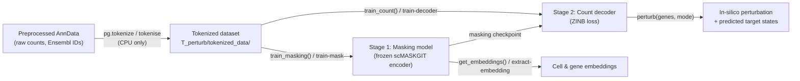
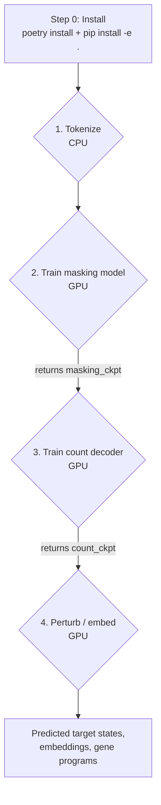

**PerturbGen** is a foundation model that predicts how genetic perturbations reshape cellular state trajectories in scRNA-seq data. This page takes you from a fresh clone to your first in-silico perturbation in four stages: **install → tokenize → train (two stages) → perturb**. Everything you need to run the shipped pretrained encoder and tokenizer dictionaries comes bundled with the repository — only your own AnnData and, for training, a CUDA GPU are required.
Sources: [README.md](/README.md#L1-L13), [model.py](/perturbgen/model.py#L1-L30), [pyproject.toml](/pyproject.toml#L1-L5)

## PerturbGen at a Glance

The system follows a fixed data-to-prediction pipeline. A preprocessed AnnData (raw counts in `.X`, Ensembl gene IDs as the `var` index) is converted into a **tokenized dataset** on CPU; a frozen pretrained **scMASKGIT encoder** is then fine-tuned as a masking model, which in turn feeds a **count decoder** trained with a ZINB loss; finally the trained model performs in-silico gene perturbations (e.g., a knockout of *IL1B* at 6 h predicting the 10 h state). The diagram below shows the full data flow — read it left to right, and note that only the tokenizer step runs without a GPU.
Sources: [train_and_perturb.ipynb](/docs/examples/train_and_perturb.ipynb#L13-L44), [model.py](/perturbgen/model.py#L1-L30), [train.py](/perturbgen/train.py#L697-L713)


Sources: [README.md](/README.md#L7-L9)

The same pipeline is exposed through **two surfaces**: an installable `perturbgen` CLI (four commands) and a scvi-tools-style Python API (`import perturbgen as pg`) that runs everything in-process — the API is the recommended entry point for beginners because it requires no shell argument lists and returns paths/checkpoints directly.
Sources: [model.py](/perturbgen/model.py#L1-L30), [pyproject.toml](/pyproject.toml#L12-L14), [installation.rst](/docs/installation.rst#L44-L72)



Sources: [train_and_perturb.ipynb](/docs/examples/train_and_perturb.ipynb#L13-L44), [train.py](/perturbgen/train.py#L697-L713)

## Step 0 — Install the Environment

Clone the repository, install [Poetry](https://python-poetry.org) once, then build the pinned Python 3.11 environment. Poetry resolves every dependency exactly (the lock file pins NumPy 2.2.0, PyTorch Lightning, `datasets`, and ~200 more packages), so avoid mixing in `pip install` upgrades until you know what you need.
Sources: [README.md](/README.md#L14-L31), [installation.rst](/docs/installation.rst#L5-L25), [pyproject.toml](/pyproject.toml#L7-L80)

```shell
git clone https://github.com/Lotfollahi-lab/Perturbgen.git
cd Perturbgen
curl -sSL https://install.python-poetry.org | python3 -   # one-time Poetry install
poetry env use python3.11
poetry install
source "$(poetry env info -p)/bin/activate"
pip install -e .    # registers the `perturbgen` CLI entry point
```

Sources: [README.md](/README.md#L14-L31), [installation.rst](/docs/installation.rst#L14-L33), [installation.rst](/docs/installation.rst#L44-L55), [pyproject.toml](/pyproject.toml#L12-L14)

**Hardware requirements** differ sharply by stage: tokenization and inference notebooks run on CPU (≥32 GB RAM recommended for larger datasets), while training requires CUDA. At the tutorial default `batch_size=64`, a full epoch peaks at **13.8 GB** (masking stage) and **15.8 GB** (count-decoder stage) of GPU memory — comfortable on 24 GB cards such as the RTX 3090/4090, tight on 16 GB.
Sources: [README.md](/README.md#L32-L48)

| Setup component | Requirement / Command | Notes |
|---|---|---|
| Python | 3.11 (fixed via Poetry) | `poetry env use python3.11` |
| Tokenization | CPU, ≥32 GB RAM | No GPU, no encoder checkpoint needed |
| Training (masking) | CUDA GPU, ~13.8 GB peak @ batch 64 | 24 GB GPUs recommended |
| Training (count decoder) | CUDA GPU, ~15.8 GB peak @ batch 64 | Lower `batch_size` on 16 GB GPUs |
| Multi-GPU | Automatic (`devices=-1`) | DDP default; DeepSpeed ZeRO-2 via `--parallel_distribution deepspeed` |

Sources: [README.md](/README.md#L32-L48), [train.py](/perturbgen/train.py#L64-L68), [train.py](/perturbgen/train.py#L662-L670)

Training and inference log to **Weights & Biases**, which is **offline by default** — runs are saved locally (re-upload later with `wandb sync`) and never hang on authentication, which matters on machines without internet. To log live, either `export WANDB_MODE=online` or pass `--wandb_mode online`; point runs at your own account with `--wandb_entity <your-team>`.
Sources: [README.md](/README.md#L50-L68), [train.py](/perturbgen/train.py#L190-L201)

> [!TIP]
> Trainings use `batch_size=64` by default to reproduce paper numbers, and `torch.compile` is enabled for the masking model on the CLI. Inside Jupyter, the Python API automatically disables compilation and uses a notebook-safe single-GPU strategy (`single_device=True`) because multi-process DDP cannot launch in an interactive kernel — so prefer the CLI or batch scripts for multi-GPU runs. Sources: [train.py](/perturbgen/train.py#L145-L158)

## The Four-Stage Workflow

Every path through PerturbGen — CLI, API, or notebook — traverses the same four stages. Stage 1 (tokenization) is CPU-only and idempotent; stages 2–3 form the **two-stage training** where the masking checkpoint feeds the count decoder; stage 4 consumes both checkpoints for perturbation or embedding extraction.
Sources: [train_and_perturb.ipynb](/docs/examples/train_and_perturb.ipynb#L13-L44), [train.py](/perturbgen/train.py#L697-L720)



Sources: [train_and_perturb.ipynb](/docs/examples/train_and_perturb.ipynb#L13-L44)

| Stage | What happens | Hardware | Primary output |
|---|---|---|---|
| 1. Tokenize | Tokenize + pair cells (source → later time points), select HVGs, write `.dataset` files | CPU | `T_perturb/tokenized_data/<dataset>/` |
| 2. Train masking | Fine-tune the frozen pretrained encoder for masked-gene prediction | GPU (13.8 GB) | `masking_ckpt` path |
| 3. Train count decoder | Train the count decoder with ZINB loss, seeded by the masking checkpoint | GPU (15.8 GB) | `count_ckpt` path |
| 4. Perturb / embed | Knock out / overexpress genes; extract cell & gene embeddings | GPU | Predicted states, embedding matrices |

Sources: [train_and_perturb.ipynb](/docs/examples/train_and_perturb.ipynb#L13-L44), [train.py](/perturbgen/train.py#L697-L720), [model.py](/perturbgen/model.py#L69-L130)

## Path A — Quick Start via the Python API (recommended)

The `train_and_perturb.ipynb` tutorial is the fastest end-to-end route: it trains on the in-vivo LPS challenge (source state `6h_LPS`, target `10h_LPS`), then knocks out *IL1B* (`ENSG00000125538`) and predicts how the 10 h state changes. The complete logic is about a dozen calls: Sources: [train_and_perturb.ipynb](/docs/examples/train_and_perturb.ipynb#L13-L44)

```python
import perturbgen as pg

# 1) TOKENIZE your preprocessed AnnData (CPU; no encoder needed)
model_input = pg.tokenize(
    adata_path, dataset='lps_6h_perturb',
    reference_time='6h_LPS',                 # source state
    time_point_order=['6h_LPS', '10h_LPS'],  # pairs run source -> later points
    time_obs='Time_point', var_list=[...], main_pairing_obs='cell_pairing_index',
    gene_median_path=..., token_dict_path=..., gene_mapping_path=...,
)

# 2) BUILD THE MODEL — the pretrained scmaskgit encoder ships with the repo and
#    is used by default from pretraining_cohort/
model = pg.PerturbGen(model_input, source='6h_LPS', pred_tps=[1])

# 3) TRAIN in two steps so you choose which masking checkpoint feeds the decoder
masking_ckpt = model.train_masking(output_dir='model')
count_ckpt   = model.train_count(output_dir='model', masking_ckpt=masking_ckpt)

# 4) SAVE / EMBED / PERTURB (checkpoints are reused; load() restores them)
model.save('model')                                   # pg.PerturbGen.load('model')
emb  = model.get_embeddings(masking_ckpt=masking_ckpt)
pred = model.perturb(genes=['ENSG00000125538'],       # IL1B knockout
                     count_ckpt=count_ckpt, pred_tps=[1])
```

Sources: [train_and_perturb.ipynb](/docs/examples/train_and_perturb.ipynb#L13-L44)

Three API behaviors make re-running notebooks painless: `pg.tokenize()` is **idempotent** (if the output directory exists it returns immediately; pass `overwrite=True` to force a rebuild); `pg.PerturbGen.save()`/`load()` persist and restore both checkpoints so a kernel restart skips retraining; and perturbation modes are plain string aliases — `mode="knockout"` (also accepted: `overexpress`, `delete`, `pad`) and `where="source"` or `where="target"` control where the edit is applied in the sequence.
Sources: [model.py](/perturbgen/model.py#L69-L96), [model.py](/perturbgen/model.py#L59-L66), [train_and_perturb.ipynb](/docs/examples/train_and_perturb.ipynb#L13-L44)

The tutorial data for this example is the LPS challenge AnnData, downloadable without credentials from the project S3 bucket, and the tokenizer reference dictionaries (`gene_median`, `token_dict`, `gene_mapping`) are shipped inside `perturbgen/pp/` — you never need to generate them yourself.
Sources: [train_and_perturb.ipynb](/docs/examples/train_and_perturb.ipynb#L63-L100), [configs/paths.py](/perturbgen/configs/paths.py#L7-L11), [train_and_perturb.ipynb](/docs/examples/train_and_perturb.ipynb#L46-L62)

> [!TIP]
> The pretrained encoder checkpoint is stored via Git LFS, and `git lfs pull` may fail with a 403 bandwidth error. Download it from Hugging Face (https://huggingface.co/lotfollahi-lab/PerturbGen) instead and save the `.ckpt` into `pretraining_cohort/` keeping its filename — training then finds it automatically with no `--encoder_path` argument. Sources: [README.md](/README.md#L93-L99), [configs/paths.py](/perturbgen/configs/paths.py#L13-L17)

## Path B — Quick Start via the CLI

After `pip install -e .`, the `perturbgen` command exposes the same pipeline. Each CLI command delegates to a Python module, so any flag valid for that module (e.g., `--batch_size`, `--epochs`) works directly: Sources: [installation.rst](/docs/installation.rst#L44-L55), [\_\_main\_\_.py](/perturbgen/__main__.py#L60-L97)

| CLI command | Purpose | Delegates to |
|---|---|---|
| `perturbgen tokenise` | Data preprocessing & tokenization (CPU) | `perturbgen.pp.GF_tokenisation.main` |
| `perturbgen train-mask` | Train the masking model (stage 1) | `perturbgen.train.main` (`--train_mode masking`) |
| `perturbgen train-decoder` | Train the count decoder (stage 2) | `perturbgen.train.main` (`--train_mode count`) |
| `perturbgen extract-embedding` | Load a checkpoint and extract embeddings | `perturbgen.val.main` |

Sources: [\_\_main\_\_.py](/perturbgen/__main__.py#L60-L97), [\_\_main\_\_.py](/perturbgen/__main__.py#L72-L88), [train.py](/perturbgen/train.py#L57-L62)

CLI invocations are argument-driven; the most common knobs for a first run are batch size, epochs, and the dataset paths. For example, training the masking model on tokenized data looks like: Sources: [train.py](/perturbgen/train.py#L83-L105), [train.py](/perturbgen/train.py#L186-L189)

```shell
perturbgen train-mask \
  --src_dataset T_perturb/tokenized_data/<dataset>/dataset_hvg_src/<source>.dataset \
  --tgt_dataset_folder T_perturb/tokenized_data/<dataset>/dataset_hvg_tgt \
  --batch_size 64 --epochs 5
```

Sources: [train.py](/perturbgen/train.py#L83-L105)

Tokenization via CLI accepts the dataset name, gene-filtering mode (`hvg` by default; `hvg_flavor='seurat_v3'` matches the released recipe), and the observation keys used for pairing and time encoding. The Python API's `pg.tokenize()` forwards exactly these arguments internally, so both paths produce identical `.dataset` outputs.
Sources: [GF_tokenisation.py](/perturbgen/pp/GF_tokenisation.py#L35-L100), [model.py](/perturbgen/model.py#L69-L130)

## Where Your Files Live

PerturbGen creates a conventional workspace around itself the first time you run anything, so you do not need to configure directories manually. `ROOT` is the parent directory containing the repository; `data/`, `T_perturb/res/`, and `T_perturb/tokenized_data/` are auto-created at import. Note the repository ships its tokenizer dictionaries and the pretrained checkpoint under `perturbgen/pp/` and `pretraining_cohort/` — these are defaults, not files you generate.
Sources: [configs/paths.py](/perturbgen/configs/paths.py#L1-L35)

```
<ROOT>/                        # parent dir containing the repo (auto-detected)
├── Perturbgen/                # this repository
│   ├── perturbgen/
│   │   ├── pp/                # shipped tokenizer dicts (gene_median, token_dict, ensembl mapping)
│   │   ├── configs/paths.py   # path resolution + auto-mkdir
│   │   ├── model.py           # Python API (pg.tokenize, pg.PerturbGen)
│   │   ├── train.py           # training entry point (masking + count)
│   │   └── val.py             # embeddings / generation entry point
│   ├── docs/examples/         # 6 tutorial notebooks
│   └── pretraining_cohort/    # default location of the pretrained encoder .ckpt
├── data/                      # place your raw .h5ad here (auto-created)
└── T_perturb/                 # workspace (auto-created)
    ├── tokenized_data/        # output of stage 1
    └── res/                   # results
```

Sources: [configs/paths.py](/perturbgen/configs/paths.py#L1-L35), [README.md](/README.md#L77-L86)

| Path constant | Resolves to | Role in quick start |
|---|---|---|
| `GENE_MEDIAN_PATH` / `TOKEN_DICT_PATH` / `GENE_MAPPING_PATH` | `perturbgen/pp/*.pkl` | Tokenizer references passed to `pg.tokenize()` |
| `ENCODER_CKPT_PATH` | `pretraining_cohort/20250709_...ckpt` | Default frozen encoder, no flag needed |
| `DATA_DIR` | `<ROOT>/data/` | Where you put raw `.h5ad` inputs |
| `TOKENIZED_DIR` | `<ROOT>/T_perturb/tokenized_data/` | Output of `pg.tokenize()` / `tokenise` |

Sources: [configs/paths.py](/perturbgen/configs/paths.py#L7-L17), [configs/paths.py](/perturbgen/configs/paths.py#L22-L35)

## Troubleshooting First Runs

The four issues beginners hit most often all have one-line fixes documented in the code and README. Keep this table handy for your first training session: Sources: [README.md](/README.md#L32-L48), [README.md](/README.md#L50-L68), [README.md](/README.md#L93-L99)

| Symptom | Cause | Fix |
|---|---|---|
| CUDA out-of-memory during count-decoder training | 16 GB GPU vs 15.8 GB peak | Lower `batch_size` (or `batch_size=` in the API); use DeepSpeed (`--parallel_distribution deepspeed`) to cut per-GPU memory |
| Wandb run hangs at startup | Authentication blocks on offline machines | Offline is default; force with `--wandb_mode disabled` or log online via `export WANDB_MODE=online` |
| `git lfs pull` fails with HTTP 403 | Git LFS bandwidth limit on the checkpoint | Download the `.ckpt` from Hugging Face into `pretraining_cohort/` unchanged |
| Tokenization reruns from scratch each time | `overwrite` semantics | `pg.tokenize()` skips if output exists; only pass `overwrite=True` when data changed |

Sources: [README.md](/README.md#L32-L48), [train.py](/perturbgen/train.py#L190-L201), [model.py](/perturbgen/model.py#L85-L96)

The tutorial notebooks are version-controlled as `_nb.py` scripts converted from Jupyter; regenerate runnable `.ipynb` files with `jupytext --to ipynb --execute <your_file>_nb.py` if you prefer the notebook interface.
Sources: [README.md](/README.md#L70-L76), [installation.rst](/docs/installation.rst#L35-L42)

## Where to Go Next

Once your first masking → count → perturb cycle completes, continue in this order: for deeper GPU sizing, Poetry alternatives, and multi-GPU guidance see [Installation and Hardware Requirements](3-installation-and-hardware-requirements); for guided notebook-by-notebook coverage of preprocessing, embeddings, and post-perturbation analyses see [Tutorial Notebooks Walkthrough](4-tutorial-notebooks-walkthrough); and to understand *why* the two-stage masking/decoder design works, read [Architecture Overview](5-architecture-overview).
Sources: [README.md](/README.md#L77-L86), [model.py](/perturbgen/model.py#L1-L30)