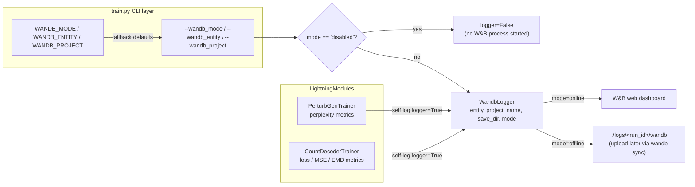
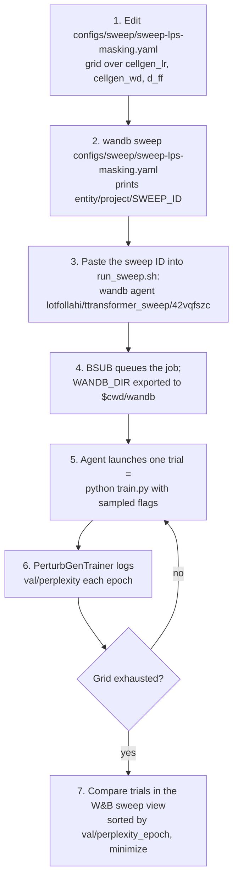

PerturbGen uses **Weights & Biases (W&B)** as its single source of truth for training telemetry: every loss curve, perplexity score, and evaluation metric produced during model training flows through W&B's dashboard, and every hyperparameter sweep is orchestrated by a W&B *sweep agent*. This page explains how the tracking layer is wired into the Lightning training entry points, how to configure it via CLI flags and environment variables, how the offline-first default protects cluster jobs, and how to launch and monitor your own hyperparameter sweeps. No prior W&B experience is assumed.

## Tracking Architecture at a Glance

Experiment tracking in PerturbGen follows the standard PyTorch Lightning logger pattern rather than direct `wandb` API calls. The `WandbLogger` class from `pytorch_lightning.loggers` is imported once in the training entry point, configured from three CLI flags (each with an environment-variable fallback), and handed to the `pl.Trainer`. From that moment, every `self.log(..., logger=True)` call inside the two Lightning modules — `PerturbGenTrainer` (masked-token pretraining) and `CountDecoderTrainer` (count prediction) — is transparently forwarded to W&B.

The design deliberately separates *what* is logged (the modules) from *where* it goes (the logger), which means you can switch between online, offline, and fully disabled tracking without touching any model code.

Sources: [train.py](perturbgen/train.py#L12-L13), [Model/trainer.py](perturbgen/Model/trainer.py#L22-L25)

## Configuring W&B: CLI Flags and Environment Variables

Three flags on `train.py` control the entire W&B setup. Each follows the same precedence rule: the CLI flag wins; if omitted, the corresponding `WANDB_*` environment variable is used; if that is also unset, a hard-coded fallback applies.

| Flag | Environment variable | Default fallback | Purpose |
|---|---|---|---|
| `--wandb_mode` | `WANDB_MODE` | `offline` | `online`, `offline`, or `disabled` |
| `--wandb_entity` | `WANDB_ENTITY` | *your default W&B entity* | Team or username that owns the project |
| `--wandb_project` | `WANDB_PROJECT` | `perturbgen` | Project name on the W&B dashboard |

The `offline` default is a deliberate operational choice: runs are saved locally and never block on authentication, which matters on shared compute clusters where interactive logins are impractical. In W&B terminology, an **entity** is your user or team namespace, a **project** groups related runs, and a **run** is one execution of a training script.

Sources: [train.py](perturbgen/train.py#L168-L194)

## Run Modes: online, offline, disabled

The `--wandb_mode` flag maps directly onto W&B's native modes, plus one special case that is unique to PerturbGen:

| Mode | Behavior | When to use |
|---|---|---|
| `online` | Live streaming to the W&B dashboard | Interactive sessions with network access |
| `offline` (default) | Everything written to a local `wandb/` directory; upload later with `wandb sync <run_dir>` | Cluster jobs, shared accounts, unreliable networks |
| `disabled` | **No logger at all** — `trainer` receives `logger=False` instead of a `WandbLogger` | Debugging, tests, notebook runs |

> [!TIP]
> Notice the `disabled` branch does **not** create a `WandbLogger(mode='disabled')` — it passes `logger=False` to the Trainer instead. The code comment explains why: even in `disabled` mode, accessing `WandbLogger.experiment` triggers `wandb.init()`, whose service startup can hang a headless Jupyter kernel. Skipping the logger object entirely sidesteps that failure mode while keeping `self.log` calls and checkpointing functional.

Sources: [train.py](perturbgen/train.py#L168-L179), [train.py](perturbgen/train.py#L620-L626)

## What Gets Logged to Your Runs

Metrics are emitted from the Lightning modules with the `logger=True` flag, which routes them into the active `WandbLogger`. Names use a `stage/metric` convention so the W&B dashboard groups them cleanly. The monitoring key for checkpoint selection is chosen in `train.py` depending on whether a validation split exists:

| Training mode | Logged metrics | Checkpoint monitor |
|---|---|---|
| `masking` (PerturbGenTrainer) | `train/perplexity`, `val/perplexity` (epoch-aggregated variants appear as `..._epoch` in W&B) | `val/perplexity`, else `train/perplexity` |
| `count` (CountDecoderTrainer) | `val/loss`, `val/mse`, `val/emd`, `train/emd` | `val/mse`, else `train/mse` |
| Count-mode testing | `test/loss`, `test/mse` | — |

A few details worth knowing when reading dashboard charts: the EMD values are computed on epoch boundaries over accumulated predictions, subsampled to at most 10,000 cells with a fixed generator seed of 42, so the series is reproducible across runs; and all `self.log` calls for these metrics pass `logger=True`, which is what activates the W&B pipeline.

Sources: [train.py](perturbgen/train.py#L583-L619), [Model/trainer.py](perturbgen/Model/trainer.py#L1008-L1036), [Model/trainer.py](perturbgen/Model/trainer.py#L1047-L1102), [Model/trainer.py](perturbgen/Model/trainer.py#L1153-L1179)

## Run Naming and Multi-GPU Safety

Each run gets a timestamp-based identifier of the form `YYYYMMDD_HHMM_cellgen`, and in multi-GPU settings a six-character UUID suffix is appended (`..._a3f2c1`) so that DDP workers launching near-simultaneously do not collide into one run name. Local W&B files land under `save_dir=args.log_dir` (default `logs/`). The same naming pattern appears in the legacy HPO script, which shows the convention predates the current pipeline.

Sources: [train.py](perturbgen/train.py#L574-L576), [train.py](perturbgen/train.py#L628-L638), [scmaskgit/hpo.py](scmaskgit/hpo.py#L286-L301)

## Hyperparameter Sweeps with a W&B Agent

Sweeps are where W&B becomes more than a passive logger. PerturbGen ships eight ready-made sweep configs under `perturbgen/configs/sweep/` (masking and count variants for the LPS, EB, cytoimmgen, and HSPC datasets). A W&B sweep config declares a **search method** (grid, random, bayes), a **metric to optimize**, the **program** to launch, and a **parameter space** in which fixed values use `value:` and grids use `values:`. The `wandb agent` process then samples configurations from that space and launches one training run per sample.

Anatomy of the shipped masking sweep config (`sweep-lps-masking.yaml`):

| Key | Example value | Role |
|---|---|---|
| `method: grid` | `grid` | Exhaustively evaluates every parameter combination |
| `metric: {goal: minimize, name: val/perplexity_epoch}` | — | The dashboard ranks trials by this exact Lightning key |
| `parameters.*.value` | `train_mode: 'masking'` | Constant across all trials |
| `parameters.*.values` | `cellgen_lr: [1e-5, 5e-4, ...]` | The swept search grid |
| `program:` | absolute path to `train.py` | Script the agent executes per trial |
| `project:` | `ttransformer_sweep` | W&B project that owns the sweep |

> [!TIP]
> Two practical adjustments when reusing these configs: the shipped `program:` and dataset paths are absolute paths from the authors' Lustre filesystem, so replace them with paths valid on your machine (e.g., `perturbgen/train.py` relative to the agent's working directory); and the `metric.name` string must match a logged Lightning key *character-for-character*, or the agent cannot rank trials.

The batch script wraps the agent in an LSF job: it loads CUDA, activates the environment, exports `WANDB_DIR=$cwd/wandb` so run artifacts land on the working filesystem rather than `$HOME`, then starts `wandb agent <entity>/<project>/<sweep_id>`. You only need to substitute your own sweep ID after running step 2.

Sources: [run_sweep.sh](perturbgen/run_sweep.sh#L1-L26), [sweep-lps-masking.yaml](perturbgen/configs/sweep/sweep-lps-masking.yaml#L1-L75)

## The Legacy Ray Tune + W&B Path

Inside the `scmaskgit` package (the earlier codebase PerturbGen's `PerturbGenTrainer` evolved from), `hpo.py` implements an alternative sweep strategy: **Ray Tune with BOHB** (Bayesian optimization + HyperBand early stopping) instead of a native W&B agent. It demonstrates a different logger configuration worth knowing about: `WandbLogger(project="Moscf", log_model=True, settings=wandb.Settings(save_code=False))` — notably `log_model=True`, which uploads checkpoints as W&B artifacts. Because it was built for a cluster where `$HOME` is not writable, the script pins all five W&B directory environment variables (`WANDB_CACHE_DIR`, `WANDB_CONFIG_DIR`, `WANDB_ARTIFACT_DIR`, `WANDB_DATA_DIR`, `WANDB_ARTIFACT_LOCATION`) to the current working directory. Its search space spans architecture (`d_model`, `num_heads`, `num_layers`, `d_ff`), regularization (`dropout`, `weight_decay`), and optimization (`learning_rate`, `batch_size`) over 20 samples.

For new work, prefer the native `wandb agent` workflow in the previous section — it is the path exercised by the shipped sweep configs — but this file is a useful reference if you need checkpoint artifacts on the dashboard or HyperBand early termination of weak trials.

Sources: [scmaskgit/hpo.py](scmaskgit/hpo.py#L39-L43), [scmaskgit/hpo.py](scmaskgit/hpo.py#L286-L304), [scmaskgit/hpo.py](scmaskgit/hpo.py#L337-L364)

## Troubleshooting

| Symptom | Likely cause | Fix |
|---|---|---|
| Training hangs at startup inside Jupyter | `wandb.init()` service startup in a headless kernel | Run with `--wandb_mode disabled` (takes the `logger=False` shortcut) |
| Job blocks waiting for login on the cluster | `--wandb_mode online` without cached credentials | Keep the default `offline`, or run `wandb login` once / set `WANDB_API_KEY` |
| `disk quota exceeded` errors from wandb | W&B cache defaulting to `$HOME` | Export `WANDB_DIR` (and related `WANDB_*_DIR` vars) to a workspace path, as `run_sweep.sh` does |
| Offline runs never appear on the dashboard | Offline mode writes locally by design | Run `wandb sync logs/<run_id>/wandb/<run_name>` after the job finishes |
| Sweep shows no ranked trials | `metric.name` in the YAML does not match a logged key | Use the exact Lightning key, e.g. `val/perplexity_epoch` |
| Duplicate run names in multi-GPU DDP | Several workers initializing simultaneously | Already handled: a UUID suffix is appended when more than one GPU is visible |

Sources: [train.py](perturbgen/train.py#L168-L194), [train.py](perturbgen/train.py#L620-L638), [run_sweep.sh](perturbgen/run_sweep.sh#L20-L24)

## Next Steps

With tracking understood, natural continuations in this catalog are:

- Launch the sweeps you just learned to read on the dashboard: [Hyperparameter Sweeps and Batch Jobs](18-hyperparameter-sweeps-and-batch-jobs)
- Understand where the logged perplexity comes from in the masking objective: [Two-Stage Masking and Count Decoder Training](7-two-stage-masking-and-count-decoder-training)
- Scale tracked runs across nodes while keeping one coherent run: [Distributed Training with DDP and DeepSpeed](19-distributed-training-with-ddp-and-deepspeed)
- Manage the `log_dir` and path variables that ground W&B's local storage: [Configuration System and Path Management](17-configuration-system-and-path-management)