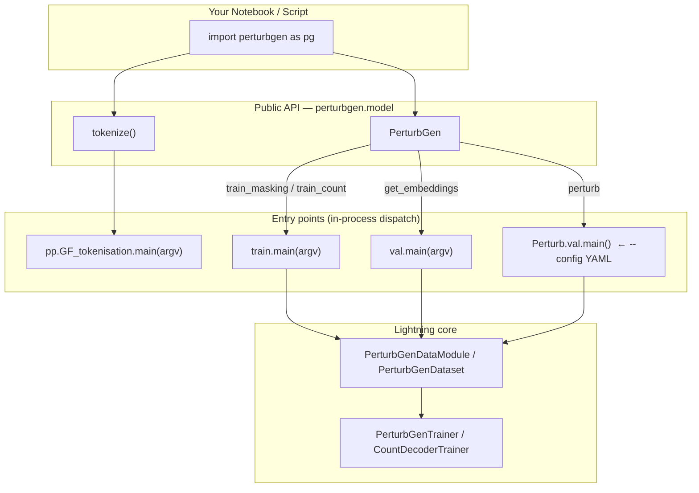
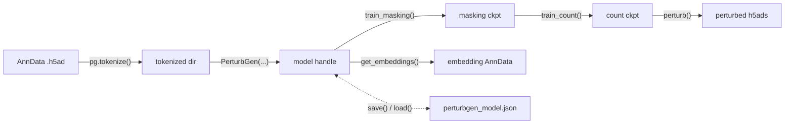

This page documents the programmatic Python interface of PerturbGen. The package exposes a deliberately minimal, scvi-tools-style facade in `perturbgen.model`: a module-level `tokenize()` function and a `PerturbGen` model class covering the full lifecycle — tokenization, two-stage training, embedding extraction, in-silico perturbation, and persistence. Everything runs **in-process** (no shell-outs to CLI scripts), so the API is notebook-first by design. This page is a reference: for guided usage see [Quick Start](2-quick-start) and [Tutorial Notebooks Walkthrough](4-tutorial-notebooks-walkthrough), and for the command-line equivalent see [CLI Command Reference](22-cli-command-reference).

Sources: [model.py](perturbgen/model.py#L1-L27), [__init__.py](perturbgen/__init__.py#L1-L6)

## API Layering and Design Model

The public API is a thin, typed facade over the repository's existing entry points. Each `PerturbGen` method synthesizes an argument vector (or, for perturbation, a temporary YAML config) and dispatches to the underlying `main()` function in the same process. This layering gives you a stable, documented surface while the CLI entry points, PyTorch Lightning modules, and data pipeline remain independently usable at a lower level.



The module docstring states the contract explicitly: the API starts from a tokenized-data directory, everything runs in process, and a CUDA GPU is required for `train_masking()`, `train_count()`, and `perturb()` — the same requirement as the CLI.

Sources: [model.py](perturbgen/model.py#L1-L27), [train.py](perturbgen/train.py#L60-L80)

> [!TIP]
> The entry points call `os.chdir(ROOT)` **at import time** ([train.py](perturbgen/train.py#L27)), which would silently relocate a notebook's working directory. The API neutralizes this with the `_preserve_cwd()` context manager wrapped around every dispatch ([model.py](perturbgen/model.py#L43-L54)). If you bypass the API and import entry points directly, restore `os.getcwd()` yourself — and note that `perturb()` deliberately imports `Perturb/val.py` only *after* making paths absolute, because that module also chdirs at import ([model.py](perturbgen/model.py#L644-L653)).

## Package Exports and Import Surface

The top-level package exports exactly two names via `__all__`, both from `perturbgen.model`. This is the entirety of the supported public interface — deeper modules are considered internal.

| Symbol | Kind | Purpose |
|---|---|---|
| `perturbgen.PerturbGen` | Class | Trainable/perturbable model handle over one tokenized dataset |
| `perturbgen.tokenize` | Function | Standalone preprocessing: AnnData → tokenized dataset directory |

Usage follows the idiom `import perturbgen as pg`, as documented in the module docstring. The Sphinx API docs ([docs/apidoc/perturbgen](docs/apidoc/perturbgen/perturbgen.rst#L15-L22)) additionally auto-document `perturbgen.model`, `perturbgen.train`, and `perturbgen.val` via `automodule`, but only the two `__all__` exports are the stable contract.

Sources: [__init__.py](perturbgen/__init__.py#L1-L6), [model.py](perturbgen/model.py#L1-L27), [perturbgen.rst](docs/apidoc/perturbgen/perturbgen.rst#L15-L22)

## Preprocessing: `tokenize()`

`tokenize()` is a **standalone preprocessing step** — no model required. It tokenizes and pairs an AnnData file and returns the tokenized-data directory path, which is what you pass to `PerturbGen()`. It works by synthesizing an argv list and invoking `perturbgen.pp.GF_tokenisation.main()` in-process; output is written under the project's `TOKENIZED_DIR` (see [Configuration System and Path Management](17-configuration-system-and-path-management)).

Sources: [model.py](perturbgen/model.py#L69-L149), [paths.py](perturbgen/configs/paths.py#L30)

**Key parameters:**

| Parameter | Type / Default | Meaning |
|---|---|---|
| `adata_path` | `str` | Input AnnData `.h5ad` |
| `dataset` | `str` | Name of the output subdirectory under `TOKENIZED_DIR` |
| `reference_time` | `str` | The source state; source files written as `<reference_time>.dataset` / `.h5ad` |
| `time_obs` | `str` (keyword-only) | `obs` column holding time-point labels |
| `time_point_order` | `Sequence[str]` | Ordered time points; pairs run source → later entries |
| `var_list` | `Sequence[str]` | Metadata variables carried through pairing |
| `main_pairing_obs` | `str` (keyword-only) | Column used for cell pairing |
| `gene_median_path`, `token_dict_path`, `gene_mapping_path` | `str` (keyword-only) | Vocabulary/statistics files; the shipped defaults live in `perturbgen.pp` |
| `n_hvg` | `int = 2000` | Number of highly variable genes |
| `hvg_mode` | `"after_tokenisation"` \| `"before_tokenisation"` | `after_tokenisation` selects exactly `n_hvg` from the Geneformer-tokenizable set; `before_tokenisation` intersects first and yields fewer |
| `pairing_mode` | `"stratified"` \| `"mapping"` | Pairing strategy; `"mapping"` additionally consumes `pairing_file` |
| `overwrite` | `bool = False` | Force re-tokenization; otherwise an existing output is returned as-is |

The function is **idempotent**: if the output already exists it is returned unchanged (a fast no-op on notebook re-runs) unless `overwrite=True`. For the underlying Geneformer-style tokenization mechanics see [Geneformer-Style Gene Tokenization](9-geneformer-style-gene-tokenization) and [Cell Pairing and Data Curation](14-cell-pairing-and-data-curation).

Sources: [model.py](perturbgen/model.py#L69-L149)

## The `PerturbGen` Model Class

`PerturbGen` represents a trained (or trainable) model over exactly one tokenized dataset. Its constructor validates the standard tokenizer layout, auto-detects file-name keys, and records hyperparameters used by all later methods.

### Construction

```python
model = pg.PerturbGen(
    tokenized_dir,               # output of tokenize() or a released dataset
    source="90m_LPS",            # reference time point
    encoder_path="...ckpt",      # optional pretrained encoder
    var_list=["cell_type_harmonized", "cell_pairing_index", "time_after_LPS"],
    pred_tps=[1, 2],
)
```

The constructor infers every file path from the standard layout, using `n_hvg` purely as a filename key (`<n_hvg>_hvg`):

```text
<tokenized_dir>/dataset_<n_hvg>_hvg_src/<source>.dataset
<tokenized_dir>/dataset_<n_hvg>_hvg_tgt/
<tokenized_dir>/h5ad_pairing_<n_hvg>_hvg_src/<source>.h5ad
<tokenized_dir>/h5ad_pairing_<n_hvg>_hvg_tgt/
<tokenized_dir>/token_id_to_genename_<n_hvg>.pkl
<tokenized_dir>/tokenid_to_rowid_<n_hvg>.pkl
```

Paths are stored **absolute** so the entry points' `os.chdir(ROOT)` cannot break them; any missing file raises a `FileNotFoundError` naming the key and expected path.

**Constructor parameters:**

| Parameter | Default | Meaning |
|---|---|---|
| `tokenized_dir` | required | Tokenized dataset directory |
| `source` | required (keyword-only) | Reference/source time point (e.g. `"90m_LPS"`, `"normal"`) |
| `n_hvg` | `None` | Filename key; `None` auto-detects from `dataset_<n>_hvg_src` folders |
| `encoder_path` | `None` | Pretrained encoder checkpoint (e.g. from the pretraining cohort) |
| `encoder` | `"scmaskgit"` | Encoder architecture selector |
| `n_layers`, `d_ff`, `d_model` | `6`, `64`, `768` | Transformer dimensions |
| `pred_tps` | `(1, 2)` | Predicted time-point indices |
| `var_list` | LPS metadata columns | Metadata variables carried through |
| `context_mode` | `True` | Decoder attends to other time points' observed cells |
| `cond_list` | `None` | Optional conditioning variables |
| `mask_scheduler` | `"pow"` | MaskGIT mask schedule |
| `pos_encoding_mode` | `"time_pos_sin"` | Time-aware positional encoding |
| `loss_mode` | `"zinb"` | Count-decoder loss family |
| `seed` | `42` | Reproducibility seed |
| `max_len`, `tgt_vocab_size` | `None` / `None` | Base sequence length and vocabulary size; leave both `None` to auto-detect, or set **both** to match an explicit-values model (released LPS models: `797` / `2002`) |

Sources: [model.py](perturbgen/model.py#L152-L199), [model.py](perturbgen/model.py#L200-L239), [model.py](perturbgen/model.py#L660-L677)

### Training Methods

Training is **two-stage**, mirroring the architecture documented in [Two-Stage Masking and Count Decoder Training](7-two-stage-masking-and-count-decoder-training): `train_masking()` trains the masked generative encoder, then `train_count()` trains the count decoder from a masking checkpoint. Both methods dispatch in-process to `perturbgen.train.main()` and return the metric-best checkpoint path.

| Method | Returns | Checkpoint location | Key knobs |
|---|---|---|---|
| `train_masking(output_dir, ...)` | Best masking `.ckpt` path | `<output_dir>/masking/checkpoints/*.ckpt` (one per epoch) | `max_epochs=20`, `batch_size=64`, `cellgen_lr=1e-4`, `cellgen_wd=1e-4`, `use_weighted_sampler=False`, `ckpt_every_n_epochs=1`, `seed`, `compile=True` |
| `train_count(output_dir, ...)` | Count-decoder `.ckpt` path | `<output_dir>/count/checkpoints/` | `masking_ckpt=None` (defaults to metric-best from step 1), `max_epochs=20`, `count_lr=1e-3`, `count_wd=1e-4`, `mlm_prob=0.15`, `count_dropout=0.0`, `loss_mode` from constructor |

Checkpoint-chaining is automatic: `train_masking()` stores the metric-best checkpoint on the instance, and `train_count()` uses it unless you pass `masking_ckpt=` explicitly (e.g. to pick a specific epoch after inspecting training curves). Calling `train_count()` without any masking checkpoint raises a `ValueError` telling you to run step 1 first. Both methods force `single_device=True` (no DDP) and `wandb_mode="disabled"` in the notebook context — for distributed training and W&B logging use the CLI workflows in [Distributed Training with DDP and DeepSpeed](19-distributed-training-with-ddp-and-deepspeed) and [Experiment Tracking with Weights and Biases](20-experiment-tracking-with-weights-and-biases).

Sources: [model.py](perturbgen/model.py#L284-L324), [model.py](perturbgen/model.py#L326-L377), [model.py](perturbgen/model.py#L243-L276)

### Embedding Extraction

`get_embeddings()` extracts gene and/or cell embeddings from a **trained masking model**, writing embedding AnnData files under `output_dir` and returning that path. It dispatches to `perturbgen.val.main()` with `--test_mode masking`.

| Parameter | Default | Constraint |
|---|---|---|
| `masking_ckpt` | `None` | Falls back to the instance's checkpoint from `train_masking()`; absent both → `ValueError` |
| `return_cell_embs` | `True` | Cell embeddings |
| `return_gene_embs` | `True` | **Requires** `gene_embs_condition` |
| `gene_embs_condition` | `None` | `obs` column; gene embeddings are extracted per unique value (e.g. `"time_after_LPS"`) |
| `batch_size`, `n_workers` | `64`, `4` | Throughput controls |

The coupling between `return_gene_embs` and `gene_embs_condition` is validated eagerly: requesting gene embeddings without a condition column raises a `ValueError` with the suggested remedy. For interpretation of the outputs see [Cell and Gene Embedding Extraction](11-cell-and-gene-embedding-extraction) and downstream analyses in [Gene Program Discovery](12-gene-program-discovery).

Sources: [model.py](perturbgen/model.py#L382-L458)

### In Silico Perturbation: `perturb()`

`perturb()` runs in-silico perturbation of named genes through the count decoder and writes predicted h5ads to `output_dir`. It builds a full YAML config dict in memory, writes it to a temporary file, and drives `perturbgen.Perturb.val.main()` in-process by swapping `sys.argv` (restored in a `finally` block).

**Parameters:**

| Parameter | Default | Meaning |
|---|---|---|
| `genes` | required | Ensembl IDs to perturb, e.g. `["ENSG00000125538"]` (IL1B) |
| `mode` | `"knockout"` | See mode table below |
| `where` | `"source"` | `"source"` edits the source state and propagates downstream; `"target"` edits a target state |
| `pert_tps` | `None` | With `where="target"`: which predicted time points' target states to perturb (e.g. `[1]`); **required** for target `knockout`/`delete`/`pad` |
| `pred_tps` | constructor's | Predicted time points |
| `n_samples` | `3` | Count draws from the count decoder per cell, averaged into predicted counts (`1` = predicted mean) |
| `count_ckpt` | `None` | Falls back to instance checkpoint; absent both → `ValueError` |
| `context_mode` | `False` | Perturbation prediction default; `True` lets the decoder attend to observed unperturbed cells of other time points |
| `extra_config` | `None` | Escape hatch into raw config keys (below) |
| `temperature`, `iterations` | `1.5`, `19` | **Inert** — accepted for backward compatibility only |

**Perturbation modes** (API alias → underlying `perturbation_mode`):

| API `mode` | Internal value | Notes |
|---|---|---|
| `"knockout"` | `"mask"` | Default; aliased from mask |
| `"mask"` | `"mask"` | Direct alias |
| `"overexpress"` | `"overexpress"` | The only target-mode edit that does not require `pert_tps` |
| `"delete"` | `"delete"` | Target usage requires `pert_tps` |
| `"pad"` | `"pad"` | Target usage requires `pert_tps` |

`where` maps to `perturbation_sequence` via `source→src`, `target→tgt`. Mode semantics are covered conceptually in [In Silico Perturbation Modes](10-in-silico-perturbation-modes).

**`extra_config`** injects options of the raw perturbation config (`perturbgen/Perturb/val.py`) that `perturb()` does not manage, as `{section: {key: value}}` with sections `"data"`, `"trainer"`, `"datamodule"`, or `"model"`. The API enforces ownership: keys that `perturb()` already sets are **rejected** with a `ValueError` listing the clash (only `num_workers` in `datamodule` is considered a safe override). Notable extras documented in the docstring: `data.filter_var`/`data.filter_cond` (e.g. `{"filter_var": "drug", "filter_cond": ["Drug10"]}`), and `data.perturb_genes_file` together with `perturb_colname`/`perturb_cluster` for cluster-wise gene perturbation (pass `genes=[]` alongside).

Sources: [model.py](perturbgen/model.py#L486-L542), [model.py](perturbgen/model.py#L57-L66), [model.py](perturbgen/model.py#L543-L657)

> [!TIP]
> `temperature` and `iterations` configure MaskGIT generation (`validation_mode="generate"`), but `perturb()` **always runs** `validation_mode="inference"`, which decodes the observed target cells — matching the released LPS and HSPC perturbation configs. If you pass non-default values the API emits a `UserWarning` rather than silently ignoring them ([model.py](perturbgen/model.py#L558-L563)). To actually sample with MaskGIT dynamics, use the generate mode of the CLI instead ([CLI Command Reference](22-cli-command-reference)).

Also note the docstring's practical constraint: for a **source knockout** the target gene must be expressed in the source state, otherwise every cell is filtered out.

Sources: [model.py](perturbgen/model.py#L539-L542)

### Persistence: `save()` / `load()`

Persistence is manifest-based, not weight-based: `save(path)` writes a `perturbgen_model.json` containing the tokenized-dir, source, `n_hvg`, hyperparameters, and checkpoint locations; `PerturbGen.load(path)` reconstructs the instance from it. The heavy model weights stay in the referenced `.ckpt` files, so a manifest is small and portable, and `load()` re-validates the tokenized layout through the constructor. `train_masking`/`train_count`/`perturb` also expose graceful fallbacks via `_latest_ckpt()`, which picks the most recently modified `.ckpt` if the metric-best is missing.

Sources: [model.py](perturbgen/model.py#L463-L481), [model.py](perturbgen/model.py#L680-L688)

## End-to-End Object Lifecycle

The full lifecycle, as documented in the module docstring, is a five-call pipeline. Each stage's return value feeds the next, and the manifest lets you stop/resume at any boundary:



```python
import perturbgen as pg

model = pg.PerturbGen(
    "T_perturb/tokenized_data/lps_90min_perturb",
    source="90m_LPS",
    encoder_path="pretraining_cohort/....ckpt",
    var_list=["cell_type_harmonized", "cell_pairing_index", "time_after_LPS"],
    pred_tps=[1, 2],
)
masking_ckpt = model.train_masking(output_dir="lps_model", max_epochs=20, batch_size=64)
count_ckpt = model.train_count(output_dir="lps_model", masking_ckpt=masking_ckpt)
model.save("lps_model")                       # or: pg.PerturbGen.load("lps_model")

pred = model.perturb(genes=["ENSG00000125538"],   # IL1B
                     mode="knockout", where="source")
```

The config-building logic of `perturb()` is exercised directly by the test suite, which constructs a fake tokenized directory, mocks `Perturb.val.main`, and asserts on the generated YAML — a useful executable specification of the API's contract ([test_api_perturb.py](perturbgen/tests/test_api_perturb.py#L1-L60)); see [Test and Benchmark Suite](26-test-and-benchmark-suite).

Sources: [model.py](perturbgen/model.py#L4-L20), [model.py](perturbgen/model.py#L8-L20), [test_api_perturb.py](perturbgen/tests/test_api_perturb.py#L28-L40)

## Lower-Level Module Surface

For advanced use — custom training loops, research extensions, or debugging — the layers beneath the facade are directly importable. These are internal and evolve faster than the public API.

| Module | Key symbols | Role |
|---|---|---|
| `perturbgen.Model.trainer` | `PerturbGenTrainer`, `CountDecoderTrainer` | `LightningModule`s with ~50 hyperparameters: vocab size, heads/layers, mask schedule, precision, checkpoint-key handling for `torch.compile` ([Model/trainer.py](perturbgen/Model/trainer.py#L75-L124)) |
| `perturbgen.Dataloaders.datamodule` | `PerturbGenDataset`, `PerturbGenDataModule` | `torch Dataset` + `LightningDataModule` over HF `datasets`; src/tgt time-step pairing, count tensors, condition encodings, optional `WeightedRandomSampler` ([datamodule.py](perturbgen/Dataloaders/datamodule.py#L151-L226)) |
| `perturbgen.Modules.transformer` | `PerturbGen`, `CountDecoder` | Transformer encoder/decoder implementations |
| `perturbgen.train` | `main(argv)` | argparse entry point; `--train_mode {masking, count}`, splitting, DDP/DeepSpeed strategies ([train.py](perturbgen/train.py#L60-L74)) |
| `perturbgen.val` / `perturbgen.Perturb.val` | `main(argv)` / `main()` | Validation/embedding entry; perturbation entry reading `--config <yaml>` |
| `perturbgen.pp` | `GF_tokenisation`, `tokenizer`, vocabulary `.pkl` constants | Geneformer-style tokenization; `pp` package constants point at the shipped `gene_median`, `token_dict`, and `ensembl_mapping` files ([pp/__init__.py](perturbgen/pp/__init__.py#L1-L7)); the raw `TranscriptomeTokenizer` docstring documents input formats and the 95M-series settings (`special_token=True`, `model_input_size=4096`) ([tokenizer.py](perturbgen/pp/tokenizer.py#L1-L39)) |
| `perturbgen.src` | `losses`, `metric`, `mmd`, `optimal_transport`, `utils`, `gf_utils` | Loss functions, distributional metrics ([Evaluation Metrics](13-evaluation-metrics-mmd-emd-optimal-transport)), embedding/attn utilities |
| `perturbgen.configs.paths` | `ROOT`, `REPO_DIR`, `TOKENIZED_DIR`, `ENCODER_CKPT_PATH`, `GENE_MEDIAN_PATH`, ... | Path defaults; `TOKENIZED_DIR` is where `tokenize()` writes, and `ENCODER_CKPT_PATH` points at the shipped pretraining checkpoint ([paths.py](perturbgen/configs/paths.py#L3-L16)) |

Sources: [Model/trainer.py](perturbgen/Model/trainer.py#L75-L124), [datamodule.py](perturbgen/Dataloaders/datamodule.py#L22-L36), [pp/__init__.py](perturbgen/pp/__init__.py#L1-L7), [tokenizer.py](perturbgen/pp/tokenizer.py#L1-L39), [paths.py](perturbgen/configs/paths.py#L3-L35)

## Error Contracts and Invariants

The API fails loudly and early, with actionable messages rather than silent misconfiguration:

| Raised at | Condition | Exception |
|---|---|---|
| `PerturbGen(...)` | `max_len` set without `tgt_vocab_size` (or vice versa) | `ValueError` |
| `PerturbGen(...)` | Any expected tokenized file missing for the given `source`/`n_hvg` | `FileNotFoundError` (names the path) |
| `n_hvg` auto-detection | No `dataset_<n>_hvg_src` folder, or multiple `n_hvg` variants side by side | `FileNotFoundError` / `ValueError` |
| `train_count()` | No masking checkpoint available or passed | `ValueError` |
| `get_embeddings()` | `return_gene_embs=True` without `gene_embs_condition` | `ValueError` |
| `perturb()` | No count checkpoint; invalid `mode`/`where`; `where="target"` with non-overexpress mode but no `pert_tps` | `ValueError` |
| `perturb()` `extra_config` | Unknown section, non-dict values, or keys owned by `perturb()` | `ValueError` / `TypeError` |
| `PerturbGenDataModule` | `use_weighted_sampler=True` without `sampling_keys` | `ValueError` |

**Invariants** worth remembering: `tokenize()` is idempotent by default; all stored paths are absolute and immune to the entry points' `os.chdir(ROOT)`; method chaining is automatic (metric-best masking checkpoint flows into `train_count()`); and the returned path strings from every method are the canonical handles you pass onward — nothing needs to be re-derived by hand.

Sources: [model.py](perturbgen/model.py#L200-L239), [model.py](perturbgen/model.py#L352-L357), [model.py](perturbgen/model.py#L399-L411), [model.py](perturbgen/model.py#L543-L575), [model.py](perturbgen/model.py#L628-L639), [datamodule.py](perturbgen/Dataloaders/datamodule.py#L219-L224)

## Where to Go Next

This reference gives you signatures and contracts; the following pages supply the concepts behind them:

- **Getting started hands-on**: [Quick Start](2-quick-start) → [Tutorial Notebooks Walkthrough](4-tutorial-notebooks-walkthrough)
- **Under the training and perturbation calls**: [Two-Stage Masking and Count Decoder Training](7-two-stage-masking-and-count-decoder-training), [In Silico Perturbation Modes](10-in-silico-perturbation-modes), [Cell and Gene Embedding Extraction](11-cell-and-gene-embedding-extraction)
- **Data contracts behind `tokenize()`**: [Tokenized Dataset Layout](16-tokenized-dataset-layout), [Configuration System and Path Management](17-configuration-system-and-path-management)
- **Adjacent interfaces**: [CLI Command Reference](22-cli-command-reference), [Pretrained Checkpoints and Hugging Face Assets](23-pretrained-checkpoints-and-hugging-face-assets), [ZINB and Negative Binomial Losses](24-zinb-and-negative-binomial-losses)
