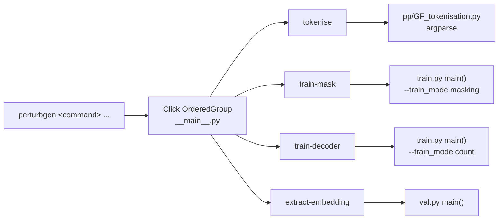
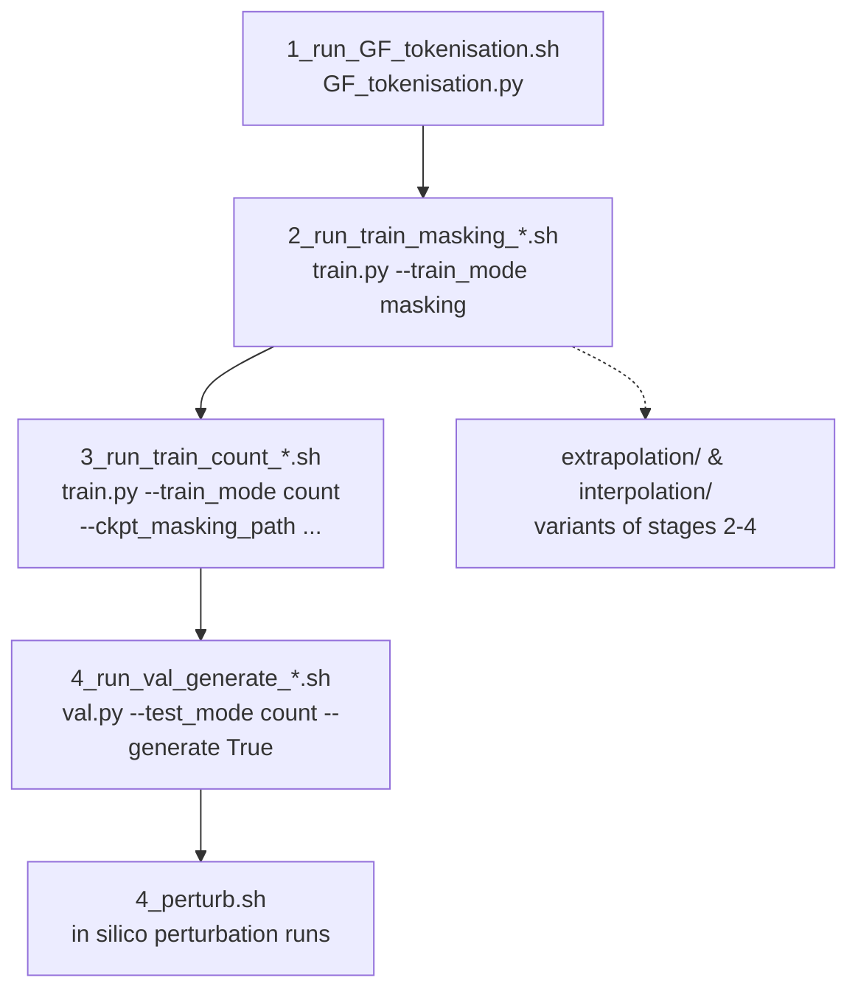

Perturbgen exposes every stage of its workflow — tokenisation, two-stage training, and evaluation/generation — through a single installed console command called `perturbgen`. This page is the authoritative reference for that command, the argparse scripts it wraps, the orchestration shell scripts used on cluster schedulers, and the path-resolution rules that determine where your file arguments must point. Commands are documented with their real flags and defaults, exactly as parsed by the code.

## The `perturbgen` Entry Point and Command Dispatch

After installing the package, the executable `perturbgen` is registered via the `[project.scripts]` table in `pyproject.toml`, which binds the command name to `perturbgen.__main__:main`. The dispatcher itself is built with the `click` library using a custom `OrderedGroup` class so that subcommands are listed in workflow order (`tokenise` → `train-mask` → `train-decoder` → `extract-embedding`) rather than alphabetically — the visual order of `perturbgen --help` mirrors the pipeline you will actually run.

Sources: [pyproject.toml](pyproject.toml#L12-L13), [__main__.py](perturbgen/__main__.py#L7-L42)

Each subcommand is a thin wrapper: it declares `nargs=-1` catch-all arguments with `ignore_unknown_options=True`, prints a "loading, please wait..." message, then lazily imports the relevant module and forwards your flags verbatim to that module's `main()`. Notably, the Click layer sets `help_option_names=[]`, which disables Click's own `--help` so that `-h`/`--help` and every other flag fall through untouched to the underlying argparse parser — meaning you query documentation from the script level, not the dispatcher level.



| Command | Wraps | Purpose |
|---|---|---|
| `perturbgen tokenise` | `perturbgen.pp.GF_tokenisation.main` | Preprocessing and Geneformer-style tokenisation |
| `perturbgen train-mask` | `perturbgen.train.main` | Train the masked generative encoder |
| `perturbgen train-decoder` | `perturbgen.train.main` | Train the count decoder on top of a masking checkpoint |
| `perturbgen extract-embedding` | `perturbgen.val.main` | Load checkpoints, generate cells, extract embeddings |

A hidden alias `tokenize` (American spelling) redirects to `tokenise`, so both spellings are accepted.

Sources: [__main__.py](perturbgen/__main__.py#L45-L88)

## `perturbgen tokenise` — Data Preprocessing and Tokenisation

The `tokenise` command accepts an `.h5ad` file and produces the paired source/target tokenised datasets (Hugging Face `.dataset` plus pairing `.h5ad` files) that training consumes. Its argparse surface controls gene filtering, cell pairing, time-point ordering, and which shipped or custom token dictionaries are used. Boolean-valued options are parsed with a `str2bool` helper, so you pass literal `True`/`False` words.

Key arguments:

| Flag | Default | Choices / Meaning |
|---|---|---|
| `--h5ad_path` | `./data/eb/EB.h5ad` | Input AnnData file |
| `--dataset` | `eb_100M` | Output dataset folder name |
| `--gene_filtering_mode` | `hvg` | `hvg`, `degs`, or `all` |
| `--hvg_mode` | `before_tokenisation` | `before_tokenisation` / `after_tokenisation` |
| `--hvg_flavor` | `seurat` | `seurat`, `seurat_v3`, `cell_ranger` (scanpy HVG flavours) |
| `--pairing_mode` | `random` | `stratified`, `random`, `mapping` |
| `--time_obs` | `Time_point` | obs column encoding states for pairing |
| `--reference_time` | `Day 00-03` | Control time point paired against |
| `--time_point_order` | EB day bins | Ordered list of time points |
| `--n_hvg` | `2000` | Number of highly variable genes |
| `--exclude_non_GF_genes` | `False` | Drop genes absent from the Geneformer dictionary |
| `--remove_mito_ribo_genes` | `False` | Filter mitochondrial/ribosomal genes |
| `--nproc` | `4` | Tokenisation worker processes |
| `--gene_median_path`, `--token_dict_path`, `--gene_mapping_path` | shipped pickles in `perturbgen/pp/` | Vocabulary/normalisation assets (overridable) |

A production invocation from the repository's batch scripts shows the flag style in practice — multi-valued options like `--var_list` and `--time_point_order` take space-separated values:

```bash
python3 pp/GF_tokenisation.py \
  --h5ad_path '/nfs/.../full_lps.h5ad' \
  --dataset lps_90min_perturb \
  --gene_filtering_mode hvg \
  --exclude_non_GF_genes True \
  --pairing_mode stratified \
  --time_obs time_after_LPS \
  --reference_time '90m_LPS' \
  --time_point_order '90m_LPS' '6h_LPS' '10h_LPS' \
  --n_hvg 2000
```

Sources: [GF_tokenisation.py](perturbgen/pp/GF_tokenisation.py#L37-L211), [1_run_GF_tokenisation.sh](perturbgen/batch_job_script/lps/1_run_GF_tokenisation.sh#L19-L37)

For the tokenisation format itself, see [Geneformer-Style Gene Tokenization](9-geneformer-style-gene-tokenization); for pairing semantics, see [Cell Pairing and Data Curation](14-cell-pairing-and-data-curation).

## `perturbgen train-mask` and `train-decoder` — Two-Stage Training

Both training commands dispatch into the same script, `perturbgen/train.py`, and are distinguished solely by `--train_mode` (`masking` for stage one, `count` for stage two). Stage two additionally requires `--ckpt_masking_path` pointing at the frozen encoder checkpoint from stage one. The argparse surface falls into five groups: data paths, optimisation, model architecture, distributed execution, and experiment tracking.

| Group | Flags (default) | Notes |
|---|---|---|
| **Mode** | `--train_mode` (`masking`) | `masking` or `count` |
| **Data** | `--src_dataset`, `--tgt_dataset_folder`, `--src_adata`, `--tgt_adata_folder`, `--mapping_dict_path`, `--tokenid_to_rowid_path` | Tokenised dataset and pairing file locations; mappings are required pickles |
| **Splitting** | `--split` (`True`), `--splitting_mode` (`stratified`), `--split_obs`, `--train_prop` (0.8), `--test_prop` (0.1) | Modes: `random`, `stratified`, `unseen_cond` |
| **Optimisation** | `--epochs` (5), `--batch_size` (64), `--cellgen_lr` (1e-4), `--count_lr` (5e-5), `--cellgen_wd` (1e-4), `--count_wd` (0.01), `--loss_mode` (`zinb`) | Loss choices: `zinb`, `nb`, `mse` |
| **Architecture** | `--encoder` (`scmaskgit`), `--encoder_path` (shipped pretraining ckpt), `--d_model` (768), `--num_layers` (6), `--d_ff` (64), `--pos_encoding_mode` (`time_pos_sin`), `--mask_scheduler` (`pow`), `--mlm_prob` (0.15), `--max_len`, `--tgt_vocab_size` | Dimension overrides apply before model offsets; `max_len`/`tgt_vocab_size` default to auto-detection from data |
| **Generation params** | `--temperature` (1.5), `--iterations` (19), `--pred_tps` (1 2 3), `--context_tps`, `--context_mode` (`True`) | Time points predicted vs. used as cross-attention context |
| **Execution** | `--parallel_distribution` (`ddp`), `--num_node` (1), `--n_workers` (4), `--single_device` (`False`), `--compile` (`True`) | `ddp` or `deepspeed`; `--single_device` is the notebook-safe mode set by the Python API |
| **Tracking** | `--wandb_mode` (`offline`), `--wandb_entity`, `--wandb_project` (`perturbgen`), `--output_dir`, `--ckpt_every_n_epochs` (10) | Each falls back to the matching `WANDB_*` environment variable |

The stage-two command in the repository's LPS interpolation workflow passes the masking checkpoint forward and switches optimisation hyperparameters accordingly (`--train_mode count --ckpt_masking_path ... --count_lr 0.001 --loss_mode zinb`).

> [!TIP]
> Boolean flags are `str2bool`-parsed: write `--split False` or `--context_mode True` as literal words. Numeric-style shorthands like `--split 0` are not guaranteed — the batch scripts in this repo always use `True`/`False`.

Sources: [train.py](perturbgen/train.py#L60-L341), [2_run_train_masking_Encoder_interpolation.sh](perturbgen/batch_job_script/lps/interpolation/2_run_train_masking_Encoder_interpolation.sh#L33-L63), [3_run_train_count_interpolation.sh](perturbgen/batch_job_script/lps/interpolation/3_run_train_count_interpolation.sh#L31-L67)

The training strategy behind these flags is explained in [Two-Stage Masking and Count Decoder Training](7-two-stage-masking-and-count-decoder-training); distributed execution details live in [Distributed Training with DDP and DeepSpeed](19-distributed-training-with-ddp-and-deepspeed).

## `perturbgen extract-embedding` — Evaluation, Generation, and Embeddings

The fourth command wraps `perturbgen/val.py`, which loads trained checkpoints and either generates cells for downstream metrics or extracts embeddings/attention. Its flag surface overlaps heavily with `train.py` (architecture flags must match the checkpoint), with evaluation-specific additions:

| Flag | Default | Purpose |
|---|---|---|
| `--test_mode` | `count` | `masking` or `count` — which checkpoint head to evaluate |
| `--ckpt_masking_path` / `--ckpt_count_path` | `None` | Checkpoint(s) to load |
| `--generate` | `True` | Run generative sampling |
| `--return_embeddings` | `False` | Also emit cell/gene embeddings |
| `--return_attn` | `False` | Also emit attention maps |
| `--sequence_length` | `150` | Sampling sequence length |
| `--iterations` | `20` | Masked-generation iterations |
| `--temperature` | `0.5` | Sampling temperature (lower = more conservative than training default) |
| `--pred_tps` / `--context_tps` | `1 2 3` / `None` | Time points to predict / condition on |
| `--n_samples` | (see script) | Number of generated samples per condition |
| `--max_len`, `--tgt_vocab_size` | `None` | Must match the values used at training time |
| `--n_workers` | `32` | DataLoader workers (higher than training default) |

The generation run in the LPS workflow shows the canonical shape: `--test_mode count --generate True --pred_tps 2 --context_tps 1 3 --temperature 0.25 --iterations 20`, i.e., interpolating time point 2 conditioned on time points 1 and 3.

Sources: [val.py](perturbgen/val.py#L33-L310), [4_run_val_generate_interpolation.sh](perturbgen/batch_job_script/lps/interpolation/4_run_val_generate_interpolation.sh#L30-L67)

Embedding extraction workflows are covered in [Cell and Gene Embedding Extraction](11-cell-and-gene-embedding-extraction), and the metrics computed from generated cells in [Evaluation Metrics: MMD, EMD, Optimal Transport](13-evaluation-metrics-mmd-emd-optimal-transport).

## Path Resolution and the ROOT Anchor

Every CLI script calls `os.chdir(ROOT)` at import time, where `ROOT` is defined in `perturbgen/configs/paths.py` as three directory levels above the `configs` package — the parent of the repository itself. This has a concrete consequence for beginners: **relative path arguments (like `T_perturb/tokenized_data/...`) resolve against `ROOT`, not against the directory your terminal is currently in**. The same module defines the project layout `ROOT/T_perturb/{data, res, tokenized_data}` and creates those directories automatically on first import.

The repo also ships its asset defaults through this module: the gene-median, token-dictionary, and gene-mapping pickles in `perturbgen/pp/`, and the pretrained encoder checkpoint under `pretraining_cohort/`, which is the fallback value of `--encoder_path` in `train.py`. This means a training command can omit `--encoder_path`, `--gene_median_path`, etc., and still work out of the box.

> [!TIP]
> When a command reports "file not found" for a relative path, check it against `ROOT/T_perturb/...` first — the working-directory switch happens before argparse values are ever touched, so absolute paths are the safest choice in your own scripts.

Sources: [paths.py](perturbgen/configs/paths.py#L3-L35), [train.py](perturbgen/train.py#L27-L28), [GF_tokenisation.py](perturbgen/pp/GF_tokenisation.py#L34-L35)

## Orchestration Scripts and the Batch Job Pipeline

Beyond the Python CLI, the repository ships shell orchestration layers. At the package root, `run_sweep.sh` is an LSF (`#BSUB` headers) GPU job whose payload is a single WandB sweep agent invocation (`wandb agent <entity>/<project>/<sweep_id>`), and `run_test.sh` is a CPU job running `python -m unittest discover .../perturbgen/tests/` against the test suite. Both export `WANDB_DIR` and load a CUDA module first.

Under `perturbgen/batch_job_script/`, dataset-specific folders (`cytoimmgen`, `eb`, `hspc`, `lps`, `sko`) contain numbered scripts that map one-to-one onto the CLI stages:



The numbered scripts are the most reliable, copy-pasteable source of flag combinations: `1_` calls the tokeniser directly with absolute paths; `2_`/`3_` call `train.py` with stage-appropriate learning rates and checkpoints; `4_` calls `val.py` for generation. The `interpolation/` and `extrapolation/` subfolders reuse the same four stages with different `--pred_tps`/`--context_tps` and splitting settings.

Sources: [run_sweep.sh](perturbgen/run_sweep.sh#L20-L25), [run_test.sh](perturbgen/run_test.sh#L20-L23), [2_run_train_masking_Encoder_interpolation.sh](perturbgen/batch_job_script/lps/interpolation/2_run_train_masking_Encoder_interpolation.sh#L24-L63)

Sweep mechanics and WandB integration are documented separately in [Hyperparameter Sweeps and Batch Jobs](18-hyperparameter-sweeps-and-batch-jobs) and [Experiment Tracking with Weights and Biases](20-experiment-tracking-with-weights-and-biases); the perturbation stage is detailed in [In Silico Perturbation Modes](10-in-silico-perturbation-modes).

## Environment Variables at the CLI Boundary

Three `WANDB_*` environment variables shape CLI behaviour without any flags: `WANDB_MODE` (default `offline` if unset — runs stay local and can be uploaded later with `wandb sync`), `WANDB_ENTITY`, and `WANDB_PROJECT` (default `perturbgen`). Every corresponding CLI flag reads its default from the environment first, so setting `export WANDB_MODE=online` once in your shell config is equivalent to passing `--wandb_mode online` on every command. The orchestration scripts additionally export `WANDB_DIR` to redirect local run files into a `wandb/` folder in the job's working directory.

Sources: [train.py](perturbgen/train.py#L168-L194), [val.py](perturbgen/val.py#L252-L278), [run_sweep.sh](perturbgen/run_sweep.sh#L20)

## Command Selection Guide

| You want to... | Use | Requires from earlier stages |
|---|---|---|
| Turn raw `.h5ad` into tokenised paired datasets | `perturbgen tokenise` | Raw AnnData with counts layer or `X` |
| Pretrain / fine-tune the masked encoder | `perturbgen train-mask` | Tokenised datasets |
| Train the count decoder head | `perturbgen train-decoder` | Masking checkpoint (`--ckpt_masking_path`) |
| Generate cells, score metrics, or extract embeddings | `perturbgen extract-embedding` | Count (and/or masking) checkpoint(s) |
| Run a hyperparameter sweep | `bash run_sweep.sh` (or `wandb agent` directly) | A WandB sweep ID |
| Verify the installation end-to-end | `bash run_test.sh` (or `python -m unittest discover perturbgen/tests/`) | Environment with GPU/CPU deps |

One architectural caveat worth knowing: the training entry point calls `pl.seed_everything(42, workers=True)` unconditionally at the start of `main()`, while the `--seed` flag (default 42) feeds downstream components — so reproducibility-sensitive splits inherit the flag, but the global seeding call is pinned.

Sources: [train.py](perturbgen/train.py#L345-L351), [run_test.sh](perturbgen/run_test.sh#L22)

## Where to Go Next

To see these commands exercised end-to-end with explanations, start with [Quick Start](2-quick-start) and [Tutorial Notebooks Walkthrough](4-tutorial-notebooks-walkthrough). For the directories the CLI expects on disk, read [Configuration System and Path Management](17-configuration-system-and-path-management) and [Tokenized Dataset Layout](16-tokenized-dataset-layout). When you outgrow the CLI's batch-script style and want in-process control from Python or notebooks, the object-oriented equivalents are covered in [Python API Reference](21-python-api-reference) — the API reuses the very same `train.py`/`val.py` mains internally, so every flag documented here maps to an API keyword. Finally, the checks that `run_test.sh` executes are unpacked in [Test and Benchmark Suite](26-test-and-benchmark-suite).
