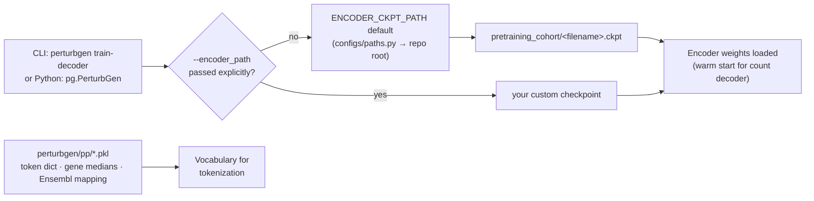
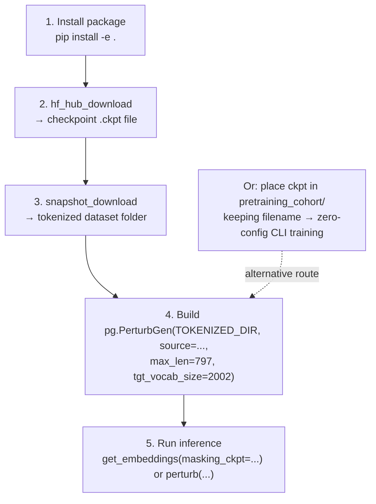

PerturbGen ships pretrained model weights so you can run embedding extraction and in-silico perturbation without training anything yourself. This page explains the **three asset systems** you will interact with as a beginner: the local checkpoint directory (`pretraining_cohort/`), the Hugging Face Hub release (`lotfollahi-lab/PerturbGen`), and the tokenizer companion files shipped inside the Python package (`perturbgen/pp/`). By the end you will know where each asset lives, how checkpoint filenames encode their training configuration, and how to wire a downloaded checkpoint into a working model.

The design principle is simple: **the code expects assets at predictable, deterministic paths**, so once files are in place, no extra flags are needed.

Sources: [README.md](/README.md#L105-L116), [paths.py](/perturbgen/configs/paths.py#L1-L35)

## The Local Checkpoint Contract: `pretraining_cohort/`

The repository contains one pretrained checkpoint, stored in the top-level `pretraining_cohort/` directory:

```
pretraining_cohort/
└── 20250709_1223_cellgen_train_masking_lr_5e-05_wd_1e-06_batch_64_ptime_pos_sin_m_pow_tp_1-2-3_s_42-epoch=00.ckpt
```

This path is not a convention — it is hard-coded as the default. The configuration module `perturbgen/configs/paths.py` derives all asset paths relative to the repository root so that **no private machine-specific paths are needed**, defining `ENCODER_CKPT_PATH` alongside three tokenizer pickles:

```python
ENCODER_CKPT_PATH = (
    REPO_DIR / "pretraining_cohort"
    / "20250709_1223_cellgen_train_masking_lr_5e-05_wd_1e-06_batch_64"
      "_ptime_pos_sin_m_pow_tp_1-2-3_s_42-epoch=00.ckpt"
)
```

When you run training through the CLI (`perturbgen train-decoder`), the `--encoder_path` argument **defaults to this path** (`default=str(ENCODER_CKPT_PATH)`), meaning the pretrained encoder is loaded automatically as a warm start — the entire point of shipping the checkpoint locally. The same mechanism works through the Python API, where `pg.PerturbGen(..., encoder_path=...)` accepts an explicit path and passes it to the underlying training entry point.

⚠️ **Critical caveat documented in the README**: this `.ckpt` is stored with **Git LFS**, and due to bandwidth limits `git lfs pull` may fail with a **403 error**. The recommended route is to download from Hugging Face instead (see the next section) and save the file into `pretraining_cohort/` **keeping its exact original filename** — that is where training looks for the encoder by default, so no `--encoder_path` flag is needed.

Sources: [paths.py](/perturbgen/configs/paths.py#L12-L19), [README.md](/README.md#L105-L116), [train.py](/perturbgen/train.py#L286-L292), [model.py](/perturbgen/model.py#L1-L26)

The full asset-resolution flow, from CLI invocation to loaded weights:



> [!TIP]
> When replacing the local checkpoint with the Hugging Face download, preserve the filename exactly. `ENCODER_CKPT_PATH` is an absolute path built from the literal filename string in `configs/paths.py` — a renamed file will silently break the default resolution.

Sources: [paths.py](/perturbgen/configs/paths.py#L14-L18), [train.py](/perturbgen/train.py#L286-L292), [model.py](/perturbgen/model.py#L287-L316)

## Anatomy of a Checkpoint Filename

Every checkpoint filename is a **self-describing configuration record**. This is deliberate: the filename is generated programmatically at save time from the training arguments, so anyone (or any script) can reconstruct the training setup from the name alone. The local checkpoint decodes as follows:

| Filename segment | Example value | Meaning |
|---|---|---|
| `20250709_1223_cellgen` | timestamp + run prefix | `YYYYMMDD_HHMM` of run creation + dataset tag |
| `train_masking` / `train_count` | training stage | masking model vs count decoder |
| `lr_5e-05` | learning rate | `cellgen_lr` or `count_lr` |
| `wd_1e-06` | weight decay | `cellgen_wd` or `count_wd` |
| `batch_64` | batch size | global batch size (split across GPUs) |
| `ptime_pos_sin` / `pos_time_pos_sin` | positional encoding | `pos_encoding_mode` (`time_pos_sin`, …) |
| `m_pow` / `m_cosine` | mask scheduler | `mask_scheduler` (`pow`, `cosine`, `exp`) |
| `tp_1-2-3` | time points | `pred_tps` — prediction targets |
| `s_42` | seed | reproducibility seed |
| `epoch=00` | epoch number | appended by Lightning's `{epoch:02d}` |

Sources: [train.py](/perturbgen/train.py#L570-L600), [train.py](/perturbgen/train.py#L603-L612)

This naming is generated in `train.py` via a `run_id` timestamp plus an f-string that interpolates the exact argparse values, then handed to a `ModelCheckpoint` callback that appends the epoch suffix. The count-decoder variant additionally embeds `drop_<dropout>` and the loss mode (e.g. `zinb`). One practical consequence for beginners: **the released checkpoints on Hugging Face follow the identical pattern**, so you can read any filename and immediately know the architecture stage, hyperparameters, and seed that produced it.

Sources: [train.py](/perturbgen/train.py#L571-L577), [train.py](/perturbgen/train.py#L578-L600)

## The Hugging Face Hub Release

The official distribution channel is the Hugging Face repository **[`lotfollahi-lab/PerturbGen`](https://huggingface.co/lotfollahi-lab/PerturbGen/tree/main)**. It hosts more than a single checkpoint — it is organized as **dataset-scoped directories** containing both model weights and, crucially, **the exact tokenized datasets each checkpoint was trained on**:

| HF path pattern | Content | Used by |
|---|---|---|
| `lps/embedding/…epoch=07.ckpt` | Masking-model checkpoint for cell/gene-embedding analyses (source `normal`; targets 90 min, 6 h, 10 h) | `cell_gene_embeddings.ipynb` |
| `lps/il1b/…train_count…epoch=03.ckpt` | Count-decoder checkpoint for the IL1B perturbation example (source `90m_LPS`; targets 6 h, 10 h) | `perturbation.ipynb` |
| `lps/tokenized/OURmed100m_LPS_all_tps_2k_hvg/` | Tokenized dataset paired with the embedding checkpoint | `cell_gene_embeddings.ipynb` |
| `lps/tokenized/OURmed100m_LPS_all_tps_2k_hvg_noNormal/` | Tokenized dataset paired with the IL1B model (unstimulated `normal` state removed) | `perturbation.ipynb` |

Sources: [README.md](/README.md#L105-L116), [cell_gene_embeddings.ipynb](/docs/examples/cell_gene_embeddings.ipynb#L18-L38), [perturbation.ipynb](/docs/examples/perturbation.ipynb#L62-L105)

Downloads use the `huggingface_hub` client with two complementary functions, both demonstrated in the tutorial notebooks:

```python
from huggingface_hub import hf_hub_download, snapshot_download

REPO = "lotfollahi-lab/PerturbGen"

# 1. A single checkpoint file:
MASKING_CKPT = hf_hub_download(
    REPO, "lps/embedding/20250714_2311_cellgen_train_masking_lr_0.0001_wd_0.0001"
          "_batch_64_ptime_pos_sin_m_cosine_tp_1-2-3_s_0-epoch=07.ckpt"
)

# 2. A whole tokenized-data folder, filtered by pattern:
LOCAL = snapshot_download(REPO, allow_patterns=["lps/tokenized/OURmed100m_LPS_all_tps_2k_hvg/*"])
TOKENIZED_DIR = os.path.join(LOCAL, "lps/tokenized/OURmed100m_LPS_all_tps_2k_hvg")
```

> [!TIP]
> The IL1B count-decoder checkpoint **contains the masking model inside it** — the notebook notes it "also contains the masking model it was trained from". This means a single `.ckpt` download is sufficient for full perturbation runs; you do not need to fetch the encoder separately.

Sources: [cell_gene_embeddings.ipynb](/docs/examples/cell_gene_embeddings.ipynb#L24-L38), [perturbation.ipynb](/docs/examples/perturbation.ipynb#L80-L100)

## Repo-Shipped Tokenizer Companion Assets

Checkpoints are useless without the **vocabulary assets** that define gene token IDs. PerturbGen ships three pickle files inside the package itself, so tokenization works out of the box with no downloads:

| Asset file (`perturbgen/pp/`) | Config constant | Role |
|---|---|---|
| `token_dict_gftokens_gc95M.pkl` | `TOKEN_DICTIONARY_FILE` / `TOKEN_DICT_PATH` | Maps genes to Geneformer token IDs |
| `gene_median_dict_gftokens_gc95M.pkl` | `GENE_MEDIAN_FILE` / `GENE_MEDIAN_PATH` | Median-expression normalization values per gene |
| `ensembl_mapping_dict_gc95M.pkl` | `ENSEMBL_MAPPING_FILE` / `GENE_MAPPING_PATH` | Ensembl ID ↔ gene mapping |

These are exposed through two parallel constant sets — `pp/__init__.py` (used by the tokenizer module) and `configs/paths.py` (used by the tokenization entry point) — both resolving to the same physical files via `os.path.dirname(__file__)`, so they survive any install location. The `gc95M` suffix indicates these belong to the **Geneformer 95M model series**; the tokenizer documentation warns explicitly to *"take care that the correct token dictionary and gene median file is used for the correct model"* (the 95M series requires `special_token=True` and input size 4096, versus 30M-series settings).

Sources: [pp/\_\_init\_\_.py](/perturbgen/pp/__init__.py#L1-L7), [paths.py](/perturbgen/configs/paths.py#L4-L10), [tokenizer.py](/perturbgen/pp/tokenizer.py#L38-L42)

Note also that tokenized datasets themselves are stored in **Hugging Face `datasets` format** (`.dataset` directories loaded via `load_from_disk`) — this is why the `datasets` library appears in the training imports and why the Hub release ships tokenized data alongside weights.

Sources: [train.py](/perturbgen/train.py#L8-L9), [tokenizer.py](/perturbgen/pp/tokenizer.py#L56-L59)

## Compatibility Rules: Checkpoints Must Meet Their Data

The single most important rule for using released assets: **a checkpoint must be paired with the tokenized data it was trained on, because token IDs are defined by that tokenization.** This is stated verbatim in both notebooks. Three concrete constraints follow:

| Constraint | Why | Released LPS values |
|---|---|---|
| `max_len` must match training | Sequence length (before the +100 model offset); mismatches corrupt positional encoding | `797` |
| `tgt_vocab_size` must match training | Target vocabulary (before the +conditions/+50 offset); mismatches cause out-of-bounds token IDs | `2002` |
| Source state must express perturbed genes | Source knockouts filter out cells lacking the gene token; batches with no qualifying cells are skipped | IL1B model uses `90m_LPS`, **not** `normal` |

The notebooks make this tangible by passing explicit dimensions when constructing the released models — `pg.PerturbGen(..., max_len=797, tgt_vocab_size=2002)` — and by warning that pointing the IL1B knockout at the unstimulated `normal` source "would skip nearly all batches and produce empty / irreproducible results", since IL1B is LPS-induced and near-zero at baseline.

Sources: [cell_gene_embeddings.ipynb](/docs/examples/cell_gene_embeddings.ipynb#L40-L56), [perturbation.ipynb](/docs/examples/perturbation.ipynb#L68-L78), [model.py](/perturbgen/model.py#L196-L203)

## Beginner Walkthrough: From Download to Working Model

The complete path from an empty machine to a running released model takes five steps:



The two canonical entry points differ in which checkpoint they consume. For **embeddings**, call `model.get_embeddings(output_dir=..., masking_ckpt=hf_hub_download(...))` — the masking checkpoint alone suffices. For **perturbation**, construct the model over the `noNormal` tokenized data and run `model.perturb(genes=["ENSG00000125538"], mode="knockout", where="source")` with the count-decoder checkpoint. Both flows are fully scripted in the tutorial notebooks, so the fastest learning strategy is to open a notebook and execute it top to bottom.

Sources: [cell_gene_embeddings.ipynb](/docs/examples/cell_gene_embeddings.ipynb#L58-L88), [perturbation.ipynb](/docs/examples/perturbation.ipynb#L80-L120), [README.md](/README.md#L105-L116)

For CLI-based work instead, the only decision is whether to override `--encoder_path`: leave it unset and the `pretraining_cohort/` checkpoint is used automatically; pass a local path (e.g. a HF download) to warm-start from something else. The Python API mirrors this through the `encoder_path` constructor argument, which is forwarded into the same argv pipeline.

Sources: [train.py](/perturbgen/train.py#L286-L292), [model.py](/perturbgen/model.py#L287-L316)

## Troubleshooting Quick Reference

| Symptom | Cause | Fix |
|---|---|---|
| `git lfs pull` fails with HTTP 403 | Bandwidth limits on Git LFS hosting | Download from the Hugging Face repo instead and save into `pretraining_cohort/` with the original filename |
| Training starts from random weights unexpectedly | Checkpoint renamed or missing, so `ENCODER_CKPT_PATH` dangles; or `--encoder_path` pointed elsewhere | Verify the exact filename exists under `pretraining_cohort/` |
| Out-of-bounds token ID errors / empty perturbation results | Checkpoint paired with mismatched tokenized data, or wrong `max_len`/`tgt_vocab_size` | Use the `snapshot_download` folder shipped with that checkpoint; set `max_len=797`, `tgt_vocab_size=2002` for released LPS models |
| Perturbation "skips nearly all batches" | Knockout of a gene not expressed in the chosen source state | Use a source where the gene is expressed (IL1B example: `90m_LPS`, not `normal`) |
| Notebook models load wrong dims | Mixed up the two released variants | Embedding model: `pred_tps=[1,2,3]`, scheduler `cosine`; IL1B model: `pred_tps=[1,2]`, source `90m_LPS` |

Sources: [README.md](/README.md#L105-L116), [perturbation.ipynb](/docs/examples/perturbation.ipynb#L68-L78), [cell_gene_embeddings.ipynb](/docs/examples/cell_gene_embeddings.ipynb#L40-L56)

## Where to Go Next

This page covered *where assets live and how to wire them*. To go deeper:

- **Load and inspect checkpoints programmatically** — see the function signatures in [Python API Reference](21-python-api-reference)
- **Understand the two-stage pipeline** that produces masking vs count checkpoints — see [Two-Stage Masking and Count Decoder Training](7-two-stage-masking-and-count-decoder-training)
- **Understand why token IDs must match** — see [Geneformer-Style Gene Tokenization](9-geneformer-style-gene-tokenization) and [Tokenized Dataset Layout](16-tokenized-dataset-layout)
- **Run the notebooks that consume these assets** — see [Tutorial Notebooks Walkthrough](4-tutorial-notebooks-walkthrough)
- **Warm-start training from a checkpoint yourself** — see [CLI Command Reference](22-cli-command-reference)