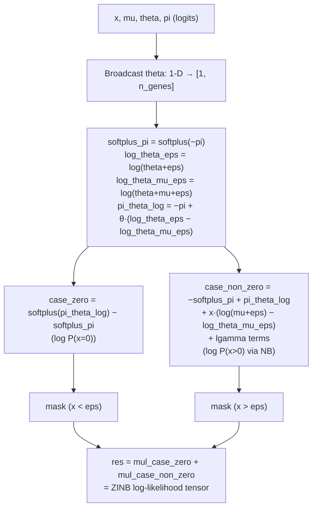
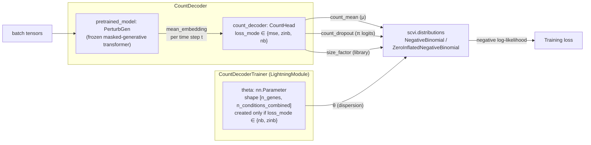

This page explains how Perturbgen models single-cell RNA-seq count data probabilistically. The repository ships two mathematically central functions — `nb` (Negative Binomial log-likelihood) and `zinb` (Zero-Inflated Negative Binomial log-likelihood) — plus the model heads and trainer wiring that produce their inputs (`mu`, `theta`, `pi`). Because raw scRNA-seq counts are overdispersed and dominated by dropouts (excess zeros), Gaussian losses on normalized values are a poor fit; the NB family models counts directly. Here we cover the distributions, their numerical-stability implementation, and how `CountHead`/`CountDecoder`/`CountDecoderTrainer` consume them.

## The Distribution Losses: Origins and Location

The core likelihood functions live in two identical copies: `perturbgen/src/losses.py` and `scmaskgit/src/losses.py`. Both were transplanted verbatim from **scvi-tools** (code version 0.8.1, attributed to Romain Lopez, Adam Gayoso, and Galen Xing), as documented in the function docstrings. Alongside them sit two plain MSE helpers, `mse` and `mse_loss`, completing the loss utility set.

Sources: [losses.py](perturbgen/src/losses.py#L49-L58), [losses.py](scmaskgit/src/losses.py#L51-L58)

An important architectural subtlety: the trainers do **not** import `nb`/`zinb` from these local modules for training. Both `perturbgen/Model/trainer.py` and `scmaskgit/Model/trainer.py` instead import the distribution classes `NegativeBinomial` and `ZeroInflatedNegativeBinomial` directly from `scvi.distributions`, while pulling only `mse_loss` from the local `losses.py`. The local `nb`/`zinb` functions are therefore the standalone, dependency-light reference implementation of the exact same math — useful for tests, notebooks, and reasoning about the likelihood without instantiating scvi distribution objects.

Sources: [trainer.py](perturbgen/Model/trainer.py#L23-L28), [trainer.py](scmaskgit/Model/trainer.py#L24-L29)

> [!TIP]
> Despite docstrings saying "Computes negative binomial loss", both functions return the **log-likelihood** (values to be maximized), not a loss to be minimized. Negation and reduction are delegated to the caller — in the training path, scvi's distribution objects handle this via their `loss` API.

## Mathematical Foundation

The Negative Binomial distribution parameterizes each gene's count with two positive quantities: the mean `mu` and the **inverse dispersion** `theta`. Its variance is `mu + mu²/theta`, so small `theta` means heavy overdispersion — exactly the gene-to-gene variability seen in UMI counts. The log-likelihood evaluated by `nb(x, mu, theta, eps)` decomposes into three terms, each implemented as one pure-tensor expression (L81-87):

```text
res = θ·(log(θ+ε) − log(θ+μ+ε))            # dispersion normalization
    + x·(log(μ+ε) − log(θ+μ+ε))            # mean/count interaction
    + lgamma(x+θ) − lgamma(θ) − lgamma(x+1) # Gamma-function normalization
```

A key preprocessing step handles broadcasting: if `theta` arrives as a 1-D tensor of shape `[n_genes]` — i.e., one dispersion shared across all cells — it is reshaped to `[1, n_genes]` so it broadcasts against cell-batched `mu` and `x`. The `eps=1e-8` constant guards every logarithm against `log(0)` when counts or parameters approach zero.

Sources: [losses.py](perturbgen/src/losses.py#L77-L89), [losses.py](scmaskgit/src/losses.py#L77-L87)

The ZINB distribution adds a dropout mixture component: with probability `π` an observation is a *structural zero* (dropout event), otherwise it is drawn from the NB component. Since `π` is passed as **logits** (unbounded real values, per the docstring), the implementation never materializes a raw probability — it works entirely in log-space using the identity `log σ(x) = −softplus(−x)`.

Sources: [losses.py](perturbgen/src/losses.py#L107-L116), [losses.py](scmaskgit/src/losses.py#L113-L116)

## Inside the `zinb` Implementation: the Two-Case Split

The zero-inflation requires evaluating a different formula depending on whether the observed count is zero. The implementation computes both branches unconditionally, then selects with multiplicative indicator masks — a fully vectorized, branch-free strategy that keeps the computation GPU-friendly:



The clever part is `case_zero = softplus(pi_theta_log) − softplus_pi`. This equals `log(π + (1−π)·NB(0))` in log-space: the `softplus` of the combined log-ratio naturally adds the NB-mass-at-zero contribution to the dropout logit without ever computing an explicit `log(exp(a) + exp(b))` that would overflow. Likewise `case_non_zero` folds `log(1−π)` (as `−softplus_pi`) into the NB density for strictly positive counts. For count data the masks `(x < eps)` and `(x > eps)` are mutually exclusive and exhaustive.

Sources: [losses.py](perturbgen/src/losses.py#L130-L149), [losses.py](scmaskgit/src/losses.py#L131-L148)

## From Embeddings to Distribution Parameters: `CountHead`

The likelihood functions need `mu`, `theta`, and `pi` as inputs — those come from the count-prediction architecture. `CountHead` is the final MLP that maps decoder embeddings to distribution parameters, configured by a single `loss_mode` switch with options `'mse'`, `'zinb'`, `'nb'` (default `'zinb'`). Before the parameter heads, the MLP output is L2-normalized along the feature dimension, which stabilizes the scale of downstream activations.

Sources: [transformer.py](perturbgen/Modules/transformer.py#L1429-L1471), [transformer.py](perturbgen/Modules/transformer.py#L1501-L1510)

The heads differ per loss mode:

| `loss_mode` | Head(s) created | Forward outputs | Purpose |
|---|---|---|---|
| `'mse'` | `relu_output`: Linear → ReLU | `count_lognorm` | Regress log-normalized counts point-wise |
| `'zinb'` | `softmax_output`: Linear → Softmax(dim=-1)* and `linear_output`: plain Linear | `count_mean`, `count_dropout` | NB mean (proportional profile) + dropout logits π |
| `'nb'` | `softmax_output`: Linear → Softmax(dim=-1)* | `count_mean` | NB mean only; no zero-inflation term |

\* When `use_size_factor=False`, the activation switches from Softmax to **Softplus** so the mean is predicted as an absolute rate rather than a fraction of a library.

Sources: [transformer.py](perturbgen/Modules/transformer.py#L1474-L1493), [transformer.py](perturbgen/Modules/transformer.py#L1511-L1525)

Size factors — the library-size scaling that converts the Softmax output into a gene-specific mean — follow a two-flag contract: if `use_size_factor=True` and `use_observed_size_factor=False`, the head *learns* a size factor via `exp(Linear(d_model, 1))`; if `use_observed_size_factor=True`, `size_factor` is emitted as `None` and supplied externally from observed counts. This mirrors classic scVI practice where `mu = softmax(h) · library_size`.

Sources: [transformer.py](perturbgen/Modules/transformer.py#L1494-L1499), [transformer.py](perturbgen/Modules/transformer.py#L1518-L1523)

Notably, `CountHead` produces **no theta output**. Dispersion is deliberately kept out of the network forward pass and handled at the trainer level (next section) — the network models the *mean structure* conditioned on embeddings, while dispersion is a condition-indexed global parameter.

Sources: [transformer.py](perturbgen/Modules/transformer.py#L1513-L1517)

## Class and Module Interaction Diagram

The count-decoding stack is a three-layer composition, designed for the two-stage training regime (see [Two-Stage Masking and Count Decoder Training](7-two-stage-masking-and-count-decoder-training)) where the generative transformer is frozen first and the count head is trained on top of its embeddings:



Sources: [transformer.py](perturbgen/Modules/transformer.py#L1527-L1636), [trainer.py](perturbgen/Model/trainer.py#L602-L723), [trainer.py](perturbgen/Model/trainer.py#L23)

Two parallel entry points feed this stack. `CountDecoder.forward` runs the frozen pretrained model in `not_masked=True` mode over ground-truth target token dictionaries, then applies `CountHead` to the `mean_embedding` of each predicted time step, emitting `count_output_t{t}`. `CountDecoder.generate_counts` performs the same head application on **iteratively generated** embeddings from the MaskGIT-style decoder — this is how in-silico perturbation predictions get count-space outputs.

Sources: [transformer.py](perturbgen/Modules/transformer.py#L1620-L1636), [transformer.py](perturbgen/Modules/transformer.py#L1638-L1667)

## Dispersion (theta) Wiring in the Trainer

`CountDecoderTrainer` materializes theta only under the probabilistic modes. The gating condition requires `loss_mode in ['nb', 'zinb']` **and** both `conditions` and `conditions_combined` to be provided; otherwise `self.theta = None`. When active, theta is a raw `nn.Parameter` initialized with `torch.randn` and shaped `[n_genes, n_conditions_combined]` — meaning the model learns a **separate inverse-dispersion value for every gene in every perturbation condition**, capturing the fact that different perturbations induce different levels of count noise per gene.

Sources: [trainer.py](perturbgen/Model/trainer.py#L739-L751)

> [!TIP]
> theta lives on the trainer, not on `CountHead`, and is indexed by combined condition — so gradient updates to dispersion come only from batches that carry the condition bookkeeping. If you instantiate `CountDecoderTrainer` for pure MSE fine-tuning, confirm `self.theta is None`; the NB/ZINB likelihood is undefined without it.

The trainer also exposes `use_size_factor` and `use_observed_size_factor` as constructor arguments, which it forwards verbatim into `CountDecoder` → `CountHead`, selecting the Softmax-vs-Softplus mean parameterization and the predicted-vs-observed library size strategy described above.

Sources: [trainer.py](perturbgen/Model/trainer.py#L650-L651), [trainer.py](perturbgen/Model/trainer.py#L706-L723)

## Choosing Between MSE, NB, and ZINB

The three loss modes form a modeling spectrum with distinct statistical assumptions and head configurations:

| Aspect | MSE (`'mse'`) | NB (`'nb'`) | ZINB (`'zinb'`) |
|---|---|---|---|
| Output space | Log-normalized counts | Raw counts (mean μ) | Raw counts (μ + dropout π) |
| Zero handling | Treats zeros as values | Poisson-like zeros only | Explicit structural zeros via dropout |
| Overdispersion | None (implicit Gaussian) | Gene×condition θ | Gene×condition θ |
| Distribution parameters learned | Mean only | μ, θ | μ, θ, π |
| Extra heads | ReLU head | Softmax/Softplus head | Softmax/Softplus + linear head |
| Best suited for | Normalized embeddings, quick baselines | Overdispersed UMI counts | UMI counts with heavy dropout (typical scRNA-seq) |
| | | | |

Sources: [transformer.py](perturbgen/Modules/transformer.py#L1446-L1460), [transformer.py](perturbgen/Modules/transformer.py#L1474-L1525), [trainer.py](perturbgen/Model/trainer.py#L611-L612)

The pros/cons trade-off is worth making explicit. **NB** buys you a principled count likelihood with a single dispersion mechanism, at the cost of underestimating dropout-driven zeros. **ZINB** matches the generative process of droplet-based single-cell data most faithfully — the mixture handles amplicon/dropout zeros separately from biological zeros — but requires one more head, one more parameter tensor per element, and can over-parameterize when true dropouts are rare. **MSE** is the cheapest and most stable to optimize, but its gradients are dominated by high-count genes and it cannot express count uncertainty — which downstream evaluation metrics (see [Evaluation Metrics: MMD, EMD, Optimal Transport](13-evaluation-metrics-mmd-emd-optimal-transport)) may rely on.

Sources: [losses.py](perturbgen/src/losses.py#L91-L150), [transformer.py](perturbgen/Modules/transformer.py#L1440-L1461)

## Numerical Stability Summary

All three numerical hazards that typically plague discrete likelihoods are neutralized in this codebase. First, every `log()` call is wrapped with `eps=1e-8` (`log(θ+ε)`, `log(μ+ε)`, `log(θ+μ+ε)`) so zero counts and vanishing parameters never produce `-inf`. Second, the ZINB dropout probability is kept in logit space throughout — `softplus` identities replace naive `log(sigmoid(·))` and `log(1−π)` computations, eliminating overflow at extreme logits. Third, Gamma normalizers use `torch.lgamma` (log-space directly) rather than `torch.gamma` followed by a log, which would underflow for large `x + θ`. These choices are inherited intact from scvi-tools and are the reason the same expressions serve both the local reference functions and the production `scvi.distributions` path.

Sources: [losses.py](perturbgen/src/losses.py#L77-L89), [losses.py](perturbgen/src/losses.py#L130-L149)

## Practical Checklist for Extending the Loss Stack

When adding a new likelihood or modifying the count head, four touchpoints must stay consistent: (1) `CountHead.__init__` — register parameter heads under the new `loss_mode` branch; (2) `CountHead.forward` — emit the matching keys in `count_outputs` (e.g., `count_mean`, `count_dropout`, `size_factor`); (3) `CountDecoderTrainer.__init__` — extend the `loss_mode in ['nb', 'zinb']` gate if the new likelihood needs trainer-held parameters like theta; and (4) the import at the trainer top if you switch between the local `losses.py` functions and `scvi.distributions`. Because `CountDecoder` iterates generically over `pred_tps`, new outputs automatically flow to every predicted time step without further plumbing.

Sources: [transformer.py](perturbgen/Modules/transformer.py#L1462-L1525), [trainer.py](perturbgen/Model/trainer.py#L739-L751), [transformer.py](perturbgen/Modules/transformer.py#L1630-L1636)

## Where to Go Next

This page sits at the intersection of the model-design and evaluation chapters. To see how the masked generative stage feeds embeddings into the count stage, read [Two-Stage Masking and Count Decoder Training](7-two-stage-masking-and-count-decoder-training). For how the predicted counts are scored at evaluation time — where the distributional view really pays off — continue to [Evaluation Metrics: MMD, EMD, Optimal Transport](13-evaluation-metrics-mmd-emd-optimal-transport). To position this count-modeling choice against GEO-based and VAE-based alternatives, see [Comparison with Alternative Perturbation Models](25-comparison-with-alternative-perturbation-models).