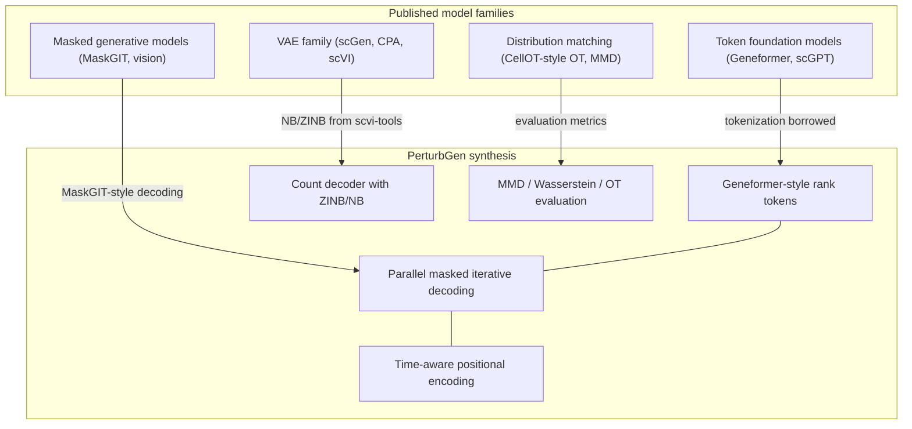
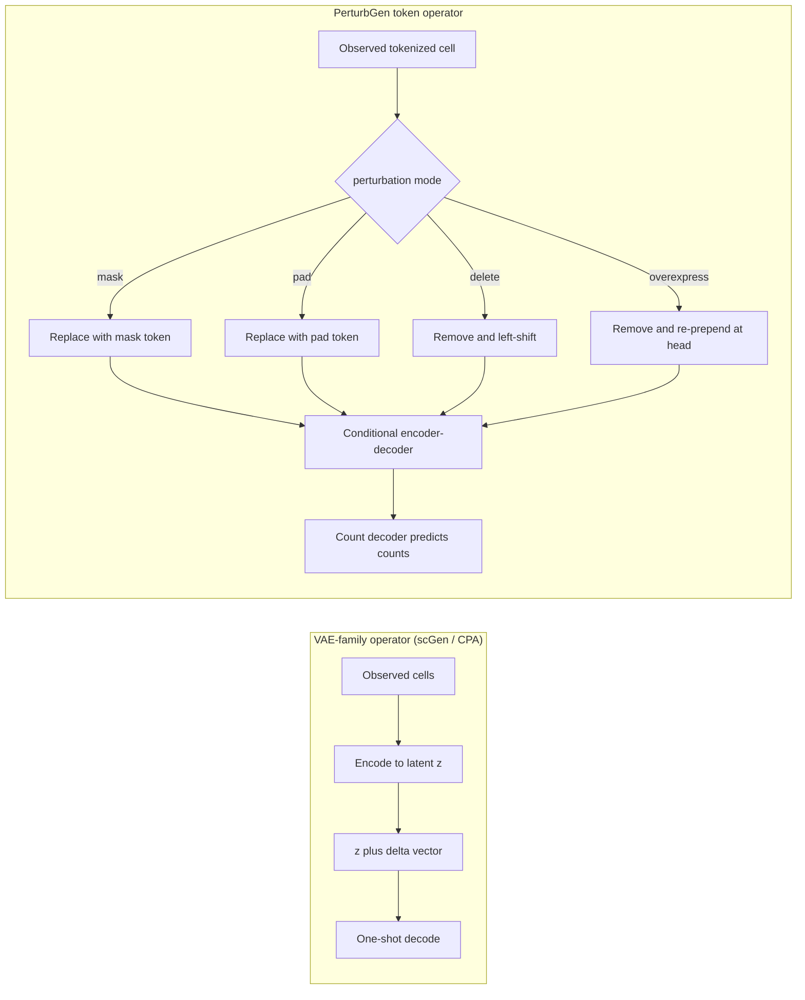

This page positions PerturbGen against the broader family of in-silico perturbation models — VAE-based response predictors (scGen, CPA), graph-based combinatorial models (GEARS), and token-based foundation models (Geneformer, scGPT) — by mapping each design decision in the PerturbGen codebase onto that landscape. Everything claimed about PerturbGen below is verified directly against the repository; claims about alternative tools summarize their published designs and are marked as such. This page is deliberately conceptual: for hands-on usage, start with [In Silico Perturbation Modes](10-in-silico-perturbation-modes).

## The Differentiating Claim: Static Response vs. Dynamic Trajectories

The repository's own positioning is explicit in its introduction: most recent approaches "can predict single-cell perturbation responses in silico, [but] cannot predict responses across dynamic cell trajectories" ([README.md](/README.md#L8-L9)). This single sentence defines the axis along which PerturbGen differentiates itself, and the axis is architecturally real, not just narrative. It is implemented as a **conditional sequence-to-sequence design**: a source (observed) token sequence is encoded, and target sequences at *multiple future time steps* (`pred_tps`) are decoded, with optional context time points (`context_tps`) that the decoder attends to ([perturbgen/Perturb/transformer.py](/perturbgen/Perturb/transformer.py#L80-L124)). Most VAE-family baselines operate on a single control→stimulated transition, which structurally cannot express "cell state at hour *t* under perturbation."

Time enters the model as a first-class signal rather than a covariate: the `PositionalEncoding` class offers sinusoidal time+position modes (`time_pos_sin`, `comb_sin`) that are *functions of the target time step*, and the code notes that learnt time encodings "cannot be used for time interpolation and extrapolation" while sinusoidal ones can ([perturbgen/Modules/transformer.py](/perturbgen/Modules/transformer.py#L50-L114)). This is what allows PerturbGen to predict at unseen intermediate times — the property the tutorial demonstrates by perturbing at 6 h and predicting at 10 h ([README.md](/README.md#L96-L97)).

## Design-Space Comparison

The table below contrasts the main published model families on the dimensions that matter architecturally. The PerturbGen column is verified against this codebase; the other columns summarize each method's published design.

| Dimension | scGen (VAE) | CPA | GEARS | **PerturbGen** |
|---|---|---|---|---|
| Data representation | Log-normalized continuous vectors | Log-normalized continuous vectors | Log-normalized gene-wise deltas | **Discrete Geneformer-style rank tokens** ([9-geneformer-style-gene-tokenization]) |
| Perturbation operator | Latent vector arithmetic (Δ stimulation) | Learned additive covariate embeddings | Message passing on a gene-gene graph | **Token-level edits: `mask` / `pad` / `delete` / `overexpress`** ([perturbgen/model.py](/perturbgen/model.py#L57-L64)) |
| Time / dynamics | One pre/post transition | Static conditions | Static conditions | **Multi-timepoint trajectories with time-aware positional encoding** ([perturbgen/Modules/transformer.py](/perturbgen/Modules/transformer.py#L87-L114)) |
| Decoding | One-shot VAE decoder | One-shot decoder | One-shot regression head | **Parallel masked iterative decoding (MaskGIT, ~18 iterations)** ([perturbgen/Perturb/transformer.py](/perturbgen/Perturb/transformer.py#L36-L37)) |
| Likelihood / loss | Gaussian (MSE) on normalized data | Gaussian + adversarial | MSE on deltas | **ZINB / NB count likelihood, borrowed from scvi-tools** ([perturbgen/src/losses.py](/perturbgen/src/losses.py#L49-L89)) |
| Stochasticity | Latent sampling | Mostly deterministic | Deterministic | **Stochastic token sampling + `n_samples` count draws averaged** ([perturbgen/model.py](/perturbgen/model.py#L510-L512)) |
| Evaluation style | Per-gene R²/correlation | Differential-expression overlap | Per-gene delta correlation | **Distribution-level: MMD, Wasserstein, cosine of embeddings** ([perturbgen/src/mmd.py](/perturbgen/src/mmd.py#L60-L67)) |

PerturbGen is best understood not as a member of one family but as a **synthesis**: it inherits the tokenization philosophy of token-based foundation models, the count likelihood of the scvi-tools lineage, the decoding machinery of masked generative image models, and the evaluation philosophy of distribution-matching methods — and adds the trajectory dimension as its own contribution.

## Perturbation Operator Semantics: Token Edits vs. Latent Arithmetic

The sharpest contrast with the VAE family is *where the perturbation happens*. scGen-style models encode cells into a continuous latent space and apply vector arithmetic; PerturbGen applies the edit **directly to the token sequence** and lets the trained encoder–decoder–count-decoder pipeline propagate it. The implementation is compact and entirely verifiable: `perturb_sequence()` replaces tokens with the `<mask>` token (knockout) or the pad token, or removes them and left-shifts (`delete`), or removes and re-prepends them at the sequence head to inflate their rank abundance (`overexpress`) ([perturbgen/Perturb/trainer.py](/perturbgen/Perturb/trainer.py#L269-L303), with the replacement-token selection at lines 313–322).

Two further axes make the operator more expressive than the latent-arithmetic baseline. First, the edit can be applied to the **source** sequence (so the perturbation propagates through the model into all predicted future states) or to the **target** sequences at selected time points (`pert_tps`), enforced by an explicit validation error ([perturbgen/model.py](/perturbgen/model.py#L506-L575)). Second, knockout is additionally enforced during *generative* decoding by setting the perturbed genes' logits to −∞, so the model can never re-select the knocked-out gene while filling the masked sequence ([perturbgen/Perturb/transformer.py](/perturbgen/Perturb/transformer.py#L235-L237)) — a guarantee that latent arithmetic cannot offer.

> [!TIP]
> The `overexpress` operator exploits the Geneformer tokenization itself: expression magnitude is encoded by token rank, so duplicating a gene's token at the sequence head raises its rank-encoded abundance — the perturbation acts on the representation's *native* magnitude encoding, not on raw counts.

## Generation Paradigm: Parallel Masked Iterative Decoding

Autoregressive token models (scGPT-style) generate genes sequentially, one token per forward pass; VAEs decode everything in a single pass. PerturbGen follows the **MaskGIT** paradigm, which is a deliberate middle ground: all masked positions are predicted in parallel each iteration, then re-masked by confidence, for a fixed budget of ~18 iterations — a number the code explicitly annotates as the MaskGIT optimum ([perturbgen/Perturb/transformer.py](/perturbgen/Perturb/transformer.py#L36-L37)). Confidence comes from `1 − p(chosen token)`, tokens with high confidence are frozen first (`can_remask_prev_masked=False` freezes them), temperature is linearly annealed, and candidates are Gumbel-sampled after top-*k* filtering ([perturbgen/Perturb/transformer.py](/perturbgen/Perturb/transformer.py#L246-L263)).

Crucially for practitioners, perturbation inference in the released workflow does **not** use this generative loop: `perturb()` runs `validation_mode="inference"`, which decodes the *observed* target cells with the edit applied — the same mode as the released LPS and HSPC configs ([perturbgen/model.py](/perturbgen/model.py#L514-L518)). The `temperature`/`iterations` arguments are retained only for backward compatibility and warn if changed ([perturbgen/model.py](/perturbgen/model.py#L558-L563)). This is a pragmatic contrast with autoregressive baselines: perturbed responses are grounded in real observed cells rather than sampled from scratch, trading generative diversity for per-cell fidelity.

## Representation and Likelihood: Discrete Tokens with Count-Aware Losses

Both scGen and CPA model log-normalized, roughly Gaussian expression with MSE-style objectives; GEARS regresses gene-wise deltas. PerturbGen instead trains its count decoder with **zero-inflated negative binomial** likelihoods by default (`loss_mode="zinb"` in the API defaults, [perturbgen/model.py](/perturbgen/model.py#L172-L176)), with the NB/ZINB functions explicitly ported from scvi-tools ([perturbgen/src/losses.py](/perturbgen/src/losses.py#L49-L89)). This gives it the overdispersion- and dropout-aware count modeling that the VAE lineage pioneered, while the discrete token front-end comes from the Geneformer lineage — the two lineages rarely meet in a single architecture. A compatibility hook confirms the contrast is deliberate: setting `loss_mode="mse"` in an eval config switches target data to `normalize_total` + `log1p`, i.e., the exact continuous regime VAE baselines operate in ([perturbgen/Perturb/val.py](/perturbgen/Perturb/val.py#L128-L132)).

The full stack is a two-stage design — a MaskGIT-style masking model, then a count decoder trained on top ([perturbgen/model.py](/perturbgen/model.py#L15-L17)) — so the discrete generative model produces token identities and a separate likelihood head produces interpretable counts. See [scMASKGIT Masked Generative Encoder](6-scmaskgit-masked-generative-encoder), [Two-Stage Masking and Count Decoder Training](7-two-stage-masking-and-count-decoder-training), and [ZINB and Negative Binomial Losses](24-zinb-and-negative-binomial-losses).

## Evaluation Paradigm: Distribution-Level Metrics

VAE-family and GEARS papers evaluate primarily with per-gene correlations and differential-expression overlap. PerturbGen's perturbation harness instead records **distribution- and embedding-level** statistics per run: `wasserstein_distance`, `delta_probs`/`delta_gene_probs`, embedding cosine similarities (CLS, gene-mean, background), plus true/perturbed/predicted counts ([perturbgen/Perturb/trainer.py](/perturbgen/Perturb/trainer.py#L200-L225)). The MMD implementation supports linear, polynomial, and multi-bandwidth RBF kernels ([perturbgen/src/mmd.py](/perturbgen/src/mmd.py#L14-L67)), and optimal transport lives alongside as a first-class metric module (`src/optimal_transport.py`). The rationale mirrors CellOT-style evaluation: when the model predicts *distributions of cell states* rather than point estimates, per-gene correlation alone under-measures fidelity — a fuller treatment is in [Evaluation Metrics: MMD, EMD, Optimal Transport](13-evaluation-metrics-mmd-emd-optimal-transport).

> [!TIP]
> Because `perturb()` decodes observed cells in inference mode, each perturbed cell is paired with a real unperturbed counterpart — which is exactly why embedding cosine similarity and delta-probability metrics are computable at single-cell granularity, something pure generative baselines cannot report without held-out pairs.

## Practical Selection Guidance

| Your situation | Better fit | Why |
|---|---|---|
| One control/stimulated snapshot, no time series | scGen / CPA | Minimal data, well-understood latent arithmetic |
| Unseen *combinatorial* perturbations, static setting | GEARS | Graph priors generalize across combinations |
| Intermediate/unobserved time points along a trajectory | **PerturbGen** | Sinusoidal time encoding supports interpolation/extrapolation ([perturbgen/Modules/transformer.py](/perturbgen/Modules/transformer.py#L63-L67)) |
| Count-level, overdispersed predictions with uncertainty | **PerturbGen** | ZINB count decoder + `n_samples` draws ([perturbgen/model.py](/perturbgen/model.py#L494-L512)) |
| Population-level response distributions | **PerturbGen** | MMD/Wasserstein/OT metrics built into the harness ([perturbgen/Perturb/trainer.py](/perturbgen/Perturb/trainer.py#L200-L225)) |
| Pretrained encoder transfer across cohorts | **PerturbGen** | Frozen `pretraining_cohort` encoder loaded by default ([README.md](/README.md#L106-L113)) |

Two operational caveats follow from the comparison. A source knockout requires the gene to actually be expressed in the source state, or every cell is filtered out ([perturbgen/model.py](/perturbgen/model.py#L539-L541)) — unlike latent addition, which silently accepts any gene. And the perturbation operator is defined only for genes in the tokenized vocabulary (mapped via the `mapping_dict`), matching the foundation-model constraint of Geneformer-style tokenization. For benchmarking PerturbGen against such baselines yourself, the repository's harness is the starting point — see [Test and Benchmark Suite](26-test-and-benchmark-suite).

## Summary

PerturbGen occupies a distinctive point in the perturbation-modeling design space: **Geneformer-style discrete tokenization** (from foundation models), **MaskGIT-style parallel masked decoding** (from image generative models), **time-aware positional encoding** (its own contribution for dynamics), **scvi-tools-style count likelihoods** (from the VAE lineage), and **distribution-level evaluation** (from the OT/MMD lineage). Its perturbation operator — `mask`/`pad`/`delete`/`overexpress` applied to source or target token sequences — is structurally more constrained and more interpretable than latent arithmetic, while remaining expressive enough to propagate edits across predicted trajectories. To go deeper into the machinery compared here, continue to [Architecture Overview](5-architecture-overview), [In Silico Perturbation Modes](10-in-silico-perturbation-modes), and [Time-Aware Positional Encoding](8-time-aware-positional-encoding).
