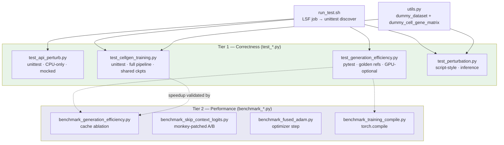
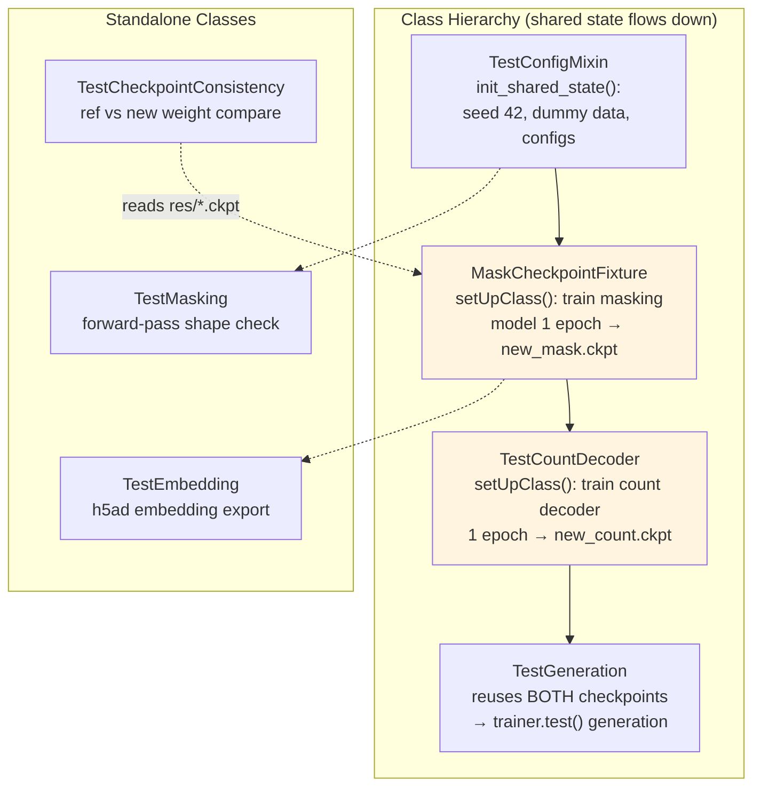
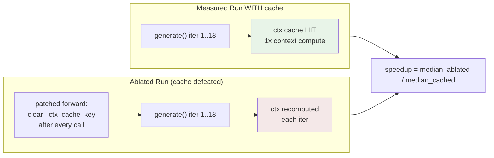
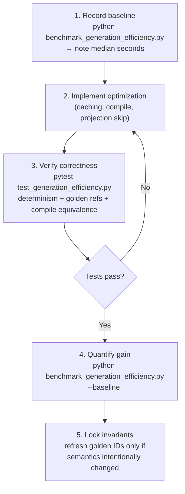

Perturbgen ships a compact but deliberately structured quality infrastructure: five functional test modules that validate correctness end-to-end, and four standalone microbenchmarks that quantify performance-critical refactors. Unlike conventional CI-driven suites, this suite is built for **HPC-cluster execution and refactor verification** — tests exercise real PyTorch Lightning training loops on synthetic data, while benchmarks use CUDA event timing to isolate the cost of specific optimizations (fused optimizers, `torch.compile`, context caching, projection skipping). This page explains the suite's architecture, the fixture strategies that keep GPU-backed tests fast, and how to run each component.

## Suite Architecture: A Two-Tier Design

The suite separates **correctness verification** from **performance measurement** into two distinct file families with different execution models. Functional tests (`test_*.py`) assert behavioral invariants — deterministic generation, checkpoint reproducibility, config validation — and run under either `unittest` discovery or `pytest`. Benchmarks (`benchmark_*.py`) are standalone scripts that print timing reports rather than asserting pass/fail, and are executed directly with `python`. This split mirrors the actual development workflow: tests guard against regressions, benchmarks quantify whether a refactor delivered its intended speedup.



The dependency arrows matter: `utils.py` fixtures feed only the Lightning-based tests, while the efficiency benchmarks exist specifically to validate the caching and compilation features that `test_generation_efficiency.py` guards for *correctness*. Together they form paired correctness/performance contracts per optimization.

Sources: [tests/utils.py](perturbgen/tests/utils.py#L1-L74), [run_test.sh](perturbgen/run_test.sh#L20-L24), [test_generation_efficiency.py](perturbgen/tests/test_generation_efficiency.py#L1-L12)

## Inventory of the Suite

The suite comprises ten files with clearly partitioned responsibilities. The table below is the authoritative map for deciding where a new test or measurement belongs.

| File | Framework | Scope | Hardware | Key Mechanism |
|---|---|---|---|---|
| `utils.py` | — | Shared fixtures | CPU | Synthetic HF `Dataset` + Poisson count matrices |
| `test_api_perturb.py` | `unittest` | `PerturbGen.perturb()` config assembly | CPU only | `mock.patch` + temp dirs |
| `test_cellgen_training.py` | `unittest` | Masking → embedding → count decoder → generation | GPU-conditional | Shared checkpoint fixtures in `setUpClass` |
| `test_generation_efficiency.py` | `pytest` | `generate()` determinism, golden IDs, `torch.compile` | GPU-optional | Golden reference tensors, cache resets |
| `test_perturbation.py` | script | `PerturberTrainer` end-to-end inference | GPU-conditional | `trainer.test()` with 1 batch |
| `benchmark_generation_efficiency.py` | standalone | `generate()` wall-clock | CPU + GPU | `--baseline` arg, cache ablation |
| `benchmark_skip_context_logits.py` | standalone | Skip LM-head in context path | GPU | Monkey-patched `call_decoder` A/B |
| `benchmark_fused_adam.py` | standalone | Fused vs. non-fused Adam | GPU | CUDA event timing on `.step()` |
| `benchmark_training_compile.py` | standalone | `torch.compile` training step | GPU | Warmup + median of reps |

Sources: [test_api_perturb.py](perturbgen/tests/test_api_perturb.py#L1-L5), [test_cellgen_training.py](perturbgen/tests/test_cellgen_training.py#L1-L45), [benchmark_training_compile.py](perturbgen/tests/benchmark_training_compile.py#L1-L9)

## Synthetic Data Fixtures: The Foundation of GPU-Free Realism

All Lightning-backed tests avoid real datasets entirely. `utils.py` provides two fixture factories that mimic the tokenized data layout the models consume. **`dummy_dataset()`** builds a Hugging Face `Dataset` with random gene token IDs sampled from `range(2, vocab_size)` (reserving indices 0–3 for special tokens), forces the last 10 positions to `0` (the `<pad>` token, simulating masked positions), and attaches `cell_type`, `length`, and `cell_pairing_index` columns. When called with `total_time_steps`, it returns a dict of per-timepoint datasets keyed `tgt_dataset_t1`, `tgt_dataset_t2`, ... — matching the multi-timepoint pairing schema.

**`dummy_cell_gene_matrix()`** complements this with raw count matrices drawn from a Poisson distribution (λ=10), squeezed to `(num_cells, 1, num_genes)` and keyed `tgt_h5ad_t1`, ... when multi-step. The pairing between token IDs and counts mirrors what `PerturbGenDataModule` expects in production, so tests exercise the real dataflow path without any file I/O. This is why tests can run a full train-epoch in seconds: the fixture shapes (100 samples, vocab 100–101, seq len 50, batch 4) are deliberately tiny.

Sources: [tests/utils.py](perturbgen/tests/utils.py#L7-L55), [tests/utils.py](perturbgen/tests/utils.py#L57-L74)

## Functional Tests in Depth

### API-Level Config Tests: Fast, Mocked, Deterministic

`test_api_perturb.py` is the only true unit-test module: it needs no GPU, no data, and no model weights. It verifies the contract that `PerturbGen.perturb()` builds a valid YAML config for `Perturb/val.py`. The fixture `_make_tokenized_dir()` creates an empty directory tree with exactly the filenames the tokenized-dataset layout validator checks for (`dataset_10_hvg_src/src.dataset`, `token_id_to_genename_10_hvg.pkl`, etc.), satisfying path validation without real data. The `_run()` helper then **mocks `perturbgen.Perturb.val.main`** with a function that reads back the generated YAML — capturing what would have been executed.

Five test cases pin the config contract: `extra_config` user keys must merge into the generated config (`test_extra_config_is_merged`); defaults appear when no override is given (`validation_mode='inference'`, `num_workers=4`); relative gene-file paths are absolutized; protected keys like `trainer.n_samples` or `trainer.num_heads` raise `ValueError('cannot set')`; and malformed sections raise `ValueError`/`TypeError`. This module demonstrates the suite's layered philosophy — test the *cheapest observable surface* first before escalating to GPU-backed integration.

Sources: [test_api_perturb.py](perturbgen/tests/test_api_perturb.py#L13-L25), [test_api_perturb.py](perturbgen/tests/test_api_perturb.py#L42-L61), [test_api_perturb.py](perturbgen/tests/test_api_perturb.py#L63-L100)

### End-to-End Pipeline Tests with Checkpoint Fixtures

`test_cellgen_training.py` is the suite's heavyweight: it runs the complete two-stage pipeline (see [Two-Stage Masking and Count Decoder Training](7-two-stage-masking-and-count-decoder-training)) on synthetic data. Its defining innovation is the **shared checkpoint fixture hierarchy**, which eliminates redundant training across test classes:



The `MaskCheckpointFixture.setUpClass` (lines 198–246) implements memoization via class-level attributes `_shared_ckpt_path` / `_shared_tmpdir`: the *first* class to trigger it trains a `PerturbGenTrainer` for exactly one epoch with `limit_train_batches=1`, checkpoints it, and copies the result to `tests/res/new_mask.ckpt`. Every subsequent inheriting class (embedding export, count decoder) loads that checkpoint instead of retraining. `TestCountDecoder` applies the identical pattern one level deeper, producing `new_count.ckpt`. This converts what would be ~4 full training runs into exactly 2.

Individual assertions target the invariants that matter scientifically: `TestMasking.test_forward_pass` checks `dec_embedding` has shape `(batch, max_seq_length, d_model)`; `TestEmbedding.test_cell_embeddings_only` verifies that `return_embeddings=True` with `return_gene_embs=False` still writes exactly one `*inference_embs*.h5ad` containing `cls_embeddings` in `obsm` and *no* gene embeddings in `varm` — a regression guard against a previously observed `None`-iteration bug (documented in the inline comment at line 297–298).

Sources: [test_cellgen_training.py](perturbgen/tests/test_cellgen_training.py#L49-L191), [test_cellgen_training.py](perturbgen/tests/test_cellgen_training.py#L198-L246), [test_cellgen_training.py](perturbgen/tests/test_cellgen_training.py#L272-L322), [test_cellgen_training.py](perturbgen/tests/test_cellgen_training.py#L325-L367)

### Checkpoint Reproducibility Testing

The final class, `TestCheckpointConsistency`, implements a **reference-checkpoint comparison** pattern: it loads `tests/res/reference_mask.ckpt` and `reference_count.ckpt` (previously recorded baselines) and compares every tensor against the newly produced `new_mask.ckpt` / `new_count.ckpt` using `torch.allclose(atol=1e-5, rtol=1e-4)`. The `compare_weights()` helper collects mismatches with their max absolute diff, and the test deliberately accumulates *all* failures before calling `self.fail()` once — so a single run reports every divergent checkpoint pair rather than aborting at the first. This is the suite's defense against nondeterministic training drift, complementing the seed pinning (`pl.seed_everything(42)`, `cudnn.deterministic=True`) established in `init_shared_state`.

Sources: [test_cellgen_training.py](perturbgen/tests/test_cellgen_training.py#L452-L484), [test_cellgen_training.py](perturbgen/tests/test_cellgen_training.py#L486-L532)

### Generation Regression Tests: Determinism and Golden References

`test_generation_efficiency.py` guards the generation-optimization refactor in `Modules/transformer.py` (relevant background: [In Silico Perturbation Modes](10-in-silico-perturbation-modes)). Its docstring enumerates the four guarded properties: deterministic token IDs under fixed seeds, stability of the no-context path, non-`None` `mean_embedding` in training forward, and cache-invariant generation. The module is organized into six pytest classes, each addressing one invariant:

| Class | Invariant Guarded | Technique |
|---|---|---|
| `TestGenerateDeterminism` | Same seed → identical token IDs | Run `generate()` twice, reset `_enc_cache_key`/`_ctx_cache_key` between runs, `torch.equal` |
| `TestGoldenReference` | Output matches refactor-era snapshot | Hard-coded `REFERENCE_IDS_T3` tensor compared bit-exact |
| `TestTrainingForward` | `not_masked=True` path intact post-cleanup | Shape + non-`None` assertions on `mean_embedding` |
| `TestContextCacheCorrectness` | Cache hits don't alter output; multi-`pred_tps` isolation | Cache reset + re-run comparison; `sequence_length` param |
| `TestCountDecoderGenerate` | `generate_counts()` end-to-end | Shape check on `count_output_t3['count_mean']` |
| `TestCompiledModel` | `torch.compile` equivalence | `torch.equal` on token IDs; `allclose(atol=1e-4)` on logits; CUDA-only |

The **golden reference pattern** deserves explanation. `REFERENCE_IDS_T3` is a 2×30 tensor of token IDs recorded from the unmodified codebase with seeds (model=42, run=7) and `iterations=4`. If a future change alters generation semantics — even by one token — the test fails with an explicit expected-vs-got diff. The code also includes a self-recording escape hatch: when the reference is `None`, the test prints the tensor to copy back in and skips, formalizing the snapshot-update workflow in a single file.

> [!TIP]
> The cache-reset idiom `model._enc_cache_key = None; model._ctx_cache_key = None` before each timing or determinism run is essential — without it, the second `generate()` call would hit the encoder/context caches and measure cache lookup rather than full computation. Both the tests and all four benchmarks replicate this idiom.

Sources: [test_generation_efficiency.py](perturbgen/tests/test_generation_efficiency.py#L1-L37), [test_generation_efficiency.py](perturbgen/tests/test_generation_efficiency.py#L109-L175), [test_generation_efficiency.py](perturbgen/tests/test_generation_efficiency.py#L183-L250), [test_generation_efficiency.py](perturbgen/tests/test_generation_efficiency.py#L292-L345)

### Perturbation Inference Test

`test_perturbation.py` validates `PerturberTrainer` (the perturbation-mode trainer) using the shared dummy fixtures and a realistic production configuration: `d_model=768`, `perturbation_mode='overexpress'`, `perturbation_sequence='tgt'`, `context_mode=True`, `temperature=1.5`, 19 MaskGIT iterations, and `pos_encoding_mode='time_pos_sin'` (see [Time-Aware Positional Encoding](8-time-aware-positional-encoding)). Rather than asserting individual tensors, it delegates to Lightning's `trainer.test()` with `limit_test_batches=1` — a single inference batch through the full test step, including perturbed-sequence construction and metric computation. This is a smoke test in structure but an integration test in coverage, and like the training tests it adapts precision to hardware (`16` on GPU, `32` on CPU).

Sources: [test_perturbation.py](perturbgen/tests/test_perturbation.py#L27-L62), [test_perturbation.py](perturbgen/tests/test_perturbation.py#L70-L100), [test_perturbation.py](perturbgen/tests/test_perturbation.py#L124-L138)

## Execution Model

The canonical entry point is `run_test.sh`, an LSF (`BSUB`) batch job header targeting a CPU-interactive queue with 10 GB RAM. After loading CUDA 12.1 and activating the `cytomeister` environment, it runs:

```bash
python -m unittest discover /.../perturbgen/tests/
```

Note the discovery implications: `unittest discover` collects `unittest.TestCase` subclasses (`test_api_perturb.py`, `test_cellgen_training.py`), and because pytest is a superset runner, the same directory also works under `pytest` for the function-style classes in `test_generation_efficiency.py`. Module-level code executes at *collection* time in both frameworks — which is why `test_cellgen_training.py`'s hard path assertions (lines 37–40) fail fast at import if the Lustre-mounted encoder or mapping dictionaries are absent. Two alternative invocation forms appear in comments: single-module discovery and direct pytest per file.

Sources: [run_test.sh](perturbgen/run_test.sh#L1-L25), [test_cellgen_training.py](perturbgen/tests/test_cellgen_training.py#L25-L44)

## The Benchmark Layer: Measuring What Refactors Deliver

### Common Measurement Methodology

All four benchmarks share a rigorous timing protocol that intermediate developers should replicate in their own measurements. The pattern is: **N warmup iterations** (to trigger CUDA kernel compilation and allocator warm-up) followed by **N timed repetitions**, each bracketed by `torch.cuda.synchronize()` before and after, measured with `torch.cuda.Event(enable_timing=True)` pairs, and summarized by the **median** rather than the mean — median is robust to the occasional garbage-collection pause or clock-spike that would otherwise inflate averages. Every benchmark resets `_enc_cache_key`/`_ctx_cache_key` before each repetition so that cache effects are measured deliberately, not accidentally.

Sources: [benchmark_fused_adam.py](perturbgen/tests/benchmark_fused_adam.py#L61-L93), [benchmark_generation_efficiency.py](perturbgen/tests/benchmark_generation_efficiency.py#L65-L111), [benchmark_training_compile.py](perturbgen/tests/benchmark_training_compile.py#L69-L100)

### The Four Benchmarks Compared

| Benchmark | Question Answered | Dimensions | A/B Strategy |
|---|---|---|---|
| `benchmark_generation_efficiency.py` | How fast is `generate()` overall, and what does the context cache save? | CPU config: batch 4, seq 200, vocab 300, 18 iters | Runs WITH and WITHOUT cache by patching `forward` to clear `_ctx_cache_key` after every call; `--baseline <s>` flag computes speedup vs. a recorded pre-refactor number |
| `benchmark_skip_context_logits.py` | What does skipping the `decoder_fc` LM-head projection in `generate_context` save? | GPU: vocab 25000, d_model 768, 6 layers, batch {4,16,32} | Monkey-patches `call_decoder` to force `compute_logits=True` (BEFORE) vs. native `False` (AFTER); also verifies training-step timing is untouched |
| `benchmark_fused_adam.py` | Does fused Adam accelerate the optimizer step? | GPU: vocab 25000, d_model 768, 2 layers (fits MIG slice) | Two full models, `Adam(fused=False/True)`, timed on complete forward+backward+step; graceful fallback if fused is unsupported |
| `benchmark_training_compile.py` | Does `torch.compile` speed up training steps? | GPU: vocab 25000, d_model 768, seq 128, batch 32, 6 layers | Two model builds with `compile_model=False/True`, identical step function, per-step median |

Sources: [benchmark_generation_efficiency.py](perturbgen/tests/benchmark_generation_efficiency.py#L147-L172), [benchmark_skip_context_logits.py](perturbgen/tests/benchmark_skip_context_logits.py#L1-L14), [benchmark_fused_adam.py](perturbgen/tests/benchmark_fused_adam.py#L1-L8), [benchmark_training_compile.py](perturbgen/tests/benchmark_training_compile.py#L1-L9)

### The Cache-Ablation Technique

The most methodologically interesting is the **context-cache ablation** in `benchmark_generation_efficiency.py`. To isolate what the context cache contributes, the benchmark cannot simply "turn it off" via a flag — instead it wraps `model.forward` with a patch that clears `_ctx_cache_key` after every call, guaranteeing the cache never hits during the measured run. The report then prints the derived call-count arithmetic: with `context_tps=[1,2]` and 18 iterations, the cache saves `len(context_tps) × (iterations − 1) = 34` decoder passes per `generate()` call. The no-context config (`context_tps=None`) runs as an experimental control where the cache should show *zero* effect — a built-in sanity check on the measurement itself.



Sources: [benchmark_generation_efficiency.py](perturbgen/tests/benchmark_generation_efficiency.py#L53-L86), [benchmark_generation_efficiency.py](perturbgen/tests/benchmark_generation_efficiency.py#L147-L168), [benchmark_generation_efficiency.py](perturbgen/tests/benchmark_generation_efficiency.py#L175-L204)

### Monkey-Patch A/B for Projection Skipping

`benchmark_skip_context_logits.py` targets a different waste pattern: `generate_context` builds context embeddings by running the decoder, but only consumes `dec_embedding` — the `d_model → vocab` projection (`decoder_fc`) was previously computed and discarded. The BEFORE state is reconstructed *without modifying source code*: the benchmark monkey-patches `model.call_decoder` to force `kwargs['compute_logits'] = True`, times it, restores the original, and times the native AFTER path. Batching over {4, 16, 32} reveals how the projection waste scales, and the closing `bench_training()` section confirms the training loop never calls `generate_context`, so the optimization carries zero training-side risk. The final summary table prints per-batch BEFORE/AFTER/speedup rows.

> [!TIP]
> The monkey-patch pattern (swap a bound method, measure, restore) is the suite's standard for benchmarking hypothetical code states — it lets you quantify a proposed optimization *before* committing it, and the same pattern is reusable for any `compute_logits`-style gated computation.

Sources: [benchmark_skip_context_logits.py](perturbgen/tests/benchmark_skip_context_logits.py#L1-L14), [benchmark_skip_context_logits.py](perturbgen/tests/benchmark_skip_context_logits.py#L79-L135), [benchmark_skip_context_logits.py](perturbgen/tests/benchmark_skip_context_logits.py#L138-L171)

## Development Workflow: Tests and Benchmarks as Paired Contracts

The suite encodes a repeatable refactor workflow, visible in the `benchmark_generation_efficiency.py` usage docstring:



Step 3's equivalence tests are the linchpin: `TestCompiledModel` asserts compiled and uncompiled models produce *identical* token IDs and `allclose` logits, meaning `torch.compile` must be semantically transparent — any speedup it delivers is "free." This correctness-before-performance ordering is the suite's core discipline, and the same contract applies to DeepSpeed-scale training discussed in [Distributed Training with DDP and DeepSpeed](19-distributed-training-with-ddp-and-deepspeed).

Sources: [benchmark_generation_efficiency.py](perturbgen/tests/benchmark_generation_efficiency.py#L7-L13), [test_generation_efficiency.py](perturbgen/tests/test_generation_efficiency.py#L288-L345)

## Practical Caveats

Three operational realities affect anyone running this suite. **First, hardcoded infrastructure paths**: `test_cellgen_training.py` and `test_perturbation.py` assert the existence of Lustre-mounted encoder checkpoints and token-mapping pickles (e.g., `/lustre/scratch126/cellgen/.../foundation_107m/checkpoints/...`) at import time, and `test_perturbation.py` force-changes the working directory to a cluster root — the suite as committed assumes execution on the originating HPC environment and needs path substitution elsewhere. **Second, mixed frameworks and conventions**: `test_generation_efficiency.py` is pytest-native, `test_cellgen_training.py` is unittest-native with pytest-compatible shared fixtures, and `test_perturbation.py` is cell-delimited script style (`# %%`) — `unittest discover` will execute the last only as a flat script. **Third, hardware gating**: benchmarks exit immediately without CUDA, compiled-model tests `pytest.skip` gracefully, but the two full-pipeline test files will import-fail on missing cluster artifacts before any skip logic engages.

Sources: [test_cellgen_training.py](perturbgen/tests/test_cellgen_training.py#L25-L44), [test_perturbation.py](perturbgen/tests/test_perturbation.py#L22-L24), [benchmark_fused_adam.py](perturbgen/tests/benchmark_fused_adam.py#L106-L111), [test_generation_efficiency.py](perturbgen/tests/test_generation_efficiency.py#L293-L296)

## Where to Go Next

To understand what the tests are actually verifying, read the architecture pages first: the generation loop guarded by the golden references is detailed in [In Silico Perturbation Modes](10-in-silico-perturbation-modes), and the two-stage checkpoint fixture mirrors [Two-Stage Masking and Count Decoder Training](7-two-stage-masking-and-count-decoder-training). The metrics computed inside `trainer.test()` (MMD, EMD, optimal transport) are explained in [Evaluation Metrics: MMD, EMD, Optimal Transport](13-evaluation-metrics-mmd-emd-optimal-transport), while the config keys asserted by `test_api_perturb.py` map directly onto [Configuration System and Path Management](17-configuration-system-and-path-management). For the training infrastructure the benchmarks measure, continue to [Distributed Training with DDP and DeepSpeed](19-distributed-training-with-ddp-and-deepspeed) and [Experiment Tracking with Weights and Biases](20-experiment-tracking-with-weights-and-biases).