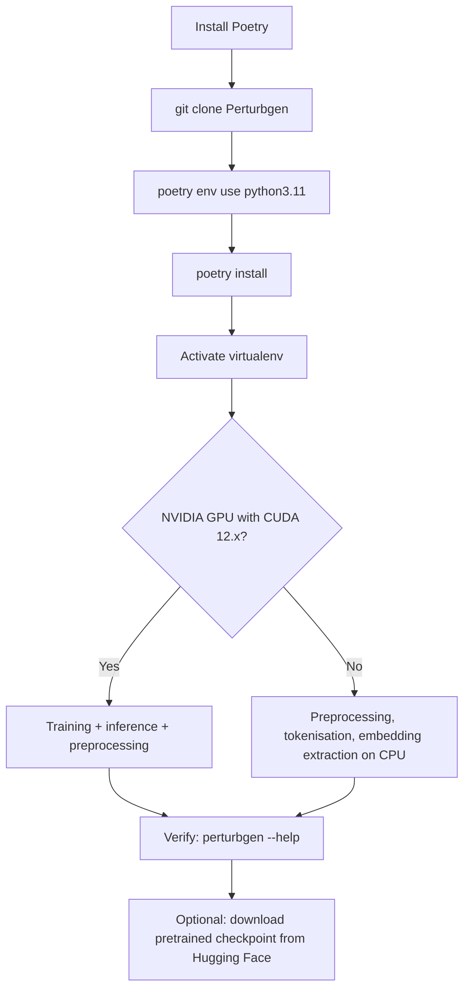
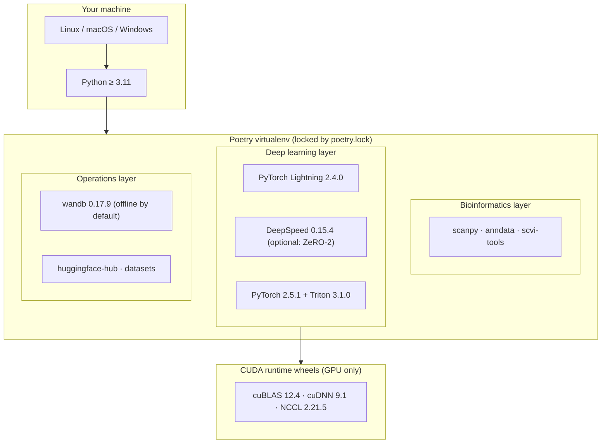
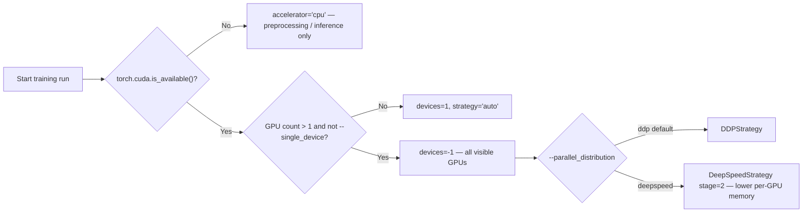

This page covers everything needed to get a working PerturbGen environment on your machine: the supported installation paths (Poetry, pip, and Docker), the exact dependency stack that gets installed, and the hardware you need for each workload — from CPU-only preprocessing to multi-GPU training. PerturbGen is distributed as the installable Python package `PerturbGen` ("Cell state and temporal prediction of scRNA-seq data") with a `perturbgen` command-line entry point, so a correct installation gives you both the library and the CLI in one step.


## System Prerequisites at a Glance

Before running any installer, confirm your machine meets these requirements. The single hard constraint is **Python 3.11 or newer** — the project declares `requires-python = ">=3.11"` for the package and `python = ">=3.11,<4.0"` for the Poetry environment, and the Docker image is built on the official `python:3.11` base. Python dependencies resolve cross-platform (the locked requirements contain platform markers for macOS and Windows), but **GPU training effectively requires Linux with a CUDA 12.x driver**, because the PyPI PyTorch wheels ship CUDA 12.4 runtime libraries.

| Requirement | Value | Notes |
|---|---|---|
| Python | ≥ 3.11 | `<4.0` upper bound in the Poetry environment |
| OS (training) | Linux + CUDA 12.x driver | PyPI wheels bundle CUDA 12.4 runtime (cuDNN 9.1, NCCL 2.21.5) |
| OS (preprocessing/inference) | macOS / Linux / Windows | Platform markers exist for Darwin and win32 |
| System package (Docker) | `libopenmpi-dev` | Required to build `mpi4py` inside the container |
| RAM (CPU workflows) | ≥ 32 GB recommended | For the larger preprocessing datasets |
| GPU (training) | ≥ 24 GB VRAM comfortable | See measured figures below |

Sources: [pyproject.toml](pyproject.toml#L9-L20), [Dockerfile](Dockerfile#L2), [requirements.txt](requirements.txt#L14-L28), [requirements.txt](requirements.txt#L159-L170), [README.md](README.md#L45-L46)

The files that govern installation live at the repository root and in the package directory. This is the terrain you are about to work with:

```
Perturbgen/
├── pyproject.toml         # Python ≥3.11, full dependency set, `perturbgen` CLI entry point
├── poetry.toml            # Poetry behaviour: virtualenvs.create = true
├── poetry.lock            # exact locked versions for reproducible installs
├── requirements.txt       # pip fallback, generated from poetry.lock
├── setup.py               # legacy setuptools stub (package name T_perturb)
├── Dockerfile             # linux/amd64 · python:3.11 · libopenmpi-dev · ENTRYPOINT perturbgen
└── perturbgen/
    ├── requirements.txt   # ⚠ legacy internal pins (cu118 dev wheels) — not the supported path
    ├── __main__.py        # CLI: tokenise · train-mask · train-decoder · extract-embedding
    ├── run_test.sh        # reference CPU test job (1 core, 10 GB RAM)
    └── run_sweep.sh       # reference GPU sweep job (4 exclusive GPUs, 8 cores, 50 GB RAM)
```

Sources: [pyproject.toml](pyproject.toml#L1-L13), [poetry.toml](poetry.toml#L1-L3), [Dockerfile](Dockerfile#L1-L14)

## Installing with Poetry (Recommended)

Poetry is the supported installation path: it creates an isolated virtualenv and installs the exact versions locked in `poetry.lock`. First install Poetry itself — either via the official installer or, alternatively, with `pipx`:

```shell
curl -sSL https://install.python-poetry.org | python3 -
# or: pipx install poetry
```

Then clone the repository, pin the environment to Python 3.11, and install:

```shell
git clone https://github.com/Lotfollahi-lab/Perturbgen.git
cd Perturbgen
poetry env use python3.11
poetry install
```

Because `poetry.toml` sets `virtualenvs.create = true`, Poetry builds a dedicated virtualenv automatically; activate it with `source "$(poetry env info -p)/bin/activate"`. The build backend is `poetry-core>=2.0.0`, which is why Poetry (rather than raw setuptools) drives the whole process.

The following flowchart shows the complete path from zero to a verified installation, including the fork between CPU-only work and GPU training:



Sources: [installation.rst](docs/installation.rst#L4-L38), [README.md](README.md#L12-L41), [poetry.toml](poetry.toml#L1-L3), [pyproject.toml](pyproject.toml#L15-L17)

One detail to be aware of: the tutorial notebooks in this repository are stored as `_nb.py` script files rather than `.ipynb`, and are converted back (and executed) with `jupytext` — `jupytext --to ipynb --execute <your_file>_nb.py`. The `jupytext`-compatible Jupyter stack (`ipykernel`, `ipython`, `jupyter-client`) is part of the locked dependencies, so no extra install is needed for this.

Sources: [installation.rst](docs/installation.rst#L40-L48), [README.md](README.md#L83-L88)

## Alternative: pip Installation

If your workflow mandates pip instead of Poetry, the repository ships a root-level `requirements.txt` that was **generated from `poetry.lock`** and therefore contains the same exact locked versions. The file header documents the intended invocation — install the locked dependencies first, then install the package itself without re-resolving dependencies:

```shell
pip install -r requirements.txt
pip install -e . --no-deps
```

The editable install (`pip install -e .`) is also referenced in the official installation docs and is what wires the `perturbgen` command into your `PATH`. Poetry and pip are not interchangeable in *resolution behaviour* — pip with this file reproduces the lock exactly rather than re-resolving from `pyproject.toml`.

| Install path | Command | Best for |
|---|---|---|
| Poetry (supported) | `poetry env use python3.11 && poetry install` | Day-to-day development; exact reproducibility |
| pip fallback | `pip install -r requirements.txt && pip install -e . --no-deps` | Constrained environments, Dockerfiles, CI |
| Docker | `docker build` (see below) | Fully isolated linux/amd64 environments |

Sources: [requirements.txt](requirements.txt#L1-L3), [installation.rst](docs/installation.rst#L50-L53)

> [!TIP]
> Do **not** install from `perturbgen/requirements.txt`. That file is a legacy internal artifact: it pins a pre-release `torch==2.3.0.dev20240312+cu118`, CUDA **11** libraries (`nvidia-*-cu11`), older `lightning==2.2.1`/`scanpy==1.9.8`, and even a private `git+ssh` dependency on `amirvhd/T_perturb` — none of which match the current supported stack. The root `requirements.txt` is the only pip-sanctioned file.

Sources: [perturbgen/requirements.txt](perturbgen/requirements.txt#L43-L55), [perturbgen/requirements.txt](perturbgen/requirements.txt#L87-L94), [requirements.txt](requirements.txt#L1-L3)

## Container-Based Installation (Docker)

The `Dockerfile` packages the entire environment into a reproducible image. It is pinned to the **`linux/amd64` platform** on the official `python:3.11` base, uses BuildKit cache mounts to speed up `apt` and `pip` layers, and — critically — installs the system package `libopenmpi-dev`, which is the native MPI library that the pinned `mpi4py==4.0.1` builds against. The image then performs an editable pip install of the repository and sets `perturbgen` as the container entrypoint, so `docker run <image> train-mask ...` maps directly onto CLI usage.

```dockerfile
FROM --platform=linux/amd64 python:3.11
RUN ... apt-get install -y --no-install-recommends libopenmpi-dev
COPY . /app
RUN ... pip install -e .
ENTRYPOINT ["perturbgen"]
```

For training inside a container you additionally need the NVIDIA Container Toolkit so the container can reach the host GPU; the image itself carries the CUDA 12.4 runtime libraries via the Python wheel dependencies, not a `nvidia/cuda` base image.

Sources: [Dockerfile](Dockerfile#L2-L14), [pyproject.toml](pyproject.toml#L159-L170)

## Core Dependency Stack

A successful `poetry install` pulls a large locked set (~300 packages). Understanding the stack in layers makes the hardware requirements in the next section legible — each layer maps onto a specific workload. The versions below are the exact pins enforced by Poetry:

| Layer | Key packages (pinned versions) | Purpose |
|---|---|---|
| Deep learning core | `torch 2.5.1`, `torchvision 0.20.1`, `torchaudio 2.5.1`, `triton 3.1.0` | Model computation and kernel compilation |
| Distributed / training ops | `pytorch-lightning 2.4.0`, `lightning 2.4.0`, `deepspeed 0.15.4`, `mpi4py 4.0.1` | Trainer loops, DDP, ZeRO stage 2, multi-node |
| CUDA runtime (bundled) | `nvidia-cublas-cu12 12.4.5.8`, `nvidia-cudnn-cu12 9.1.0.70`, `nvidia-nccl-cu12 2.21.5` (+ cupti/nvrtc/curand/cusolver/cusparse/nvtx at 12.4.x) | GPU libraries shipped as pip wheels |
| Single-cell bio stack | `scanpy 1.11.2`, `anndata 0.11`, `scvi-tools 1.3.1.post1`, `scikit-learn 1.5.2`, `scipy 1.14.1`, `numba 0.61.2` | Preprocessing, `AnnData` I/O, NB/ZINB distributions |
| Data & model assets | `datasets 3.0.0`, `huggingface-hub 0.26.5`, `transformers 4.47.0` | Tokenized dataset loading, checkpoint downloads |
| Tracking & sweeps | `wandb 0.17.9`, `optuna 4.1.0`, `ray 2.40.0`, `tensorboard 2.18.0` | Experiment logging, hyperparameter search |
| Evaluation metrics | `pot 0.9.4` (optimal transport), `evaluate`, `torchmetrics 1.4.1` | MMD/EMD/OT distances, perplexity, MSE |
| Documentation (optional group) | `sphinx ^8.2.3`, `sphinx-rtd-theme ^3.0.2`, `myst-nb ^1.3.0`, `sphinx-autobuild` | Building the readthedocs site |

Sources: [pyproject.toml](pyproject.toml#L263-L271), [pyproject.toml](pyproject.toml#L216-L235), [pyproject.toml](pyproject.toml#L159-L170), [pyproject.toml](pyproject.toml#L57-L91), [pyproject.toml](pyproject.toml#L192-L222), [pyproject.toml](pyproject.toml#L306-L310), [pyproject.toml](pyproject.toml#L120), [pyproject.toml](pyproject.toml#L139)

The following diagram shows how these layers stack on top of your OS and Python installation, and which components activate only when a GPU is present:



Sources: [pyproject.toml](pyproject.toml#L20), [pyproject.toml](pyproject.toml#L159-L170), [README.md](README.md#L66-L70)

## Hardware Requirements

Hardware needs split cleanly by workload. **Preprocessing, tokenization, and inference notebooks run on CPU** — a machine with **≥ 32 GB RAM is recommended for the larger datasets**. No GPU is needed until you reach the training commands (`train-mask`, `train-decoder`), and **training requires a CUDA GPU**.

The GPU memory figures below were measured over a full training epoch on the LPS tutorial data at the default batch size of 64:

| Training stage | Peak GPU memory (batch size 64) |
|----------------|---------------------------------|
| Masking model  | 13.8 GB                         |
| Count decoder  | 15.8 GB                         |

In practice this means training at the default batch size runs on **24 GB GPUs (e.g. RTX 3090/4090) and larger**. On 16 GB cards the count-decoder stage sits close to the memory limit; if you hit an out-of-memory (OOM) error, lower the batch size via the `--batch_size` flag on the CLI (or `batch_size=` in the Python API). To reproduce the paper's results exactly, keep the default batch size of 64.

Sources: [README.md](README.md#L43-L59), [train.py](perturbgen/train.py#L146)

For multi-GPU scaling, the training code **automatically uses all visible GPUs** (`devices=-1` when more than one GPU is detected), with **DDP as the default strategy**; **DeepSpeed (ZeRO stage 2)** is available via `--parallel_distribution deepspeed`, which also reduces per-GPU memory. Single-node execution is the default (`--num_node 1`), and there is an explicit `--single_device` escape hatch that forces one GPU without DDP/DeepSpeed. Device selection itself is automatic: the trainer sets `accelerator = 'gpu'` if `torch.cuda.is_available()`, otherwise it falls back to CPU — which is why the CPU-only workflows above work unchanged.



Sources: [README.md](README.md#L61-L64), [train.py](perturbgen/train.py#L656-L688), [train.py](perturbgen/train.py#L147-L158)

There is also device-adaptive behaviour worth knowing about on data-center hardware: at model construction the trainer checks the GPU name and, on **A100 or NVIDIA H100 80GB** devices, sets `torch.set_float32_matmul_precision` (default `'medium'`) and prints which GPU is in use; on any other setup it simply reports "CUDA is not available, using CPU for training" when applicable. No configuration is required — this is automatic tuning for tensor-core-capable accelerators.

Sources: [Model/trainer.py](perturbgen/Model/trainer.py#L43-L52)

For reference, the repository's own HPC job scripts document the resource envelopes the authors used on a LSF cluster. The CPU unit-test job requests 1 core and 10 GB RAM with the `cuda-12.1.1` module loaded; the hyperparameter sweep job requests **4 exclusive GPUs, 8 CPU cores, and 50 GB RAM** on a GPU partition:

| Reference job | Queue | Cores | RAM | GPUs | CUDA module |
|---|---|---|---|---|---|
| `run_test.sh` (unit tests) | `cpu-interactive` | 1 | 10 GB | — | `cuda-12.1.1` |
| `run_sweep.sh` (wandb sweep) | `gpu-lotfollahi` | 8 | 50 GB | 4 (exclusive process) | `cuda-12.1.1` |

Sources: [run_test.sh](perturbgen/run_test.sh#L1-L25), [run_sweep.sh](perturbgen/run_sweep.sh#L1-L26)

> [!TIP]
> Experiment logging to Weights & Biases is **offline by default**, deliberately so that runs never hang on wandb authentication on machines without internet access (e.g., firewalled compute clusters). Offline runs can be uploaded later with `wandb sync`; to log online, either `export WANDB_MODE=online` or pass `--wandb_mode online` per run, and use `--wandb_mode disabled` to switch logging off entirely. Direct your runs to your own account with `--wandb_entity <your-team>`.

Sources: [README.md](README.md#L66-L81), [train.py](perturbgen/train.py#L625-L638)

## Verifying the Installation

Once installed, the fastest sanity check is the CLI itself. Running `perturbgen` should print the command group with these subcommands — `tokenise` (data preprocessing/tokenisation), `train-mask` (masking model), `train-decoder` (count decoder model), and `extract-embedding` (load a checkpoint and extract embeddings). If this help text appears, the package, its dependencies, and the entry point are all wired correctly.

```shell
$ perturbgen
Usage: perturbgen [OPTIONS] COMMAND [ARGS]...
Commands:
  tokenise           Data preprocessing, tokenisation
  train-mask         Training the masking model
  train-decoder      Training the count decoder model
  extract-embedding  Load checkpoint and extract the embeddings
```

Sources: [installation.rst](docs/installation.rst#L55-L72), [__main__.py](perturbgen/__main__.py#L38-L72)

For a functional check of the training stack, the repository ships a unittest suite that the authors run on a CPU queue with 10 GB of RAM — `python -m unittest discover` over the `perturbgen/tests/` directory. A minimal GPU availability check before your first training run is one line: `python -c "import torch; print(torch.cuda.is_available(), torch.cuda.device_count())"`.

Sources: [run_test.sh](perturbgen/run_test.sh#L20-L25)

## Downloading Pretrained Assets (Optional)

The pretrained model checkpoint is distributed via Hugging Face at `huggingface.co/lotfollahi-lab/PerturbGen`. Note one installation-time pitfall: although a checkpoint file exists in `pretraining_cohort/` via Git LFS, `git lfs pull` may fail with a 403 bandwidth error — download the `.ckpt` from the Hugging Face link instead and save it in `pretraining_cohort/` **keeping its original filename**. That location is where training looks for the encoder by default, so no `--encoder_path` flag is needed afterwards.

Sources: [README.md](README.md#L105-L112)

## Troubleshooting

| Symptom | Cause | Fix |
|---|---|---|
| `CUDA out of memory` during training | Count-decoder stage peaks at 15.8 GB at batch size 64 | Lower `--batch_size`; or use `--parallel_distribution deepspeed` (ZeRO-2 lowers per-GPU memory) |
| Jupyter kernel stalls when training | `torch.compile` is on by default and can stall/deadlock inside a Jupyter kernel | The in-process API disables it automatically; via CLI pass `--compile False` and/or `--single_device True` |
| Run hangs at start waiting for wandb | Online wandb auth on a machine without internet | W&B is offline by default; explicitly set `--wandb_mode online` or `export WANDB_MODE=online` if you *want* online logging |
| "CUDA is not available, using CPU" during training | No usable GPU / missing CUDA 12.x driver | Verify driver with `nvidia-smi`; training needs a CUDA GPU, other workloads legitimately stay on CPU |
| `poetry install` resolves the wrong Python | Virtualenv picked up a non-3.11 interpreter | Re-run `poetry env use python3.11` before `poetry install` |
| `git lfs pull` fails with 403 | Bandwidth limits on the Git LFS-hosted checkpoint | Download from the Hugging Face repo and place the `.ckpt` in `pretraining_cohort/` |
| `mpi4py` fails to build in Docker | Native MPI headers missing | The Dockerfile already installs `libopenmpi-dev`; replicate this on bare-metal pip installs |

Sources: [README.md](README.md#L56-L64), [train.py](perturbgen/train.py#L148-L158), [Model/trainer.py](perturbgen/Model/trainer.py#L43-L52), [Dockerfile](Dockerfile#L6), [README.md](README.md#L111-L112)

## Where to Go Next

You now have a working environment and know what hardware each workload demands. The natural reading progression from here: if you have not yet run anything, start with the [Quick Start](2-quick-start), then move to the [Tutorial Notebooks Walkthrough](4-tutorial-notebooks-walkthrough) to see the installed toolchain in action. When you begin training in earnest, the deeper operational pages become relevant: how dataset and checkpoint paths are resolved ([Configuration System and Path Management](17-configuration-system-and-path-management)), scaling beyond one GPU ([Distributed Training with DDP and DeepSpeed](19-distributed-training-with-ddp-and-deepspeed)), configuring the W&B logging you just learned about ([Experiment Tracking with Weights and Biases](20-experiment-tracking-with-weights-and-biases)), the exact CLI flags behind `perturbgen` ([CLI Command Reference](22-cli-command-reference)), fetching the released checkpoint ([Pretrained Checkpoints and Hugging Face Assets](23-pretrained-checkpoints-and-hugging-face-assets)), and running the test/benchmark suite on your new environment ([Test and Benchmark Suite](26-test-and-benchmark-suite)).
