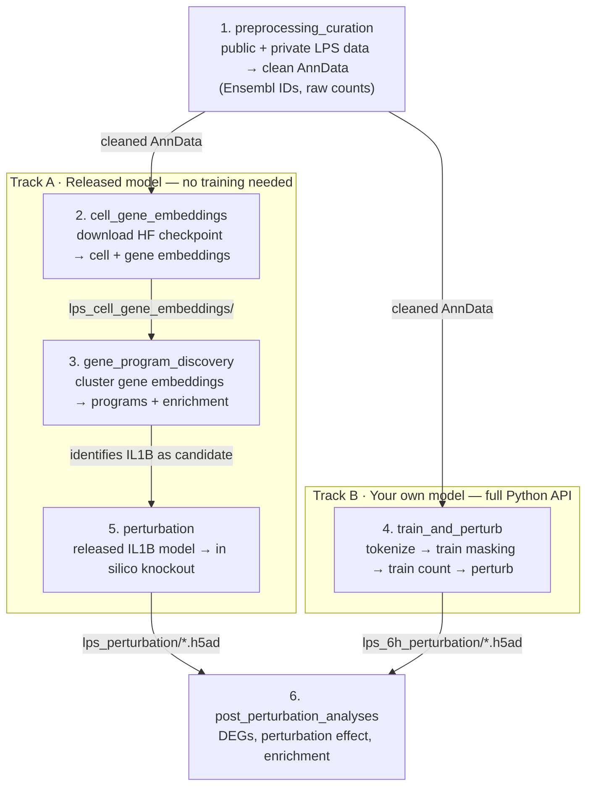
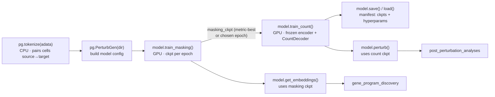

This page walks through the six Jupyter notebooks shipped in `docs/examples/`, which together form a complete PerturbGen analysis workflow on the LPS immune-response time-course dataset. Each notebook is a self-contained, executable lesson — from raw public data download all the way to interpreting in silico perturbation results. The notebooks assume familiarity with Python-based scientific computing (Scanpy/AnnData) and single-cell data, and they are organized in the docs via the `Tutorial` toctree so they render as a connected narrative on the documentation site. By the end of this walkthrough you will know exactly which notebook to run, in what order, and what each one produces for the next stage.

Sources: [tutorial.rst](/docs/tutorial.rst#L1-L17), [preprocessing_curation.ipynb](/docs/examples/preprocessing_curation.ipynb#L7-L17)

## The Six-Notebook Landscape

The tutorial toctree in `docs/tutorial.rst` lists the notebooks in the following order: `preprocessing_curation`, `cell_gene_embeddings`, `gene_program_discovery`, `train_and_perturb`, `perturbation`, and `post_perturbation_analyses`. Functionally they split into **two tracks**: a *released-model track* (analyze without training anything, using checkpoints downloaded from Hugging Face) and a *training track* (build your own model end-to-end with the Python API). Both tracks converge on the same final artifact — a post-perturbation AnnData that the analysis notebook consumes.

Sources: [tutorial.rst](/docs/tutorial.rst#L10-L17), [cell_gene_embeddings.ipynb](/docs/examples/cell_gene_embeddings.ipynb#L5-L16), [train_and_perturb.ipynb](/docs/examples/train_and_perturb.ipynb#L5-L16)

The table below summarizes each notebook's role, required model assets, and hardware needs — use it to decide which track fits your situation:

| # | Notebook | Purpose | Model source | Hardware | Key output |
|---|----------|---------|-------------|----------|------------|
| 1 | `preprocessing_curation` | Merge public + private LPS data; harmonize gene IDs and cell types | None (data only) | CPU | Clean AnnData, raw counts, Ensembl `var` index |
| 2 | `cell_gene_embeddings` | Extract cell and time-resolved gene embeddings | Released masking checkpoint (Hugging Face) | CUDA GPU | `lps_cell_gene_embeddings/` h5ad with `obsm` + `varm` |
| 3 | `gene_program_discovery` | De novo gene program discovery + enrichment | Consumes embeddings from notebook 2 | CPU | Gene programs, UMAPs, enrichment plots |
| 4 | `train_and_perturb` | Full API workflow: tokenize → train → perturb | Pretrained `scmaskgit` encoder + your training | CUDA GPU (24 GB fits `batch_size=64`, ~16 GB peak) | Trained checkpoints + post-perturbation h5ad |
| 5 | `perturbation` | In silico IL1B knockout with the released manuscript model | Released count-decoder checkpoint (Hugging Face) | CUDA GPU | `lps_perturbation/*.h5ad` |
| 6 | `post_perturbation_analyses` | Quantify perturbation effects: DEGs, cell-type response | Consumes output of notebook 5 (or 4) | CPU | Barplots, DEG tables, enrichment |

Sources: [tutorial.rst](/docs/tutorial.rst#L10-L17), [train_and_perturb.ipynb](/docs/examples/train_and_perturb.ipynb#L42-L52), [cell_gene_embeddings.ipynb](/docs/examples/cell_gene_embeddings.ipynb#L18-L45), [perturbation.ipynb](/docs/examples/perturbation.ipynb#L48-L52)

## Shared Assets: What Every Notebook Depends On

Three asset categories recur across the notebooks. First, the **released model assets** live in the Hugging Face repository `lotfollahi-lab/PerturbGen`: notebooks download a specific checkpoint (`hf_hub_download`) together with the *exact tokenized dataset that checkpoint was trained on* (`snapshot_download`) — token IDs are defined by the tokenization, so a checkpoint is only valid with its matching tokenized data. Second, the **tokenizer reference files** shipped inside the package (`gene_median`, `token_dict`, `gene_mapping`) are resolved through `perturbgen.configs.paths` constants, so notebooks never hardcode their locations. Third, a **gene-ID mapping file** `docs/examples/reference/mart_export.txt` — an Ensembl BioMart export of `HGNC symbol → Gene stable ID` pairs (~86k rows) — supports symbol↔Ensembl harmonization during preprocessing.

Sources: [cell_gene_embeddings.ipynb](/docs/examples/cell_gene_embeddings.ipynb#L18-L45), [perturbation.ipynb](/docs/examples/perturbation.ipynb#L48-L60), [train_and_perturb.ipynb](/docs/examples/train_and_perturb.ipynb#L54-L82), [mart_export.txt](/docs/examples/reference/mart_export.txt#L1-L15)

## Notebook 1: Preprocessing and Curation

This notebook prepares the LPS datasets — both the public source and private data — and demonstrates how to merge them into a training-ready AnnData. It starts by downloading the public LPS dataset from the EBI Biostudies archive (dataset E-MTAB-10026, a ~7.2 GB `h5ad` file) using `gdown`, then loads it with Scanpy and investigates the object to identify LPS-stimulated samples versus healthy control cells. This is the natural first notebook for anyone bringing their own data, and its conventions (raw counts in `.X`, Ensembl IDs as the `var` index) are exactly what the later API notebooks expect.

Sources: [preprocessing_curation.ipynb](/docs/examples/preprocessing_curation.ipynb#L7-L17), [preprocessing_curation.ipynb](/docs/examples/preprocessing_curation.ipynb#L25-L78)

The curation steps follow a reproducible pattern you can copy for your own cohort: copy `full_clustering` into an `obs['cell_type']` column, filter out cell types with fewer than 50 cells to remove statistically fragile categories, and verify the `obs['time_after_LPS']` column — the ordered time-point categories (`normal` < `90m_LPS` < `10h_LPS` in the public data) that drive PerturbGen's trajectory modeling. The gene annotation uses Ensembl stable IDs alongside HGNC symbols (~19k genes in the shown `var` table), which is the identifier scheme the tokenizer requires.

Sources: [preprocessing_curation.ipynb](/docs/examples/preprocessing_curation.ipynb#L760-L959)

For the deeper statistical rationale behind pairing cells across time points, continue to [Cell Pairing and Data Curation](14-cell-pairing-and-data-curation); the identifier scheme is covered in [Geneformer-Style Gene Tokenization](9-geneformer-style-gene-tokenization).

## Notebook 2: Cell and Gene Embeddings (Released Model)

This notebook extracts cell embeddings and time-resolved gene embeddings from the **released PerturbGen model used for the embedding analyses in the manuscript** — the masking model trained on LPS data with the unstimulated `normal` state as source and 90 min, 6 h, and 10 h as targets. No training happens here: the checkpoint and its tokenized data are downloaded from Hugging Face, the model is rebuilt with the checkpoint's exact configuration (`n_hvg=2000`, `n_layers=6`, `d_model=768`, `max_len=797`, `tgt_vocab_size=2002`, cosine mask scheduler, time conditioning), and embeddings are produced in a single `model.get_embeddings()` call.

Sources: [cell_gene_embeddings.ipynb](/docs/examples/cell_gene_embeddings.ipynb#L5-L16), [cell_gene_embeddings.ipynb](/docs/examples/cell_gene_embeddings.ipynb#L47-L80)

The output AnnData has a precise contract that notebook 3 depends on: **cell embeddings** are stored in `obsm["cls_embeddings"]`, while **gene embeddings** are extracted separately per time point (via `gene_embs_condition="time_after_LPS"`) and stored in `varm` (`90m_LPS`, `6h_LPS`, `10h_LPS`). The notebook writes everything to `lps_cell_gene_embeddings/` and explicitly hands off to the next notebook.

Sources: [cell_gene_embeddings.ipynb](/docs/examples/cell_gene_embeddings.ipynb#L62-L84)

The embedding mechanics themselves — how the masking model's representations become cell/gene vectors — are explained in [Cell and Gene Embedding Extraction](11-cell-and-gene-embedding-extraction).

## Notebook 3: Gene Program Discovery

This notebook treats gene embeddings as a framework for *de novo gene program discovery*: genes grouped into the same program may represent coordinated biological functions and serve as candidate perturbation targets. It loads the `*inference_embs*.h5ad` written by notebook 2 — an AnnData with 69,433 cells × 2,000 genes, cell embeddings under `obsm["cls_embeddings"]`, and per-timepoint gene embeddings under `varm` — then runs standard Scanpy workflows (`normalize_total`, `log1p`, `neighbors`, `UMAP`) on the cell embeddings for visualization.

Sources: [gene_program_discovery.ipynb](/docs/examples/gene_program_discovery.ipynb#L5-L15), [gene_program_discovery.ipynb](/docs/examples/gene_program_discovery.ipynb#L37-L77)

The key conceptual move is a **transposition**: each gene becomes an *observation*, and its features are the 768-dimensional learned embedding vector rather than expression values. The notebook stacks all time-point gene-embedding matrices into one AnnData (`{gene}_{timepoint}` rows), drops all-zero gene–timepoint vectors, and applies standard single-cell tooling — neighborhood graphs, clustering, and `gseapy` enrichment — to the embedding space. This is precisely the analysis that surfaced the cytokine/chemokine program with IL1B as its leading gene, motivating the perturbation experiments in notebooks 4 and 5.

Sources: [gene_program_discovery.ipynb](/docs/examples/gene_program_discovery.ipynb#L263-L320), [perturbation.ipynb](/docs/examples/perturbation.ipynb#L15-L20)

Program-discovery methodology is treated in depth in [Gene Program Discovery](12-gene-program-discovery).

## Notebook 4: Train and Perturb — The End-to-End Python API

This is the flagship tutorial: it trains PerturbGen on the in vivo LPS challenge with the **6 h state as source and 10 h as target**, then knocks out **IL1B** at 6 h and predicts how the 10 h state changes — all in-process, no shell calls. The notebook header states the five-step API contract: `pg.tokenize` → `pg.PerturbGen` → `train_masking` → `train_count` → `save`/`embed`/`perturb`. Prerequisites are a preprocessed AnnData (QC'd, Ensembl IDs, raw counts), the tokenizer reference files, the pretrained `scmaskgit` encoder checkpoint (used by default from `pretraining_cohort/` in the repository, downloadable from Hugging Face if `git lfs pull` fails), and a CUDA GPU.

Sources: [train_and_perturb.ipynb](/docs/examples/train_and_perturb.ipynb#L5-L52)

Step through the stages with their verified behaviors:

| API call | Stage | Hardware | Key details |
|----------|-------|----------|-------------|
| `pg.tokenize(adata_path, dataset=..., reference_time='6h_LPS', time_point_order=[...])` | Tokenize + pair cells | CPU | Writes the `.dataset` layout; HVG selection defaults to `hvg_flavor='seurat_v3'` over Geneformer-tokenizable genes |
| `pg.PerturbGen(TOKENIZED_DIR, source=..., pred_tps=[...])` | Build model | CPU | Ships with frozen pretrained `scmaskgit` encoder; pass `encoder_path=` to override |
| `model.train_masking(output_dir=...)` | Stage 1 training | GPU | Checkpoint saved **every epoch**; returns metric-best (perplexity) checkpoint; ~91.5 M params total, only ~19.7 M trainable |
| `model.train_count(output_dir=..., masking_ckpt=...)` | Stage 2 training | GPU | Initializes `CountDecoder` from your chosen masking epoch; ~95.7 M total, ~4.3 M trainable (encoder frozen) |
| `model.save(dir)` / `pg.PerturbGen.load(dir)` | Persist | CPU | Manifest stores tokenized dir, source, hyperparameters, and both checkpoint paths |
| `model.get_embeddings(...)` | Analysis | GPU | Embeddings come from the **masking** model; `gene_embs_condition` splits gene embeddings per column value |
| `model.perturb(genes=[...], count_ckpt=...)` | Prediction | GPU | Uses the trained count-decoder checkpoint; writes post-perturbation h5ad to `output_dir` |

Sources: [train_and_perturb.ipynb](/docs/examples/train_and_perturb.ipynb#L84-L115), [train_and_perturb.ipynb](/docs/examples/train_and_perturb.ipynb#L327-L350), [train_and_perturb.ipynb](/docs/examples/train_and_perturb.ipynb#L560-L645), [train_and_perturb.ipynb](/docs/examples/train_and_perturb.ipynb#L648-L693), [train_and_perturb.ipynb](/docs/examples/train_and_perturb.ipynb#L695-L745)

> [!TIP]
> The two-stage training design gives you an explicit decision point: because `train_masking` saves a checkpoint per epoch, you choose *which* masking epoch feeds the count decoder (the notebook demonstrates initializing from epoch 8 while perturbing with count epoch 2). Inspect training curves — e.g., in Weights & Biases — before locking in the handoff; the default is simply the metric-best checkpoint.

The configuration values flowing into these calls (`GENE_MEDIAN_PATH`, `TOKEN_DICT_PATH`, `GENE_MAPPING_PATH`, `TOKENIZED_DIR`) are managed by the package's path system described in [Configuration System and Path Management](17-configuration-system-and-path-management); the two training stages are dissected in [Two-Stage Masking and Count Decoder Training](7-two-stage-masking-and-count-decoder-training).

## Notebook 5: In Silico Perturbation (Released Model)

This notebook runs an in silico perturbation with the **released IL1B model from the manuscript**, downloaded from Hugging Face — the count-decoder checkpoint (which embeds the masking model it was trained from) plus its matching tokenized data (`90m_LPS` source, targets 6 h and 10 h). It reproduces the paper's experimental logic, illustrated below: gene-program discovery across the LPS trajectory highlighted a cytokine/chemokine program with IL1B emerging as a mechanistic candidate, and PerturbGen then simulates an IL1B knockout at the 90-minute source to see how the disruption propagates to 6 h and 10 h.

Sources: [perturbation.ipynb](/docs/examples/perturbation.ipynb#L5-L52), [perturbation.ipynb](/docs/examples/perturbation.ipynb#L62-L112)

The notebook doubles as the practical reference for `model.perturb()` arguments — experiments change without touching model code:

| Argument | Values | Meaning |
|----------|--------|---------|
| `genes` | Ensembl ID (recommended) or symbol; accepts a **list** | Which genes to perturb; a list enables multi-gene/combinatorial knockouts. `ENSG00000125538` = IL1B |
| `where` | `'source'` (default) / `'target'` | `'source'` edits the source state and propagates downstream along the trajectory; `'target'` perturbs the predicted state directly |
| `pred_tps` | Indices into the dataset's ordered time points (1 → 6 h, 2 → 10 h for the released model) | Which downstream time points to generate, for both control and perturbed runs |
| `pert_tps` | Only with `where='target'`; required for knockout-type modes there | Which target time point(s) to edit before predicting |
| `mode` | `'knockout'` / `'pad'` / `'delete'` / `'overexpress'` | How the gene token is edited (see below) |
| `n_samples` | Integer (e.g. 3) | Generative samples per condition |
| `extra_config` | `{section: {key: value}}` | Escape hatch for YAML config options without a dedicated argument |

Sources: [perturbation.ipynb](/docs/examples/perturbation.ipynb#L114-L236)

The four **perturbation modes** map directly onto biological interpretations — loss-of-function versus gain-of-function:

| Mode | Token edit | Biological analogy | Intensity |
|------|-----------|--------------------|-----------|
| `'knockout'` | Replace with `[MASK]` — model infers consequences from context | CRISPR KO / knockdown | Default, recommended |
| `'pad'` | Replace with `[PAD]` — removed from the active sequence | Complete absence from expressed gene set | Stronger knockout assumption |
| `'delete'` | Token removed from the sequence entirely (sequence shortens) | Strongest deletion; robustness stress-test | Strongest |
| `'overexpress'` | Token promoted to the top rank of the ranked gene sequence | CRISPRa / activation — rank encodes relative expression | Gain-of-function |

Sources: [perturbation.ipynb](/docs/examples/perturbation.ipynb#L188-L215)

> [!TIP]
> The notebook carries a critical warning: a **source knockout only has an effect if the gene is expressed in the source state** — cells lacking the gene token in the source are filtered, and batches left with no qualifying cells are skipped. IL1B is LPS-induced and near-zero in the unstimulated `normal` baseline, which is why the released IL1B model uses `90m_LPS` as its source; pointing a perturbation at `normal` would skip nearly all batches and yield empty, irreproducible results. Always verify expression of your target gene in the chosen source before running.

The complete mode taxonomy and their mechanistic grounding are detailed in [In Silico Perturbation Modes](10-in-silico-perturbation-modes).

## Notebook 6: Post-Perturbation Analyses

This final notebook examines transcriptomic changes after in silico perturbation, consuming the h5ad written by notebook 5 (or 4). The output AnnData follows a documented three-layer contract: **`.X` holds the perturbed counts** (raw), **`layers['pred_counts']`** holds reconstructed pre-perturbation counts, **`layers['true_counts']`** holds the original observed counts, plus a per-cell `mean_cos_similarity` metric. Because all counts are raw, the notebook normalizes and log-transforms before any downstream analysis.

Sources: [post_perturbation_analyses.ipynb](/docs/examples/post_perturbation_analyses.ipynb#L9-L16), [post_perturbation_analyses.ipynb](/docs/examples/post_perturbation_analyses.ipynb#L44-L85)

The analysis pipeline then proceeds in three verifiable steps. First, it reorganizes the object into perturbed/unperturbed counterparts using `status` and `status_time` annotations (`perturbed_6h_LPS` vs `unperturbed_6h_LPS`, etc.) and concatenates them into one comparison AnnData. Second, it computes the **"perturbation effect"**: per cell type and time point, a Wilcoxon rank-sum test (`sc.tl.rank_genes_groups`) compares perturbed against unperturbed cells, counting significant DEGs (`pvals_adj < 0.05`), visualized as a cell-type-ranked barplot — the myeloid lineage (CD14+/CD16+ monocytes, dendritic cells) shows the strongest effect and is subsetted for deeper analysis. Third, Ensembl IDs are mapped back to gene symbols for interpretability, followed by `gseapy` enrichment on the perturbation-driven changes.

Sources: [post_perturbation_analyses.ipynb](/docs/examples/post_perturbation_analyses.ipynb#L44-L100), [post_perturbation_analyses.ipynb](/docs/examples/post_perturbation_analyses.ipynb#L102-L190)

How these predictions are scored at the population level (MMD, EMD, optimal transport) is covered in [Evaluation Metrics: MMD, EMD, Optimal Transport](13-evaluation-metrics-mmd-emd-optimal-transport).

## Recommended Path Through the Documentation

For beginners we suggest this progression: run the notebooks in the toctree order above while reading along in the docs. After finishing this walkthrough, continue with [Architecture Overview](5-architecture-overview) to understand what the checkpoints contain, then [Quick Start](2-quick-start) recap and [Installation and Hardware Requirements](3-installation-and-hardware-requirements) if you are still setting up. When you reach the analysis notebooks, deepen each topic with its dedicated deep-dive page: [In Silico Perturbation Modes](10-in-silico-perturbation-modes), [Cell and Gene Embedding Extraction](11-cell-and-gene-embedding-extraction), [Gene Program Discovery](12-gene-program-discovery), and [Pretrained Checkpoints and Hugging Face Assets](23-pretrained-checkpoints-and-hugging-face-assets) for troubleshooting checkpoint downloads. For reproducibility-oriented users, [Test and Benchmark Suite](26-test-and-benchmark-suite) shows how the same workflows are validated programmatically.

Sources: [tutorial.rst](/docs/tutorial.rst#L6-L17)

## Common Pitfalls and Practical Notes

| Pitfall | Symptom | Fix (as documented in the notebooks) |
|---------|---------|--------------------------------------|
| Checkpoint/tokenized-data mismatch | Garbage or failed model load | Download the tokenized dataset shipped alongside each released checkpoint; token IDs are defined by that tokenization |
| Perturbing a gene not expressed in the source | "No cells" messages, empty/skipped batches | Choose a source where the gene is expressed (IL1B example uses `90m_LPS`, not `normal`) |
| Reusing a non-empty `output_dir` for `perturb()` | Previously computed genes silently skipped | Use a fresh `output_dir` per experiment |
| GPU out-of-memory during training/perturbation | CUDA OOM error | `batch_size=64` fits 24 GB cards (~16 GB peak); lower the batch size |
| Raw counts fed directly to analysis | Distorted DEG/enrichment results | `normalize_total` + `log1p` both perturbed and predicted counts before analysis |
| Kernel restart after tokenization | Lost `TOKENIZED_DIR`/`SOURCE` variables | The notebook defines these paths before the tokenize cell precisely so a restart doesn't force re-tokenization |
