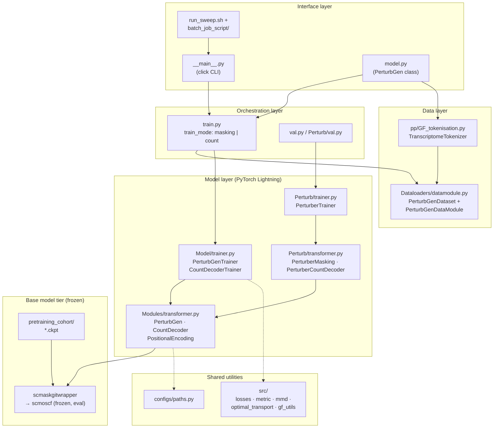
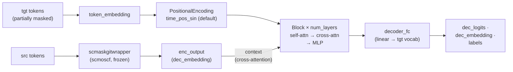
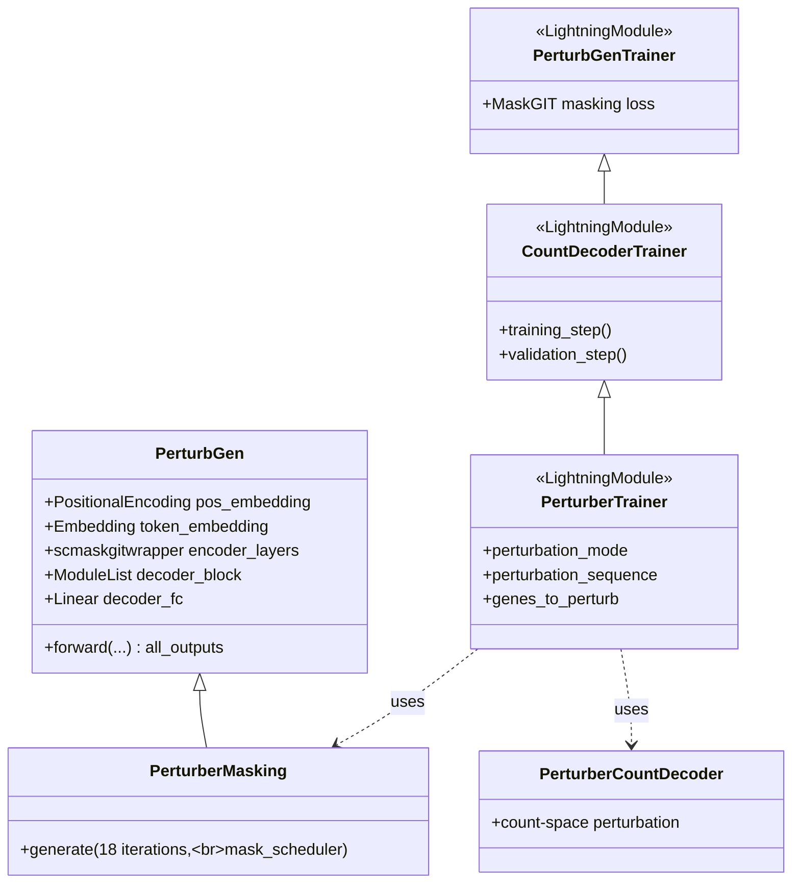

PerturbGen is a foundation model for predicting how perturbations reshape dynamic cellular trajectories — given a tokenized single-cell dataset, it predicts gene expression at future time points and supports in silico gene perturbations across those transitions. This page maps the repository's architectural layers from first principles: how the codebase is partitioned, how data flows from raw AnnData through tokenization into a two-stage masked-generative model, and how the perturbation, configuration, and training-infrastructure layers are composed. It is the entry point for the Deep Dive section; each architectural subsystem documented here has a dedicated page that goes deeper.


Sources: [README.md](README.md#L9-L16), [docs/architecture.png](docs/architecture.png)

## The Three-Tier Repository Layout

The repository is not a single package — it is a three-tier system in which each top-level directory owns one stage of the model's lifecycle. `pretraining_cohort/` owns the upstream pretraining data pipeline (bronze→silver harmonization, median calculation, tokenization) plus the pretrained encoder checkpoint that ships with the repo via Git LFS. `scmaskgit/` owns the base masked-generative transformer (`scmoscf` in `Modules/T_model.py`) — the architecture trained during pretraining. `perturbgen/` is the application package that wraps the pretrained `scmaskgit` encoder as a frozen feature extractor and adds the decoder, count-decoder, and perturbation machinery around it.

| Tier | Directory | Responsibility | Key artifacts |
|---|---|---|---|
| Pretraining cohort | `pretraining_cohort/` | Cohort harmonization, median aggregation, tokenization pipeline | Encoder checkpoint `.ckpt`, `preprocessing/`, `tokenization/` |
| Base model | `scmaskgit/` | Masked-generative transformer (`scmoscf`), its own `PositionalEncoding`, losses, metrics | `Modules/T_model.py`, `src/` |
| Application | `perturbgen/` | Fine-tuning, perturbation, tokenization pipeline, CLI, Python API, configs | `Model/`, `Modules/`, `Perturb/`, `pp/`, `configs/`, `model.py` |

Sources: [scmaskgit/Modules/T_model.py](scmaskgit/Modules/T_model.py#L1-L120), [perturbgen/Modules/transformer.py](perturbgen/Modules/transformer.py#L407-L449), [pretraining_cohort/](pretraining_cohort#L1-L1)

## Visual Project Structure

The `perturbgen/` package itself follows a strict subsystem decomposition. Each directory is a layer with a single direction of dependency: `pp/` (tokenization) feeds `Dataloaders/` (pairing and batching), which feeds `Model/` and `Perturb/` (Lightning trainers), which are orchestrated by `train.py`, `val.py`, the click-based CLI in `__main__.py`, and the scvi-tools-style Python API in `model.py`.

```
perturbgen/
├── __main__.py            # click CLI: tokenise, train-mask, train-decoder, extract-embedding
├── model.py               # scvi-tools-style Python API (PerturbGen class + tokenize())
├── train.py / val.py      # Lightning orchestration entry points
├── pp/                    # Geneformer-style tokenization + shipped vocab/median pickles
│   ├── GF_tokenisation.py # Tokenization pipeline main()
│   ├── tokenizer.py       # TranscriptomeTokenizer
│   └── *.pkl              # gene medians, token dict, Ensembl mapping (gc95M)
├── Dataloaders/
│   └── datamodule.py      # PerturbGenDataset + PerturbGenDataModule (src/tgt pairing)
├── Modules/
│   └── transformer.py     # PerturbGen, CountDecoder, Encoder, scmaskgitwrapper, PositionalEncoding
├── Model/
│   └── trainer.py         # PerturbGenTrainer (masking), CountDecoderTrainer (count)
├── Perturb/
│   ├── trainer.py         # PerturberTrainer (in silico perturbation)
│   ├── transformer.py     # PerturberMasking, PerturberCountDecoder
│   └── val.py
├── src/                   # losses, metrics (MMD/EMD/OT), GF utils, shared utils
├── configs/               # paths.py + eval/ + sweep/ YAMLs
└── batch_job_script/      # per-dataset sweep scripts (hspc, lps, eb, sko, cytoimmgen)
```

Sources: [perturbgen/__main__.py](perturbgen/__main__.py#L42-L66), [perturbgen/model.py](perturbgen/model.py#L1-L33), [perturbgen/train.py](perturbgen/train.py#L11-L24)

## Layered Architecture

Every request — whether it arrives through the CLI, the sweep shell scripts, or the in-process Python API — traverses the same vertical stack. The critical design decision is at the boundary between the base model tier and the application tier: `perturbgen.Modules.transformer` imports `scmoscf` directly from `scmaskgit.Modules.T_model` and wraps it in `scmaskgitwrapper`, which loads the shipped pretrained checkpoint, freezes every parameter, and only ever exposes its `dec_embedding` output. All learning in the application tier happens in the decoder stack on top of this frozen encoder.



Sources: [perturbgen/Modules/transformer.py](perturbgen/Modules/transformer.py#L14-L19), [perturbgen/Modules/transformer.py](perturbgen/Modules/transformer.py#L407-L449), [perturbgen/train.py](perturbgen/train.py#L560-L731), [perturbgen/configs/paths.py](perturbgen/configs/paths.py#L1-L35)

## The PerturbGen Transformer: Frozen Encoder Plus Masked Decoder

Inside `Modules/transformer.py`, the `PerturbGen` module composes four components. A `PositionalEncoding` layer provides **time-aware positional encoding** in four selectable modes (`time_pos_sin`, `comb_sin`, `sin_learnt`, `time_pos_learnt`) — the sinusoidal `time_pe`/`pos_pe` pair is what allows interpolation and extrapolation to time steps never seen during training. A `token_embedding` maps the Geneformer-style vocabulary to `d_model`-dimensional vectors. The encoder branch is switchable: `encoder='scmaskgit'` instantiates the frozen pretrained wrapper, while `encoder='Transformer_encoder'` trains a fresh `Encoder` from scratch. Finally, a stack of timm-derived `Block`s (self-attention → cross-attention against the encoded source/context → MLP) projects into `decoder_fc`, a linear head over the target vocabulary.

The frozen encoder itself is a 12-layer, `d_model=768`, 8-head, 4096-token transformer (`scmoscf`) loaded from `pretraining_cohort/*.ckpt`. The wrapper handles two checkpoint layouts — standalone scmaskgit checkpoints keyed `transformer.*` and nested PerturbGen checkpoints keyed `transformer.encoder_layers.model.*` — strips the appropriate prefix, then sets `requires_grad=False` and `eval()` mode on every parameter.



A second-order performance concern shapes this module's forward pass: the frozen encoder output and the cross-attention context embeddings are invariant across MaskGIT's 18 demasking iterations (only the target time step's tokens change between iterations), so both are cached using an `O(1)` key built from `data_ptr()`, shape, and stride rather than an expensive full-tensor comparison.

Sources: [perturbgen/Modules/transformer.py](perturbgen/Modules/transformer.py#L24-L120), [perturbgen/Modules/transformer.py](perturbgen/Modules/transformer.py#L407-L449), [perturbgen/Modules/transformer.py](perturbgen/Modules/transformer.py#L688-L760), [perturbgen/Modules/transformer.py](perturbgen/Modules/transformer.py#L1140-L1150)

> [!TIP]
> The encoder checkpoint is auto-resolved from `configs.paths.ENCODER_CKPT_PATH`, so downloading the Hugging Face `.ckpt` into `pretraining_cohort/` (keeping its filename) is all that's needed — no `--encoder_path` flag. The wrapper also explicitly detects Git LFS pointer files (<1 KB starting with `version https://git-lfs`) and fails with an actionable download hint instead of a cryptic tensor-shape error.

## Two-Stage Training Pipeline

Training is deliberately split into two sequential stages, both orchestrated by `train.py` under one `--train_mode` flag. The **masking stage** (`PerturbGenTrainer`) trains the decoder as a MaskGIT-style masked-token model against token IDs, monitored by `val/perplexity`. The **count stage** (`CountDecoderTrainer`) then trains a regression head from the frozen embedding space to actual expression counts, monitored by `val/mse` and configured for ZINB or negative-binomial loss (`--loss_mode`). `main()` returns the `ModelCheckpoint.best_model_path` of each stage so callers can chain them without guessing by filename.

| Aspect | Stage 1: Masking | Stage 2: Count decoder |
|---|---|---|
| Lightning module | `PerturbGenTrainer` | `CountDecoderTrainer` |
| Objective | MLM loss over masked token IDs | ZINB / NB / MSE regression to counts |
| Monitor metric | `val/perplexity` (min) | `val/mse` (min) |
| Default LR / weight decay | `cellgen_lr=1e-4` / `cellgen_wd=1e-4` | `count_lr=5e-5` / `count_wd=1e-2` |
| Input | Tokenized `src`/`tgt` datasets | Tokenized datasets + raw count matrices + condition encodings |
| torch.compile | Enabled by default (CPU-disable via `--compile False`) | Not compiled |

Sources: [perturbgen/train.py](perturbgen/train.py#L63-L70), [perturbgen/train.py](perturbgen/train.py#L560-L731), [perturbgen/Model/trainer.py](perturbgen/Model/trainer.py#L91-L150), [README.md](README.md#L45-L58)

## Perturbation as an Inheritance Layer

In silico perturbation is implemented not as a separate subsystem but as a shallow inheritance chain layered on top of both training stages. `PerturberMasking` extends `PerturbGen` with a guided `generate()` method implementing iterative parallel demasking: a mask scheduler (`uniform`, `pow`, `cosine`, `log`, `exp`) controls how many tokens are remasked per iteration, confidence scores rank tokens, top-k filtering plus temperature-annealed Gumbel sampling produce predictions, and a `topk-margin` mode derives uncertainty scores from the gap between the top-2 logits. On the trainer side, `PerturberTrainer` extends `CountDecoderTrainer` and adds the perturbation configuration surface: `perturbation_mode` (`mask`, `pad`, `delete`, `overexpress`), `perturbation_sequence` (`src` or `tgt` — where the edit is applied), gene-to-token ID resolution through the pickled mapping dictionaries, and `pert_tps` validation against `pred_tps`.



Sources: [perturbgen/Perturb/trainer.py](perturbgen/Perturb/trainer.py#L19-L150), [perturbgen/Perturb/transformer.py](perturbgen/Perturb/transformer.py#L15-L100), [perturbgen/Modules/transformer.py](perturbgen/Modules/transformer.py#L1300-L1420), [perturbgen/model.py](perturbgen/model.py#L57-L64)

> [!TIP]
> The masking stage caches cross-attention context embeddings per `(src data_ptr, shape, target time step)` because they are provably invariant across the 18 demasking iterations — only the target time step's token IDs mutate during generation. Training and normal inference deliberately bypass this cache.

## Configuration and Path Management

Path management is centralized in `configs/paths.py`, which derives `ROOT` and `REPO_DIR` from the file's own location and side-effect-creates the `data/`, `T_perturb/res/`, and `T_perturb/tokenized_data/` directories at import time. The shipped preprocessing assets in `pp/` — the gene median dictionary, token dictionary, and Ensembl mapping (`*_gc95M.pkl`) — are wired as module-level defaults, meaning tokenization runs with zero path arguments on a fresh clone. Entry points perform `os.chdir(ROOT)` at import; the Python API neutralizes this with a `_preserve_cwd()` context manager so notebook working directories survive calls into the CLI-shaped internals.

Sources: [perturbgen/configs/paths.py](perturbgen/configs/paths.py#L1-L35), [perturbgen/model.py](perturbgen/model.py#L40-L49), [perturbgen/pp/GF_tokenisation.py](perturbgen/pp/GF_tokenisation.py#L28-L32), [perturbgen/pp/GF_tokenisation.py](perturbgen/pp/GF_tokenisation.py#L63-L76)

## Cross-Cutting Training Infrastructure

Four infrastructure concerns are handled uniformly across trainers. **Distribution**: Lightning strategy selection defaults to DDP (`find_unused_parameters=False`), with DeepSpeed ZeRO stage 2 available via `--parallel_distribution deepspeed`; multi-GPU runs use all visible devices (`devices=-1`), while the in-process Python API forces a single-device, notebook-safe strategy because multi-process DDP cannot launch inside a Jupyter kernel. **Experiment tracking**: Weights & Biases logging defaults to `offline` mode (read from `WANDB_MODE`), and `--wandb_mode disabled` skips `wandb.init()` entirely to avoid headless-kernel hangs. **Compilation**: the masking model is `torch.compile`d by default; checkpoints are saved with the `._orig_mod.` prefix stripped and re-inserted on load via `_restore_compiled_keys` for strict resume. **Device precision**: `set_matmul_precision_for_device` downgrades float32 matmul precision to `medium` specifically on A100/H100 hardware.

Sources: [perturbgen/train.py](perturbgen/train.py#L660-L713), [perturbgen/train.py](perturbgen/train.py#L106-L130), [perturbgen/Model/trainer.py](perturbgen/Model/trainer.py#L54-L71), [README.md](README.md#L60-L92)

## Dual Interface: CLI and Python API

The same orchestration is exposed through two interfaces. The click CLI in `__main__.py` defines four commands in a deliberate pedagogical order (`tokenise`, `train-mask`, `train-decoder`, `extract-embedding`), each forwarding raw arguments to the corresponding `main()` function — the hidden `tokenize` alias exists for US-spelling users. The Python API in `model.py` wraps the same entry points in-process: `pg.tokenize()` mirrors the tokenization CLI argument-by-argument, and the `PerturbGen` class chains `train_masking()` → `train_count()` → `perturb()` with a mode-alias table mapping friendly names (`knockout` → `mask`, `source` → `src`) onto the underlying perturbation enums. The API auto-detects `n_hvg`, `max_len`, and `tgt_vocab_size` from the tokenized-data layout rather than requiring them explicitly.

Sources: [perturbgen/__main__.py](perturbgen/__main__.py#L42-L89), [perturbgen/model.py](perturbgen/model.py#L1-L64), [perturbgen/model.py](perturbgen/model.py#L125-L200)

## Suggested Reading Progression

This overview established the vertical skeleton. The natural deep-dive order mirrors the data flow: start with how genes become tokens, then how the base model was trained, then how fine-tuning and perturbation work on top of it.

1. [Geneformer-Style Gene Tokenization](9-geneformer-style-gene-tokenization) — the `pp/` layer and shipped vocabularies feeding the model
2. [scMASKGIT Masked Generative Encoder](6-scmaskgit-masked-generative-encoder) — the frozen base model tier in detail
3. [Two-Stage Masking and Count Decoder Training](7-two-stage-masking-and-count-decoder-training) — the two Lightning training stages summarized above
4. [Time-Aware Positional Encoding](8-time-aware-positional-encoding) — the `PositionalEncoding` mode matrix
5. [In Silico Perturbation Modes](10-in-silico-perturbation-modes) — the `PerturberTrainer` inheritance layer and MaskGIT guided generation

For operating the system rather than understanding it, jump to [Configuration System and Path Management](17-configuration-system-and-path-management), [Distributed Training with DDP and DeepSpeed](19-distributed-training-with-ddp-and-deepspeed), or the hands-on [Quick Start](2-quick-start).