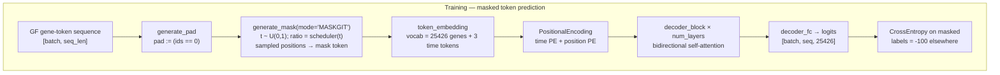
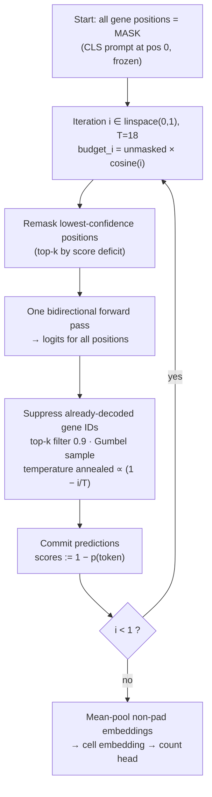

This page dissects the masked generative encoder at the core of the `scmaskgit` subpackage — the `scmoscf` module in `scmaskgit/Modules/T_model.py`. The model transplants the **MaskGIT** paradigm (masked token modeling with confidence-based iterative parallel decoding) from image synthesis to single-cell transcriptomics: a cell is represented as a Geneformer-style sequence of gene tokens, a random subset is masked under a scheduler during training, and at inference an entirely masked cell is progressively demasked over a fixed number of parallel decoding iterations. We cover the architecture topology, the token protocol, the training-time masking algorithm, the iterative decoding loop, guided generation, and the embedding interface exposed to downstream consumers (count regression and perturbation analyses).

## Architectural Role and Design Lineage

The module header states it is "mostly copy-paste from timm library" (the Vision Transformer reference implementation), but the model it builds, `scmoscf`, is explicitly documented as a "Seq2Seq model for cell generation using masked language modeling adopted from MaskGIT" ([T_model.py](scmaskgit/Modules/T_model.py#L1-L4), [T_model.py](scmaskgit/Modules/T_model.py#L504-L510)). Unlike autoregressive generators, the encoder is a **single-stack, bidirectional (non-causal) transformer**: there is no separate decoder and no causal attention mask. Every gene position attends to every other position, which is precisely what makes MaskGIT-style parallel decoding possible — all token predictions for one iteration are produced in a single forward pass, then refined over successive iterations. The `Block` layers are constructed without a `context_dim`, so they operate in pure self-attention mode ([T_model.py](scmaskgit/Modules/T_model.py#L352-L359)), and SDPA attention is invoked with `is_causal=False` ([T_model.py](scmaskgit/Modules/T_model.py#L258)).

A distinctive biological adaptation: because cells are unordered sets of gene tokens rather than spatial image patches, "position" in the sequence encodes token rank (expression magnitude) rather than spatial location, and a dedicated **time-axis embedding** marks the pseudotime/time-step condition the cell is being generated for. The `PositionalEncoding` module supports four modes (`time_pos_sin`, `comb_sin`, `sin_learnt`, `time_pos_learnt`) and adds a per-time-step embedding to token embeddings ([T_model.py](scmaskgit/Modules/T_model.py#L32-L146)). The full treatment of the time axis is deferred to [Time-Aware Positional Encoding](8-time-aware-positional-encoding); for this page, note only that the default forward pass calls `self.pos_embedding(src_embedding, 1)` before the attention stack ([T_model.py](scmaskgit/Modules/T_model.py#L784-L785)).

Sources: [T_model.py](scmaskgit/Modules/T_model.py#L1-L4), [T_model.py](scmaskgit/Modules/T_model.py#L504-L510), [T_model.py](scmaskgit/Modules/T_model.py#L352-L359), [T_model.py](scmaskgit/Modules/T_model.py#L32-L146), [T_model.py](scmaskgit/Modules/T_model.py#L784-L785)

## Model Topology: Token Embedding → Bidirectional Attention Stack → Logit Head

The `scmoscf` constructor assembles four components ([T_model.py](scmaskgit/Modules/T_model.py#L478-L591)):

1. **Token embedding** — `nn.Embedding(total_vocab_size, d_model, padding_idx=pad_token)` where `total_vocab_size = tgt_vocab_size + n_total_tps`. The vocabulary is the gene token space extended by one token per modeling time step; padding index 0 gets a zero vector ([T_model.py](scmaskgit/Modules/T_model.py#L572-L575)).
2. **Positional encoding** — the four-mode `PositionalEncoding` module configured by `pos_encoding_mode` (default `'time_pos_sin'`) ([T_model.py](scmaskgit/Modules/T_model.py#L552-L557)).
3. **Decoder stack** — `nn.ModuleList` of `Block` modules (self-attention + GELU MLP, residual connections with LayerNorm), stacked `num_layers` times ([T_model.py](scmaskgit/Modules/T_model.py#L576-L588), [T_model.py](scmaskgit/Modules/T_model.py#L308-L371)).
4. **Logit head** — a single `nn.Linear(d_model, tgt_vocab_size)` projecting each position to the gene vocabulary ([T_model.py](scmaskgit/Modules/T_model.py#L589)).

The `call_decoder` method runs the stack, optionally collects per-layer self-attention weights (averaged across layers and cast to `float16`), applies the logit head, and — critically for downstream pages — computes `mean_embedding` via `mean_nonpadding_embs`, a mask-aware mean pool over token embeddings that serves as the **cell-level representation** ([T_model.py](scmaskgit/Modules/T_model.py#L702-L736), [T_model.py](scmaskgit/Modules/T_model.py#L727-L735)). The training/eval branch in `forward` is the switch between the two regimes: while `self.training`, tokens pass through `generate_mask` in `'MASKGIT'` mode with the configured scheduler; in eval mode, `labels=None` and tokens flow through unmasked ([T_model.py](scmaskgit/Modules/T_model.py#L774-L783)).

Sources: [T_model.py](scmaskgit/Modules/T_model.py#L478-L591), [T_model.py](scmaskgit/Modules/T_model.py#L702-L736), [T_model.py](scmaskgit/Modules/T_model.py#L774-L783), [T_model.py](scmaskgit/Modules/T_model.py#L308-L371)

## Token Space and Special-Token Protocol

The encoder relies on a small, strict token-ID protocol that both training masking and generation decoding depend on. Integer IDs below the vocabulary extension are gene tokens from the Geneformer tokenizer; the reserved IDs are shown below.

| Token ID | Role | Enforcement points |
|---|---|---|
| `0` | Padding (also `padding_idx` of the embedding) | `generate_pad` masks all logic at `ids == 0`; excluded from masking and pooling ([T_model.py](scmaskgit/Modules/T_model.py#L573-L575), [T_model.py](scmaskgit/Modules/T_model.py#L679-L680)) |
| `1` | `[MASK]` (`self.mask_token = 1`) | Written by `generate_mask` during training; counts as "tokens to decode" during generation ([T_model.py](scmaskgit/Modules/T_model.py#L570), [T_model.py](scmaskgit/Modules/T_model.py#L1255-L1256)) |
| `tgt_vocab_size … +n_total_tps` | Per-time-step condition tokens (CLS-style, position 0) | Appended to embedding table; never masked — CLS mask row forced to `False` ([T_model.py](scmaskgit/Modules/T_model.py#L572), [T_model.py](scmaskgit/Modules/T_model.py#L682-L686)) |

Two protocol details matter for correctness. First, the CLS/time-step token at position 0 is protected in every masking path: the MASKGIT branch concatenates a `zeros((batch, 1))` boolean mask so position 0 is never remasked ([T_model.py](scmaskgit/Modules/T_model.py#L682-L686)), and during generation the prompt position is frozen by setting its score to `-inf` before iteration begins ([T_model.py](scmaskgit/Modules/T_model.py#L1251-L1252)). Second, random-token sampling in the BERT branch uses `torch.randint(2, self.tgt_vocab_size, ...)` with an explicit comment that `+1` excludes pad and CLS from random replacement ([T_model.py](scmaskgit/Modules/T_model.py#L660-L663)).

> [!TIP]
> The mask token doing double duty is an implementation subtlety worth internalizing: `generate_sequence` computes `total_tokens = torch.sum(tmp_ids == 1, dim=1)` ([T_model.py](scmaskgit/Modules/T_model.py#L1255-L1256)) — i.e., the number of remaining mask tokens *is* the decoding budget. Any preprocessing step that leaves a literal `1` in the sequence will corrupt this count.

Sources: [T_model.py](scmaskgit/Modules/T_model.py#L570-L575), [T_model.py](scmaskgit/Modules/T_model.py#L682-L686), [T_model.py](scmaskgit/Modules/T_model.py#L660-L663), [T_model.py](scmaskgit/Modules/T_model.py#L1251-L1256)

## The Training Objective: Variable-Rate Random Masking

The `generate_mask` method implements two masking regimes, selectable by `mask_mode` ([T_model.py](scmaskgit/Modules/T_model.py#L593-L689)). The **BERT** branch is the canonical 80/10/10 corruption (MASK / random / original), adapted from the HuggingFace data collator ([T_model.py](scmaskgit/Modules/T_model.py#L631-L664)). However, `scmoscf.forward` always calls it with `mask_mode='MASKGIT'`, so the second branch is the operative training path ([T_model.py](scmaskgit/Modules/T_model.py#L775-L781)).

The MASKGIT branch implements **variable-rate masking**: instead of a fixed corruption ratio, each sample draws a random time `t ~ U(0,1)` per batch (`rand_time = uniform((batch,))`), converts it to a mask ratio through `noise_schedule(rand_time, method=mask_scheduler, total_tokens=seq_len-1)`, and masks `round(sample_length × ratio)` positions, clamped to a minimum of 1 ([T_model.py](scmaskgit/Modules/T_model.py#L665-L688)). Which positions get masked is decided by `argsort` of uniform random values — a permutation-based uniform sample over non-pad, non-CLS positions. The scheduler is configurable across `'uniform'`, `'pow'`, `'cosine'`, `'log'`, `'exp'` (documented at the generation call sites; cosine is the default, matching MaskGIT's finding that cosine difficulty-weighting trains best) ([T_model.py](scmaskgit/Modules/T_model.py#L495), [T_model.py](scmaskgit/Modules/T_model.py#L993-L995)). Unmasked positions receive label `-100` so cross-entropy ignores them — the loss is computed **only** on masked positions ([T_model.py](scmaskgit/Modules/T_model.py#L688)).

| Property | BERT mode | MASKGIT mode (default) |
|---|---|---|
| Mask fraction | Fixed (`mlm_probability`, default 0.3) | Random per sample: `scheduler(t)`, `t ~ U(0,1)` |
| Corruption mix | 80% MASK / 10% random / 10% original | 100% MASK token |
| Position choice | Bernoulli per position | Permutation of uniform randoms (exact count) |
| Protected positions | CLS (pad excluded via probability fill 0) | CLS + pad via `rand_int[pad]=1` trick |
| Training signal | Position-wise denoising | Difficulty-scaled denoising aligned with iterative decoding |

The design rationale is train/inference symmetry: at generation time the model must reconstruct a sequence from an arbitrary partial context (every ratio from ~0% to ~100% masked), so the training distribution must cover that entire spectrum. A random `t` per sample plus the cosine schedule approximates exactly that curriculum. This is also why `mlm_probability` is effectively inert in the default configuration — it only parameterizes the BERT branch.

> [!TIP]
> The BERT branch contains latent bugs that are masked (pun intended) by the default path: `tgt_input_id[masked_indices] = self.mask_token` replaces **all** selected positions with MASK, so the 80/10/10 comment is not honored in the current code, and the `sin_learnt`/`time_pos_learnt` forward branches reference an undefined `tgt_time_step_` variable ([T_model.py](scmaskgit/Modules/T_model.py#L128-L146)). Treat non-default modes as unverified; the shipped configuration (`MASKGIT` + `time_pos_sin`) is the exercised, validated path.

Sources: [T_model.py](scmaskgit/Modules/T_model.py#L593-L689), [T_model.py](scmaskgit/Modules/T_model.py#L631-L664), [T_model.py](scmaskgit/Modules/T_model.py#L665-L688), [T_model.py](scmaskgit/Modules/T_model.py#L775-L781), [T_model.py](scmaskgit/Modules/T_model.py#L495)

## Confidence-Based Iterative Parallel Decoding

Inference inverts the training objective. `CountDecoder.generate` initializes a fully masked target sequence — `ids` filled with `mask_token`, position 0 seeded with the input's CLS token, positions beyond `sequence_length` zeroed — and hands it to `generate_sequence` with `demask_fn=self.pretrained_model` ([T_model.py](scmaskgit/Modules/T_model.py#L1037-L1042), [T_model.py](scmaskgit/Modules/T_model.py#L1045-L1058)). The `generate_sequence` loop ([T_model.py](scmaskgit/Modules/T_model.py#L1191-L1334)) is the canonical MaskGIT decoding algorithm adapted for set-structured tokens:

1. **Iterate** over `torch.linspace(0, 1, iterations)` zipped with `reversed(range(iterations))` — iteration fraction rises, `steps_until_x0` falls ([T_model.py](scmaskgit/Modules/T_model.py#L1258-L1264)).
2. **Compute the remask budget** from the scheduler: `rand_mask_prob = noise_schedule(ratio=iteration, ...)`; the number of tokens to re-hide is `unmasked_count × rand_mask_prob` ([T_model.py](scmaskgit/Modules/T_model.py#L1266-L1276)).
3. **Remask the least-confident tokens**: `torch.topk(scores, ...)` selects positions with the highest `scores` (confidence deficit) and they are overwritten with the mask token ([T_model.py](scmaskgit/Modules/T_model.py#L1277-L1284)).
4. **Predict all positions in one forward pass** through the encoder; logits are sliced past the prompt ([T_model.py](scmaskgit/Modules/T_model.py#L1292-L1300)).
5. **Suppress already-decoded gene IDs** in the logits so a token already committed elsewhere in the cell cannot be re-emitted in this iteration ([T_model.py](scmaskgit/Modules/T_model.py#L1313-L1315)).
6. **Sample**: `top_k` filtering at `topk_filter_thres=0.9`, then `gumbel_sample` with a temperature annealed as `starting_temperature × (steps_until_x0 / iteration)` — high randomness early, near-greedy late ([T_model.py](scmaskgit/Modules/T_model.py#L1316-L1320)).
7. **Update confidence scores** as `scores = 1 − softmax(logits)[pred_id]` and freeze committed tokens when `can_remask_prev_masked=False` (the default) by filling non-masked positions' scores with `-inf` ([T_model.py](scmaskgit/Modules/T_model.py#L1322-L1333)).

Defaults mirror the MaskGIT paper's optimum: `iterations=18` (commented "optimal of iterations in MaskGIT"), `temperature=2.0` (recommended range 2.0–3.0), `topk_filter_thres=0.9`, `mask_scheduler='cosine'` ([T_model.py](scmaskgit/Modules/T_model.py#L962-L967)). After the loop, the final decoder output's non-padding embeddings are mean-pooled into a cell embedding and pushed through the count head ([T_model.py](scmaskgit/Modules/T_model.py#L1061-L1068)) — the consumer contract is covered in [Two-Stage Masking and Count Decoder Training](7-two-stage-masking-and-count-decoder-training).

This decoding scheme carries two orders-of-magnitude advantages over autoregressive generation of a 2,048-token cell: only 18 forward passes total (vs. one per token), and each pass is fully parallel across the sequence and batch. The repository even ships dedicated benchmarks for this behavior (`perturbgen/tests/benchmark_generation_efficiency.py`, `perturbgen/tests/test_generation_efficiency.py`), detailed in [Test and Benchmark Suite](26-test-and-benchmark-suite).

Sources: [T_model.py](scmaskgit/Modules/T_model.py#L1191-L1334), [T_model.py](scmaskgit/Modules/T_model.py#L1258-L1284), [T_model.py](scmaskgit/Modules/T_model.py#L1292-L1333), [T_model.py](scmaskgit/Modules/T_model.py#L962-L967), [T_model.py](scmaskgit/Modules/T_model.py#L1037-L1058), [T_model.py](scmaskgit/Modules/T_model.py#L1061-L1068)

## Guided Generation with Gene-Prompt Logit Boosting

`guided_generate` extends the decoding loop for **in-silico perturbation of known gene programs**: it accepts `unique_gene_list` and `shared_gene_list` dictionaries and biases the generative trajectory toward those genes. Inside `generate_sequence`, when both lists are provided, the raw logits are boosted before filtering — `logits[:, :, unique_genes] += 5` and `logits[:, :, shared_genes] += 2` ([T_model.py](scmaskgit/Modules/T_model.py#L1302-L1307)). Because boost happens pre-`top_k` and pre-softmax, it raises both the probability of these tokens being sampled and their confidence scores, making the model commit to them early and keep them.

The guided path also restructures decoding itself: for `time_step == 1`, a first pass decodes only the first `prompt_length = 10` positions over `iterations=10`, effectively "seeding" the cell with the guided genes as a prefix prompt; those tokens are then unmasked into the buffer (`ids_[:, prompt_length:] = 1` forces them into the to-decode set? — no: the returned ids are written back and the remaining positions continue through a full `iterations` decode) ([T_model.py](scmaskgit/Modules/T_model.py#L1129-L1157)). This two-stage prompting trades a small extra compute cost for stronger adherence to the requested gene list. The perturbation semantics built on this entry point — knockout overexpression, combinatorial conditions — are documented in [In Silico Perturbation Modes](10-in-silico-perturbation-modes).

Sources: [T_model.py](scmaskgit/Modules/T_model.py#L1071-L1189), [T_model.py](scmaskgit/Modules/T_model.py#L1302-L1307), [T_model.py](scmaskgit/Modules/T_model.py#L1129-L1157)

## Attention Mechanics: SDPA with Recoverable Weights

The `CrossAttention` module is a unified self/cross-attention primitive with two execution paths ([T_model.py](scmaskgit/Modules/T_model.py#L176-L305)). The `'sdpa'` path routes through `torch.nn.functional.scaled_dot_product_attention` under an explicit kernel constraint — `sdpa_kernel(backends=[FLASH_ATTENTION, EFFICIENT_ATTENTION])` — for memory-efficient long-sequence attention over up to 2,048 gene tokens ([T_model.py](scmaskgit/Modules/T_model.py#L250-L252)). The `'normal'` path is a materialized-softmax einsum implementation that always returns attention weights ([T_model.py](scmaskgit/Modules/T_model.py#L222-L235)).

When `return_attn=True` under SDPA, flash kernels cannot expose attention matrices, so the code employs an identity-matrix trick: it passes `torch.eye(seq_len)` as the *value* tensor, so SDPA's output is the attention matrix itself; a second manual `out_ @ v` then recovers the real output ([T_model.py](scmaskgit/Modules/T_model.py#L247-L248), [T_model.py](scmaskgit/Modules/T_model.py#L285-L288), [T_model.py](scmaskgit/Modules/T_model.py#L260-L264)). The collected per-block self-attention maps are averaged across layers and cast to `float16` in `call_decoder` ([T_model.py](scmaskgit/Modules/T_model.py#L722-L725)) — these are the tensors consumed by attention-based gene program discovery, treated fully in [Gene Program Discovery](12-gene-program-discovery). Note the attention-weight recovery path is substantially more expensive (it defeats fused kernels) and should be reserved for analysis runs.

> [!TIP]
> The attention-recovery trick (identity as value) silently doubles the memory traffic of the attention block — do not enable `return_attn` in sweep or training configurations. The averaged layer weights are also `float16`, which matters if you later threshold or cluster them at high precision.

Sources: [T_model.py](scmaskgit/Modules/T_model.py#L176-L305), [T_model.py](scmaskgit/Modules/T_model.py#L222-L235), [T_model.py](scmaskgit/Modules/T_model.py#L250-L252), [T_model.py](scmaskgit/Modules/T_model.py#L285-L288), [T_model.py](scmaskgit/Modules/T_model.py#L722-L725)

## Class Interaction Map

The module-level relationships below show how the encoder composes internally and how it is consumed by the count-decoding wrapper in the same file. The `Encoder` class (a vanilla `torch.nn.TransformerEncoder` variant with the same embedding/PE front-end) coexists as an alternative encoder body ([T_model.py](scmaskgit/Modules/T_model.py#L374-L475)).

```mermaid
classDiagram
    class PositionalEncoding {
        +mode: time_pos_sin | comb_sin | sin_learnt | time_pos_learnt
        +forward(x, tgt_time_step)
    }
    class Block {
        +self_attn: CrossAttention
        +feed_forward: Mlp
        +forward(x, tgt_mask)
    }
    class CrossAttention {
        +normal_attention()
        +sdpa_attention(FLASH/EFFICIENT)
    }
    class scmoscf {
        +mask_token = 1
        +generate_mask(mode='MASKGIT')
        +call_decoder() → dict
        +forward(src_input_id)
    }
    class CountDecoder {
        +pretrained_model: scmoscf
        +count_decoder: CountHead
        +generate(iterations=18)
        +guided_generate(unique/shared genes)
        +generate_sequence(demask_fn)
    }
    class CountHead {
        +loss_mode: mse | zinb | nb
    }
    scmoscf *-- PositionalEncoding
    scmoscf *-- "num_layers" Block
    Block *-- CrossAttention
    Block *-- Mlp
    CountDecoder o-- scmoscf : demask_fn
    CountDecoder *-- CountHead
```

Sources: [T_model.py](scmaskgit/Modules/T_model.py#L478-L591), [T_model.py](scmaskgit/Modules/T_model.py#L861-L956), [T_model.py](scmaskgit/Modules/T_model.py#L374-L475), [__init__.py](scmaskgit/Modules/__init__.py#L1)

## Configuration Reference

Constructor defaults for `scmoscf` ([T_model.py](scmaskgit/Modules/T_model.py#L481-L502)) and generation-time defaults for `generate` ([T_model.py](scmaskgit/Modules/T_model.py#L962-L967)):

| Parameter | Default | Meaning |
|---|---|---|
| `tgt_vocab_size` | 25426 | Gene token vocabulary size (Geneformer tokenizer output space) |
| `d_model` | 256 | Token embedding / hidden dimension |
| `num_heads` | 8 | Attention heads per block |
| `num_layers` | 1 | Number of self-attention blocks |
| `d_ff` | 2048 | Attention head inner dim; MLP hidden sizing |
| `max_seq_length` | 2048 | Maximum tokens per cell (drives positional PE length) |
| `mlm_probability` | 0.3 | Mask fraction (BERT branch only; inert under MASKGIT) |
| `pred_tps` / `n_total_tps` | [1, 2, 3] / 3 | Target time steps; vocab extension size |
| `mask_scheduler` | `'cosine'` | Mask-ratio schedule: uniform, pow, cosine, log, exp |
| `pos_encoding_mode` | `'time_pos_sin'` | Time + position encoding variant |
| `pad_token` / `mask_token` | 0 / 1 | Reserved token IDs |
| `iterations` (generation) | 18 | Decoding refinement steps |
| `temperature` (generation) | 2.0 | Gumbel sampling temperature, annealed; range 2.0–3.0 |
| `topk_filter_thres` | 0.9 | Fraction of logits retained pre-sampling |
| `can_remask_prev_masked` | False | Whether committed tokens may be re-hidden |

Scaling notes for advanced users: the depth default (`num_layers=1`) is intentionally minimal — sweep configurations in `perturbgen/configs/sweep/` and the pretraining checkpoint naming convention (`..._pow_tp_1-2-3_s_42...` in `pretraining_cohort/`) indicate that depth, scheduler family (`pow` vs `cosine`), and time-step sets are the primary swept axes (see [Hyperparameter Sweeps and Batch Jobs](18-hyperparameter-sweeps-and-batch-jobs) and [Pretrained Checkpoints and Hugging Face Assets](23-pretrained-checkpoints-and-hugging-face-assets)).

Sources: [T_model.py](scmaskgit/Modules/T_model.py#L481-L502), [T_model.py](scmaskgit/Modules/T_model.py#L962-L967)

## Where This Fits and Where to Go Next

The masked generative encoder is the first stage of a two-phase training scheme: it learns the token-space distribution of cells via masked prediction, after which its pooled `mean_embedding` output is frozen and a count head (ZINB/NB/MSE) is trained on top for expression regression ([T_model.py](scmaskgit/Modules/T_model.py#L796-L858)). The embedding also serves as the export surface for cell/gene representation extraction ([Cell and Gene Embedding Extraction](11-cell-and-gene-embedding-extraction)).

Recommended reading order from here: **[Two-Stage Masking and Count Decoder Training](7-two-stage-masking-and-count-decoder-training)** for the second training stage that wraps this encoder; **[Time-Aware Positional Encoding](8-time-aware-positional-encoding)** for the `tgt_time_step` conditioning semantics referenced throughout this page; **[Geneformer-Style Gene Tokenization](9-geneformer-style-gene-tokenization)** for how raw counts become the input token sequences; and **[In Silico Perturbation Modes](10-in-silico-perturbation-modes)** for how `generate` and `guided_generate` are orchestrated into perturbation prediction.
