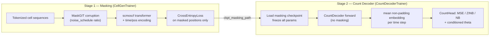
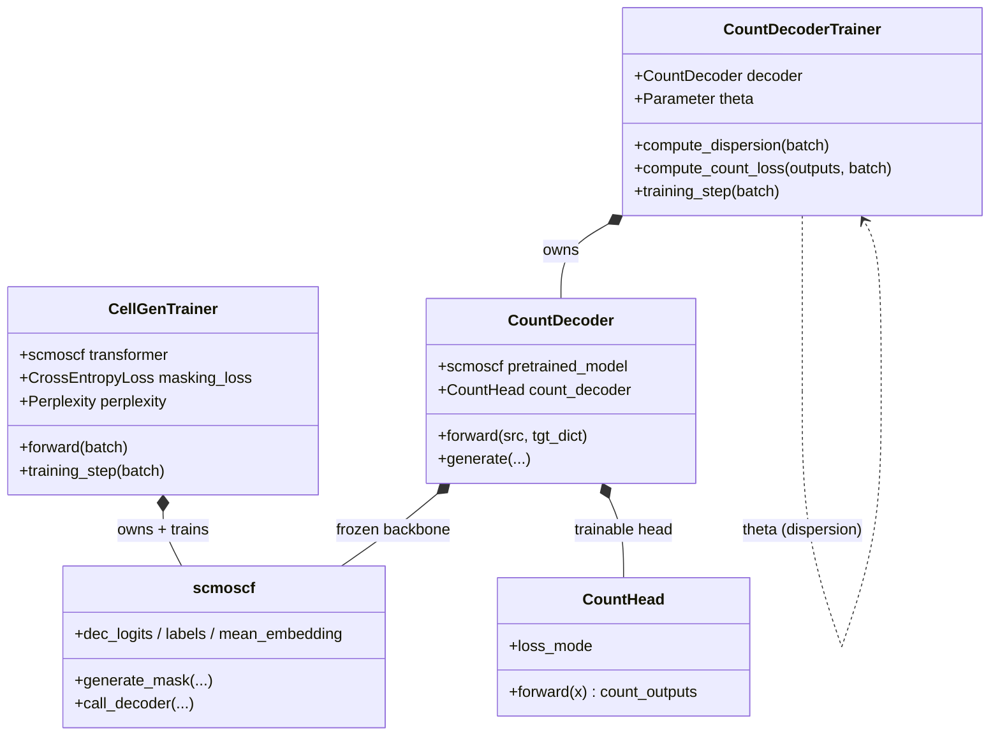

Perturbgen's pretraining recipe decouples **what a cell is** (discrete gene-token identity) from **how much a cell expresses** (continuous per-gene counts). Stage 1 trains a MaskGIT-style masked generative backbone (`CellGenTrainer` wrapping the `scmoscf` transformer) with cross-entropy over randomly corrupted token sequences. Stage 2 freezes that backbone entirely and trains a lightweight `CountDecoder`/`CountHead` that regresses gene-expression counts from pooled cell embeddings, using MSE, ZINB, or NB losses. This page explains both stages as implemented in the `scmaskgit` training package, from the masking operator down to the distributional count loss.

Sources: [trainer.py](scmaskgit/Model/trainer.py#L62-L130), [T_model.py](scmaskgit/Modules/T_model.py#L478-L591)

## Design Rationale: Why Decouple Token Identity from Count Regression

The two stages answer two fundamentally different prediction problems. Stage 1 is a **discrete denoising task**: given a sequence of Geneformer-style gene tokens with a random subset replaced by `[MASK]`, predict the original token identity at each masked position. This forces the transformer to learn cell-state semantics in embedding space. Stage 2 is a **continuous regression task**: pool the (uncorrupted) sequence into a single cell embedding and predict the full count vector, optionally under a negative-binomial-style observation model that respects count-data overdispersion and dropout.

The decoupling has a concrete architectural payoff: during Stage 2 inference (and later in-silico perturbation), the frozen backbone performs MaskGIT iterative parallel decoding to synthesize target-cell token sequences, and only afterwards does the trained count head convert the pooled embedding into calibrated counts. Training the head on frozen features guarantees that count calibration never distorts the generative decoder learned in Stage 1.

Sources: [trainer.py](scmaskgit/Model/trainer.py#L62-L212), [trainer.py](scmaskgit/Model/trainer.py#L275-L371), [T_model.py](scmaskgit/Modules/T_model.py#L861-L948), [T_model.py](scmaskgit/Modules/T_model.py#L958-L975)

## Stage 1: MaskGIT-Style Masked Token Prediction

### Trainer and model composition

`CellGenTrainer` is a PyTorch Lightning `LightningModule` that instantiates `scmoscf` with a vocabulary of gene tokens plus per-time-step task tokens (`total_vocab_size = tgt_vocab_size + n_total_tps`), a stack of decoder blocks, and a final `decoder_fc` projection back to the token vocabulary. The only training objective is a plain `nn.CrossEntropyLoss` assigned to `self.masking_loss`; perplexity (`torchmetrics.text.Perplexity`, ignoring index `-100`) is tracked alongside as a diagnostic. Optimization is a single Adam optimizer over all transformer parameters with configurable `weight_decay` and `initial_lr`, monitored on `train/masking_loss`.

Sources: [trainer.py](scmaskgit/Model/trainer.py#L62-L130), [trainer.py](scmaskgit/Model/trainer.py#L162-L169), [T_model.py](scmaskgit/Modules/T_model.py#L572-L591)

### The masking operator: BERT vs MASKGIT

The masking itself lives in `scmoscf.generate_mask`, which supports two regimes selectable via `mask_mode`. The **BERT** regime is the classic 80/10/10 corruption (mask / random token / keep), applied to a fixed `mlm_probability` fraction of positions, with CLS and padding positions excluded. The **MASKGIT** regime — the default for this pipeline — draws an independent masking ratio per sample: `rand_time ~ Uniform(0,1)` is mapped through a `noise_schedule` (methods: `uniform`, `pow`, `cosine`, `log`, `exp`) into a probability, which is multiplied by the sample's actual sequence length and rounded with a floor of one masked token. Positions to mask are then chosen uniformly at random via `rand_int.argsort`, so each cell in a batch is corrupted at a different rate. Crucially, `labels` are set to `-100` at all non-masked positions, so the cross-entropy loss and perplexity are computed over masked tokens only.

| Property | BERT mode | MASKGIT mode |
|---|---|---|
| Mask ratio | Fixed per batch (`mlm_probability`) | Per-sample, sampled from `noise_schedule` |
| Input corruption | 80% `[MASK]`, 10% random, 10% original | 100% replaced by mask token |
| Position selection | i.i.d. Bernoulli per position | Uniform without replacement (`argsort` trick) |
| Excluded positions | CLS + padding | CLS + padding (set `rand_int = 1`) |
| Typical use | MLM-style encoders | MaskGIT-style parallel iterative decoding |

Sources: [T_model.py](scmaskgit/Modules/T_model.py#L593-L689), [T_model.py](scmaskgit/Modules/T_model.py#L997-L999), [utils.py](scmaskgit/src/utils.py#L29-L56)

### Stage 1 forward pass and training step

In `scmoscf.forward`, masking runs only under `self.training`; the corrupted ids are embedded via `token_embedding` (with `padding_idx=0`), receive time-aware positional encoding, and flow through the decoder blocks. The head returns `dec_logits`, the `labels`, and `mean_embedding` — a mean over non-padding token embeddings. The Lightning `training_step` flattens logits and labels, applies cross-entropy, and logs `train/masking_loss` and `train/perplexity` (the latter under `torch.no_grad()` with `sync_dist=True` for DDP-correct aggregation). The validation step mirrors this and logs `val/loss` and `val/perplexity`, which is the monitored metric for checkpoint selection.

> [!TIP]
> The mask-scheduler choice is recorded in the checkpoint filename (e.g., `..._m_pow_tp_1-2-3_s_42-...ckpt` in `pretraining_cohort/` means scheduler `pow`, prediction time steps 1–2–3, seed 42), so a trained checkpoint is self-describing with respect to its Stage 1 corruption policy.

Sources: [T_model.py](scmaskgit/Modules/T_model.py#L738-L793), [T_model.py](scmaskgit/Modules/T_model.py#L702-L736), [trainer.py](scmaskgit/Model/trainer.py#L171-L248), [T_model.py](scmaskgit/Modules/T_model.py#L23-L30)

## Stage 2: Count Decoder Training

### Frozen backbone and task tokens

`CountDecoderTrainer` reconstructs a fresh `scmoscf`, restores Stage 1 weights from `ckpt_masking_path` via `modify_ckpt_state_dict` (stripping the `transformer.` prefix) with `strict=False`, then sets `requires_grad = False` on **every** backbone parameter. The frozen module is handed to `CountDecoder`, which owns the trainable `CountHead`. A second optional checkpoint (`ckpt_count_path`) restores a previously trained count head — again with `strict=False`. The trainer also registers one extra vocabulary id per time step (`cls_token_{i} = total_vocab_size + (i - 1)`) as a buffer; in `forward`, these task tokens are prepended to each target sequence before the decoder runs, letting one model serve multiple prediction horizons.

> [!TIP]
> The `strict=False` load tolerates buffers registered after the checkpoint was saved (e.g., positional-encoding tables or CLS-token buffers), which is what allows Stage 2 checkpoints to be re-loaded into later perturbation-time trainers without schema churn.

Sources: [trainer.py](scmaskgit/Model/trainer.py#L275-L371), [trainer.py](scmaskgit/Model/trainer.py#L392-L402), [trainer.py](scmaskgit/Model/trainer.py#L447-L465)

### From embeddings to counts: CountHead modes

`CountDecoder.forward` invokes the frozen backbone with masking disabled (`not_masked=True`) — no MaskGIT corruption during Stage 2 training — and pools each time step's output into `mean_embedding` (mean over non-padding tokens, despite the `cls_embedding` naming). `CountHead` then applies an MLP followed by L2 normalization and branches on `loss_mode`:

| Loss mode | Output heads | Semantics |
|---|---|---|
| `mse` | `count_lognorm` = Linear → ReLU | Regresses log-normalized counts directly |
| `zinb` | `count_mean` = Linear → Softmax; `count_dropout` = Linear (zi_logits) | Mean as a fraction of library size; zero-inflation logits |
| `nb`  | `count_mean` = Linear → Softmax | Overdispersed counts without zero inflation |

The softmax parameterization makes `count_mean` a per-gene expression fraction; at loss time it is scaled by the target library size (`batch_size_factor`) to recover an absolute mean, following the standard scVI-style size-factor decode.

Sources: [T_model.py](scmaskgit/Modules/T_model.py#L796-L858), [T_model.py](scmaskgit/Modules/T_model.py#L931-L948), [trainer.py](scmaskgit/Model/trainer.py#L544-L547)

### Conditioned dispersion and the count loss

For `zinb`/`nb` modes, dispersion is not a free per-gene vector but is **conditioned on experimental batch**: the trainer holds `theta ∈ R^{n_genes × n_conditions_combined}` and `compute_dispersion` multiplies a one-hot encoding of each cell's combined condition (`combined_batch`) through `theta`, exponentiating the result to obtain per-gene dispersion. `compute_count_loss` then loops over every prediction time step in `pred_tps`: for `mse` it sums squared errors on log-normalized counts; for `zinb` it evaluates the log-likelihood of true counts under a `ZeroInflatedNegativeBinomial(mu, theta, zi_logits)` from scvi-tools; for `nb` under a plain `NegativeBinomial`. Per-time-step losses are summed into a scalar. When `n_samples > 1`, predictions are drawn from the fitted distribution and averaged rather than reported as the posterior mean.

Sources: [trainer.py](scmaskgit/Model/trainer.py#L467-L494), [trainer.py](scmaskgit/Model/trainer.py#L496-L572)

### Training loop and diagnostics

The Stage 2 `training_step` logs `train/loss` and, under `torch.no_grad()`, a batch-wise `train/mse` against true counts. At each epoch end, the accumulated true/predicted counts are concatenated and a Pearson correlation is logged (`train/pearson`) — the canonical quality signal for count reconstruction. The validation step computes the same loss with distributional sampling enabled and logs `val/loss`, `val/mse`, and epoch-level Pearson correlation.

Sources: [trainer.py](scmaskgit/Model/trainer.py#L652-L699), [trainer.py](scmaskgit/Model/trainer.py#L701-L734)

## Orchestration, Checkpoints, and Reproducibility

A single entry point, `scmaskgit/train.py`, drives both stages via the `--train_mode` flag (`masking` or `count`), which selects `CellGenTrainer` vs `CountDecoderTrainer` and the matching `CellGenDataModule`. The masking stage is wired with model hyperparameters (`d_model=768`, `num_heads=8`, mask scheduler, prediction/context time steps, positional-encoding mode) and persisted through a `ModelCheckpoint` whose filename encodes the run id, learning rate, weight decay, batch size, positional mode, mask scheduler, time steps, and seed. Logging goes to a Weights & Biases project named `Moscf`; large runs use `DDPStrategy(find_unused_parameters=True)` with `bf16-mixed` precision across all visible GPUs. The repository ships a concrete Stage 1 artifact following this convention in `pretraining_cohort/`.

Sources: [train.py](scmaskgit/train.py#L42-L50), [train.py](scmaskgit/train.py#L301-L324), [train.py](scmaskgit/train.py#L350-L387), [train.py](scmaskgit/train.py#L390-L438)

## Stage 1 vs Stage 2 at a Glance

| Dimension | Stage 1 — Masking | Stage 2 — Count Decoder |
|---|---|---|
| Trainer class | `CellGenTrainer` | `CountDecoderTrainer` |
| Trainable params | Full `scmoscf` backbone | `CountHead` + optional `theta` only |
| Input corruption | MASKGIT per-sample ratios (or BERT) | None (`not_masked=True`) |
| Loss | `CrossEntropyLoss` over masked tokens, `-100` ignored | MSE / ZINB / NB log-likelihood, summed over `pred_tps` |
| Key metrics | masked loss, perplexity | loss, MSE, Pearson correlation |
| Optimization | Adam, `initial_lr`, `weight_decay`, monitor `train/masking_loss` | `lr`, `weight_decay` hyperparameters on head |
| Artifact | masking checkpoint (`ckpt_masking_path`) | count-head checkpoint (`ckpt_count_path`) |
| Role downstream | MaskGIT iterative decoding backbone | Count calibration for generated cells |

Sources: [trainer.py](scmaskgit/Model/trainer.py#L62-L169), [trainer.py](scmaskgit/Model/trainer.py#L275-L409), [trainer.py](scmaskgit/Model/trainer.py#L496-L572), [T_model.py](scmaskgit/Modules/T_model.py#L931-L948)

## Where to Go Next

The masking operator and its noise schedules are treated in depth in [scMASKGIT Masked Generative Encoder](6-scmaskgit-masked-generative-encoder); the `time_pos_sin` positional scheme referenced throughout this page is dissected in [Time-Aware Positional Encoding](8-time-aware-positional-encoding), and the token sequences these stages consume come from [Geneformer-Style Gene Tokenization](9-geneformer-style-gene-tokenization). The mathematical details of the distributional losses belong to [ZINB and Negative Binomial Losses](24-zinb-and-negative-binomial-losses). For running these stages at scale — sweeps, DDP, and W&B tracking — continue with [Hyperparameter Sweeps and Batch Jobs](18-hyperparameter-sweeps-and-batch-jobs), [Distributed Training with DDP and DeepSpeed](19-distributed-training-with-ddp-and-deepspeed), and [Experiment Tracking with Weights and Biases](20-experiment-tracking-with-weights-and-biases); for how the frozen Stage 1 backbone is reused at inference, see [In Silico Perturbation Modes](10-in-silico-perturbation-modes).
