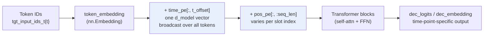
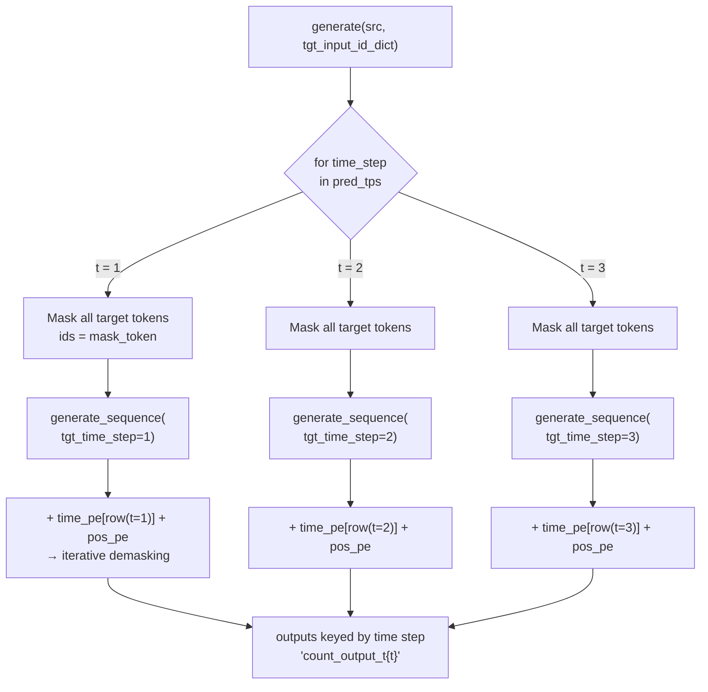

This page explains how PerturbGen injects **which time point is being predicted** into its token representations. A single MaskGIT-style encoder must produce a *different* transcriptomic distribution for day 1, day 2, and day 3 of a perturbation time course, yet it shares one set of weights and one token embedding table across all of them. The `PositionalEncoding` module solves this by combining a **time-point encoding** (identifies the target time step) with a **slot-position encoding** (identifies the token's index in the sequence), and it offers four interchangeable modes controlled by a single CLI/config parameter. This page documents the module's construction, its per-encoder index-offset conventions, how `tgt_time_step` flows through training and generation, and the interpolation/extrapolation trade-offs between sinusoidal and learnt variants.

## Why a Time Axis in Positional Encoding

PerturbGen models a source cell state and one or more target cell states measured at successive time points after a perturbation. The target time steps are declared via `pred_tps` (default `[1, 2, 3]`) and `n_total_tps`, and the model maintains `self.total_tps = list(range(1, n_total_tps + 1))` as its canonical time-point index space. During generation, the model loops over these time points and produces a separate de-noised sequence per time point — each loop iteration explicitly tags the request with a `tgt_time_step`. The positional encoding is the mechanism that makes the *same* transformer block behave differently for `t=1` versus `t=3`, because the time identity is added directly to the token embeddings before any attention layer sees them. This design is what allows one checkpoint to serve multi-step prediction instead of training one model per time point.

Sources: [transformer.py](perturbgen/Modules/transformer.py#L591-L696), [transformer.py](perturbgen/Perturb/transformer.py#L94-L124)

Both additions happen **once, before the encoder stack** — the time information is baked into the input representations rather than injected per layer. The diagram above shows the `time_pos_sin` composition; the other modes swap *how* the two components are computed, not *where* they are added.

Sources: [transformer.py](perturbgen/Modules/transformer.py#L670-L676), [transformer.py](perturbgen/Modules/transformer.py#L130-L161)

## The `PositionalEncoding` Module at a Glance

`PositionalEncoding` lives in `perturbgen/Modules/transformer.py` and is instantiated once per model. Its constructor takes four key arguments: `d_model` (embedding width), `length` (maximum sequence length for slot encoding), `n_time_steps` (size of the time axis), `encoder` (`'scmaskgit'` or `'Transformer_encoder'`), and `mode` (one of the four encoding strategies). The module is shared by the production `PerturbGen` model, the legacy `scmoscf` base model in `scmaskgit/Modules/T_model.py` (which carries an equivalent copy), and the alternative `Encoder` class — all three wire it in identically as `self.pos_embedding`.

Sources: [transformer.py](perturbgen/Modules/transformer.py#L34-L79), [transformer.py](perturbgen/Modules/transformer.py#L670-L676), [T_model.py](scmaskgit/Modules/T_model.py#L32-L146), [T_model.py](scmaskgit/Modules/T_model.py#L552-L557)

A critical construction detail: **the time buffer is deliberately oversized**. When `mode='time_pos_sin'`, the module builds two registered buffers — `time_pe` of shape `[1, n_time_steps + Δ, d_model]` and `pos_pe` of shape `[1, length, d_model]`. For the `scmaskgit` encoder, `Δ = +2`; for `Transformer_encoder`, `Δ = +1`. At forward time, `tgt_time_step` is shifted by a per-encoder offset before indexing the time buffer. The code comments mark this as *"adjust for src embedding starting at 0"*: the extra slots reserve room below the trained time-point indices so the shifted lookups never underflow the table.

Sources: [transformer.py](perturbgen/Modules/transformer.py#L81-L93), [transformer.py](perturbgen/Modules/transformer.py#L130-L138)

> [!TIP]
> Because time and position tables are created with `register_buffer` (not `nn.Parameter`), the sinusoidal variants are **non-trainable but checkpointed**: they are serialized into the `.ckpt` state dict and follow the model across devices via Lightning's `.to()` semantics. The learnt variants instead use `nn.Embedding`, whose weights *are* trained — this is why switching modes changes both the parameter count and what a pretrained checkpoint can load cleanly.

Sources: [transformer.py](perturbgen/Modules/transformer.py#L87-L112), [transformer.py](perturbgen/Modules/transformer.py#L127-L128)

## Four Encoding Modes Compared

The `mode` parameter selects between four strategies, all producing the same mathematical contract: `x + time_encoding + position_encoding` (except `comb_sin`, which fuses the two into one table).

| Mode | Time component | Position component | Trainable params | Time interpolation/extrapolation |
|---|---|---|---|---|
| `time_pos_sin` (default) | Sinusoidal buffer, indexed by `tgt_time_step` | Sinusoidal buffer, sliced to `seq_len` | None | Yes — closed-form function of the index |
| `comb_sin` | Fused: one sinusoid over the flattened `(time × position)` grid | Fused into the same table | None | Yes |
| `sin_learnt` | Sinusoidal buffer | `nn.Embedding(length, d_model)` | Position table | Yes — time stays closed-form |
| `time_pos_learnt` | `nn.Embedding(n_time_steps, d_model)` | `nn.Embedding(length, d_model)` | Both tables | No — unseen time indices have untrained entries |

Sources: [transformer.py](perturbgen/Modules/transformer.py#L87-L114), [transformer.py](perturbgen/Modules/transformer.py#L63-L67)

The `comb_sin` mode deserves a precise description: it builds a **single** sinusoidal table of size `n_time_steps * length` and treats the `(time, position)` pair as one linear index. At forward time it slices the contiguous block `[tgt_time_step * length : tgt_time_step * length + seq_len]`, so time step `t` occupies the `t`-th strip of one long positional axis rather than adding a separate time vector.

Sources: [transformer.py](perturbgen/Modules/transformer.py#L94-L98), [transformer.py](perturbgen/Modules/transformer.py#L143-L147)

## The Default Mode: `time_pos_sin`

The sinusoidal generator reproduces the classic Transformer formula: for position `p` and dimension pair `(2i, 2i+1)`, it writes `sin(p · div_term)` into even columns and `cos(p · div_term)` into odd columns, where `div_term = exp(arange(0, d_model, 2) · −log(10000)/d_model)`. The result is stored with a leading batch dimension (`pe.unsqueeze(0)`) so it broadcasts cleanly against `[batch, seq, d_model]` activations.

Sources: [transformer.py](perturbgen/Modules/transformer.py#L116-L125)

At forward time, the mode performs three verifiable steps:

1. **Offset the time index** according to the encoder type (table below).
2. **Look up the time vector**: `time_pe = self.time_pe[:, tgt_time_step_].unsqueeze(0)` — a single `d_model` vector, broadcast across the whole sequence, identical for every token in the batch sample.
3. **Add the slot encoding**: `pos_pe = self.pos_pe[:, :x.size(1)]` — sliced to the actual sequence length, varying per token.

The final expression is `return x + time_pe + pos_pe`. The legacy copy in `scmaskgit/Modules/T_model.py` implements the identical semantics with an explicit `expand(batch, seq, -1)` instead of implicit broadcasting.

Sources: [transformer.py](perturbgen/Modules/transformer.py#L130-L142), [T_model.py](scmaskgit/Modules/T_model.py#L121-L126)

## Encoder-Specific Time Index Offsets

The mapping from a logical time point (`1, 2, 3, …`) to a physical buffer row differs per encoder family:

| Encoder | Buffer size | Forward offset `tgt_time_step → tgt_time_step_` | Rationale (from code comments) |
|---|---|---|---|
| `scmaskgit` | `n_time_steps + 2` | `+1` | Src embedding occupies the reserved slots below the target range |
| `Transformer_encoder` | `n_time_steps + 1` | `0` (unchanged) | Src embedding starts at index 0; one extra slot for the src step |
| `GF_frozen` / `GF_fine_tuned` | `n_time_steps` | `−1` | Geneformer-style encoders use 0-indexed time steps |

Sources: [transformer.py](perturbgen/Modules/transformer.py#L81-L85), [transformer.py](perturbgen/Modules/transformer.py#L130-L138)

Two call sites make these conventions concrete. The alternative `Encoder` class always encodes at `tgt_time_step=0` (its forward has no time-step argument to thread), while the legacy `scmoscf` base model hardcodes `pos_embedding(src_embedding, 1)` in its forward pass — with the `scmaskgit` `+1` offset this resolves to buffer row 2. The production `PerturbGen` model instead threads the real target time step through, as described next.

Sources: [transformer.py](perturbgen/Modules/transformer.py#L570-L577), [T_model.py](scmaskgit/Modules/T_model.py#L784-L785)

## Time-Step Flow in Training and Generation

During generation, `PerturberMasking.generate` iterates over `self.pred_tps` and dispatches one full MaskGIT iterative-denoising run per time point. Each call passes `tgt_time_step=time_step` down into `generate_sequence`, so every demask iteration for that time point re-applies the same `time_pe` row — the logits the decoder produces are explicitly conditioned on the requested time point, and results are keyed back into per-time-step outputs (`'count_output_t{t}'`, `'cls_embedding_t{t}'`).

Sources: [transformer.py](perturbgen/Perturb/transformer.py#L94-L124), [transformer.py](perturbgen/Perturb/transformer.py#L30-L79)

An efficiency property documented directly in the model code: because the context embeddings depend only on the encoder output and the fixed `tgt_time_step` — not on the evolving masked sequence — they are **computed once per predicted time point and cached across all ~18 MaskGIT demask iterations** (`_ctx_cache_key` / `_ctx_cache_output`). This is safe precisely *because* the time encoding is constant within a generation loop.

Sources: [transformer.py](perturbgen/Modules/transformer.py#L742-L752)

> [!TIP]
> When reusing the legacy `scmaskgit/Modules/T_model.py` copy of `PositionalEncoding` outside PerturbGen, note that its forward pass only fully implements `time_pos_sin`: the `comb_sin`, `sin_learnt`, and `time_pos_learnt` branches reference a variable `tgt_time_step_` that is never assigned in that class (the `encoder` constructor argument was commented out there), so those branches will raise `NameError`. The canonical, mode-complete implementation is the `perturbgen/Modules/transformer.py` version.

Sources: [T_model.py](scmaskgit/Modules/T_model.py#L121-L146), [T_model.py](scmaskgit/Modules/T_model.py#L33-L47)

## Configuring the Encoding Mode

The mode is a first-class training parameter. In `train.py`, `--pos_encoding_mode` accepts exactly the four mode strings with `time_pos_sin` as default, and companion flags `--pred_tps` (default `[1, 2, 3]`) and `--context_tps` define the time-point index space the encoding table must cover.

| CLI argument | Default | Role in time-aware encoding |
|---|---|---|
| `--pos_encoding_mode` | `time_pos_sin` | Selects one of `time_pos_sin`, `comb_sin`, `sin_learnt`, `time_pos_learnt` |
| `--pred_tps` | `[1, 2, 3]` | Time points the model predicts; each gets its own `time_pe` row (offset applied) |
| `--context_tps` | `None` | Additional time points supplied as cross-attention context |
| `--mask_scheduler` | `pow` | Masking schedule (orthogonal to PE, but co-recorded in run names) |

Sources: [train.py](perturbgen/train.py#L297-L303), [train.py](perturbgen/train.py#L243-L256), [train.py](perturbgen/train.py#L231-L236)

The checkpoint naming convention encodes the encoding choice so runs are self-describing. The filename template appends `..._tp_{time_steps_str}_s_{args.seed}_pos_{args.pos_encoding_mode}_m_{args.mask_scheduler}` — which is exactly how the shipped pretraining checkpoint `pretraining_cohort/20250709_..._ptime_pos_sin_m_pow_tp_1-2-3_s_42-epoch=00.ckpt` decomposes: sinusoidal time+position encoding (`pos_sin`), power-scheduled masking (`m_pow`), predicted time points 1–3 (`tp_1-2-3`), seed 42. Sweeps treat the mode as a tunable dimension too — for example, the HSPC masking sweep pins `positional_encoding: 'time_pos_learnt'` while varying layers and learning rates.

Sources: [train.py](perturbgen/train.py#L600-L602), [sweep-hspc-masking.yaml](perturbgen/configs/sweep/sweep-hspc-masking.yaml#L36-L37)

When loading a pretrained encoder, the mode is part of the architecture, not just the weights: the wrapper `scmaskgitwrapper` reconstructs `scmoscf` with default `pos_encoding_mode='time_pos_sin'` and then loads the checkpoint's `state_dict`, which contains the registered sinusoidal buffers. A checkpoint trained with a learnt mode therefore expects the matching `nn.Embedding` shapes at load time — mode changes between training and inference require retraining.

Sources: [transformer.py](perturbgen/Modules/transformer.py#L401-L466)

## Interpolation, Extrapolation, and Mode Choice

The docstring states the governing constraint plainly: *"'time_pos_learn' cannot be used for time interpolation and extrapolation — the missing time step encoding is not available during training."* The asymmetry follows from the two construction mechanisms. Sinusoidal encodings are **closed-form functions of an integer index** — the same formula that fills rows 0–4 could fill row 7, so an unseen time step has a well-defined encoding by construction. Learnt encodings are **lookup tables**: an `nn.Embedding` row for a time index never visited during training holds an untrained random vector, so generating for `t=4` when only `t∈{1,2,3}` was trained would inject noise rather than signal.

Sources: [transformer.py](perturbgen/Modules/transformer.py#L63-L67), [transformer.py](perturbgen/Modules/transformer.py#L116-L128)

The practical selection heuristic this implies: choose a sinusoidal time axis (`time_pos_sin`) when the deployment scenario may query time points beyond the training grid — the shipped pretraining checkpoint made exactly this choice. Choose `time_pos_learnt` when the time grid is fixed and closed, in exchange for the flexibility of learned, potentially sharper time separations — the trade-off explored by the HSPC sweep. Within-model comparisons of mode quality belong to the sweep/benchmark workflow rather than to any single configuration.

Sources: [sweep-hspc-masking.yaml](perturbgen/configs/sweep/sweep-hspc-masking.yaml#L36-L37), [train.py](perturbgen/train.py#L297-L303)

## Where to Go Next

This page sits inside the Model Design track of the Deep Dive section. For the surrounding context: the masked-generative training objective that consumes these time-conditioned logits is covered in [scMASKGIT Masked Generative Encoder](6-scmaskgit-masked-generative-encoder) and [Two-Stage Masking and Count Decoder Training](7-two-stage-masking-and-count-decoder-training); how gene identity reaches the token embedding table *before* time/position are added is covered in [Geneformer-Style Gene Tokenization](9-geneformer-style-gene-tokenization). To see the time axis in action — generating per-time-step counterfactual states via the `tgt_time_step` loop — continue to [In Silico Perturbation Modes](10-in-silico-perturbation-modes). For hands-on mode selection and sweep setup, see [Configuration System and Path Management](17-configuration-system-and-path-management) and [Hyperparameter Sweeps and Batch Jobs](18-hyperparameter-sweeps-and-batch-jobs); for the checkpoint whose name encodes `pos_sin`, see [Pretrained Checkpoints and Hugging Face Assets](23-pretrained-checkpoints-and-hugging-face-assets).