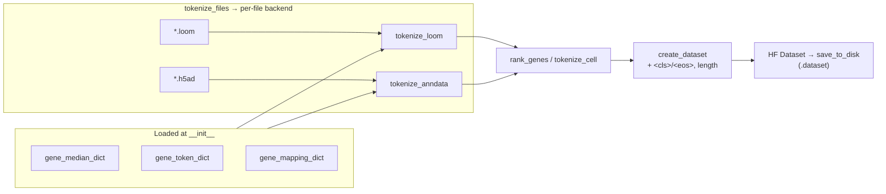
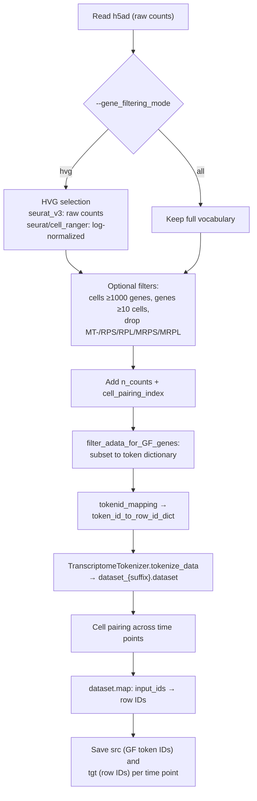

Perturbgen represents every cell not as a numeric expression vector, but as a **rank-encoded sequence of gene tokens** — the tokenization scheme introduced by Geneformer. This page explains how raw single-cell counts are converted into model-ready token sequences: the rank-value encoding principle, the three shipped vocabulary assets, the `TranscriptomeTokenizer` class (ported from Geneformer), the `GF_tokenisation` end-to-end pipeline, and the dual token-ID space (Geneformer tokens vs. compact row IDs) that the rest of the framework consumes. After reading it, you will understand exactly what an `input_ids` sequence in a `.dataset` artifact means and how it was produced.

Sources: [tokenizer.py](perturbgen/pp/tokenizer.py#L1-L39), [GF_tokenisation.py](perturbgen/pp/GF_tokenisation.py#L1-L35)

## The Rank-Value Encoding Principle

The core idea inherited from Geneformer is that **a cell is encoded by ranking its genes, not by storing their expression values**. For each cell, the pipeline (1) scales gene counts, (2) keeps only detected genes, and (3) sorts genes in descending order of scaled expression, emitting the corresponding gene token IDs in that order. Position in the sequence therefore implicitly encodes relative expression level, and the token values identify *which* gene sits at each rank. This is a deliberate departure from continuous-valued inputs: the transformer operates on a discrete vocabulary shared with the Geneformer foundation model, which is what enables Geneformer-based embedding extraction downstream (see [Cell and Gene Embedding Extraction](11-cell-and-gene-embedding-extraction)).

Sources: [tokenizer.py](perturbgen/pp/tokenizer.py#L66-L83), [tokenizer.py](perturbgen/pp/tokenizer.py#L520-L532)

The per-cell transformation can be summarized as follows:

```mermaid
flowchart LR
    A["Raw counts matrix X<br/>(genes × cells)"] --> B["Collapse duplicate Ensembl IDs<br/>(sum counts)"]
    B --> C["Restrict to vocabulary genes<br/>(protein-coding + miRNA)"]
    C --> D["Median-normalize:<br/>X / n_counts × 10,000 / gene_median"]
    D --> E["Mask undetected genes<br/>(keep nonzero entries)"]
    E --> F["Sort descending by<br/>scaled expression value"]
    F --> G["Sequence of gene token IDs<br/>in rank order"]
    G --> H["Truncate to model_input_size − 2"]
    H --> I["&lt;cls&gt; + rank-ordered tokens + &lt;eos&gt;"]
```



Sources: [tokenizer.py](perturbgen/pp/tokenizer.py#L75-L83), [tokenizer.py](perturbgen/pp/tokenizer.py#L656-L680)

Two module-level functions implement the ranking core. `rank_genes` computes `np.argsort(-gene_vector)` — a descending sort of the median-scaled values — and returns the token array reordered accordingly; `tokenize_cell` first applies a `np.nonzero` mask so that undetected genes never enter the sequence. Because only detected genes are ranked, sequence length is data-dependent (up to the vocabulary size), which is why padding and truncation logic exist downstream.

Sources: [tokenizer.py](perturbgen/pp/tokenizer.py#L66-L83)

> [!TIP]
> Token order *is* the expression signal. When a sequence must be truncated (e.g., `--max_len` below the longest cell), the **lowest-ranked genes — the least-expressed ones — are dropped first**, as the `apply_dim_overrides` warning documents. Choose truncation lengths with this loss profile in mind.

Sources: [utils.py](perturbgen/src/utils.py#L59-L83)

## Vocabulary and Normalization Assets

Tokenization is driven by three pickle dictionaries shipped inside `perturbgen/pp/`, all suffixed `gc95M` (Genecorpus-95M model series). The package's `__init__.py` exposes their paths as defaults so that both the pipeline script and the tokenizer resolve the same assets without configuration.

| Asset | Default file (`perturbgen/pp/`) | Maps | Role |
|---|---|---|---|
| Token dictionary | `token_dict_gftokens_gc95M.pkl` | Ensembl ID → token ID | Defines the vocabulary; includes special tokens (`<cls>`, `<eos>`, IDs 0–3) |
| Gene median dictionary | `gene_median_dict_gftokens_gc95M.pkl` | Ensembl ID → non-zero median expression | Per-gene normalization factor computed across the Genecorpus pretraining corpus |
| Ensembl mapping | `ensembl_mapping_dict_gc95M.pkl` | Ensembl ID → canonical Ensembl ID | Collapses versioned/alias Ensembl IDs; duplicates are merged by summing counts |

Sources: [\_\_init\_\_.py](perturbgen/pp/__init__.py#L1-L7), [tokenizer.py](perturbgen/pp/tokenizer.py#L35-L37)

At construction time, the tokenizer loads the median and token dictionaries and performs three invariant checks that intermediate developers should internalize: (1) when `special_token=True`, `<cls>` and `<eos>` must exist in the token dictionary (hard error otherwise); (2) when `special_token=False` but the dictionary *contains* those tokens, a warning reminds you that the 95M series expects them; and (3) the mapping dictionary is filtered to entries whose target exists in the token dictionary, guaranteeing every collapse target is tokenizable. A `genelist_dict` (every vocabulary gene → `True`) then acts as the vocabulary-membership filter applied to each input file's genes.

Sources: [tokenizer.py](perturbgen/pp/tokenizer.py#L351-L398)

The constructor defaults encode the 95M-series configuration: `model_input_size=4096`, `special_token=True`, `collapse_gene_ids=True`, `chunk_size=512`. The module docstring states the complementary contract: **95M series → `special_token=True`, `model_input_size=4096`; 30M series → `special_token=False`, `model_input_size=2048`.** Mixing these settings silently produces sequences incompatible with the intended checkpoint, so treat them as a matched pair (see [Pretrained Checkpoints and Hugging Face Assets](23-pretrained-checkpoints-and-hugging-face-assets)).

Sources: [tokenizer.py](perturbgen/pp/tokenizer.py#L293-L335), [tokenizer.py](perturbgen/pp/tokenizer.py#L319-L324)

## Gene ID Collapsing Before Ranking

Raw datasets frequently carry multiple Ensembl identifiers that resolve to the same gene (versioned IDs, deprecated accessions). The `sum_ensembl_ids` routine runs before any ranking and is available for both storage backends. In the **loom path**, it asserts the presence of `ensembl_id` row attributes and `n_counts` cell attributes, writes an `ensembl_id_collapsed` column via the mapping dictionary, and — when duplicates exist — streams the file in `chunk_size` blocks, grouping duplicate-gene rows and *summing their counts* into a `__dedup.loom` output. In the **h5ad path**, the same mapping is applied with `data.var.ensembl_id.str.upper().map(gene_mapping_dict)`; duplicate columns are aggregated per gene with sparse DataFrame sums and concatenated back onto the deduplicated AnnData.

Sources: [tokenizer.py](perturbgen/pp/tokenizer.py#L86-L202), [tokenizer.py](perturbgen/pp/tokenizer.py#L204-L290)

If `collapse_gene_ids=False`, the routine switches to validation mode: it checks that the Ensembl IDs present in the token dictionary are unique within the file and raises `ValueError("Error: data Ensembl IDs non-unique.")` otherwise. This gives pipeline authors a cheap integrity gate — the check runs against the token dictionary keys, so only vocabulary-relevant IDs are validated.

Sources: [tokenizer.py](perturbgen/pp/tokenizer.py#L116-L127), [tokenizer.py](perturbgen/pp/tokenizer.py#L228-L239)

## Per-Cell Normalization Math

Both file-format paths apply an identical three-factor normalization before ranking, with `target_sum=10_000`:

```
X_norm = (gene counts / cell n_counts) × 10,000 / gene_median[gene]
```

The first factor is library-size normalization (expressing each gene as counts-per-10k); the second divides by the gene's **non-zero median expression across the pretraining corpus**, which rescales genes onto a comparable dynamic range so the ranking reflects biologically meaningful prominence rather than raw detection frequency. In `tokenize_anndata`, this is implemented as `X_view / n_counts * target_sum / norm_factor_vector` on the sparse submatrix restricted to vocabulary genes; the loom path applies the same formula per scan chunk with `norm_factor_vector[:, None]` broadcasting.

Sources: [tokenizer.py](perturbgen/pp/tokenizer.py#L473-L532), [tokenizer.py](perturbgen/pp/tokenizer.py#L595-L613)

Cell-level inclusion honors an optional `filter_pass` observation (or loom column attribute): cells with value `1` are tokenized, everything else is skipped. When the attribute is absent, a printed notice confirms that all cells are tokenized. Custom cell metadata declared in `custom_attr_name_dict` is carried alongside tokens through every chunk and reattached in the final dataset — this is how fields like `Time_point` and `cell_pairing_index` survive into the tokenized artifacts.

Sources: [tokenizer.py](perturbgen/pp/tokenizer.py#L489-L517), [tokenizer.py](perturbgen/pp/tokenizer.py#L534-L541)

## Special Tokens and Sequence Formatting

The final dataset assembly happens in `create_dataset`. Sequences are stored under an `input_ids` feature together with an integer `length`. When `special_token=True` (the 95M configuration used throughout Perturbgen), formatting proceeds as: truncate the rank-ordered tokens to `model_input_size − 2` (4094), insert the `<cls>` token ID at position 0, and append the `<eos>` token ID at the end. Without special tokens, the sequence is simply truncated to `model_input_size`. A `keep_uncropped_input_ids` flag additionally preserves the full pre-truncation sequence as `input_ids_uncropped` with its own `length_uncropped` feature.

Sources: [tokenizer.py](perturbgen/pp/tokenizer.py#L632-L686)



Sources: [tokenizer.py](perturbgen/pp/tokenizer.py#L437-L471), [tokenizer.py](perturbgen/pp/tokenizer.py#L400-L435)

The entry point `tokenize_data` glues everything together: glob the data directory for the chosen format, dispatch per file, then `Dataset.from_dict` (or `Dataset.from_generator` when `use_generator=True` for memory-constrained corpora) and `save_to_disk` to `<output_prefix>.dataset`. These `.dataset` directories are exactly what the training data pipeline loads later — their on-disk structure is detailed in [Tokenized Dataset Layout](16-tokenized-dataset-layout).

Sources: [tokenizer.py](perturbgen/pp/tokenizer.py#L400-L435), [tokenizer.py](perturbgen/pp/tokenizer.py#L646-L654)

## The GF_tokenisation Pipeline

For perturbation fine-tuning datasets, `GF_tokenisation.py` orchestrates tokenization plus all the preprocessing that must happen around it. The pipeline is CLI-driven (`get_args`) and executes the following stages:



Sources: [GF_tokenisation.py](perturbgen/pp/GF_tokenisation.py#L213-L240), [GF_tokenisation.py](perturbgen/pp/GF_tokenisation.py#L318-L338), [GF_tokenisation.py](perturbgen/pp/GF_tokenisation.py#L440-L528)

Key preprocessing decisions worth noting for intermediate users:

- **Counts discipline.** The script guarantees raw counts land in `adata.layers['counts']` and that `adata.X` holds counts before tokenization — HVG flavors other than `seurat_v3` temporarily log-normalize (`normalize_total(1e4)` + `log1p`) for selection, then restore counts (`adata.X = adata.layers['counts']  # need raw counts`), because the tokenizer's median normalization assumes raw inputs.
- **HVG timing is a first-class option.** `--hvg_mode before_tokenisation` selects HVGs before the vocabulary subsetting; `after_tokenisation` runs the same scanpy HVG machinery on the GF-filtered AnnData. `--hvg_flavor seurat_v3` is the only flavor ranking on raw counts directly.
- **Dictionary-aware output naming.** Every artifact is suffixed with the filtering regime (e.g., `2000_hvg` or `all`), so `token_id_to_genename_2000_hvg.pkl` and `dataset_2000_hvg/` unambiguously belong together.
- **Mito/ribosomal removal** is opt-in (`--remove_mito_ribo_genes`) and matches gene-name prefixes `MT-`, `RPS`, `RPL`, `MRPS`, `MRPL`.

Sources: [GF_tokenisation.py](perturbgen/pp/GF_tokenisation.py#L237-L279), [GF_tokenisation.py](perturbgen/pp/GF_tokenisation.py#L341-L400), [GF_tokenisation.py](perturbgen/pp/GF_tokenisation.py#L301-L317)

The script instantiates the tokenizer exactly per the 95M contract — `model_input_size=4096`, `special_token=True`, `collapse_gene_ids=True` — with `custom_attr_name_dict` set to the requested `--var_list` plus the injected `cell_pairing_index`, so pairing metadata rides along into the `.dataset` artifact.

Sources: [GF_tokenisation.py](perturbgen/pp/GF_tokenisation.py#L436-L459)

## The Dual Token-ID Space: GF Tokens vs. Row IDs

This is the most consequential design decision in Perturbgen's tokenization layer. After tokenization, the pipeline maintains **two parallel representations of the same cell**:

| ID space | Content | Used for |
|---|---|---|
| **GF token IDs** | Geneformer vocabulary IDs (incl. `<cls>`=0-range specials) | Source (control) cells when extracting Geneformer embeddings — the upstream model requires its native vocabulary |
| **Row IDs** | Compact contiguous indices 0…N−1 via `tokenid_mapping` | Target cells and transformer-mode inputs — the Perturbgen decoder indexes embedding rows with these |

`tokenid_mapping(adata_subset, token_dict_path)` returns the subset AnnData aligned to row IDs plus both directions of the mapping (`token_id_to_row_id_dict`, `row_id_to_gene_name`), which are persisted as `tokenid_to_rowid_{suffix}.pkl` and `token_id_to_genename_{suffix}.pkl`. The HF `dataset.map(map_input_ids_to_row_id, ...)` then rewrites every target example's `input_ids` from GF tokens to row IDs. The `--src_mode` flag governs the source side: with `Geneformer` (default) the source dataset keeps *original token IDs* — the code comments state that "Geneformer needs initial token ids to extract correct embeddings" — whereas `Transformer` stores the row-ID-mapped variant.

Sources: [GF_tokenisation.py](perturbgen/pp/GF_tokenisation.py#L402-L420), [GF_tokenisation.py](perturbgen/pp/GF_tokenisation.py#L482-L488), [GF_tokenisation.py](perturbgen/pp/GF_tokenisation.py#L509-L527)

> [!TIP]
> Special token IDs are hard-coded as **{0, 1, 2, 3}**. The pipeline strips them from `token_dict` when building gene-name lookups, and evaluation code blanks them out before computing ROUGE — so any custom vocabulary must reserve IDs 0–3 for `<cls>`/`<eos>`/control tokens or these utilities will misinterpret gene IDs as specials.

Sources: [GF_tokenisation.py](perturbgen/pp/GF_tokenisation.py#L288-L299), [utils.py](perturbgen/src/utils.py#L274-L281)

Row IDs also define the model's input dimensionality. `apply_dim_overrides` detects `vocab` and `max_len` from the tokenized data and allows manual `--tgt_vocab_size` / `--max_len` overrides — with an explicit warning that shrinking the vocabulary makes condition tokens (numbered above the gene IDs) collide with gene tokens, and shrinking `max_len` truncates the lowest-ranked genes. This keeps checkpoints trained with fixed dimensions loadable across datasets.

Sources: [utils.py](perturbgen/src/utils.py#L59-L83)

## Batch Integration: Padding Utilities

Because rank-encoded sequences have variable length, batching pads them to a common length. `perturbgen/src/gf_utils.py` is a verbatim port of the relevant helpers from Geneformer's `perturber_utils.py` (Hugging Face `ctheodoris/Geneformer`, header-dated 2025-09-06). `pad_tensor` right-pads with `pad_token_id` via `torch.nn.functional.pad`; `pad_3d_tensor` handles a chosen non-batch dimension; and `pad_tensor_list` resolves the target length as either `dynamic` (longest member of the list), an explicit integer, or — with a logged warning — a fallback to `model_input_size`. Padded 1-D tensors are stacked; 3-D padded tensors are concatenated along dim 0.

Sources: [gf_utils.py](perturbgen/src/gf_utils.py#L1-L14), [gf_utils.py](perturbgen/src/gf_utils.py#L29-L62)

## Pretraining-Scale Tokenization

The `pretraining_cohort/` tree contains the recipe used to tokenize the harmonized pretraining corpus itself (see [Pretraining Cohort Harmonization Pipeline](15-pretraining-cohort-harmonization-pipeline)). Notably, this script imports the **upstream `geneformer` package's** `TranscriptomeTokenizer` rather than the vendored copy, supplying cohort-specific median, token-dictionary, and Ensembl-mapping files, `model_input_size=4096`, `nproc=32`, and custom attributes `{"tissue", "disease"}`. It walks the harmonized h5ad tree, calls `tokenize_data` with `use_generator=True` and `file_format='h5ad'`, disables HF datasets caching up front, and clears the HuggingFace cache directory after each file — a pragmatic memory-hygiene pattern for very large corpora.

Sources: [tokenization.py](pretraining_cohort/tokenization/tokenization.py#L1-L42)

## Key Pipeline Parameters Reference

The table below consolidates the most consequential CLI arguments of `GF_tokenisation.py` (defaults shown as shipped):

| Parameter | Default | Choices / Notes |
|---|---|---|
| `--h5ad_path` | `./data/eb/EB.h5ad` | Input AnnData with raw counts + `ensembl_id` in `var` |
| `--dataset` | `eb_100M` | Artifact/folder naming stem |
| `--gene_filtering_mode` | `hvg` | `hvg` / `degs` / `all`; suffixes all outputs |
| `--hvg_mode` | `before_tokenisation` | `before_tokenisation` / `after_tokenisation` |
| `--hvg_flavor` | `seurat` | `seurat_v3` ranks raw counts; others log-normalize first |
| `--n_hvg` | `2000` | Top-N genes for HVG modes |
| `--exclude_non_GF_genes` | `False` | Drop AnnData genes absent from the GF token dictionary |
| `--remove_mito_ribo_genes` | `False` | Prefix filter: `MT-`, `RPS/RPL`, `MRPS/MRPL` |
| `--src_mode` | `Geneformer` | `Geneformer` keeps GF token IDs for source cells; `Transformer` uses row IDs |
| `--pairing_mode` | `random` | `stratified` / `random` / `mapping` (see [Cell Pairing and Data Curation](14-cell-pairing-and-data-curation)) |
| `--time_obs` | `Time_point` | Observation driving pairing and time encoding |
| `--reference_time` | `Day 00-03` | Control time point stored as the `src` dataset |
| `--model input paths` | shipped pickles | `--gene_median_path`, `--token_dict_path`, `--gene_mapping_path` default to `perturbgen/pp/` assets |
| `--nproc` | `4` | Processes for dataset mapping |

Sources: [GF_tokenisation.py](perturbgen/pp/GF_tokenisation.py#L37-L211), [\_\_init\_\_.py](perturbgen/pp/__init__.py#L1-L7)

## Where to Go Next

Tokenization is the contract between raw data and everything downstream. To continue along the Deep Dive track, the natural progression is [Time-Aware Positional Encoding](8-time-aware-positional-encoding) (how time tokens join the token sequence), then [Two-Stage Masking and Count Decoder Training](7-two-stage-masking-and-count-decoder-training) (how these sequences are consumed by the generative objective). For the artifacts tokenization produces, read [Tokenized Dataset Layout](16-tokenized-dataset-layout); for running the pipeline end-to-end, the command surface is documented in [CLI Command Reference](22-cli-command-reference) and the class API in [Python API Reference](21-python-api-reference).
