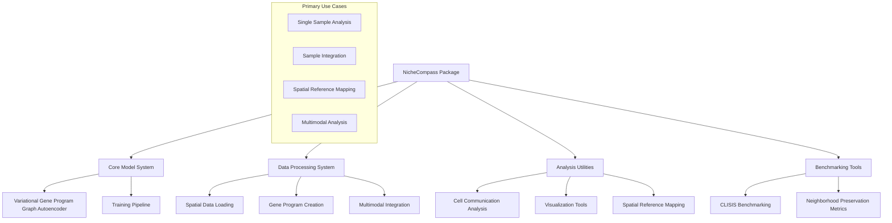
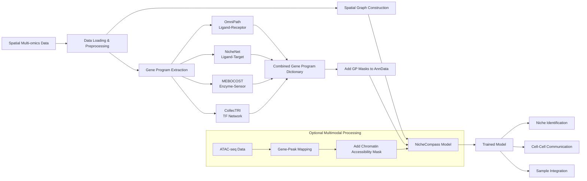
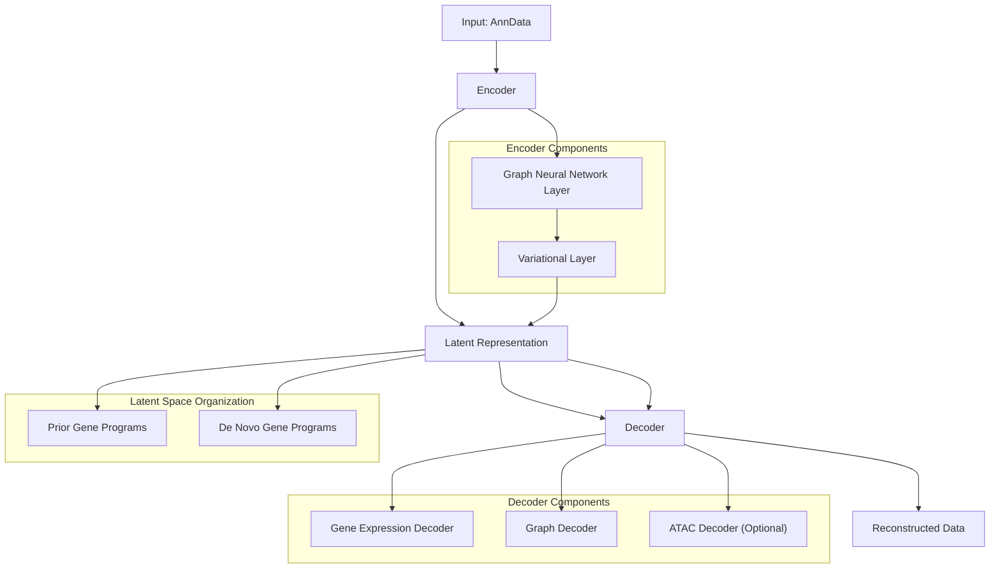
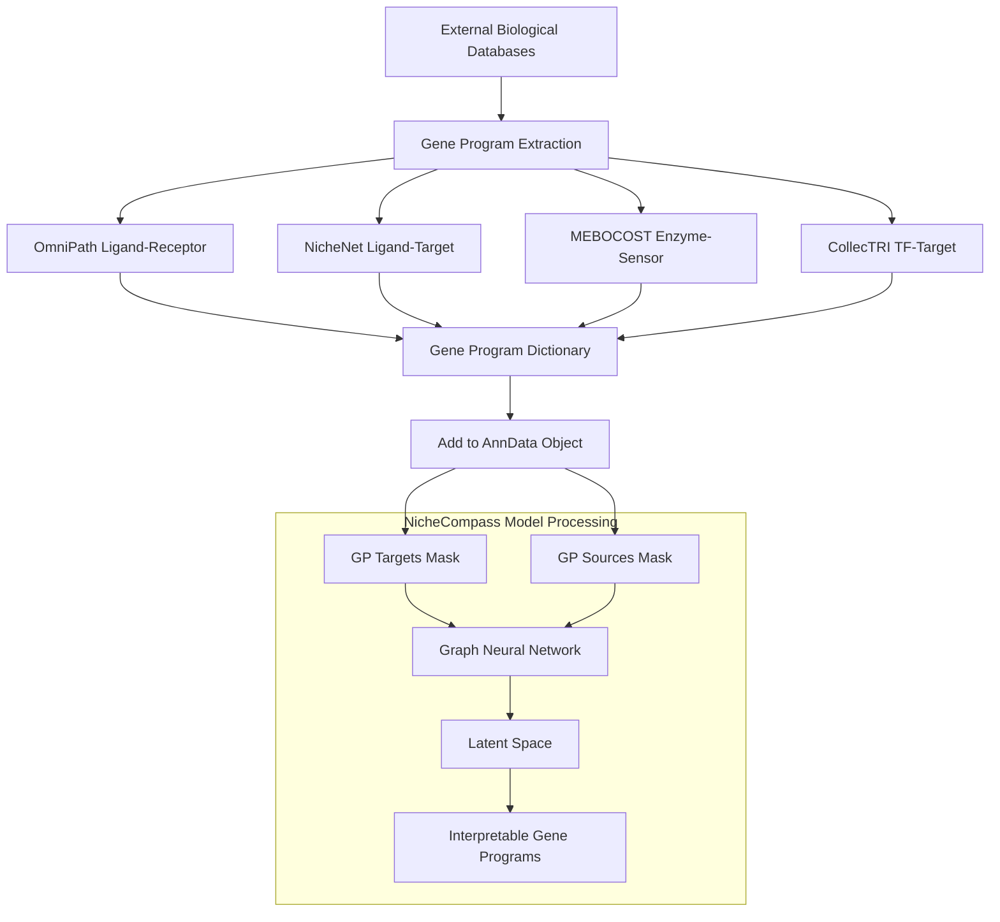
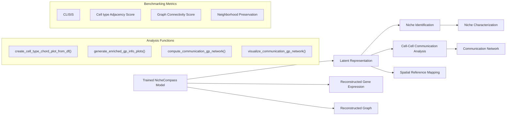

# Overview

<details>
<summary>Relevant source files</summary>

The following files were used as context for generating this wiki page:

- [README.md](README.md)
- [docs/index.md](docs/index.md)
- [docs/release_notes/index.md](docs/release_notes/index.md)
- [docs/user_guide/index.md](docs/user_guide/index.md)
- [pyproject.toml](pyproject.toml)
- [src/nichecompass/utils/analysis.py](src/nichecompass/utils/analysis.py)

</details>


NicheCompass (**N**iche **I**dentification based on **C**ellular grap**H** **E**mbeddings of **COM**munication **P**rograms **A**ligned across **S**patial **S**amples) is a Python package for end-to-end analysis of spatial multi-omics data. It focuses on spatial atlas building, niche identification, cell-cell communication inference, and spatial reference mapping. This document provides a high-level overview of the system architecture, core components, and key capabilities of NicheCompass.

Sources: [README.md:11-11](), [docs/index.md:3-4]()

## System Purpose and Scope

NicheCompass enables the comprehensive analysis of spatial transcriptomics and multi-modal omics data through:

1. **Spatial Data Processing**: Loading and preprocessing spatial omics data
2. **Gene Program Extraction**: Creating interpretable gene programs from biological databases
3. **Neural Network Modeling**: Using a Variational Gene Program Graph Autoencoder to learn cellular representations
4. **Niche Identification**: Identifying and characterizing cellular niches in spatial context
5. **Communication Analysis**: Inferring cell-cell communication networks
6. **Spatial Reference Mapping**: Aligning and integrating multiple spatial samples

The package is developed and maintained by the Lotfollahi Lab at the Wellcome Sanger Institute.

Sources: [README.md:11-11](), [docs/index.md:3-4]()

## High-Level Architecture



The NicheCompass system consists of four main subsystems that work together to provide comprehensive spatial omics analysis. The core model system includes the variational autoencoder and training pipeline, while the data processing system handles data loading, gene program creation, and multimodal integration. Analysis utilities and benchmarking tools enable downstream analysis and evaluation.

Sources: [README.md:11-11](), [pyproject.toml:29-37](), [pyproject.toml:67-74]()

## Core Model and Data Flow



The NicheCompass workflow begins with spatial multi-omics data, which undergoes preprocessing and spatial graph construction. In parallel, gene programs are extracted from multiple biological databases (OmniPath, NicheNet, MEBOCOST, and CollecTRI) and combined into a gene program dictionary. These gene programs are added as masks to the AnnData object, which is then used to train the NicheCompass model. The trained model enables various downstream analyses, including niche identification, cell-cell communication inference, and sample integration. Optionally, ATAC-seq data can be integrated through gene-peak mapping.

Sources: [pyproject.toml:29-37](), [pyproject.toml:67-74](), [pyproject.toml:75-77]()

## Model Architecture



The NicheCompass model follows a variational autoencoder architecture. The encoder processes the input AnnData object using a graph neural network layer followed by a variational layer to produce a latent representation. The latent space is organized into prior gene programs (derived from biological databases) and de novo gene programs (learned from the data). The decoder reconstructs gene expression data, the graph structure, and optionally ATAC-seq data from the latent representation.

Sources: [docs/user_guide/index.md:7-13]()

## Gene Program System



The Gene Program system is a key component of NicheCompass. Gene programs are extracted from multiple external biological databases (OmniPath, NicheNet, MEBOCOST, and CollecTRI) and combined into a gene program dictionary. This dictionary is added to the AnnData object as GP targets and sources masks. These masks inform the graph neural network during model training, resulting in interpretable gene programs in the latent space.

Sources: [pyproject.toml:29-37](), [docs/user_guide/index.md:7-13]()

## Analysis Capabilities



NicheCompass provides a variety of analysis capabilities for extracting insights from trained models. The latent representation enables niche identification and characterization, cell-cell communication analysis, and spatial reference mapping. The package includes functions for creating cell type chord plots, generating enriched gene program information plots, computing communication gene program networks, and visualizing these networks. Benchmarking metrics such as CLISIS, cell type adjacency score, graph connectivity score, and neighborhood preservation are available for evaluating model performance.

Sources: [src/nichecompass/utils/analysis.py:22-1148]()

## Use Cases and Installation

NicheCompass supports several key use cases:

1. **Single Sample Analysis**: Analyzing a single spatial transcriptomics sample
2. **Sample Integration**: Integrating multiple spatial samples
3. **Spatial Reference Mapping**: Mapping across reference samples
4. **Multimodal Analysis**: Analyzing combined RNA-seq and ATAC-seq data

The package can be installed via pip:

```bash
pip install nichecompass
```

For more comprehensive installations with additional features:

```bash
# For benchmarking capabilities
pip install nichecompass[benchmarking]

# For multimodal analysis
pip install nichecompass[multimodal]

# For all features
pip install nichecompass[all]
```

For detailed tutorials and usage examples, refer to the [Tutorials](#4) section.

Sources: [README.md:13-16](), [pyproject.toml:67-74](), [pyproject.toml:75-77]()

## Development History

NicheCompass has undergone several releases:

| Version | Date | Key Changes |
|---------|------|-------------|
| 0.2.3 | 17.02.2025 | Added numpy<2 dependency constraint |
| 0.2.2 | 09.01.2025 | Synced repository with Zenodo for DOI |
| 0.2.1 | 15.10.2024 | Added user guide to documentation |
| 0.2.0 | 22.08.2024 | Bug fixes and hyperparameter optimizations |
| 0.1.0 | 13.02.2024 | First NicheCompass version |

The package is actively maintained by the Lotfollahi Lab at the Wellcome Sanger Institute.

Sources: [docs/release_notes/index.md:7-44]()

## Dependencies and System Requirements

NicheCompass is built on several key dependencies:

| Dependency | Purpose |
|------------|---------|
| PyTorch Geometric (PyG) | Graph neural network operations |
| AnnData | Data structure for annotated data matrices |
| scanpy | Single-cell analysis in Python |
| OmniPath | Protein-protein interaction database |
| decoupler | Footprint analysis tools |
| mlflow | Experiment tracking |

The package requires Python 3.9 or higher and is primarily tested on Linux operating systems.

Sources: [pyproject.toml:29-37](), [pyproject.toml:9-11](), [pyproject.toml:21-28]()

## Documentation and Resources

For more detailed information about specific aspects of NicheCompass, refer to:

- [Architecture](#2): High-level system architecture
- [Core Model](#2.1): Detailed model architecture
- [Gene Programs](#2.2): In-depth explanation of gene programs
- [Multimodal Integration](#2.3): Integration of RNA-seq and ATAC-seq data
- [Tutorials](#4): Usage examples and tutorials
- [Analysis Utilities](#5): Detailed explanation of analysis tools

Additional resources include:
- [GitHub Issues](https://github.com/Lotfollahi-lab/nichecompass/issues) for bug reports
- [Contributing Guide](https://nichecompass.readthedocs.io/en/latest/contributing.html) for development contributions

Sources: [README.md:13-17]()

---