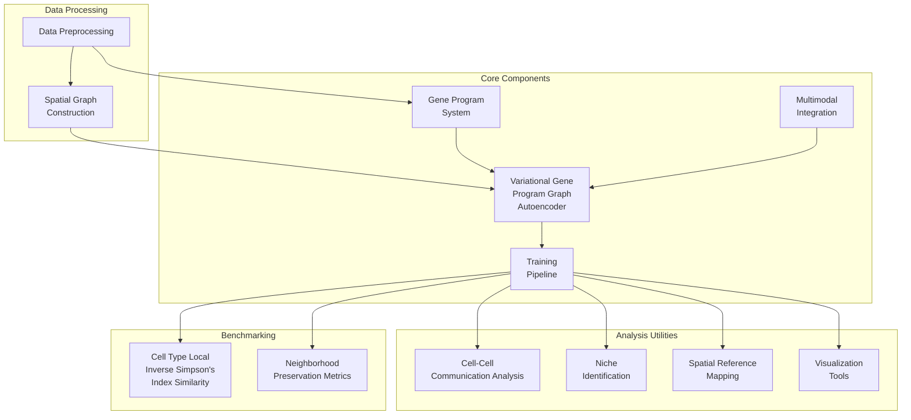
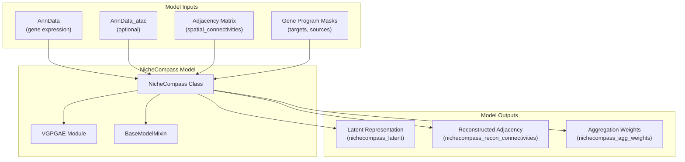
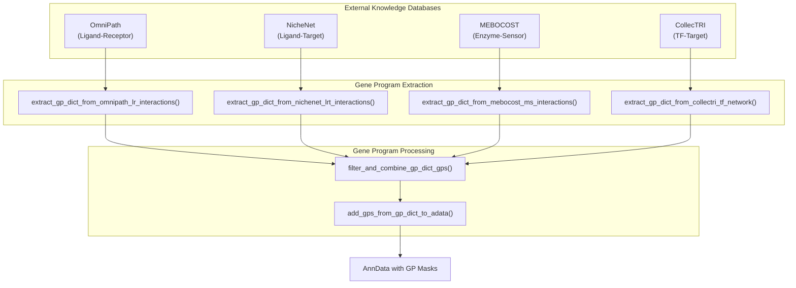
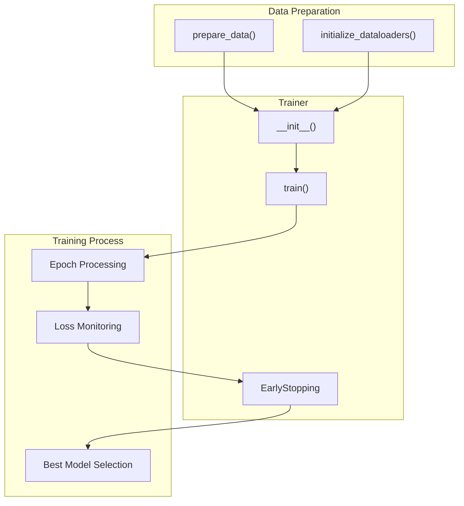
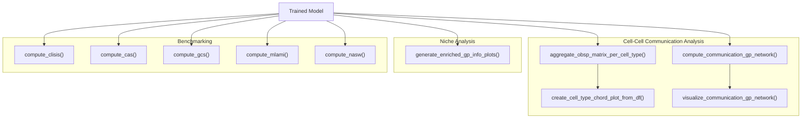
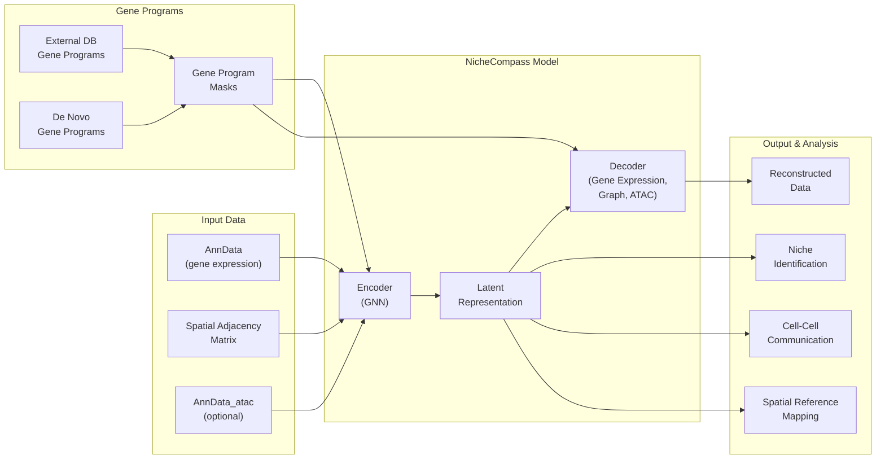
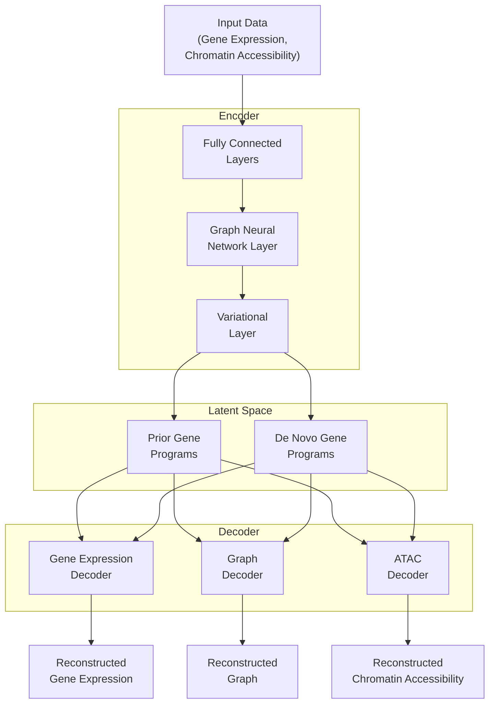
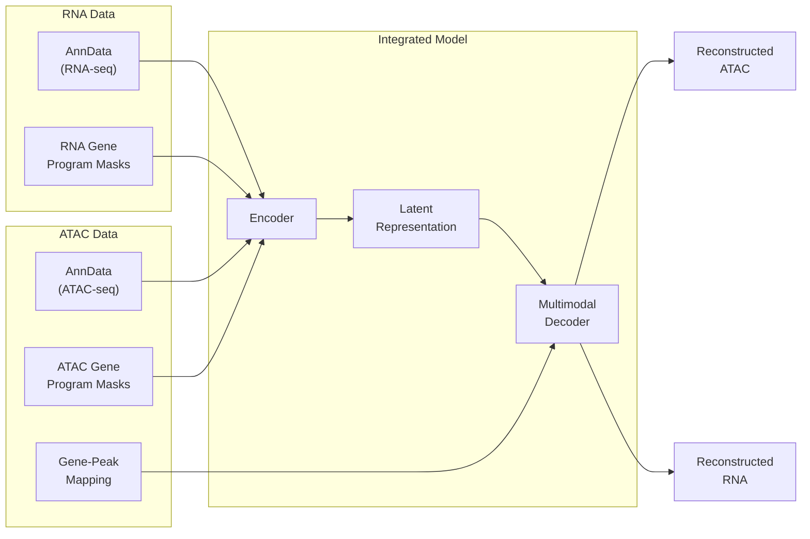

# Architecture

Relevant source files

The following files were used as context for generating this wiki page:

- [README.md](README.md)
- [docs/index.md](docs/index.md)
- [docs/release_notes/index.md](docs/release_notes/index.md)
- [docs/user_guide/index.md](docs/user_guide/index.md)
- [environment.yaml](environment.yaml)
- [pyproject.toml](pyproject.toml)
- [src/nichecompass/__init__.py](src/nichecompass/__init__.py)
- [src/nichecompass/benchmarking/__init__.py](src/nichecompass/benchmarking/__init__.py)
- [src/nichecompass/benchmarking/clisis.py](src/nichecompass/benchmarking/clisis.py)
- [src/nichecompass/data/__init__.py](src/nichecompass/data/__init__.py)
- [src/nichecompass/models/nichecompass.py](src/nichecompass/models/nichecompass.py)
- [src/nichecompass/train/trainer.py](src/nichecompass/train/trainer.py)
- [src/nichecompass/utils/__init__.py](src/nichecompass/utils/__init__.py)
- [src/nichecompass/utils/analysis.py](src/nichecompass/utils/analysis.py)
- [src/nichecompass/utils/gene_programs.py](src/nichecompass/utils/gene_programs.py)
- [src/nichecompass/utils/utils.py](src/nichecompass/utils/utils.py)

This document provides a comprehensive overview of the NicheCompass system architecture, detailing its components, data flow, and module organization. It explains how the various parts of the system interact to enable end-to-end analysis of spatial multi-omics data, including spatial atlas building, niche identification, cell-cell communication inference, and spatial reference mapping.

For installation instructions, please refer to [Installation](#3), and for practical application examples, see [Tutorials](#4).

## System Overview

NicheCompass is built on a modular architecture that integrates several key components to analyze spatial transcriptomics and multimodal data.

Sources: [README.md:11-11](), [pyproject.toml:8-8](), [src/nichecompass/models/nichecompass.py:1-4](), [src/nichecompass/benchmarking/clisis.py:1-7]()

## Core Components

The NicheCompass system is composed of four main components that work together to analyze spatial multi-omics data:

### 1. Model Component

At the heart of NicheCompass is the `NicheCompass` model class, which implements a Variational Gene Program Graph Autoencoder (VGPGAE). This model:
- Learns latent representations of cells in their spatial context
- Uses gene program masks to guide the learning of interpretable representations
- Supports multimodal data integration (RNA-seq and ATAC-seq)
- Enables various downstream analyses like niche identification

Sources: [src/nichecompass/models/nichecompass.py:24-581](), [src/nichecompass/modules/__init__.py]()

### 2. Gene Program System

The Gene Program System is responsible for creating and managing interpretable gene programs that serve as the basis for the model's latent representations:

Sources: [src/nichecompass/utils/gene_programs.py:286-356](), [src/nichecompass/utils/gene_programs.py:359-596](), [src/nichecompass/utils/gene_programs.py:599-665](), [src/nichecompass/utils/__init__.py:11-18]()

### 3. Training Pipeline

The Training Pipeline manages the model training process through the `Trainer` class:

Sources: [src/nichecompass/train/trainer.py:28-91](), [src/nichecompass/train/trainer.py:217-306](), [src/nichecompass/data/__init__.py:1-6]()

### 4. Analysis Utilities

NicheCompass provides a suite of utilities for analyzing the trained model results:

Sources: [src/nichecompass/utils/analysis.py:23-104](), [src/nichecompass/utils/analysis.py:105-210](), [src/nichecompass/utils/analysis.py:212-404](), [src/nichecompass/benchmarking/__init__.py:8-22]()

## Data Flow

NicheCompass processes data through a well-defined pipeline that integrates spatial information, gene expression, and prior biological knowledge:

Sources: [src/nichecompass/models/nichecompass.py:189-249](), [src/nichecompass/train/trainer.py:91-166](), [src/nichecompass/utils/gene_programs.py:18-111]()

## Code Organization

The NicheCompass codebase is organized into several modules, each handling specific aspects of the system:

| Module | Purpose | Key Classes/Functions |
|--------|---------|----------------------|
| `models` | Defines the main model class | `NicheCompass` |
| `modules` | Contains neural network components | `VGPGAE` |
| `nn` | Low-level neural network modules | - |
| `data` | Data loading and preprocessing | `SpatialAnnTorchDataset`, `initialize_dataloaders` |
| `train` | Training pipeline | `Trainer` |
| `utils` | Utility functions | Gene program extraction, analysis utilities |
| `benchmarking` | Evaluation metrics | `compute_clisis`, `compute_cas`, `compute_gcs` |

Sources: [src/nichecompass/__init__.py:3-5](), [pyproject.toml:30-37]()

## Model Architecture Details

The Variational Gene Program Graph Autoencoder (VGPGAE) is the core model of NicheCompass:

Sources: [src/nichecompass/models/nichecompass.py:547-581]()

## Configuration and Hyperparameters

NicheCompass provides several configuration options and hyperparameters that influence model performance:

| Parameter Category | Key Parameters | Description |
|--------------------|---------------|-------------|
| **Model Structure** | `n_fc_layers_encoder`, `n_layers_encoder`, `n_hidden_encoder` | Control the size and depth of the encoder network |
| | `conv_layer_encoder` | Type of GNN layer ("gcnconv" or "gatv2conv") |
| | `n_addon_gp` | Number of de novo gene programs to learn |
| **Loss Weights** | `lambda_edge_recon` | Weight for edge reconstruction loss |
| | `lambda_gene_expr_recon` | Weight for gene expression reconstruction loss |
| | `lambda_chrom_access_recon` | Weight for chromatin accessibility reconstruction loss |
| **Training Process** | `n_epochs`, `n_epochs_all_gps` | Control training duration and GP pruning timing |
| | `lr`, `weight_decay` | Control optimizer behavior |
| **Gene Program System** | `min_genes_per_gp`, `max_genes_per_gp` | Filter gene programs by size |
| | `active_gp_thresh_ratio` | Threshold for determining active gene programs |

Sources: [docs/user_guide/index.md:5-16](), [src/nichecompass/models/nichecompass.py:189-249](), [src/nichecompass/train/trainer.py:217-306]()

## Multimodal Integration

NicheCompass supports multimodal analysis of RNA-seq and ATAC-seq data:

Sources: [src/nichecompass/models/nichecompass.py:339-374](), [src/nichecompass/utils/__init__.py:8-10]()

## Version and Dependency Management

NicheCompass is meticulously versioned and has specific dependencies that ensure its functionality:

| Dependency Category | Key Dependencies | Purpose |
|---------------------|-----------------|---------|
| **Core Dependencies** | PyTorch Geometric (PyG) | Graph neural network framework |
| | AnnData | Data structure for annotated data matrices |
| | scanpy | Single-cell analysis in Python |
| | omnipath | Access to multiple databases of molecular biology |
| | decoupler | Tool for extraction of biological signatures |
| **Optional Dependencies** | scib-metrics | Benchmarking metrics |
| | squidpy | Spatial single-cell analysis |
| | scglue | For multimodal data integration |

Sources: [pyproject.toml:29-81](), [environment.yaml:8-14](), [docs/release_notes/index.md:7-44]()

## Conclusion

The NicheCompass architecture is designed to provide a comprehensive framework for spatial multi-omics data analysis. By integrating graph neural networks with interpretable gene programs and supporting multimodal data, it enables researchers to identify and characterize cellular niches, infer cell-cell communication, and map spatial references across samples.

The modular design allows for flexible analysis workflows and extension to different biological questions, while the core model ensures that the learned representations preserve both gene expression patterns and spatial relationships.

---