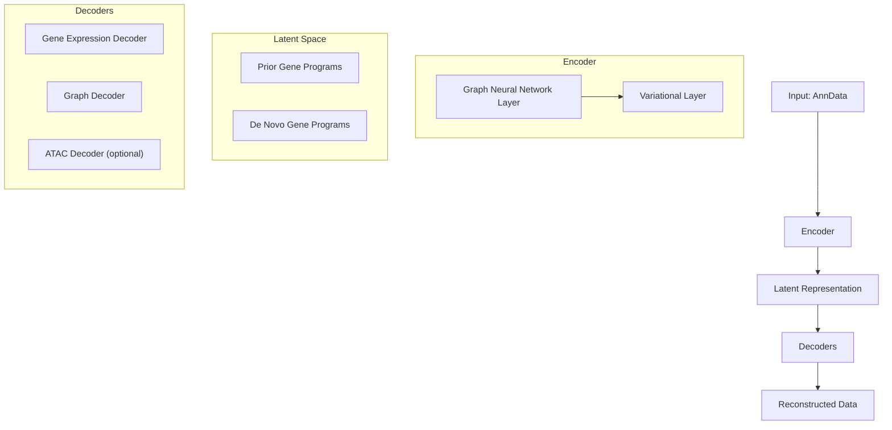
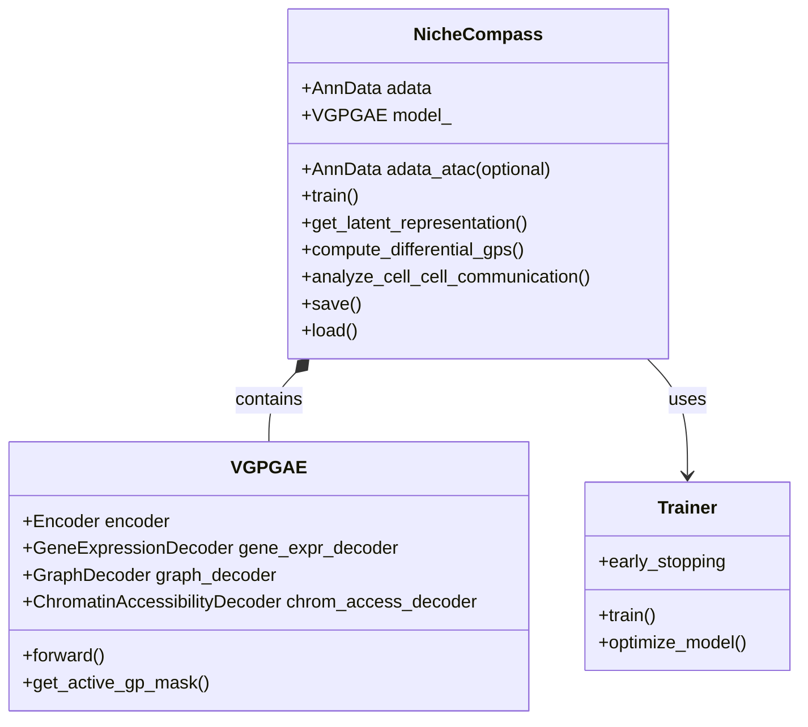
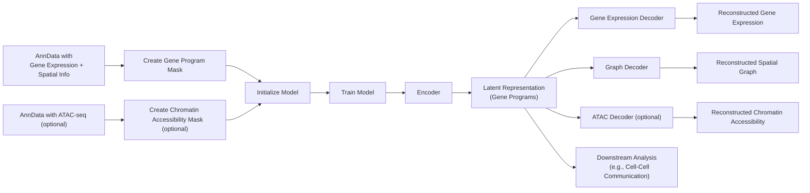
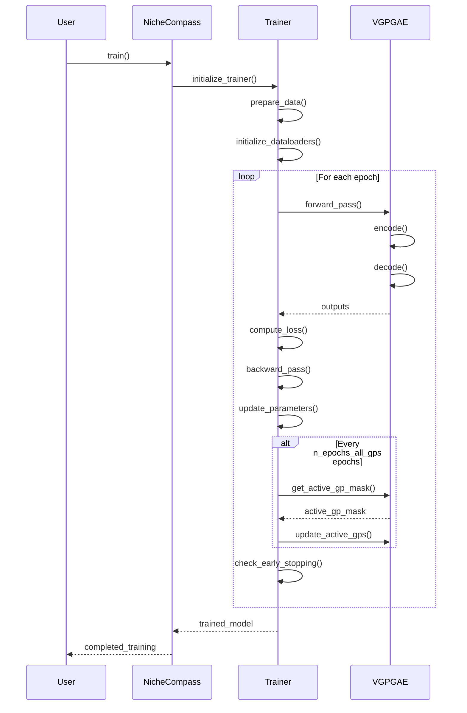
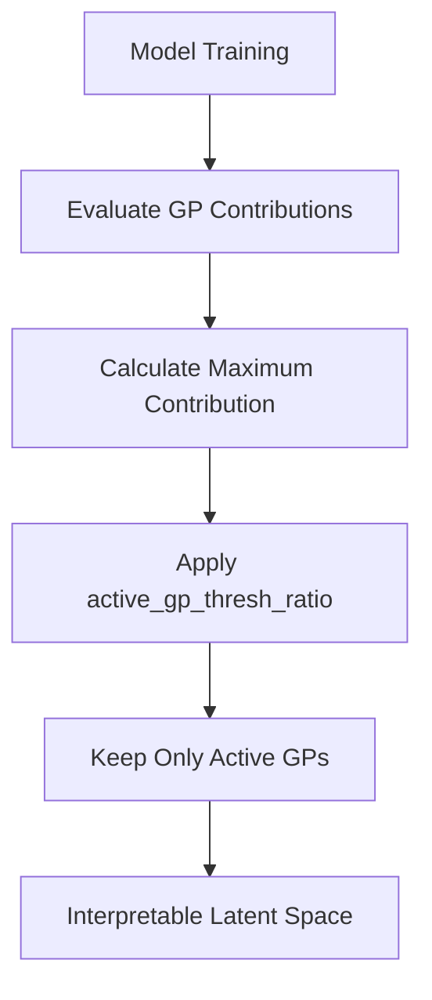
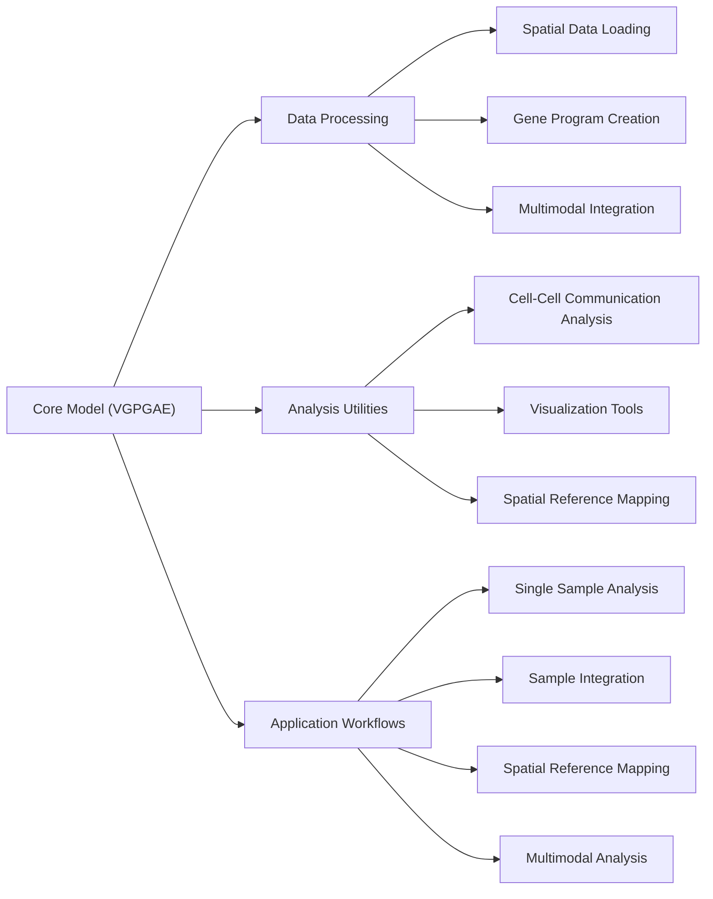

# Core Model

<details>
<summary>Relevant source files</summary>

The following files were used as context for generating this wiki page:

- [.readthedocs.yaml](.readthedocs.yaml)
- [docs/installation.md](docs/installation.md)
- [docs/tutorials/notebooks/mouse_brain_multimodal.ipynb](docs/tutorials/notebooks/mouse_brain_multimodal.ipynb)
- [docs/tutorials/notebooks/mouse_cns_sample_integration.ipynb](docs/tutorials/notebooks/mouse_cns_sample_integration.ipynb)
- [docs/tutorials/notebooks/mouse_cns_single_sample.ipynb](docs/tutorials/notebooks/mouse_cns_single_sample.ipynb)
- [docs/tutorials/notebooks/mouse_cns_spatial_reference_mapping.ipynb](docs/tutorials/notebooks/mouse_cns_spatial_reference_mapping.ipynb)
- [environment.yaml](environment.yaml)
- [src/nichecompass/__init__.py](src/nichecompass/__init__.py)
- [src/nichecompass/benchmarking/__init__.py](src/nichecompass/benchmarking/__init__.py)
- [src/nichecompass/benchmarking/clisis.py](src/nichecompass/benchmarking/clisis.py)
- [src/nichecompass/data/__init__.py](src/nichecompass/data/__init__.py)
- [src/nichecompass/models/nichecompass.py](src/nichecompass/models/nichecompass.py)
- [src/nichecompass/train/trainer.py](src/nichecompass/train/trainer.py)
- [src/nichecompass/utils/__init__.py](src/nichecompass/utils/__init__.py)
- [src/nichecompass/utils/gene_programs.py](src/nichecompass/utils/gene_programs.py)
- [src/nichecompass/utils/utils.py](src/nichecompass/utils/utils.py)

</details>


The Core Model of NicheCompass is the central analytical engine within the system, responsible for transforming spatial multi-omics data into a biologically interpretable latent space. This page documents the architecture, components, and functionality of the Variational Gene Program Graph Autoencoder (VGPGAE), which forms the foundation of NicheCompass's analytical capabilities.

For information about how Gene Programs are created and used, see [Gene Programs](#2.2).
For information about multimodal integration, see [Multimodal Integration](#2.3).

## Architecture Overview

The Core Model follows a variational graph autoencoder architecture that has been specially designed to handle spatial omics data and incorporate prior biological knowledge through gene programs.



Sources:
- [src/nichecompass/models/nichecompass.py]()
- [docs/tutorials/notebooks/mouse_brain_multimodal.ipynb:778-791]()

## Key Components

### NicheCompass Model Class

The `NicheCompass` class serves as the primary interface to the Core Model, providing methods for initialization, training, and analysis:



Sources:
- [src/nichecompass/models/nichecompass.py:24-219]()
- [src/nichecompass/train/trainer.py:28-166]()

### Variational Gene Program Graph Autoencoder (VGPGAE)

The VGPGAE is the mathematical core of NicheCompass, transforming spatial omics data into an interpretable latent space where each dimension corresponds to a gene program.

#### Encoder

The encoder processes input data through graph neural network layers and applies a variational transformation:

- **Graph Neural Network Layer**: Captures spatial relationships between cells
- **Variational Layer**: Produces a probabilistic latent representation by mapping to a distribution (mean μ and log variance logσ²)

The encoder architecture is configurable with parameters such as:
- `conv_layer_encoder`: Type of graph convolutional layer (e.g., GCNConv, GATv2Conv)
- `n_hidden_encoder`: Number of hidden nodes
- `n_layers_encoder`: Number of message passing layers

#### Latent Space

The latent space combines two types of gene programs:

- **Prior Gene Programs**: Based on known biological pathways (e.g., ligand-receptor interactions)
- **De Novo Gene Programs**: Learned from the data without prior constraints, enabling discovery of new patterns

#### Decoders

The model includes multiple decoders:

1. **Gene Expression Decoder**: Reconstructs gene expression data using linear masked layers that enforce the gene program structure
2. **Graph Decoder**: Reconstructs the spatial graph structure using cosine similarity
3. **Chromatin Accessibility Decoder** (optional): Reconstructs ATAC-seq data in multimodal analysis

Sources:
- [src/nichecompass/models/nichecompass.py:189-219]()
- [docs/tutorials/notebooks/mouse_brain_multimodal.ipynb:885-896]()

## Data Flow

The following diagram illustrates how data flows through the Core Model:



Sources:
- [docs/tutorials/notebooks/mouse_brain_multimodal.ipynb:778-847]()

## Model Initialization and Training

### Initialization

The NicheCompass model is initialized with:

1. AnnData object containing gene expression and spatial information
2. Optional AnnData object with ATAC-seq data for multimodal analysis
3. Configuration parameters for model architecture and training

Example initialization from the mouse brain multimodal tutorial:

```python
model = NicheCompass(adata,
                     adata_atac,
                     counts_key="counts",
                     adj_key="spatial_connectivities",
                     gp_names_key="nichecompass_gp_names",
                     active_gp_names_key="nichecompass_active_gp_names",
                     gp_targets_mask_key="nichecompass_gp_targets",
                     gp_targets_categories_mask_key="nichecompass_gp_targets_categories",
                     gp_sources_mask_key="nichecompass_gp_sources",
                     gp_sources_categories_mask_key="nichecompass_gp_sources_categories",
                     latent_key="nichecompass_latent",
                     conv_layer_encoder="gatv2conv",
                     active_gp_thresh_ratio=0.01)
```

Sources:
- [docs/tutorials/notebooks/mouse_brain_multimodal.ipynb:778-791]()

### Training Process

The training process involves these major steps:



Training involves optimizing multiple loss components:

| Loss Component | Description | Parameter |
|----------------|-------------|-----------|
| Edge Reconstruction | Loss for reconstructing spatial relationships | `lambda_edge_recon` |
| Gene Expression Reconstruction | Loss for reconstructing gene expression | `lambda_gene_expr_recon` |
| Chromatin Accessibility Reconstruction | Loss for reconstructing ATAC-seq data | `lambda_chrom_access_recon` |
| L1 Masked | Regularization for prior gene programs | `lambda_l1_masked` |
| L1 Addon | Regularization for de novo gene programs | `lambda_l1_addon` |

Example training code from the mouse brain multimodal tutorial:

```python
model.train(n_epochs=400,
            n_epochs_all_gps=25,
            lr=0.001,
            lambda_edge_recon=500000.,
            lambda_gene_expr_recon=300.,
            lambda_chrom_access_recon=300.,
            lambda_l1_masked=0.,
            lambda_l1_addon=30.,
            edge_batch_size=256,
            use_cuda_if_available=True,
            n_sampled_neighbors=4)
```

Sources:
- [src/nichecompass/train/trainer.py:28-198]()
- [docs/tutorials/notebooks/mouse_brain_multimodal.ipynb:800-813]()

## Active Gene Programs

A key feature of the Core Model is its ability to identify "active" gene programs - those that significantly contribute to data reconstruction:

- During training, the model evaluates each gene program's contribution
- Gene programs with contributions below `active_gp_thresh_ratio` times the maximum contribution are considered inactive
- Only active gene programs are retained in the final latent representation

This mechanism ensures the latent space remains interpretable and focused on biologically meaningful dimensions.



Sources:
- [src/nichecompass/models/nichecompass.py:134-152]()

## Supported Analysis Modalities

The Core Model supports several distinct analysis modalities:

### Single Sample Analysis

- Processes one spatial transcriptomics sample
- Creates an interpretable latent space of gene programs
- Enables cell-cell communication and niche identification

### Sample Integration

- Integrates multiple spatial samples
- Uses batch information to correct for batch effects
- Creates a unified latent space across samples

### Spatial Reference Mapping

- First trains on reference samples
- Maps query samples onto the reference latent space
- Maintains consistent gene program interpretation across samples

### Multimodal Analysis

- Integrates RNA-seq and ATAC-seq data
- Maps peaks to genes based on genomic proximity
- Creates a unified latent representation of both modalities

Sources:
- [docs/tutorials/notebooks/mouse_cns_single_sample.ipynb]()
- [docs/tutorials/notebooks/mouse_cns_sample_integration.ipynb]()
- [docs/tutorials/notebooks/mouse_cns_spatial_reference_mapping.ipynb]()
- [docs/tutorials/notebooks/mouse_brain_multimodal.ipynb]()

## Technical Implementation

The Core Model is implemented in PyTorch with PyTorch Geometric extensions for graph operations. The model architecture is highly modular, allowing for customization of:

- Graph neural network types (GCN, GAT)
- Number of layers and hidden dimensions
- Loss function weightings
- Active gene program threshold
- Regularization parameters

The implementation follows a clean object-oriented design with three main classes:
- `NicheCompass`: User-facing API
- `VGPGAE`: Core model architecture
- `Trainer`: Training logic

Sources:
- [src/nichecompass/models/nichecompass.py]()
- [src/nichecompass/train/trainer.py]()
- [environment.yaml:8-14]()

## Relation to Other NicheCompass Components

The Core Model is the central component of NicheCompass, interacting with other system components:



Sources:
- System Architecture diagrams provided in the context information

---