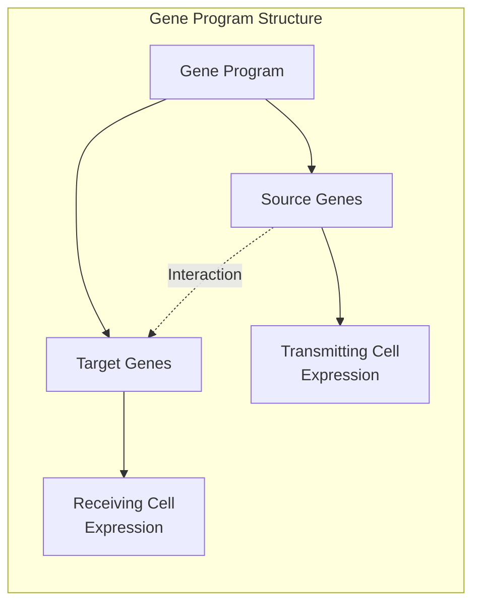
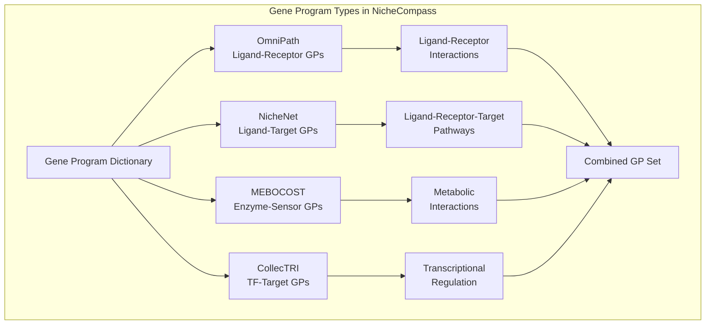
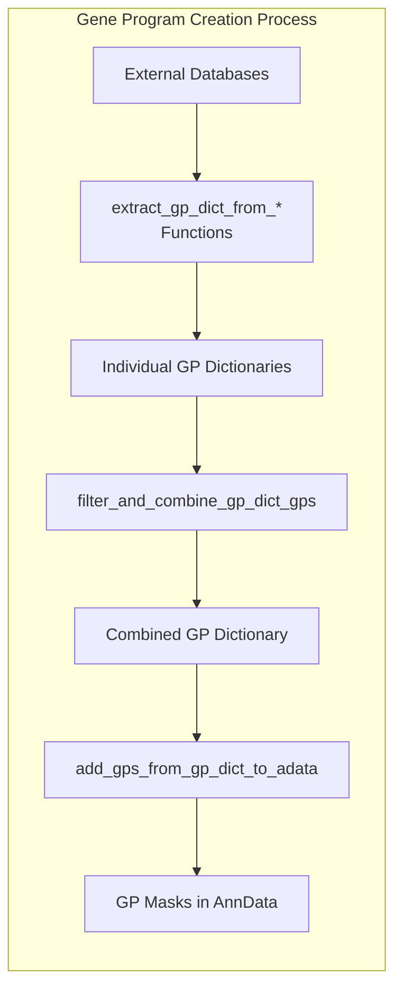
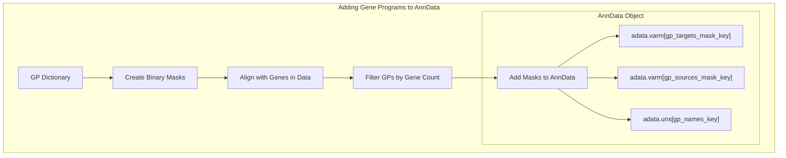
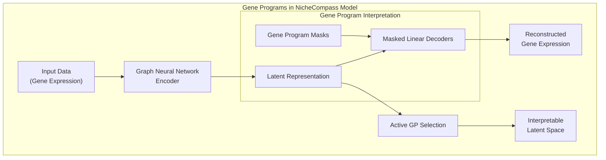
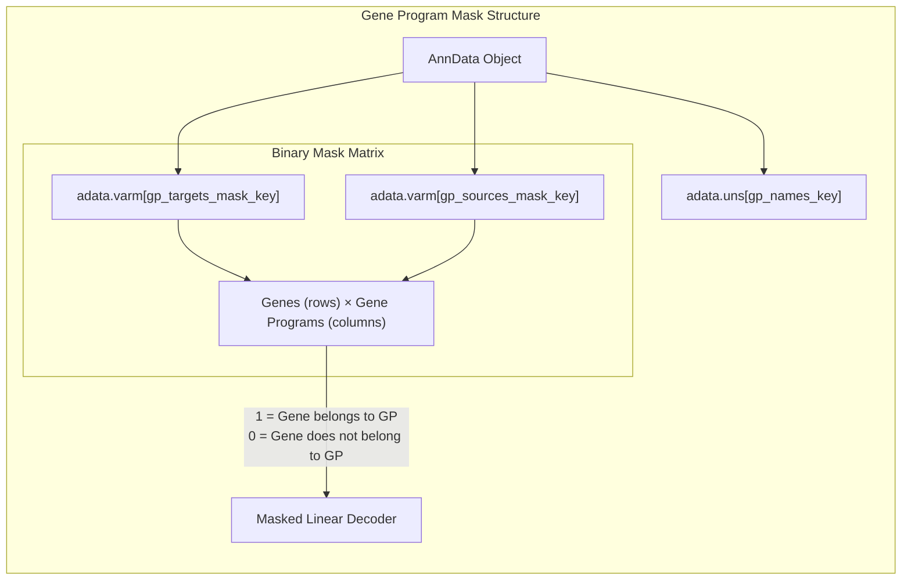
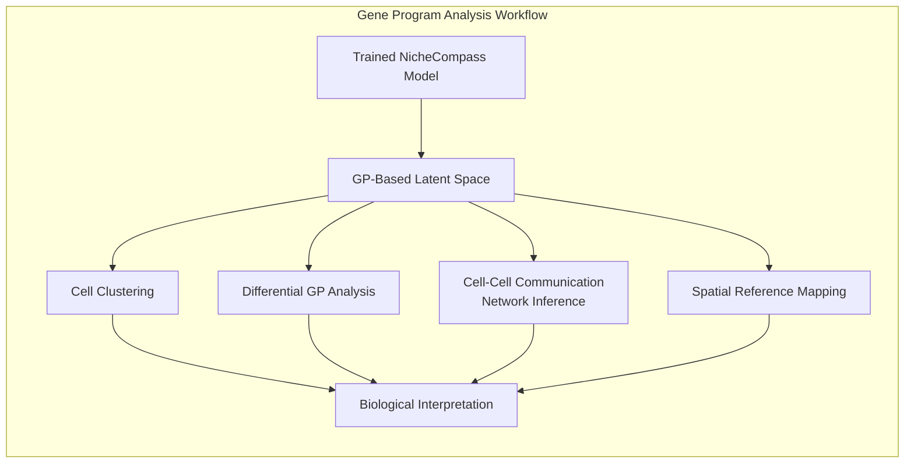

# Gene Programs

<details>
<summary>Relevant source files</summary>

The following files were used as context for generating this wiki page:

- [.readthedocs.yaml](.readthedocs.yaml)
- [docs/installation.md](docs/installation.md)
- [docs/tutorials/notebooks/mouse_brain_multimodal.ipynb](docs/tutorials/notebooks/mouse_brain_multimodal.ipynb)
- [docs/tutorials/notebooks/mouse_cns_sample_integration.ipynb](docs/tutorials/notebooks/mouse_cns_sample_integration.ipynb)
- [docs/tutorials/notebooks/mouse_cns_single_sample.ipynb](docs/tutorials/notebooks/mouse_cns_single_sample.ipynb)
- [docs/tutorials/notebooks/mouse_cns_spatial_reference_mapping.ipynb](docs/tutorials/notebooks/mouse_cns_spatial_reference_mapping.ipynb)
- [environment.yaml](environment.yaml)
- [src/nichecompass/__init__.py](src/nichecompass/__init__.py)
- [src/nichecompass/benchmarking/__init__.py](src/nichecompass/benchmarking/__init__.py)
- [src/nichecompass/benchmarking/clisis.py](src/nichecompass/benchmarking/clisis.py)
- [src/nichecompass/data/__init__.py](src/nichecompass/data/__init__.py)
- [src/nichecompass/models/nichecompass.py](src/nichecompass/models/nichecompass.py)
- [src/nichecompass/train/trainer.py](src/nichecompass/train/trainer.py)
- [src/nichecompass/utils/__init__.py](src/nichecompass/utils/__init__.py)
- [src/nichecompass/utils/gene_programs.py](src/nichecompass/utils/gene_programs.py)
- [src/nichecompass/utils/utils.py](src/nichecompass/utils/utils.py)

</details>


## Purpose and Scope

This document describes the Gene Programs component of NicheCompass, which provides a biologically interpretable foundation for analyzing spatial multi-omics data. Gene Programs are sets of functionally related genes derived from prior biological knowledge that NicheCompass uses to make its latent space interpretable and to understand cellular interactions in spatial context.

For information about how Gene Programs integrate with the core model architecture, see [Core Model](#2.1). For multimodal applications involving chromatin accessibility, see [Multimodal Integration](#2.3).

## What are Gene Programs?

Gene Programs (GPs) in NicheCompass represent collections of functionally related genes that participate in specific biological pathways or processes. Unlike general gene sets, NicheCompass's Gene Programs are designed to capture interactions between cells by distinguishing between:

1. **Source genes**: Genes expressed in transmitting/signaling cells (e.g., ligands, enzymes)
2. **Target genes**: Genes expressed in receiving cells (e.g., receptors, targets of transcription factors)

This source-target relationship makes Gene Programs particularly suitable for studying cell-cell communication in spatial data.



Sources: [src/nichecompass/utils/gene_programs.py:40-121]()

## Types of Gene Programs

NicheCompass supports several types of biologically informed Gene Programs, each capturing different aspects of cellular communication:

| Gene Program Type | Source Genes | Target Genes | Biological Focus |
|-------------------|--------------|--------------|------------------|
| OmniPath | Ligands | Receptors | Direct cell-cell communication via ligand-receptor pairs |
| NicheNet | Ligands | Receptors + Target genes | Extended pathway from ligand-receptor to downstream effects |
| MEBOCOST | Enzymes | Sensors | Metabolic interactions |
| CollecTRI | - | Transcription factors + Target genes | Transcriptional regulation networks |

These Gene Programs can be used individually or combined to provide a comprehensive framework for understanding different types of cellular interactions.



Sources: [docs/tutorials/notebooks/mouse_brain_multimodal.ipynb:322-428](), [docs/tutorials/notebooks/mouse_cns_single_sample.ipynb:299-405]()

## Gene Program Creation

NicheCompass provides utility functions to extract Gene Programs from various databases. The extraction process typically involves:

1. Retrieving interaction data from a database
2. Converting gene names to a standardized format
3. Structuring the data into a Gene Program dictionary
4. Combining and filtering Gene Programs from different sources



The major utility functions for Gene Program creation include:

- `extract_gp_dict_from_omnipath_lr_interactions()`: Creates ligand-receptor GPs from OmniPath
- `extract_gp_dict_from_nichenet_lrt_interactions()`: Creates ligand-target GPs from NicheNet
- `extract_gp_dict_from_mebocost_ms_interactions()`: Creates enzyme-sensor GPs from MEBOCOST
- `extract_gp_dict_from_collectri_tf_network()`: Creates transcription factor GPs from CollecTRI
- `filter_and_combine_gp_dict_gps_v2()`: Combines and filters GPs from multiple sources

Each Gene Program is structured as a dictionary entry with the following format:

```
"GP_Name": {
    "sources": ["GeneA", "GeneB", ...],  # Source genes (e.g., ligands)
    "targets": ["GeneC", "GeneD", ...],  # Target genes (e.g., receptors)
    "sources_categories": ["CategoryA", ...],  # Categories for source genes
    "targets_categories": ["CategoryB", ...]   # Categories for target genes
}
```

Sources: [src/nichecompass/utils/gene_programs.py:683-1193](), [docs/tutorials/notebooks/mouse_cns_single_sample.ipynb:299-405]()

## Adding Gene Programs to Data

Once created, Gene Programs need to be added to the AnnData object used by NicheCompass. This is done using the `add_gps_from_gp_dict_to_adata` function, which:

1. Converts Gene Programs into binary masks for sources and targets
2. Aligns these masks with genes present in the expression data
3. Filters Gene Programs based on minimum and maximum gene criteria
4. Adds the masks to the AnnData object as sparse matrices



Key parameters for adding Gene Programs:

- `min_genes_per_gp`: Minimum number of genes required in a GP
- `min_source_genes_per_gp`: Minimum number of source genes required
- `min_target_genes_per_gp`: Minimum number of target genes required
- `max_genes_per_gp`: Maximum number of genes allowed in a GP

These parameters help ensure that the Gene Programs included in the analysis have sufficient biological relevance and are well-represented in the dataset.

Sources: [src/nichecompass/utils/gene_programs.py:18-168](), [docs/tutorials/notebooks/mouse_cns_single_sample.ipynb:467-484]()

## Gene Programs in the NicheCompass Model

Gene Programs form a core component of the NicheCompass model architecture. They provide a biologically interpretable structure to the latent space through the use of linear masked decoders.



Key aspects of how Gene Programs are used in the model:

1. **Initialization**: Gene Programs are provided to the model as binary masks during initialization
2. **Active GP Selection**: During training, NicheCompass identifies which Gene Programs are most informative using an activation threshold ratio
3. **Latent Representation**: The latent space of the model can be interpreted in terms of Gene Program activities
4. **Gene Expression Reconstruction**: Masked linear decoders use Gene Programs to reconstruct gene expression patterns
5. **Cell-Cell Communication**: The source-target structure of Gene Programs allows inference of cell-cell communication

Sources: [src/nichecompass/models/nichecompass.py:24-188](), [docs/tutorials/notebooks/mouse_brain_multimodal.ipynb:782-813]()

## Implementation Details

### Gene Program Masks

The Gene Program information is stored in the AnnData object as binary masks:

- `adata.varm[gp_targets_mask_key]`: Binary matrix (genes × gene programs) for target genes
- `adata.varm[gp_sources_mask_key]`: Binary matrix (genes × gene programs) for source genes
- `adata.uns[gp_names_key]`: List of Gene Program names

These masks define which genes belong to which Gene Programs, allowing the model to use this structured prior knowledge during training.



Sources: [src/nichecompass/utils/gene_programs.py:179-257]()

### Active Gene Programs

During model training, NicheCompass identifies which Gene Programs are most informative for explaining the data using an activation threshold:

```python
active_gp_thresh_ratio = 0.01  # Example threshold
```

Gene Programs with aggregated decoder weights below this threshold (relative to the maximum) are considered inactive and are dropped from the final latent representation. This helps focus the analysis on the most relevant biological pathways.

The active Gene Programs are stored in:
- `adata.uns[active_gp_names_key]`: List of active Gene Program names
- `adata.obsm[latent_key]`: Latent representation limited to active Gene Programs

Sources: [src/nichecompass/models/nichecompass.py:134-147](), [docs/tutorials/notebooks/mouse_cns_single_sample.ipynb:133-159]()

## Using Gene Programs for Analysis

After training a NicheCompass model, the Gene Program-based latent space can be used for various analyses:

1. **Niche Identification**: Clustering cells based on their Gene Program activities
2. **Cell-Cell Communication**: Analyzing which cell types communicate through which Gene Programs
3. **Differential Gene Program Analysis**: Identifying Gene Programs that are differentially active between conditions or cell types
4. **Spatial Mapping**: Using Gene Program activities for spatial reference mapping across samples

These analyses leverage the biological interpretability of Gene Programs to provide meaningful insights into cell-cell interactions in spatial context.



Sources: [docs/tutorials/notebooks/mouse_cns_single_sample.ipynb:682-937](), [docs/tutorials/notebooks/mouse_brain_multimodal.ipynb:855-949]()

## Customization and Extension

Users can customize Gene Programs based on their specific research questions:

1. **Custom Gene Program Definition**: Create your own Gene Program dictionary with source and target genes
2. **Gene Program Filtering**: Adjust filtering parameters to focus on specific pathways
3. **De Novo Gene Programs**: NicheCompass can learn additional Gene Programs not defined in prior knowledge
4. **Multimodal Gene Programs**: For multimodal data, Gene Programs can be extended to include chromatin accessibility features

This flexibility allows NicheCompass to be adapted to various biological systems and research questions.

Sources: [src/nichecompass/utils/gene_programs.py:675-1264](), [docs/tutorials/notebooks/mouse_brain_multimodal.ipynb:674-714]()

---