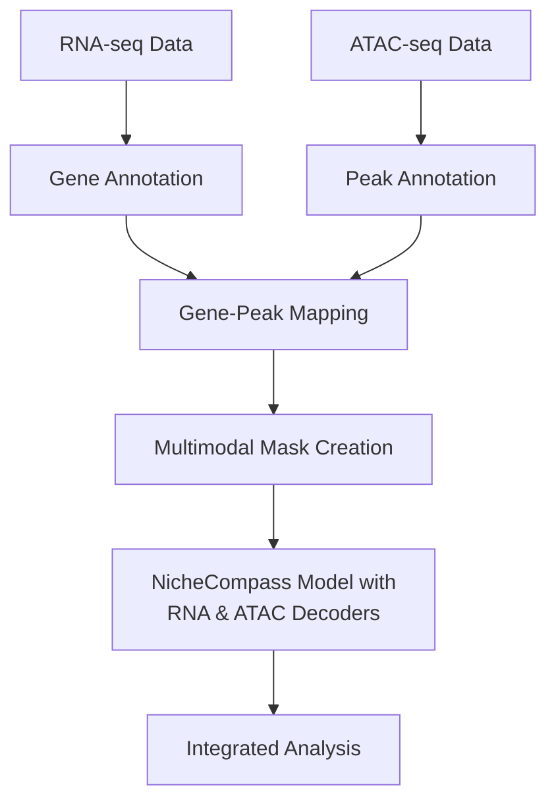
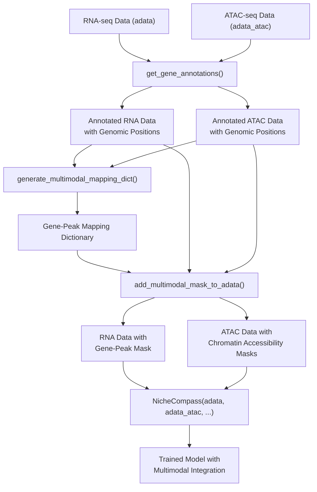
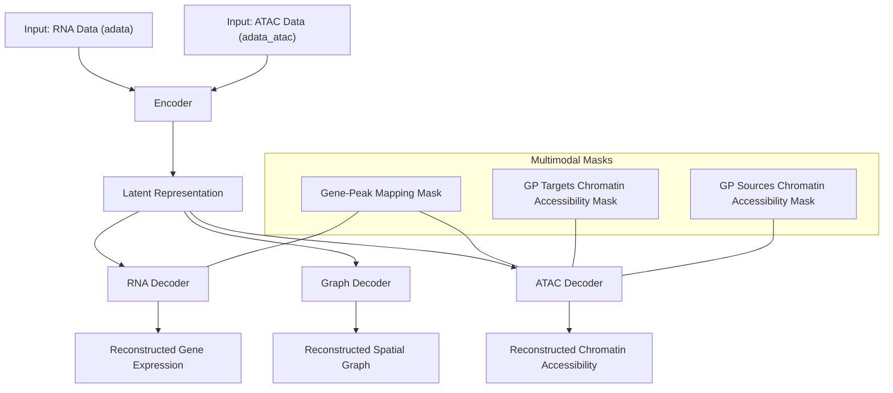

# Multimodal Integration

Relevant source files

The following files were used as context for generating this wiki page:

- [.readthedocs.yaml](.readthedocs.yaml)
- [docs/installation.md](docs/installation.md)
- [docs/tutorials/notebooks/mouse_brain_multimodal.ipynb](docs/tutorials/notebooks/mouse_brain_multimodal.ipynb)
- [docs/tutorials/notebooks/mouse_cns_sample_integration.ipynb](docs/tutorials/notebooks/mouse_cns_sample_integration.ipynb)
- [docs/tutorials/notebooks/mouse_cns_single_sample.ipynb](docs/tutorials/notebooks/mouse_cns_single_sample.ipynb)
- [docs/tutorials/notebooks/mouse_cns_spatial_reference_mapping.ipynb](docs/tutorials/notebooks/mouse_cns_spatial_reference_mapping.ipynb)
- [src/nichecompass/utils/multimodal_mapping.py](src/nichecompass/utils/multimodal_mapping.py)

This page describes NicheCompass's multimodal integration system, which enables joint analysis of RNA-seq (gene expression) and ATAC-seq (chromatin accessibility) data. The integration maps genomic peaks to genes based on their chromosomal proximity, allowing the model to incorporate both data types in its variational gene program graph autoencoder. For information about the core model architecture, see [Core Model](#2.1), and for details about gene programs, see [Gene Programs](#2.2).

## System Overview

The multimodal integration workflow connects RNA-seq and ATAC-seq data through genomic annotation and mapping, creating specialized masks that link gene programs with their corresponding chromatin accessibility regions.

Sources: [docs/tutorials/notebooks/mouse_brain_multimodal.ipynb:673-686](), [src/nichecompass/utils/multimodal_mapping.py:17-105]()

## Key Components and Functions

### Gene Annotation System

The `get_gene_annotations()` function adds genomic positions to genes and peaks by linking with a GTF annotation file. This creates the foundation for mapping between the two modalities.

| Parameter | Description |
|-----------|-------------|
| `adata` | AnnData RNA object for gene annotations |
| `adata_atac` | AnnData ATAC object to annotate |
| `gtf_file_path` | Path to GTF file with genomic positions |
| `drop_unannotated_genes` | Whether to remove genes without annotations |

### Gene-Peak Mapping

The `generate_multimodal_mapping_dict()` function builds a mapping between genes and peaks based on their genomic proximity, determining which peaks might influence which genes.

| Parameter | Description |
|-----------|-------------|
| `adata` | AnnData RNA object with genes as features |
| `adata_atac` | AnnData ATAC object with peaks as features |
| `gene_region` | Region to consider: "combined", "promoter", or "gene_body" |
| `promoter_len` | Length of promoter regions in base pairs |
| `extend_range` | Maximum distance for mapping in base pairs |

### Multimodal Mask Creation

The `add_multimodal_mask_to_adata()` function creates masks linking gene programs to corresponding peaks, which the model uses to integrate the modalities.

| Parameter | Description |
|-----------|-------------|
| `adata` | AnnData RNA object with gene program masks |
| `adata_atac` | AnnData ATAC object for peak masks |
| `gene_peak_mapping_dict` | Dictionary mapping genes to peaks |
| `filter_peaks_based_on_genes` | Whether to keep only peaks mapped to genes |
| `gp_targets_mask_key` | Key for target gene program mask |
| `gp_sources_mask_key` | Key for source gene program mask |
| `ca_targets_mask_key` | Key for target chromatin accessibility mask |
| `ca_sources_mask_key` | Key for source chromatin accessibility mask |

Sources: [src/nichecompass/utils/multimodal_mapping.py:107-193](), [src/nichecompass/utils/multimodal_mapping.py:196-382]()

## Integration Workflow

The following diagram illustrates the detailed multimodal integration process:

Sources: [docs/tutorials/notebooks/mouse_brain_multimodal.ipynb:595-714]()

## Integration with the NicheCompass Model

This diagram shows how multimodal data is processed within the NicheCompass model architecture:

Sources: [docs/tutorials/notebooks/mouse_brain_multimodal.ipynb:774-800]()

## Step-by-Step Analysis Workflow

1. **Data Loading and Preprocessing**:
   - Load RNA-seq and ATAC-seq data as AnnData objects
   - Filter genes and peaks based on quality metrics and spatial variability

2. **Gene Program Creation**:
   - Create gene program masks from prior knowledge databases
   - Define target and source genes for each gene program

3. **Gene and Peak Annotation**:
   - Add chromosomal positions to genes and peaks using a GTF file

4. **Gene-Peak Mapping**:
   - Create mapping between genes and peaks based on genomic proximity
   - Consider promoters and gene bodies for mapping

5. **Multimodal Mask Creation**:
   - Create chromatin accessibility masks linking gene programs to peaks

6. **Model Training**:
   - Initialize NicheCompass with RNA-seq and ATAC-seq data
   - Train to integrate both modalities

7. **Integrated Analysis**:
   - Analyze the integrated data to gain biological insights

| Step | Description | Function/Method |
|------|-------------|----------------|
| 1 | Load data | `sc.read_h5ad()` |
| 2 | Create gene program masks | `add_gps_from_gp_dict_to_adata()` |
| 3 | Annotate genes and peaks | `get_gene_annotations()` |
| 4 | Create gene-peak mapping | `generate_multimodal_mapping_dict()` |
| 5 | Create multimodal masks | `add_multimodal_mask_to_adata()` |
| 6 | Initialize model | `NicheCompass(adata, adata_atac, ...)` |
| 7 | Train model | `model.train()` |

Sources: [docs/tutorials/notebooks/mouse_brain_multimodal.ipynb:452-535](), [docs/tutorials/notebooks/mouse_brain_multimodal.ipynb:595-714](), [docs/tutorials/notebooks/mouse_brain_multimodal.ipynb:774-847]()

## Example: Mouse Brain Multimodal Analysis

The mouse_brain_multimodal.ipynb tutorial demonstrates multimodal analysis of a postnatal day 22 coronal section from a spatial ATAC-RNA-seq mouse brain dataset (Zhang et al., 2023).

Dataset characteristics:
- 9,215 observations at spot resolution
- 22,914 probed genes
- 121,068 called peaks

The workflow includes:
1. Creating gene program masks from knowledge databases (OmniPath, NicheNet, MEBOCOST, CollecTRI)
2. Filtering spatially variable genes (3,000) and peaks (15,000)
3. Annotating genes and peaks with genomic positions
4. Creating a gene-peak mapping based on proximity
5. Adding multimodal masks to connect gene programs with corresponding peaks
6. Training a NicheCompass model with both modalities
7. Analyzing integrated results for spatial gene regulation insights

This example shows how NicheCompass integrates spatial RNA-seq and ATAC-seq data to understand relationships between chromatin accessibility and gene expression in spatial context.

Sources: [docs/tutorials/notebooks/mouse_brain_multimodal.ipynb:29-34](), [docs/tutorials/notebooks/mouse_brain_multimodal.ipynb:132-143](), [docs/tutorials/notebooks/mouse_brain_multimodal.ipynb:532-714]()

---