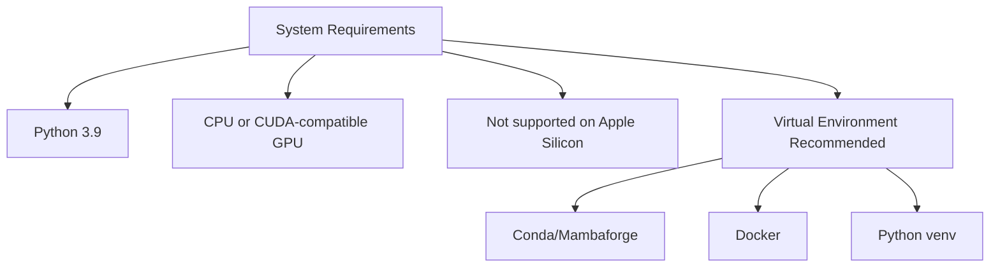
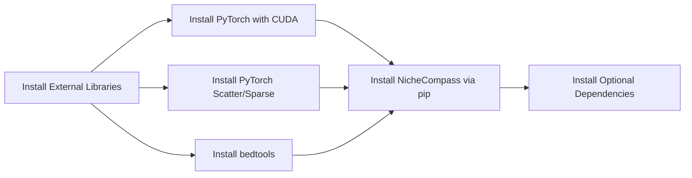
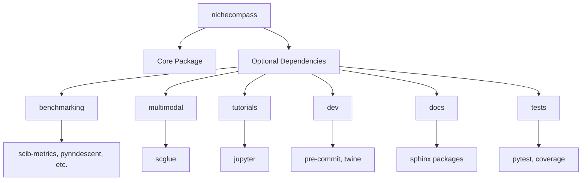
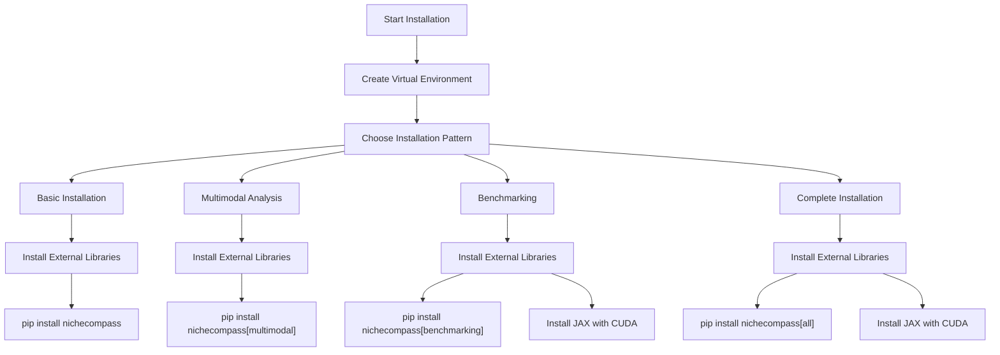
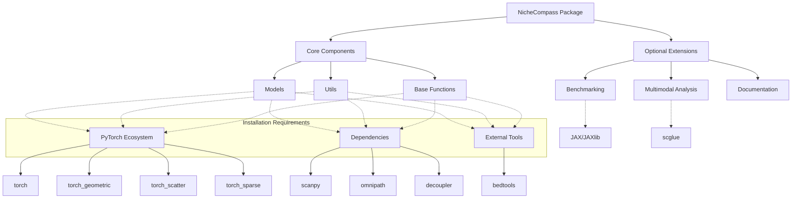

# Installation

<details>
<summary>Relevant source files</summary>

The following files were used as context for generating this wiki page:

- [.github/actions/setup/action.yaml](.github/actions/setup/action.yaml)
- [.readthedocs.yaml](.readthedocs.yaml)
- [docs/index.md](docs/index.md)
- [docs/installation.md](docs/installation.md)
- [docs/release_notes/index.md](docs/release_notes/index.md)
- [docs/tutorials/notebooks/mouse_brain_multimodal.ipynb](docs/tutorials/notebooks/mouse_brain_multimodal.ipynb)
- [docs/tutorials/notebooks/mouse_cns_sample_integration.ipynb](docs/tutorials/notebooks/mouse_cns_sample_integration.ipynb)
- [docs/tutorials/notebooks/mouse_cns_single_sample.ipynb](docs/tutorials/notebooks/mouse_cns_single_sample.ipynb)
- [docs/tutorials/notebooks/mouse_cns_spatial_reference_mapping.ipynb](docs/tutorials/notebooks/mouse_cns_spatial_reference_mapping.ipynb)
- [docs/user_guide/index.md](docs/user_guide/index.md)
- [pyproject.toml](pyproject.toml)
- [src/nichecompass/utils/analysis.py](src/nichecompass/utils/analysis.py)
- [tests/test_basic.py](tests/test_basic.py)

</details>


This document provides instructions for installing NicheCompass, a Python package for end-to-end analysis of spatial multi-omics data. For information about the overall architecture and system design, see [Architecture](#2).

## System Requirements

NicheCompass is compatible with Python 3.9 and does not currently support Apple silicon. The package requires several external dependencies, particularly PyTorch-related libraries which may need GPU support for optimal performance.



Sources: [pyproject.toml:10-11](). [docs/installation.md:1-8]()

## Installation Methods

NicheCompass can be installed using pip after setting up the required external dependencies. We recommend using a virtual environment like conda or Docker rather than your system Python.

### Method 1: Using pip



Sources: [docs/installation.md:56-66]()

### Method 2: Using conda environment


Sources: [docs/installation.md:39-43]()

## External Libraries Setup

Before installing NicheCompass, you'll need to set up several external libraries:

### PyTorch and PyTorch Extensions

Install PyTorch with appropriate CUDA support if available:

```bash
pip install torch==${TORCH}+${CUDA} --extra-index-url https://download.pytorch.org/whl/${CUDA}
pip install pyg_lib torch_scatter torch_sparse -f https://data.pyg.org/whl/torch-${TORCH}+${CUDA}.html
```

For example, for PyTorch 2.0.0 and CUDA 11.7:

```bash
pip install torch==2.0.0+cu117 --extra-index-url https://download.pytorch.org/whl/cu117
pip install pyg_lib torch_scatter torch_sparse -f https://data.pyg.org/whl/torch-2.0.0+cu117.html
```

### bedtools

Install bedtools using conda:

```bash
conda install bedtools=2.30.0 -c bioconda
```

Sources: [docs/installation.md:12-37](), [.github/actions/setup/action.yaml:30-43]()

## NicheCompass Installation

### Basic Installation

After setting up the external libraries, install NicheCompass via pip:

```bash
pip install nichecompass
```

### Optional Dependencies

NicheCompass provides several optional dependency groups for different functionalities:



Install all optional dependencies:

```bash
pip install nichecompass[all]
```

Or install specific dependency groups:

```bash
pip install nichecompass[benchmarking,multimodal,tutorials]
```

Sources: [pyproject.toml:29-81](), [docs/installation.md:63-66]()

## Package Dependencies

The following table shows the core dependencies required by NicheCompass:

| Dependency | Version Requirement |
|------------|---------------------|
| mlflow | >=1.28.0 |
| pyreadr | >=0.4.6 |
| scanpy | >=1.9.3,<1.10.0 |
| torch-geometric | >=2.2.0 |
| omnipath | >=1.0.7 |
| decoupler | >=1.4.0 |
| numpy | <2 |

Sources: [pyproject.toml:29-37]()

## JAX GPU Support (Optional)

For enabling GPU support for JAX (used in benchmarking), run:

```bash
pip install jaxlib==0.4.7+cuda11.cudnn86 -f https://storage.googleapis.com/jax-releases/jax_cuda_releases.html
```

Replace with the appropriate CUDA version as needed.

Sources: [docs/installation.md:45-53](), [pyproject.toml:67-74]()

## Verification

After installation, you can verify that NicheCompass is properly installed by running:

```python
import nichecompass
print(nichecompass.__version__)
```

The output should match the version you installed.

Sources: [tests/test_basic.py:1-7]()

## Common Installation Patterns

The following diagram illustrates common installation patterns depending on your needs:



Sources: [docs/installation.md:1-73](), [docs/tutorials/notebooks/mouse_brain_multimodal.ipynb:42-49](), [docs/tutorials/notebooks/mouse_cns_single_sample.ipynb:39-43]()

## Package Structure and Components

The following diagram shows how the installation fits into the overall NicheCompass system architecture:



Sources: [pyproject.toml:29-81](), [docs/installation.md:12-37]()

---