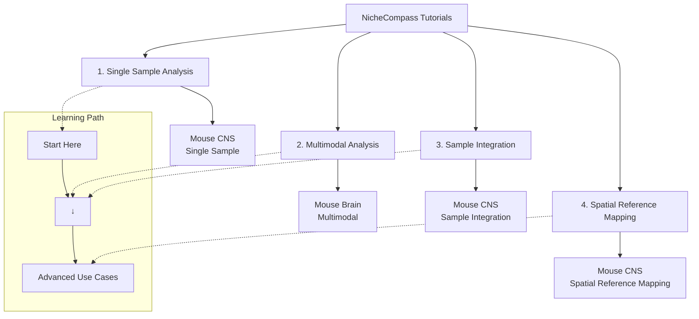
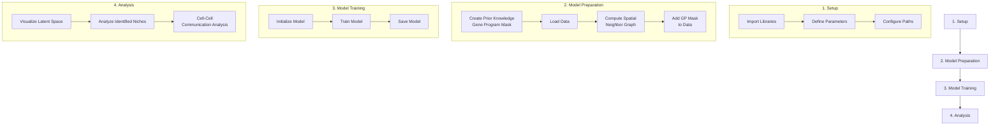
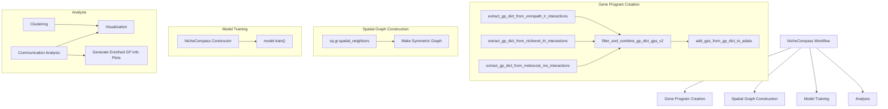
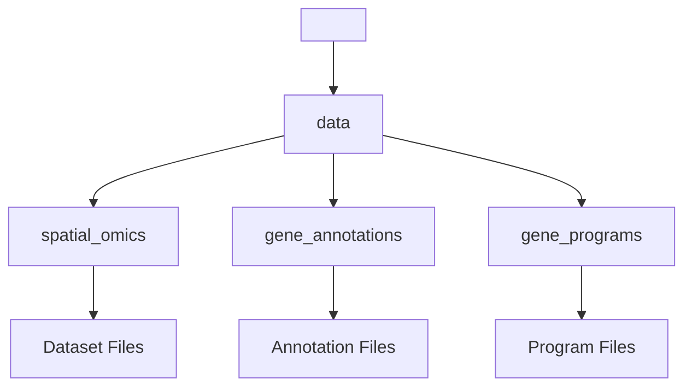
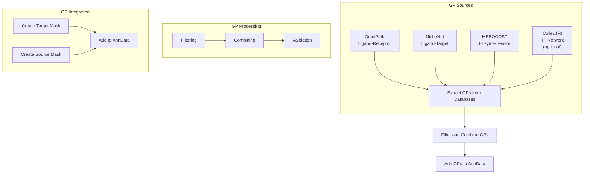
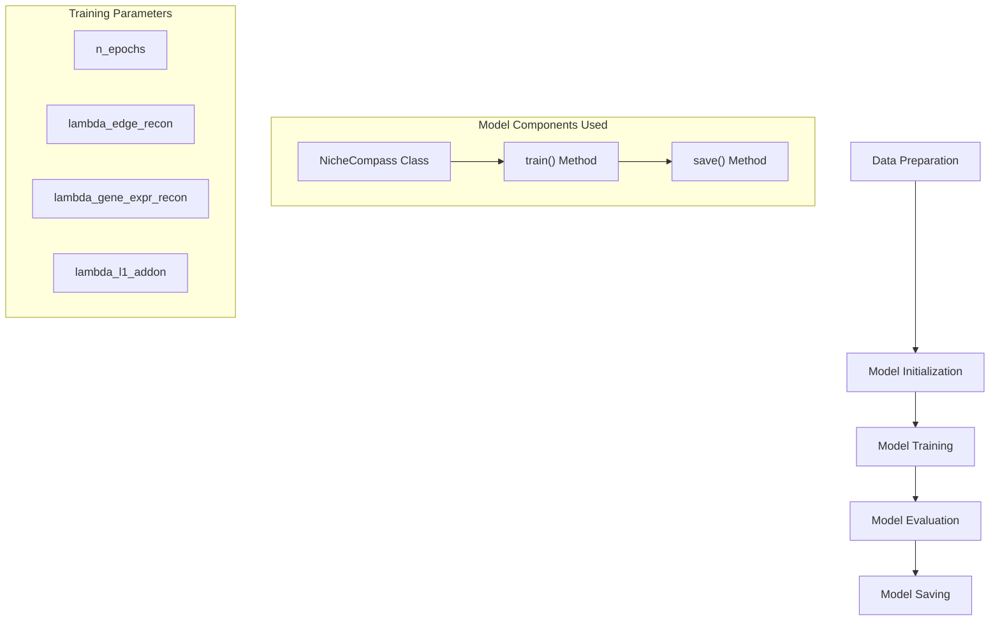

# Tutorials

<details>
<summary>Relevant source files</summary>

The following files were used as context for generating this wiki page:

- [.readthedocs.yaml](.readthedocs.yaml)
- [docs/conf.py](docs/conf.py)
- [docs/installation.md](docs/installation.md)
- [docs/tutorials/multimodal_tutorials.md](docs/tutorials/multimodal_tutorials.md)
- [docs/tutorials/notebooks/mouse_brain_multimodal.ipynb](docs/tutorials/notebooks/mouse_brain_multimodal.ipynb)
- [docs/tutorials/notebooks/mouse_cns_sample_integration.ipynb](docs/tutorials/notebooks/mouse_cns_sample_integration.ipynb)
- [docs/tutorials/notebooks/mouse_cns_single_sample.ipynb](docs/tutorials/notebooks/mouse_cns_single_sample.ipynb)
- [docs/tutorials/notebooks/mouse_cns_spatial_reference_mapping.ipynb](docs/tutorials/notebooks/mouse_cns_spatial_reference_mapping.ipynb)
- [docs/tutorials/sample_integration_tutorials.md](docs/tutorials/sample_integration_tutorials.md)
- [docs/tutorials/single_sample_tutorials.md](docs/tutorials/single_sample_tutorials.md)
- [docs/tutorials/spatial_reference_mapping_tutorials.md](docs/tutorials/spatial_reference_mapping_tutorials.md)

</details>


This page provides an overview of the available tutorials for NicheCompass and suggests a learning path for new users. Each tutorial demonstrates key aspects of the NicheCompass framework for analyzing spatial multi-omics data, including spatial atlas building, niche identification, cell-cell communication inference, and spatial reference mapping.

## Available Tutorials

NicheCompass offers four main tutorial categories, each showcasing different capabilities of the framework:



Sources: [docs/tutorials/single_sample_tutorials.md](), [docs/tutorials/multimodal_tutorials.md](), [docs/tutorials/sample_integration_tutorials.md](), [docs/tutorials/spatial_reference_mapping_tutorials.md]()

### 1. Single Sample Analysis

These tutorials demonstrate how to analyze a single spatial transcriptomics sample with NicheCompass. This is the recommended starting point for new users as it covers the core workflow and fundamental concepts.

**Available tutorial: Mouse CNS Single Sample**  
Analyzes a single sagittal brain section from the STARmap PLUS mouse central nervous system dataset.

Sources: [docs/tutorials/notebooks/mouse_cns_single_sample.ipynb]()

### 2. Multimodal Analysis

These tutorials demonstrate how to analyze multimodal data (RNA-seq and ATAC-seq) with NicheCompass, showing how the framework can integrate multiple omics layers.

**Available tutorial: Mouse Brain Multimodal**  
Analyzes a single multimodal sample (postnatal day 22 coronal section) from the spatial ATAC-RNA-seq mouse brain dataset.

Sources: [docs/tutorials/notebooks/mouse_brain_multimodal.ipynb]()

### 3. Sample Integration

These tutorials demonstrate how to integrate multiple spatial transcriptomics samples using NicheCompass, allowing for comparative analyses across samples.

**Available tutorial: Mouse CNS Sample Integration**  
Integrates three sagittal brain sections from the STARmap PLUS mouse central nervous system dataset.

Sources: [docs/tutorials/notebooks/mouse_cns_sample_integration.ipynb]()

### 4. Spatial Reference Mapping

These tutorials demonstrate how to perform spatial reference mapping across multiple samples, where a model is first trained on reference samples and then a query sample is mapped onto the reference.

**Available tutorial: Mouse CNS Spatial Reference Mapping**  
Uses two sagittal brain sections as reference samples and maps a third section as a query sample.

Sources: [docs/tutorials/notebooks/mouse_cns_spatial_reference_mapping.ipynb]()

## Tutorial Components and Workflow

All tutorials follow a similar structure and workflow, as illustrated below:



Sources: [docs/tutorials/notebooks/mouse_cns_single_sample.ipynb:51-620](), [docs/tutorials/notebooks/mouse_brain_multimodal.ipynb:51-848]()

## Key NicheCompass Components Used in Tutorials

The following diagram illustrates the key components of NicheCompass that are used in the tutorials:



Sources: [docs/tutorials/notebooks/mouse_cns_single_sample.ipynb:300-405](), [docs/tutorials/notebooks/mouse_brain_multimodal.ipynb:301-456](), [docs/tutorials/notebooks/mouse_cns_single_sample.ipynb:547-580]()

## Setting Up the Tutorial Environment

### Installation

Before running the tutorials, you need to have NicheCompass properly installed. The installation section of the documentation provides detailed instructions.

For a quick installation, you can use:

```
pip install nichecompass[all]
```

The `[all]` suffix installs optional dependencies required for running the tutorials.

Sources: [docs/installation.md:57-66]()

### Data Download

Each tutorial requires specific data files that can be downloaded from Google Drive. The tutorials include code for automatic download, or you can manually download the data to the expected directory structure:



For manual download, follow the instructions in each tutorial notebook.

Sources: [docs/tutorials/notebooks/mouse_cns_single_sample.ipynb:38-54](), [docs/tutorials/notebooks/mouse_brain_multimodal.ipynb:38-54]()

### Common Setup Steps

All tutorials begin with similar setup steps:

1. Import necessary libraries
2. Define parameters
3. Configure paths
4. Create required directories
5. Download data files (if not already done)

These steps ensure the environment is properly prepared for running the tutorial.

Sources: [docs/tutorials/notebooks/mouse_cns_single_sample.ipynb:69-261](), [docs/tutorials/notebooks/mouse_brain_multimodal.ipynb:74-282]()

## Gene Program Creation Process

A central component in all tutorials is the creation of gene programs (GPs) from prior knowledge. This process follows these steps:



Sources: [docs/tutorials/notebooks/mouse_cns_single_sample.ipynb:300-485](), [docs/tutorials/notebooks/mouse_brain_multimodal.ipynb:324-668]()

## Model Training Process

Each tutorial demonstrates the model training process with NicheCompass:



Sources: [docs/tutorials/notebooks/mouse_cns_single_sample.ipynb:547-611](), [docs/tutorials/notebooks/mouse_brain_multimodal.ipynb:784-847]()

## Analysis Workflow

After training, each tutorial demonstrates how to analyze the results:

1. Load the trained model (or use the model from training)
2. Visualize the latent space representations
3. Identify niches or cell types
4. Analyze cell-cell communication

The specific analyses vary between tutorials based on the use case.

Sources: [docs/tutorials/notebooks/mouse_cns_single_sample.ipynb:620-900](), [docs/tutorials/notebooks/mouse_brain_multimodal.ipynb:855-1900]()

## Adapting Tutorials for Custom Data

While the tutorials use specific datasets, they can be adapted for custom data by:

1. Preparing your data in AnnData format
2. Adjusting parameters to match your dataset characteristics
3. Following the same workflow steps

You'll need to ensure your data contains:
- Spatial coordinates
- Gene expression counts
- (Optionally) Cell type annotations for evaluation
- (For multimodal analysis) Corresponding ATAC-seq data

## Suggested Learning Path

1. **Start with Single Sample Analysis**: Begin with the Mouse CNS Single Sample tutorial to understand the basic workflow and concepts.

2. **Explore Multimodal or Sample Integration**: Depending on your data, continue with either the Multimodal Analysis tutorial (if you have multi-omics data) or the Sample Integration tutorial (if you have multiple samples).

3. **Advanced: Spatial Reference Mapping**: Once familiar with the framework, explore the Spatial Reference Mapping tutorial for more advanced use cases.

Each tutorial builds on concepts from the previous ones, so following this order is recommended for new users.

## Computational Requirements

The tutorials are designed to run on systems with GPU acceleration, but can also run on CPU-only systems (with longer execution times). The specific requirements vary by tutorial:

| Tutorial | Memory Requirement | GPU Memory | Approx. Runtime (GPU) | Approx. Runtime (CPU) |
|----------|-------------------|------------|----------------------|----------------------|
| Single Sample | 16GB+ | 8GB+ | 1-2 hours | 5-8 hours |
| Multimodal | 32GB+ | 16GB+ | 2-4 hours | 10-15 hours |
| Sample Integration | 32GB+ | 16GB+ | 3-5 hours | 12-24 hours |
| Spatial Reference Mapping | 32GB+ | 16GB+ | 4-6 hours | 15-30 hours |

For users with limited computational resources, each tutorial provides pre-trained models that can be used to run only the analysis sections.

Sources: [docs/tutorials/notebooks/mouse_cns_single_sample.ipynb:41-54](), [docs/tutorials/notebooks/mouse_brain_multimodal.ipynb:41-54]()

---