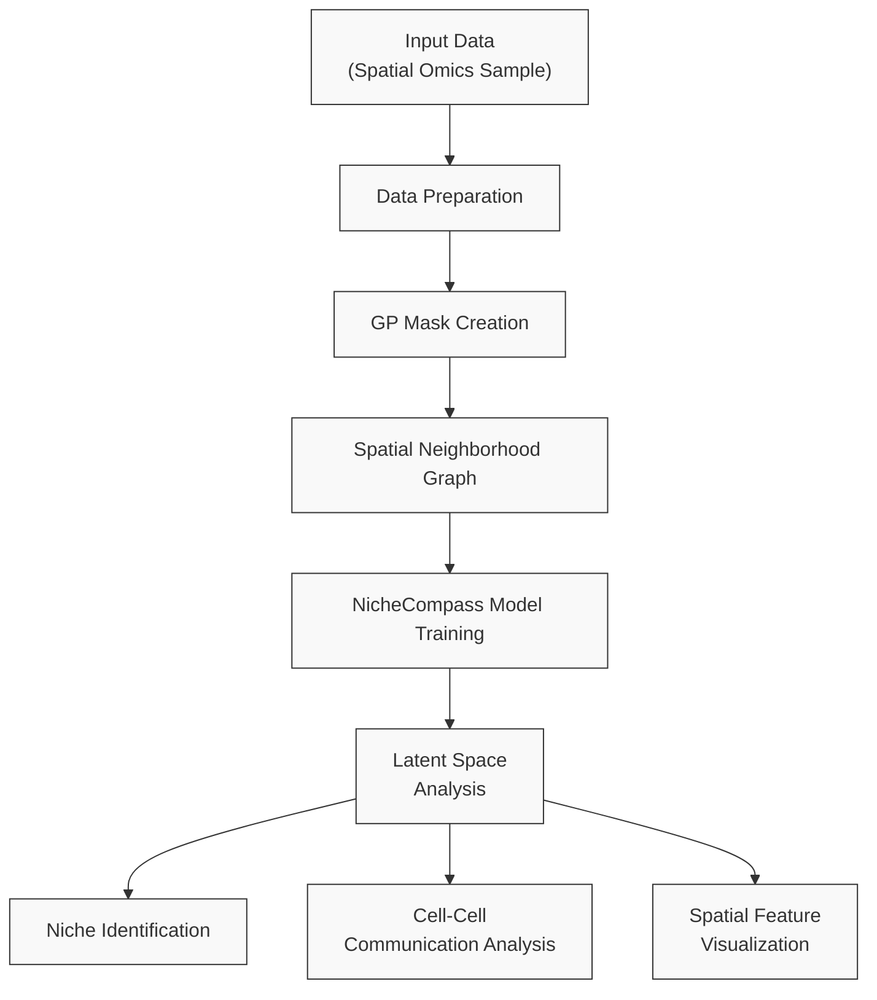
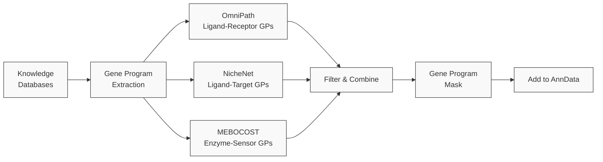
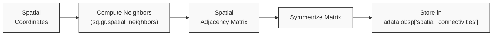
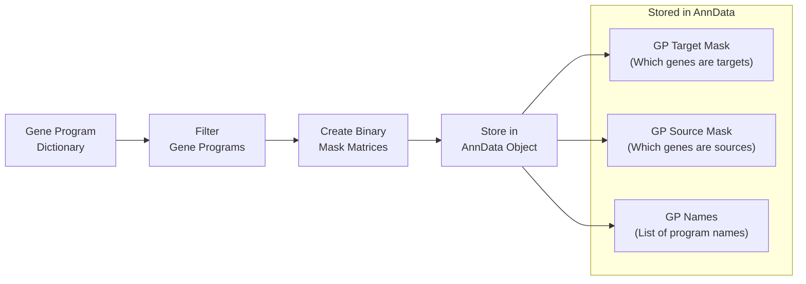
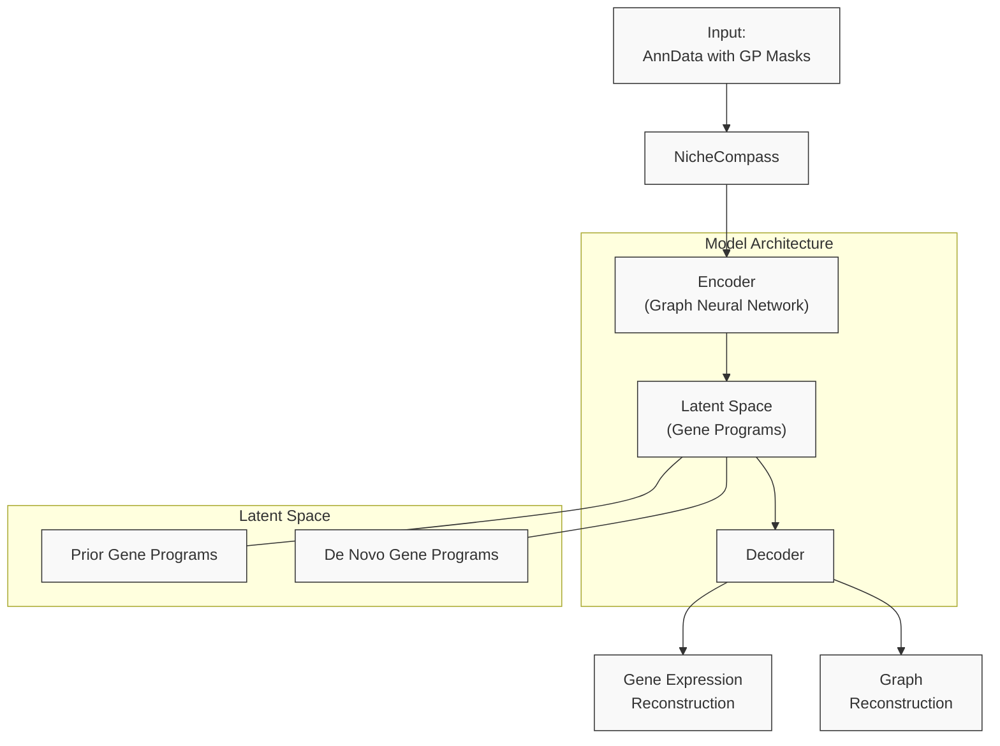
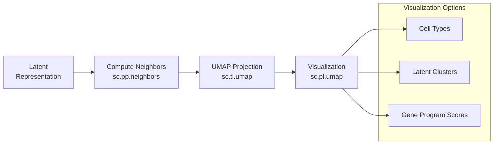
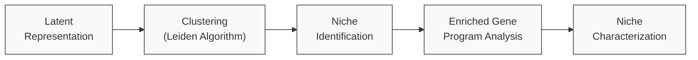
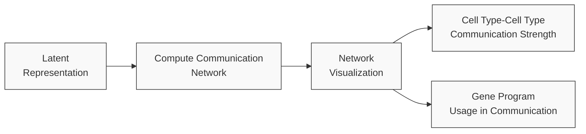

# Single Sample Analysis

<details>
<summary>Relevant source files</summary>

The following files were used as context for generating this wiki page:

- [.readthedocs.yaml](.readthedocs.yaml)
- [docs/installation.md](docs/installation.md)
- [docs/tutorials/notebooks/mouse_brain_multimodal.ipynb](docs/tutorials/notebooks/mouse_brain_multimodal.ipynb)
- [docs/tutorials/notebooks/mouse_cns_sample_integration.ipynb](docs/tutorials/notebooks/mouse_cns_sample_integration.ipynb)
- [docs/tutorials/notebooks/mouse_cns_single_sample.ipynb](docs/tutorials/notebooks/mouse_cns_single_sample.ipynb)
- [docs/tutorials/notebooks/mouse_cns_spatial_reference_mapping.ipynb](docs/tutorials/notebooks/mouse_cns_spatial_reference_mapping.ipynb)

</details>


This page describes the workflow for analyzing a single spatial omics sample using NicheCompass. Single sample analysis is the foundational use case for NicheCompass and provides a starting point for understanding cell niches and cell-cell communication within a single tissue section. For analyzing multiple samples, refer to [Sample Integration](#4.3) or [Spatial Reference Mapping](#4.4).

## Overview

NicheCompass enables comprehensive analysis of a single spatial omics sample through gene program (GP)-based modeling, providing insights into spatial relationships, cell-cell communication, and niche identification. The single sample analysis workflow consists of several key steps, from data preparation to visualizing results.



Sources: [docs/tutorials/notebooks/mouse_cns_single_sample.ipynb:26-32](), [docs/tutorials/notebooks/mouse_cns_single_sample.ipynb:608-619]()

## Data Requirements

For single sample analysis, NicheCompass requires:

1. A spatial omics dataset in AnnData format containing:
   - Expression count matrix
   - Spatial coordinates
   - Optionally cell type annotations

2. A gene program (GP) definition, either:
   - User-supplied gene program definitions
   - Automatically created from predefined databases

### Input Data Structure

The input data should conform to the following structure:

| Component | Description | Location in AnnData |
|-----------|-------------|---------------------|
| Expression counts | Raw or normalized gene expression values | `adata.layers["counts"]` |
| Spatial coordinates | 2D or 3D coordinates of each cell/spot | `adata.obsm["spatial"]` |
| Cell type annotations (optional) | Cell type labels | `adata.obs["cell_type"]` |

Sources: [docs/tutorials/notebooks/mouse_cns_single_sample.ipynb:114-161](), [docs/tutorials/notebooks/mouse_cns_single_sample.ipynb:430-434]()

## Workflow Steps

### 1. Creating Prior Knowledge Gene Program Mask

Gene programs are key to the interpretability of NicheCompass. In single sample analysis, these programs capture biological pathways and cell-cell interactions.



NicheCompass offers utilities to create gene program masks from several sources:

1. **OmniPath**: Ligand-receptor interaction pairs
2. **NicheNet**: Ligand-receptor-target gene interactions  
3. **MEBOCOST**: Enzyme-sensor interactions for metabolic pathways
4. **CollecTRI**: Transcription factor networks (optional)

These GPs can be combined to create a comprehensive mask that captures different biological interactions.

Sources: [docs/tutorials/notebooks/mouse_cns_single_sample.ipynb:280-405]()

### 2. Spatial Neighborhood Graph Construction

NicheCompass leverages the spatial organization of cells/spots through a neighborhood graph:



The spatial graph captures physical proximity relationships between cells or spots in the tissue section, which is essential for modeling spatial gene programs.

Sources: [docs/tutorials/notebooks/mouse_cns_single_sample.ipynb:412-453]()

### 3. Adding Gene Program Mask to Data

The function `add_gps_from_gp_dict_to_adata` adds the created gene program dictionary to the AnnData object as binary masks:



The mask matrices indicate which genes belong to which gene programs as sources or targets, creating a structured representation of prior biological knowledge.

Sources: [docs/tutorials/notebooks/mouse_cns_single_sample.ipynb:459-485]()

### 4. Model Initialization and Training

The NicheCompass model uses a variational graph autoencoder architecture specialized for spatial gene program analysis:



The model training process involves:
1. Initializing the model with appropriate parameters
2. Training for a specified number of epochs
3. Computing a latent neighbor graph for downstream analysis
4. Saving the trained model for later analysis

Key parameters for training include:
- Number of epochs
- Learning rate
- Regularization weights
- Edge batch size for processing large graphs

Sources: [docs/tutorials/notebooks/mouse_cns_single_sample.ipynb:529-611]()

### 5. Analysis of Results

After training, the NicheCompass model provides a latent representation of cells/spots organized by gene programs, enabling several types of analyses:

#### 5.1 Visualizing the Latent Space

The latent space can be visualized using UMAP or other dimensional reduction techniques to explore cell-type/niche organization:



The UMAP visualization shows clusters of cells with similar gene program activities, often corresponding to specific cell types or functional states.

Sources: [docs/tutorials/notebooks/mouse_cns_single_sample.ipynb:586-597](), [docs/tutorials/notebooks/mouse_cns_single_sample.ipynb:683-693]()

#### 5.2 Niche Identification and Characterization

NicheCompass identifies cell niches based on the latent gene program space:



Niches are characterized by their enriched gene programs, providing insights into their functional properties and associated biological processes.

#### 5.3 Cell-Cell Communication Analysis

NicheCompass enables detailed analysis of cell-cell communication through its gene program structure:



The cell-cell communication analysis reveals which cell types are interacting and which gene programs mediate these interactions.

Sources: [docs/tutorials/notebooks/mouse_cns_single_sample.ipynb:683-693]()

## Best Practices for Single Sample Analysis

### Parameter Selection

When running single sample analysis, consider the following parameter choices:

| Parameter | Description | Recommended Values |
|-----------|-------------|-------------------|
| `n_neighbors` | Number of spatial neighbors | 4-6 |
| `active_gp_thresh_ratio` | Threshold for active gene programs | 0.01-0.05 |
| `n_epochs` | Total training epochs | 300-500 |
| `n_epochs_all_gps` | Initial training with all GPs | 20-30 |
| `conv_layer_encoder` | Graph neural network layer type | "gcnconv" for standard analysis, "gatv2conv" for attention-based (requires more memory) |
| `edge_batch_size` | Batch size for edge decoding | Adjust based on available memory |

### Hardware Requirements

For a typical single sample analysis with 50,000-100,000 cells and 1,000-2,000 genes:
- RAM: 16+ GB (CPU processing)
- GPU Memory: 8+ GB (CUDA acceleration recommended)
- Storage: 2+ GB for model and results

Using GPU acceleration is highly recommended for datasets with more than 10,000 cells.

Sources: [docs/tutorials/notebooks/mouse_cns_single_sample.ipynb:124-161](), [docs/installation.md:19-25]()

## Example Workflow

A complete single sample analysis workflow typically follows these steps:

1. **Setup environment and import libraries**
   ```python
   import scanpy as sc
   import squidpy as sq
   from nichecompass.models import NicheCompass
   from nichecompass.utils import (add_gps_from_gp_dict_to_adata,
                                  extract_gp_dict_from_omnipath_lr_interactions,
                                  extract_gp_dict_from_nichenet_lrt_interactions,
                                  extract_gp_dict_from_mebocost_ms_interactions,
                                  filter_and_combine_gp_dict_gps_v2)
   ```

2. **Create gene program dictionary from databases**
   ```python
   omnipath_gp_dict = extract_gp_dict_from_omnipath_lr_interactions(species="mouse")
   nichenet_gp_dict = extract_gp_dict_from_nichenet_lrt_interactions(species="mouse")
   mebocost_gp_dict = extract_gp_dict_from_mebocost_ms_interactions(species="mouse")
   combined_gp_dict = filter_and_combine_gp_dict_gps_v2([omnipath_gp_dict, nichenet_gp_dict, mebocost_gp_dict])
   ```

3. **Load data and compute spatial neighbors**
   ```python
   adata = sc.read_h5ad("sample.h5ad")
   sq.gr.spatial_neighbors(adata, coord_type="generic", spatial_key="spatial", n_neighs=4)
   ```

4. **Add gene program masks to data**
   ```python
   add_gps_from_gp_dict_to_adata(gp_dict=combined_gp_dict, adata=adata)
   ```

5. **Initialize and train model**
   ```python
   model = NicheCompass(adata)
   model.train(n_epochs=400)
   ```

6. **Analyze results**
   ```python
   sc.pp.neighbors(model.adata, use_rep="nichecompass_latent")
   sc.tl.umap(model.adata)
   sc.pl.umap(model.adata, color="cell_type")
   ```

Sources: [docs/tutorials/notebooks/mouse_cns_single_sample.ipynb:80-116](), [docs/tutorials/notebooks/mouse_cns_single_sample.ipynb:294-405](), [docs/tutorials/notebooks/mouse_cns_single_sample.ipynb:430-453](), [docs/tutorials/notebooks/mouse_cns_single_sample.ipynb:459-485](), [docs/tutorials/notebooks/mouse_cns_single_sample.ipynb:540-597]()

## Next Steps

After completing single sample analysis, you may want to explore:

1. [Multimodal Analysis](#4.2) - Integrating RNA-seq with ATAC-seq data
2. [Sample Integration](#4.3) - Integrating multiple spatial samples 
3. [Spatial Reference Mapping](#4.4) - Mapping new samples onto a spatial reference

---