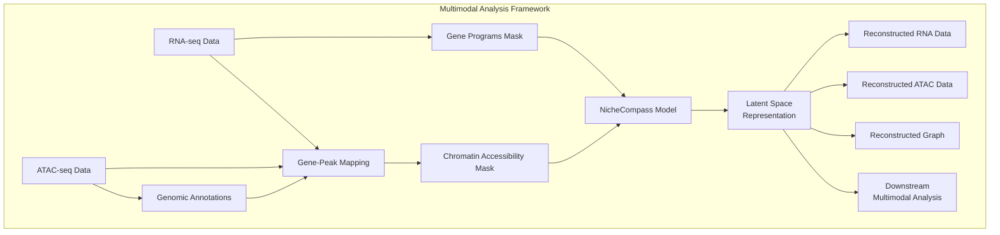
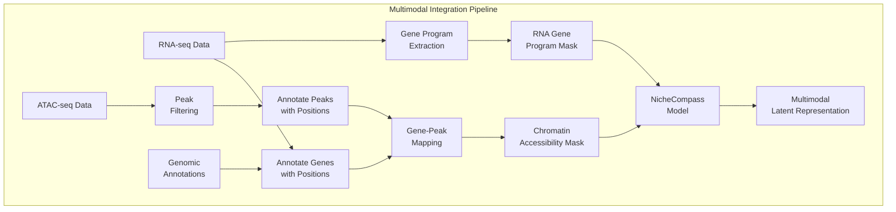
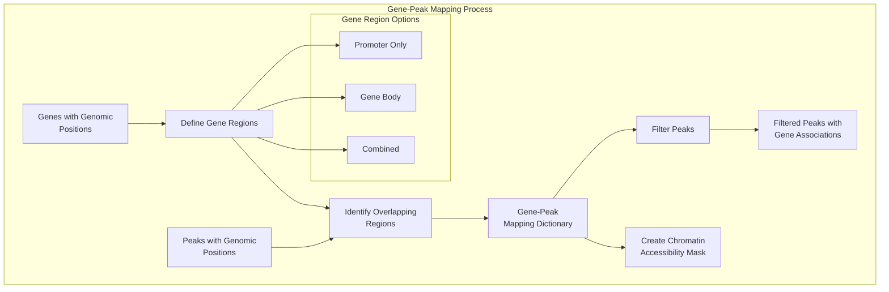
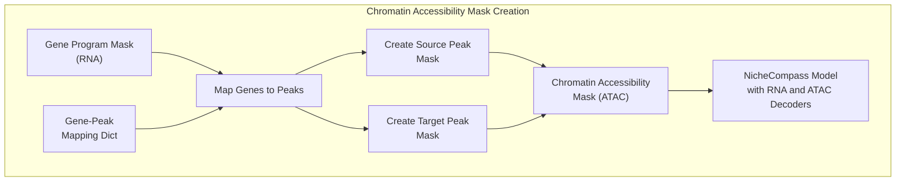

# Multimodal Analysis

<details>
<summary>Relevant source files</summary>

The following files were used as context for generating this wiki page:

- [.readthedocs.yaml](.readthedocs.yaml)
- [docs/installation.md](docs/installation.md)
- [docs/tutorials/notebooks/mouse_brain_multimodal.ipynb](docs/tutorials/notebooks/mouse_brain_multimodal.ipynb)
- [docs/tutorials/notebooks/mouse_cns_sample_integration.ipynb](docs/tutorials/notebooks/mouse_cns_sample_integration.ipynb)
- [docs/tutorials/notebooks/mouse_cns_single_sample.ipynb](docs/tutorials/notebooks/mouse_cns_single_sample.ipynb)
- [docs/tutorials/notebooks/mouse_cns_spatial_reference_mapping.ipynb](docs/tutorials/notebooks/mouse_cns_spatial_reference_mapping.ipynb)
- [src/nichecompass/utils/multimodal_mapping.py](src/nichecompass/utils/multimodal_mapping.py)

</details>


This page documents NicheCompass's multimodal analysis capabilities, specifically the integration of RNA-seq (gene expression) and ATAC-seq (chromatin accessibility) data for spatial multi-omics analysis. Multimodal analysis in NicheCompass enables users to leverage complementary data types to gain deeper insights into cellular function and regulation within spatial context.

For information about integrating multiple samples of the same modality, see [Sample Integration](#4.3). For analyzing a single RNA-seq sample, refer to [Single Sample Analysis](#4.1).

## Overview of Multimodal Analysis

NicheCompass supports the integration of RNA-seq and ATAC-seq data through a specialized gene-peak mapping approach that aligns chromatin accessibility measurements with gene programs. This integration preserves the biological interpretability of the latent space while adding information about regulatory elements and their potential relationship to gene expression patterns.



Sources: [docs/tutorials/notebooks/mouse_brain_multimodal.ipynb:28-35](), [docs/tutorials/notebooks/mouse_brain_multimodal.ipynb:682-698]()

## Data Requirements and Preparation

For multimodal analysis, NicheCompass requires:

1. An RNA-seq `AnnData` object with gene expression measurements
2. An ATAC-seq `AnnData` object with chromatin accessibility measurements
3. Gene annotations with chromosomal positions
4. Peak annotations with chromosomal positions

Both datasets should share the same spatial coordinates to enable proper integration within the spatial context.

### Required Dependencies

Multimodal analysis requires additional dependencies beyond the core NicheCompass package:

```
pip install nichecompass[all]
```

Key additional dependencies include:
- `scglue` - for gene-peak mapping functionality
- `bedtools` - for genomic operations

Sources: [docs/installation.md:63-66]()

## Multimodal Integration Pipeline

The multimodal integration process involves several key steps:

1. Gene program creation for RNA data
2. Spatial graph construction
3. Gene and peak annotation with genomic positions
4. Gene-peak mapping based on genomic proximity
5. Creation of chromatin accessibility masks aligned with gene programs
6. Joint modeling of RNA and ATAC data



Sources: [docs/tutorials/notebooks/mouse_brain_multimodal.ipynb:300-337](), [docs/tutorials/notebooks/mouse_brain_multimodal.ipynb:602-714](), [src/nichecompass/utils/multimodal_mapping.py:17-104]()

## Gene-Peak Mapping

A critical step in multimodal analysis is the mapping between genes and peaks, which enables NicheCompass to integrate chromatin accessibility data with gene expression.

### How Gene-Peak Mapping Works

The mapping process identifies which peaks may regulate which genes based on their genomic proximity:



Sources: [src/nichecompass/utils/multimodal_mapping.py:107-193](), [docs/tutorials/notebooks/mouse_brain_multimodal.ipynb:694-714]()

### Mapping Parameters

The gene-peak mapping can be customized with several parameters:

| Parameter | Description | Default |
|-----------|-------------|---------|
| `gene_region` | Region to consider for mapping (promoter, gene_body, or combined) | "combined" |
| `promoter_len` | Length of promoter region (bp upstream of TSS) | 2000 |
| `extend_range` | Maximum extended range (bp) beyond overlap | 0 |

Sources: [src/nichecompass/utils/multimodal_mapping.py:107-193]()

## Chromatin Accessibility Mask

After mapping genes to peaks, NicheCompass creates a chromatin accessibility mask that aligns with the gene program structure, enabling joint modeling of gene expression and chromatin accessibility.

### Mask Creation Process

The chromatin accessibility mask is created by mapping gene program gene sets to corresponding peak sets:



Sources: [src/nichecompass/utils/multimodal_mapping.py:196-382](), [docs/tutorials/notebooks/mouse_brain_multimodal.ipynb:699-714]()

## Model Configuration for Multimodal Analysis

When using NicheCompass for multimodal analysis, several additional parameters need to be configured:

1. Providing both RNA and ATAC AnnData objects to the model initialization
2. Adding loss weights for chromatin accessibility reconstruction
3. Adding a decoder for ATAC data

### Key Model Parameters

| Parameter | Description |
|-----------|-------------|
| `adata_atac` | ATAC-seq AnnData object |
| `lambda_chrom_access_recon` | Weight for chromatin accessibility reconstruction loss |
| `atac_recon_loss` | Type of loss function for ATAC reconstruction |

Sources: [docs/tutorials/notebooks/mouse_brain_multimodal.ipynb:784-791]()

## Example Workflow

Here's a typical workflow for multimodal analysis with NicheCompass:

1. **Generate gene program mask for RNA data**
   - Extract gene programs from prior knowledge databases
   - Add mask to RNA AnnData object

2. **Annotate genes and peaks with genomic positions**
   - Use reference genome annotations
   - Map chromosome positions to genes and peaks

3. **Create gene-peak mapping**
   - Map genes to nearby peaks
   - Filter peaks based on gene associations

4. **Add chromatin accessibility mask**
   - Translate gene program mask to peak space
   - Add mask to ATAC AnnData object

5. **Initialize and train NicheCompass model**
   - Provide both RNA and ATAC AnnData objects
   - Configure appropriate loss weights

6. **Analyze results**
   - Examine latent space representation
   - Identify regulatory relationships

Sources: [docs/tutorials/notebooks/mouse_brain_multimodal.ipynb:291-460](), [docs/tutorials/notebooks/mouse_brain_multimodal.ipynb:602-714](), [docs/tutorials/notebooks/mouse_brain_multimodal.ipynb:784-847]()

## Technical Details

### Key Functions for Multimodal Analysis

NicheCompass provides several utility functions for multimodal data preparation:

| Function | Purpose |
|----------|---------|
| `get_gene_annotations` | Adds genomic position annotations to genes |
| `generate_multimodal_mapping_dict` | Creates mapping between genes and peaks |
| `add_multimodal_mask_to_adata` | Adds chromatin accessibility masks to AnnData objects |

Sources: [src/nichecompass/utils/multimodal_mapping.py:17-104](), [src/nichecompass/utils/multimodal_mapping.py:107-193](), [src/nichecompass/utils/multimodal_mapping.py:196-382]()

### Genomic Region Definitions

NicheCompass allows different gene region definitions for peak-gene associations:

1. **Promoter only**: Only considers promoter regions upstream of transcription start sites
2. **Gene body**: Only considers the actual gene body from start to end
3. **Combined**: Considers both the gene body and promoter region (default)

The promoter length is configurable, defaulting to 2000bp upstream of the transcription start site.

Sources: [src/nichecompass/utils/multimodal_mapping.py:107-193]()

## Limitations and Considerations

When performing multimodal analysis with NicheCompass, consider the following:

1. Computational requirements increase significantly with multimodal data, especially for ATAC-seq with many peaks
2. Peak filtering is often necessary to reduce computational load
3. The quality of the gene-peak mapping depends on the accuracy of genomic annotations
4. Performance may vary depending on the spatial resolution of the data

Filtering strategies include:
- Keeping only spatially variable peaks
- Filtering based on minimum cell detection threshold
- Using only peaks that map to genes of interest

Sources: [docs/tutorials/notebooks/mouse_brain_multimodal.ipynb:534-584]()

---