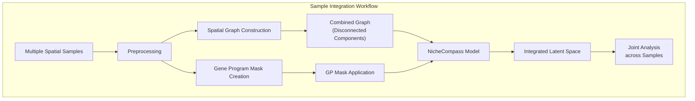
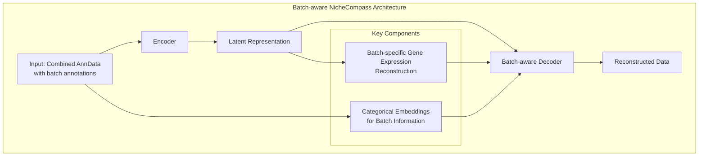
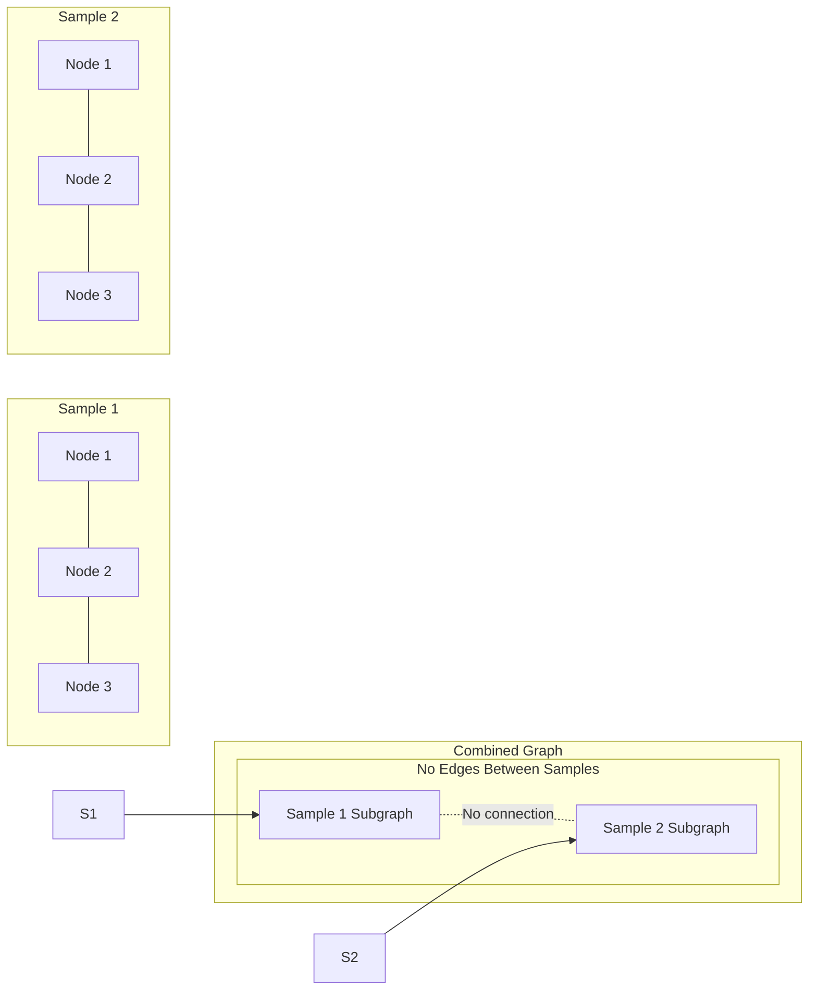
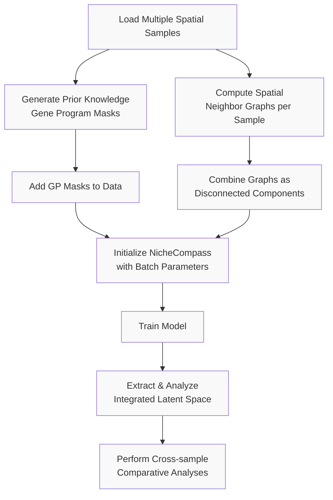

# Sample Integration

<details>
<summary>Relevant source files</summary>

The following files were used as context for generating this wiki page:

- [.readthedocs.yaml](.readthedocs.yaml)
- [docs/installation.md](docs/installation.md)
- [docs/tutorials/notebooks/mouse_brain_multimodal.ipynb](docs/tutorials/notebooks/mouse_brain_multimodal.ipynb)
- [docs/tutorials/notebooks/mouse_cns_sample_integration.ipynb](docs/tutorials/notebooks/mouse_cns_sample_integration.ipynb)
- [docs/tutorials/notebooks/mouse_cns_single_sample.ipynb](docs/tutorials/notebooks/mouse_cns_single_sample.ipynb)
- [docs/tutorials/notebooks/mouse_cns_spatial_reference_mapping.ipynb](docs/tutorials/notebooks/mouse_cns_spatial_reference_mapping.ipynb)

</details>


This document describes the Sample Integration functionality in NicheCompass, which enables the joint analysis of multiple spatial transcriptomics samples. Sample Integration allows users to learn a unified representation across samples that preserves both gene program information and spatial context. For information about integrating multimodal data (RNA + ATAC), see [Multimodal Integration](#2.3), and for mapping query samples to a pre-established spatial reference, see [Spatial Reference Mapping](#4.4).

## Overview

Sample Integration in NicheCompass integrates multiple spatial transcriptomics samples into a unified latent space where similar cell types and niches align across samples while preserving the integrity of cell-cell communication and spatial relationships. Unlike typical gene expression integration methods, NicheCompass specifically accounts for the spatial organization of cells in each sample.



Sources: [docs/tutorials/notebooks/mouse_cns_sample_integration.ipynb:133-171], [docs/tutorials/notebooks/mouse_cns_sample_integration.ipynb:432-507]

## Key Components

The Sample Integration process involves several key components that work together to achieve effective integration while preserving spatial context:

### 1. Batch-aware Model Architecture

NicheCompass implements batch-aware decoders that allow the model to account for technical and biological differences between samples during integration.



Sources: [docs/tutorials/notebooks/mouse_cns_sample_integration.ipynb:617-634]

### 2. Spatial Graph Combination

A critical aspect of sample integration is maintaining the spatial relationships within each sample while preventing artificial connections between samples.



Sources: [docs/tutorials/notebooks/mouse_cns_sample_integration.ipynb:474-507]

## Implementation Details

### Pre-processing and Setup

Before initializing the NicheCompass model for sample integration, you need to:

1. Load multiple samples into separate AnnData objects
2. Process each sample individually, computing spatial neighbor graphs
3. Combine the samples into a single AnnData object with appropriate batch annotations
4. Create disconnected spatial graphs that preserve within-sample spatial relationships

For sample integration specifically, the model requires:

- A batch identifier in `adata.obs`
- Categorical covariate configuration for batch-aware processing

Sources: [docs/tutorials/notebooks/mouse_cns_sample_integration.ipynb:432-507]

### Model Configuration

The NicheCompass model for sample integration requires specific parameters:

```python
model = NicheCompass(adata,
                     counts_key="counts",
                     adj_key="spatial_connectivities",
                     cat_covariates_embeds_injection=["gene_expr_decoder"],
                     cat_covariates_keys=["batch"],
                     cat_covariates_no_edges=[True],
                     cat_covariates_embeds_nums=[3],
                     # ... other standard parameters
                    )
```

The key batch-specific parameters are:
- `cat_covariates_keys`: List of column names in `adata.obs` that contain batch information
- `cat_covariates_embeds_injection`: Where to inject the batch information (typically in the gene expression decoder)
- `cat_covariates_embeds_nums`: Dimensions of the embedding for each categorical covariate
- `cat_covariates_no_edges`: Whether to avoid using the batch information for edge prediction

Sources: [docs/tutorials/notebooks/mouse_cns_sample_integration.ipynb:617-634]

### Disconnected Graph Construction

A key implementation detail in sample integration is the construction of the combined spatial graph:

```python
# Combine spatial neighborhood graphs as disconnected components
batch_connectivities = []
len_before_batch = 0
for i in range(len(adata_batch_list)):
    if i == 0: # first batch
        after_batch_connectivities_extension = sp.csr_matrix(
            (adata_batch_list[0].shape[0],
            (adata.shape[0] -
            adata_batch_list[0].shape[0])))
        batch_connectivities.append(sp.hstack(
            (adata_batch_list[0].obsp[adj_key],
            after_batch_connectivities_extension)))
    # ... handling middle and last batches
adata.obsp[adj_key] = sp.vstack(batch_connectivities)
```

This creates a block-diagonal adjacency matrix where connections exist only within samples, not between them.

Sources: [docs/tutorials/notebooks/mouse_cns_sample_integration.ipynb:474-507]

## Workflow Example

The full workflow for integrating multiple spatial transcriptomics samples with NicheCompass involves:



Sources: [docs/tutorials/notebooks/mouse_cns_sample_integration.ipynb:290-685]

## Use Cases and Analysis

After integrating samples with NicheCompass, you can perform various analyses:

1. **Cross-sample niche identification**: Find common niches/microenvironments across samples
2. **Differential gene program analysis**: Compare gene program activity between samples
3. **Cell-cell communication analysis**: Examine how intercellular signaling differs between samples
4. **Visualization of integrated space**: UMAP or spatial visualization of the integrated data

The integrated latent space allows for direct comparison of samples while accounting for their spatial context and biological variability.

Sources: [docs/tutorials/notebooks/mouse_cns_sample_integration.ipynb:691-736]

## Practical Considerations

When using Sample Integration in NicheCompass, consider the following:

| Consideration | Description |
|---------------|-------------|
| Memory usage | Large samples require significant memory, especially during graph combination |
| Batch differences | Substantial technical or biological differences between samples may affect integration quality |
| Spatial resolution | Consistent spatial resolution across samples is recommended |
| Gene overlap | Samples should have substantial overlap in measured genes |
| Batch parameter tuning | Adjust `cat_covariates_embeds_nums` based on the number and complexity of samples |

Sources: [docs/tutorials/notebooks/mouse_cns_sample_integration.ipynb:166-179]

## Comparison with Other Integration Methods

NicheCompass Sample Integration differs from other integration approaches:

| Method | Approach | Preserves Spatial Context? | Batch Correction |
|--------|----------|----------------------------|------------------|
| NicheCompass Integration | Graph-based integration with gene programs | Yes | Categorical embeddings in decoders |
| NicheCompass Reference Mapping | Train on reference, map query | Yes | Sequential training |
| Seurat Integration | PCA-based anchoring | No | Canonical correlation analysis |
| SCANVI | Variational autoencoder | No | Batch labels in encoder |

Sources: [docs/tutorials/notebooks/mouse_cns_sample_integration.ipynb:617-634], [docs/tutorials/notebooks/mouse_cns_spatial_reference_mapping.ipynb:637-675]

## Summary

Sample Integration in NicheCompass provides a powerful approach for analyzing multiple spatial transcriptomics samples together. By constructing disconnected spatial graphs and using batch-aware decoders, the method preserves the spatial context of each sample while enabling joint analysis in a unified latent space. This approach is particularly valuable for comparative studies across conditions, time points, or individuals, where both gene expression differences and spatial organization are important considerations.

---