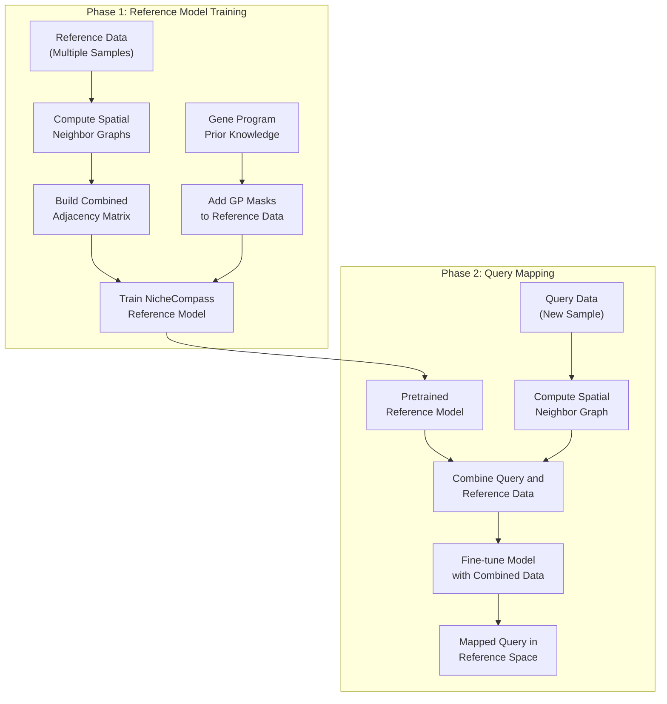
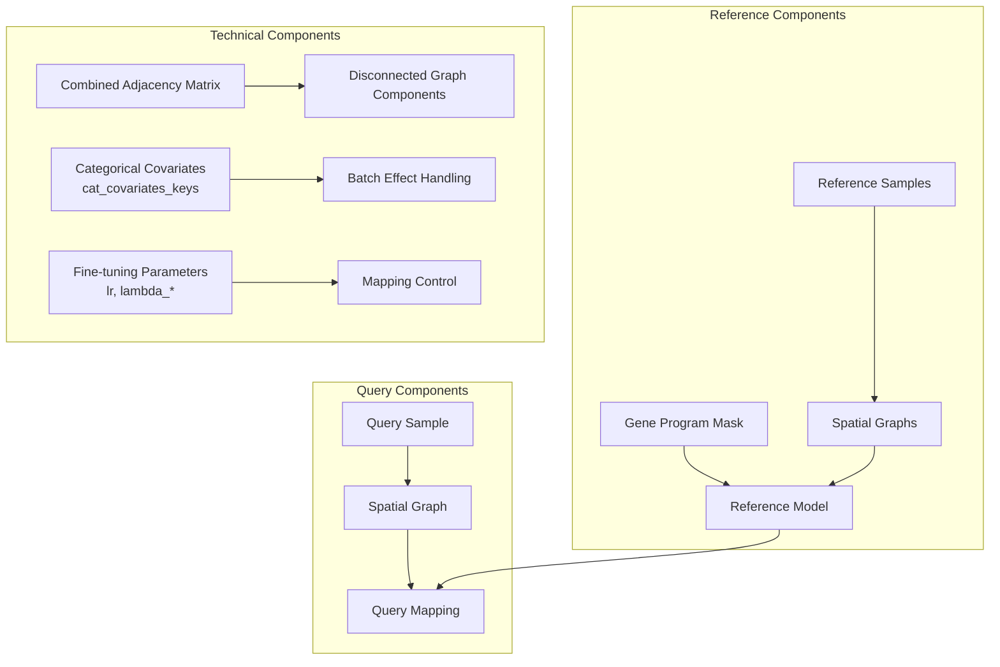
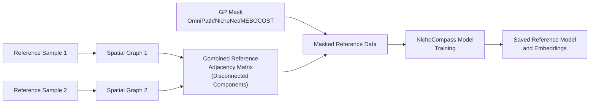
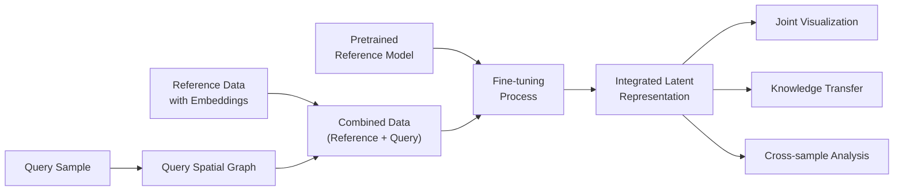
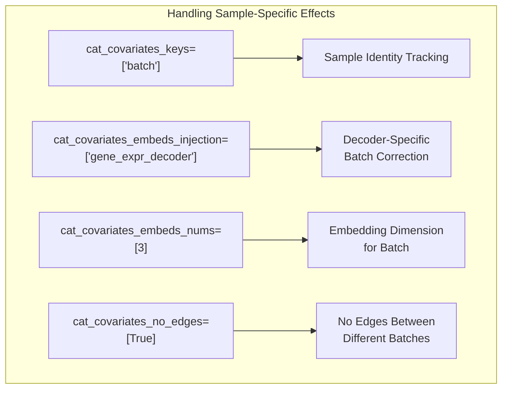
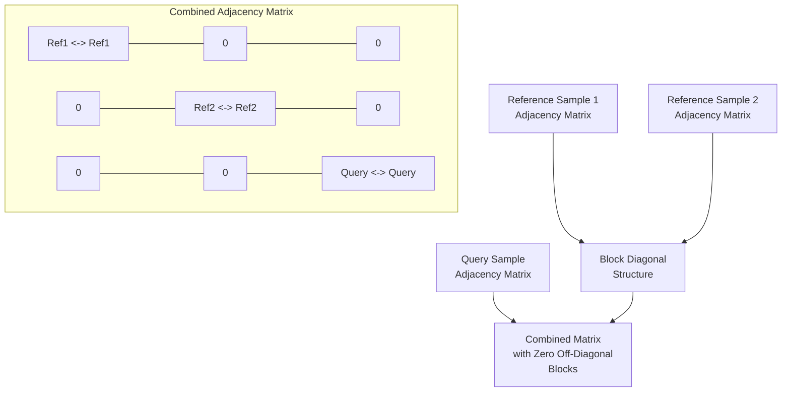

# Spatial Reference Mapping

<details>
<summary>Relevant source files</summary>

The following files were used as context for generating this wiki page:

- [.readthedocs.yaml](.readthedocs.yaml)
- [docs/installation.md](docs/installation.md)
- [docs/tutorials/notebooks/mouse_brain_multimodal.ipynb](docs/tutorials/notebooks/mouse_brain_multimodal.ipynb)
- [docs/tutorials/notebooks/mouse_cns_sample_integration.ipynb](docs/tutorials/notebooks/mouse_cns_sample_integration.ipynb)
- [docs/tutorials/notebooks/mouse_cns_single_sample.ipynb](docs/tutorials/notebooks/mouse_cns_single_sample.ipynb)
- [docs/tutorials/notebooks/mouse_cns_spatial_reference_mapping.ipynb](docs/tutorials/notebooks/mouse_cns_spatial_reference_mapping.ipynb)

</details>


Spatial Reference Mapping in NicheCompass provides a framework for integrating new spatial omics data with an existing reference atlas. Unlike regular sample integration where all samples are processed together, this approach first builds a reference model from established samples, then maps new query samples to this reference by fine-tuning the pretrained model. This enables cross-sample comparison, knowledge transfer, and annotation of new samples based on the reference.

For information about regular multi-sample analysis without using a reference, see [Sample Integration](#4.3).

## Overview



Sources: [docs/tutorials/notebooks/mouse_cns_spatial_reference_mapping.ipynb:26-39](), [docs/tutorials/notebooks/mouse_cns_spatial_reference_mapping.ipynb:433-444](), [docs/tutorials/notebooks/mouse_cns_spatial_reference_mapping.ipynb:602-686](), [docs/tutorials/notebooks/mouse_cns_spatial_reference_mapping.ipynb:702-865]()

## Key Components



Sources: [docs/tutorials/notebooks/mouse_cns_spatial_reference_mapping.ipynb:134-182](), [docs/tutorials/notebooks/mouse_cns_spatial_reference_mapping.ipynb:452-510](), [docs/tutorials/notebooks/mouse_cns_spatial_reference_mapping.ipynb:739-816]()

## Workflow and Implementation

### 1. Prepare Reference Data

The first step involves selecting and processing reference samples:



Key aspects of reference preparation:
- Multiple samples can be used as reference
- Each sample's spatial neighbor graph is computed separately
- Graphs are combined as disconnected components
- Gene program (GP) masks from prior knowledge make the latent space interpretable

Sources: [docs/tutorials/notebooks/mouse_cns_spatial_reference_mapping.ipynb:452-510](), [docs/tutorials/notebooks/mouse_cns_spatial_reference_mapping.ipynb:527-543](), [docs/tutorials/notebooks/mouse_cns_spatial_reference_mapping.ipynb:619-687]()

### 2. Query Data Preparation and Mapping

After establishing a reference model, new query samples can be mapped:



Important considerations for query mapping:
- The query sample gets its own spatial graph
- Query and reference samples remain disconnected in the spatial adjacency matrix
- Fine-tuning preserves reference structure while incorporating query data
- Batch-specific parameters handle differences between reference and query

Sources: [docs/tutorials/notebooks/mouse_cns_spatial_reference_mapping.ipynb:719-816](), [docs/tutorials/notebooks/mouse_cns_spatial_reference_mapping.ipynb:841-905](), [docs/tutorials/notebooks/mouse_cns_spatial_reference_mapping.ipynb:927-943]()

### 3. Technical Implementation

The spatial reference mapping framework uses several specific technical approaches:

#### Handling Batch Effects

Batch-specific parameters are essential for integrating reference and query data:



Sources: [docs/tutorials/notebooks/mouse_cns_spatial_reference_mapping.ipynb:143-159](), [docs/tutorials/notebooks/mouse_cns_spatial_reference_mapping.ipynb:624-635]()

#### Combined Adjacency Matrix Construction

The structure of the combined adjacency matrix is critical for proper reference mapping:



This structure ensures:
- Each sample's spatial relationships are preserved
- No artificial connections between different samples
- Disconnected components in the graph representation

Sources: [docs/tutorials/notebooks/mouse_cns_spatial_reference_mapping.ipynb:475-508](), [docs/tutorials/notebooks/mouse_cns_spatial_reference_mapping.ipynb:788-815]()

## Example Usage

Below is a simplified workflow for spatial reference mapping with NicheCompass:

1. **Process Reference Samples**:
   ```python
   # Load reference samples
   adata_reference = process_reference_samples(reference_samples)
   
   # Add GP masks
   add_gps_from_gp_dict_to_adata(
       gp_dict=combined_gp_dict,
       adata=adata_reference,
       gp_targets_mask_key="nichecompass_gp_targets",
       # other parameters...
   )
   
   # Initialize and train reference model
   model = NicheCompass(
       adata_reference,
       cat_covariates_keys=["batch"],
       cat_covariates_embeds_injection=["gene_expr_decoder"],
       # other parameters...
   )
   
   model.train(n_epochs=400, lr=0.001, lambda_edge_recon=500000.)
   
   # Save reference model
   model.save(dir_path="reference_model")
   ```

2. **Map Query Samples**:
   ```python
   # Load query sample and pretrained reference model
   adata_query = process_query_sample(query_sample)
   model = NicheCompass.load(dir_path="reference_model")
   
   # Combine reference and query data
   adata_combined = combine_reference_and_query(
       adata_reference, adata_query
   )
   
   # Map query to reference by fine-tuning
   model.fine_tune(
       adata_combined,
       n_epochs=100,
       lr=0.0001,
       # other parameters...
   )
   
   # Analyze integrated data
   sc.pp.neighbors(model.adata, use_rep="nichecompass_latent")
   sc.tl.umap(model.adata)
   ```

Sources: [docs/tutorials/notebooks/mouse_cns_spatial_reference_mapping.ipynb:619-686](), [docs/tutorials/notebooks/mouse_cns_spatial_reference_mapping.ipynb:841-942]()

## Important Parameters

The following parameters are particularly important for spatial reference mapping:

| Parameter | Description | Typical Value |
|-----------|-------------|---------------|
| `cat_covariates_keys` | List of categorical variables identifying different samples | `["batch"]` |
| `cat_covariates_embeds_injection` | Where to inject batch-specific embeddings | `["gene_expr_decoder"]` |
| `cat_covariates_no_edges` | Whether to prevent edges between different batches | `[True]` |
| `n_epochs` (reference) | Number of epochs for reference model training | 400 |
| `n_epochs` (fine-tuning) | Number of epochs for query mapping | 100-200 |
| `lr` (fine-tuning) | Learning rate for fine-tuning (typically lower than reference training) | 0.0001-0.0005 |
| `lambda_edge_recon` | Weight for edge reconstruction loss | 500000.0 |
| `lambda_gene_expr_recon` | Weight for gene expression reconstruction loss | 300.0 |

Sources: [docs/tutorials/notebooks/mouse_cns_spatial_reference_mapping.ipynb:142-182](), [docs/tutorials/notebooks/mouse_cns_spatial_reference_mapping.ipynb:646-655](), [docs/tutorials/notebooks/mouse_cns_spatial_reference_mapping.ipynb:904-909]()

## Advanced Analysis

After mapping query samples to the reference space, several analyses become possible:

1. **Cross-sample cell type identification**: Use reference annotations to identify cell types in the query sample
2. **Comparative gene program analysis**: Compare gene program activity between reference and query
3. **Niche identification**: Identify conserved and sample-specific cell niches
4. **Spatial pattern comparison**: Compare spatial organization between samples
5. **Cell-cell communication analysis**: Analyze and compare cell-cell interactions across samples

Sources: [docs/tutorials/notebooks/mouse_cns_spatial_reference_mapping.ipynb:927-1196](), [docs/tutorials/notebooks/mouse_cns_spatial_reference_mapping.ipynb:1330-1369]()

## Use Cases

Spatial reference mapping is particularly valuable in these scenarios:

1. **Atlas Building**: Incrementally build spatial atlases by mapping new samples to established references
2. **Disease Studies**: Map disease samples to healthy reference to identify pathological changes
3. **Developmental Studies**: Map different developmental stages to a common reference
4. **Cross-technique Integration**: Map data from different spatial technologies to a common reference space
5. **Cross-species Comparison**: With appropriate gene homology mapping, compare spatial organization across species

Sources: [docs/tutorials/notebooks/mouse_cns_spatial_reference_mapping.ipynb:26-39]()

---