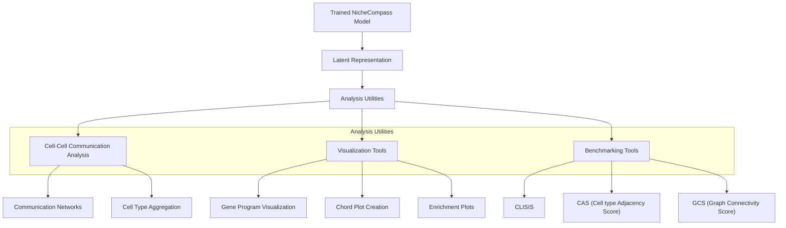
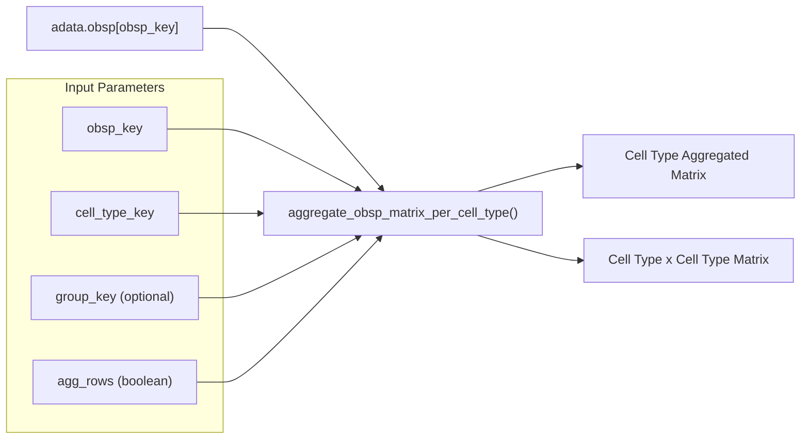
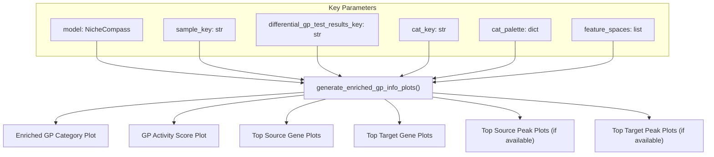
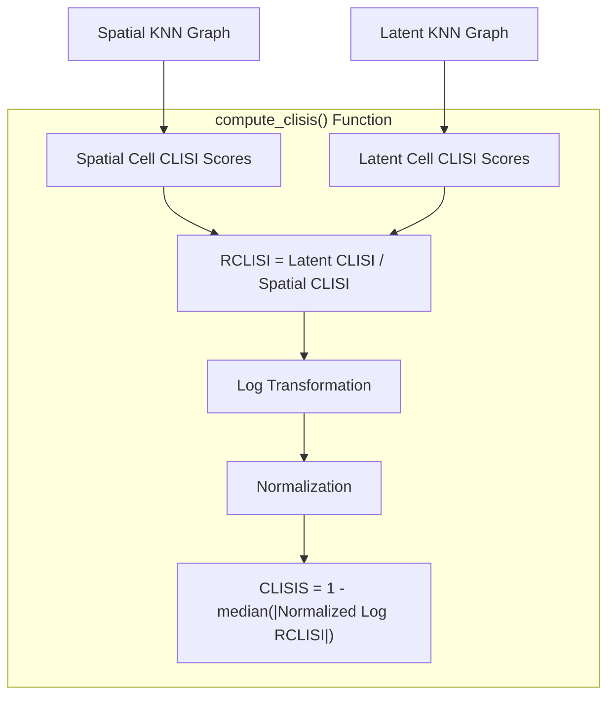
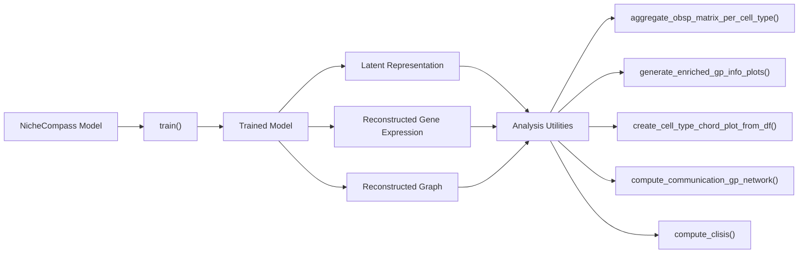

# Analysis Utilities

<details>
<summary>Relevant source files</summary>

The following files were used as context for generating this wiki page:

- [docs/index.md](docs/index.md)
- [docs/release_notes/index.md](docs/release_notes/index.md)
- [docs/user_guide/index.md](docs/user_guide/index.md)
- [environment.yaml](environment.yaml)
- [pyproject.toml](pyproject.toml)
- [src/nichecompass/__init__.py](src/nichecompass/__init__.py)
- [src/nichecompass/benchmarking/__init__.py](src/nichecompass/benchmarking/__init__.py)
- [src/nichecompass/benchmarking/clisis.py](src/nichecompass/benchmarking/clisis.py)
- [src/nichecompass/data/__init__.py](src/nichecompass/data/__init__.py)
- [src/nichecompass/models/nichecompass.py](src/nichecompass/models/nichecompass.py)
- [src/nichecompass/train/trainer.py](src/nichecompass/train/trainer.py)
- [src/nichecompass/utils/__init__.py](src/nichecompass/utils/__init__.py)
- [src/nichecompass/utils/analysis.py](src/nichecompass/utils/analysis.py)
- [src/nichecompass/utils/gene_programs.py](src/nichecompass/utils/gene_programs.py)
- [src/nichecompass/utils/utils.py](src/nichecompass/utils/utils.py)

</details>


The Analysis Utilities module in NicheCompass provides essential tools for downstream analysis of the trained model results. These utilities enable researchers to extract biological insights from spatial multi-omics data through cell-cell communication analysis, visualization of gene programs, and benchmarking metrics.

## Overview

The Analysis Utilities in NicheCompass serve as the post-training analytical layer, helping users interpret the biological meaning of the latent representations and gene programs learned by the core model. They focus on three main areas:

1. Cell-Cell Communication Analysis - Tools to infer and quantify communication patterns between cell types
2. Visualization Tools - Functions to create informative plots of gene programs and cell-cell interactions
3. Benchmarking Tools - Metrics to evaluate model performance and spatial preservation



Sources: [src/nichecompass/__init__.py](), [src/nichecompass/utils/__init__.py:1-37]()

## Cell-Cell Communication Analysis

NicheCompass provides tools to analyze and visualize cell-cell communication patterns inferred from the learned gene programs and spatial relationships.

### Matrix Aggregation Functions

The `aggregate_obsp_matrix_per_cell_type` function aggregates matrices stored in `adata.obsp` (such as reconstructed adjacency matrices or aggregation weights) by cell type. This is a fundamental operation for cell-cell communication analysis:



Sources: [src/nichecompass/utils/analysis.py:23-102]()

### Communication Network Visualization

Communication networks can be visualized using chord plots to illustrate interactions between different cell types:

1. `create_cell_type_chord_plot_from_df` - Creates chord diagrams showing connections between cell types
2. `compute_communication_gp_network` - Computes communication networks based on gene programs
3. `visualize_communication_gp_network` - Visualizes the computed communication networks

The chord plots highlight the strength of interactions between different cell types, making it easy to identify major communication axes in the tissue.

Sources: [src/nichecompass/utils/analysis.py:105-210](), [src/nichecompass/utils/__init__.py:1-37]()

## Visualization Tools

NicheCompass offers several visualization utilities to help interpret the model results and discover biological patterns.

### Gene Program Visualization

The `generate_enriched_gp_info_plots` function creates comprehensive visualization of enriched gene programs:



This function works by:
1. Computing gene and peak importances for selected gene programs
2. Creating spatial or UMAP plots showing the gene program activities
3. Displaying the top genes and peaks contributing to each gene program

Sources: [src/nichecompass/utils/analysis.py:212-404]()

### Information Plots

The helper function `plot_enriched_gp_info_plots_` handles the actual plotting mechanics of gene program information:

1. Creates a combined multi-panel figure with enriched category visualization
2. Displays gene program scores in the selected feature space
3. Shows expression/accessibility of top genes/peaks in the selected feature space

These plots help users understand which genes and peaks are most important for each gene program and how they are distributed in space.

Sources: [src/nichecompass/utils/analysis.py:406-591]()

## Benchmarking Tools

NicheCompass includes several metrics to evaluate model performance, particularly focusing on the preservation of spatial relationships in the latent space.

### CLISIS (Cell Type Local Inverse Simpson's Index Similarity)

CLISIS measures how accurately the latent nearest neighbor graph preserves local neighborhood cell type heterogeneity from the spatial nearest neighbor graph:



CLISIS ranges from 0 to 1, with higher values indicating better preservation of local neighborhood cell type heterogeneity in the latent representation.

Sources: [src/nichecompass/benchmarking/clisis.py:1-203]()

### Additional Benchmarking Metrics

NicheCompass also provides other benchmarking metrics:

1. Cell type Adjacency Score (CAS) - Measures preservation of cell type adjacency patterns
2. Graph Connectivity Score (GCS) - Evaluates how well graph connectivity is preserved
3. Neighborhood Area Similarity Weighted (NASW) - Quantifies preservation of neighborhood areas
4. Multi-Label Adjusted Mutual Information (MLAMI) - Measures agreement between cluster assignments

These metrics can be computed using functions from the `benchmarking` module.

Sources: [src/nichecompass/benchmarking/__init__.py:8-21]()

## Integration with NicheCompass Model

The analysis utilities are designed to work seamlessly with trained NicheCompass models. The `NicheCompass` class in `models/nichecompass.py` contains methods that utilize these utilities for analyzing model results.



The analysis utilities can be used directly on the AnnData object containing the model results or through higher-level interfaces provided by the model itself.

Sources: [src/nichecompass/models/nichecompass.py:24-589](), [src/nichecompass/train/trainer.py:28-453]()

## Usage Example

Below is a typical workflow for using NicheCompass analysis utilities:

1. Train a NicheCompass model
2. Compute cell-cell communication networks
3. Create visualization of enriched gene programs
4. Evaluate model performance using benchmarking metrics

```python
# 1. Train model
model = NicheCompass(adata)
trainer = Trainer(adata, model)
trainer.train(n_epochs=100)

# 2. Analyze cell-cell communication
cell_type_agg_df = aggregate_obsp_matrix_per_cell_type(
    adata=adata,
    obsp_key="nichecompass_agg_weights",
    cell_type_key="cell_type",
    agg_rows=True
)

# 3. Visualize enriched gene programs
generate_enriched_gp_info_plots(
    plot_label="Tumor_Microenvironment",
    model=model,
    sample_key="sample",
    differential_gp_test_results_key="diff_gp_results",
    cat_key="cell_type",
    cat_palette=cell_type_colors,
    feature_spaces=["latent"]
)

# 4. Compute benchmarking metrics
clisis_score = compute_clisis(
    adata=adata,
    cell_type_key="cell_type",
    latent_key="nichecompass_latent"
)
```

## Summary

The Analysis Utilities in NicheCompass provide comprehensive tools for extracting biological insights from spatial multi-omics data after model training. These utilities enable researchers to:

1. Identify and quantify cell-cell communication networks
2. Visualize gene programs and their spatial distributions
3. Benchmark model performance in preserving spatial relationships

For cell-cell communication analysis specifically, see [Cell-Cell Communication Analysis](#5.1).  
For more on visualization capabilities, see [Visualization Tools](#5.2).  
For benchmarking details, see [Benchmarking Tools](#5.3).

Sources: [src/nichecompass/utils/__init__.py:1-37](), [src/nichecompass/benchmarking/__init__.py:8-21](), [pyproject.toml:29-81]()

---