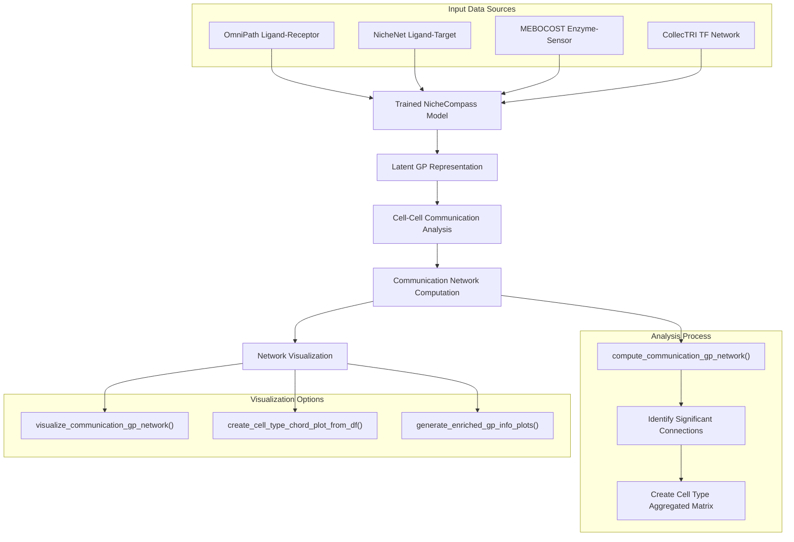
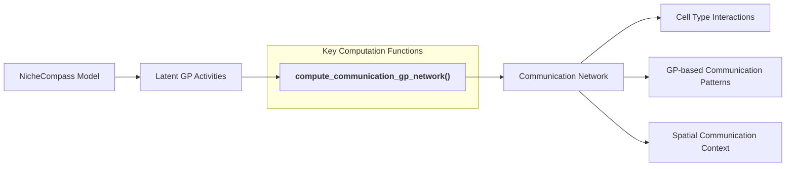
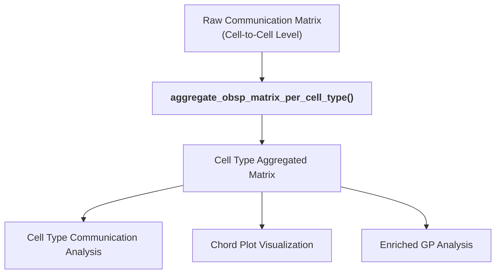
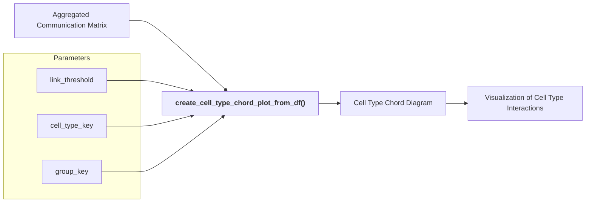
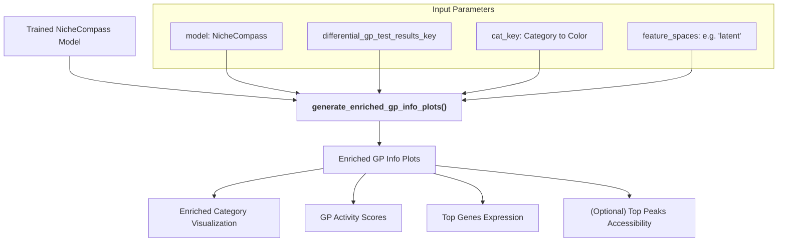

# Cell-Cell Communication Analysis

<details>
<summary>Relevant source files</summary>

The following files were used as context for generating this wiki page:

- [.readthedocs.yaml](.readthedocs.yaml)
- [docs/index.md](docs/index.md)
- [docs/installation.md](docs/installation.md)
- [docs/release_notes/index.md](docs/release_notes/index.md)
- [docs/tutorials/notebooks/mouse_brain_multimodal.ipynb](docs/tutorials/notebooks/mouse_brain_multimodal.ipynb)
- [docs/tutorials/notebooks/mouse_cns_sample_integration.ipynb](docs/tutorials/notebooks/mouse_cns_sample_integration.ipynb)
- [docs/tutorials/notebooks/mouse_cns_single_sample.ipynb](docs/tutorials/notebooks/mouse_cns_single_sample.ipynb)
- [docs/tutorials/notebooks/mouse_cns_spatial_reference_mapping.ipynb](docs/tutorials/notebooks/mouse_cns_spatial_reference_mapping.ipynb)
- [docs/user_guide/index.md](docs/user_guide/index.md)
- [pyproject.toml](pyproject.toml)
- [src/nichecompass/utils/analysis.py](src/nichecompass/utils/analysis.py)

</details>


This document explains the Cell-Cell Communication Analysis system in NicheCompass, which allows users to infer and analyze communication networks between cells in spatial multi-omics data. The system leverages gene programs extracted from various biological databases to identify potential cell-cell interactions and provides utilities for visualizing and interpreting these communication patterns.

## Purpose and Scope

The Cell-Cell Communication Analysis component of NicheCompass enables researchers to:

1. Identify and quantify cell-cell interactions based on gene program activities
2. Construct communication networks between cell types
3. Visualize communication patterns using chord plots and other informative visualizations
4. Analyze enriched gene programs involved in cell-cell communication

This document focuses specifically on the communication analysis tools. For information about gene program creation, see [Gene Programs](#2.2). For information about the core model architecture, see [Core Model](#2.1).

Sources:
- [docs/tutorials/notebooks/mouse_brain_multimodal.ipynb:104-114]()
- [docs/tutorials/notebooks/mouse_cns_single_sample.ipynb:98-103]()

## Communication Analysis Workflow



Sources:
- [docs/tutorials/notebooks/mouse_brain_multimodal.ipynb:104-114]()
- [docs/tutorials/notebooks/mouse_cns_single_sample.ipynb:98-103]()
- [src/nichecompass/utils/analysis.py:23-102]()

## Core Components

### Communication Network Computation

The core of cell-cell communication analysis in NicheCompass is based on analyzing gene programs (GPs) that represent known biological interaction pathways. Communication networks are computed based on the activity of these gene programs in spatial context.



The `compute_communication_gp_network()` function analyzes gene program activities to identify significant cell-cell communications. It processes:

1. Source GPs (e.g., ligands in ligand-receptor interactions)
2. Target GPs (e.g., receptors in ligand-receptor interactions)
3. Cell type annotations
4. Spatial neighborhood information

The result is a directed network where nodes represent cell types and edges represent communication strength between them, weighted by the activities of relevant gene programs.

Sources:
- [docs/tutorials/notebooks/mouse_brain_multimodal.ipynb:104-114]()
- [docs/tutorials/notebooks/mouse_cns_single_sample.ipynb:98-103]()

### Aggregation of Communication Data

Communication data is often aggregated at the cell type level to identify patterns of interaction between different cell populations.



The `aggregate_obsp_matrix_per_cell_type()` function (found in [src/nichecompass/utils/analysis.py:23-102]()) aggregates adjacency matrices stored in `adata.obsp` at the cell type level. It can process:

- The node label aggregator weights
- Reconstructed adjacency matrices
- Other matrices in the observation-by-observation space

This aggregation allows analysis of communication patterns between cell types rather than individual cells, making it easier to interpret biological significance.

Sources:
- [src/nichecompass/utils/analysis.py:23-102]()

## Visualization Methods

NicheCompass provides several visualization methods to interpret cell-cell communication results:

### Communication Network Visualization

The `visualize_communication_gp_network()` function creates network visualizations showing communication between cell types. These visualizations can display:

- Cell types as nodes
- Communication strength as edge weights
- Gene programs involved in communication

### Cell Type Chord Plots



The `create_cell_type_chord_plot_from_df()` function creates chord diagrams that visualize communication between cell types. These circular plots show:

- Cell types around the circumference
- Connecting chords representing communication strength
- Directionality of communication (source to target)

The function applies a threshold to display only significant connections based on the link strength ratio compared to the maximum.

Sources:
- [src/nichecompass/utils/analysis.py:105-210]()

### Enriched Gene Program Information Plots



The `generate_enriched_gp_info_plots()` function visualizes gene programs involved in cell-cell communication. For each gene program, it displays:

1. The enriched cell type category
2. Gene program activity scores
3. Expression of top genes associated with the gene program
4. (If applicable) Accessibility of top peaks associated with the gene program

These visualizations help interpret which gene programs are active in which cell types and their potential role in cell-cell communication.

Sources:
- [src/nichecompass/utils/analysis.py:212-632]()

## Usage Example

Below is a typical workflow for performing cell-cell communication analysis with NicheCompass:

1. Train a NicheCompass model with gene programs that represent biological interaction pathways (e.g., ligand-receptor, enzyme-sensor)
2. Compute the communication network between cell types
3. Visualize the network using chord plots or other network visualizations
4. Analyze enriched gene programs to interpret biological significance

Example code from the tutorials:

```python
# Compute communication network between cell types
communication_df = compute_communication_gp_network(
    model=model,
    cell_type_key=cell_type_key,
    sample=samples[0]
)

# Visualize the communication network
visualize_communication_gp_network(
    model=model,
    communication_df=communication_df,
    plot_label="Communication Network",
    save_fig=True,
    figure_folder_path=figure_folder_path
)

# Generate enriched gene program info plots
generate_enriched_gp_info_plots(
    plot_label="Enriched_GPs",
    model=model,
    sample_key=sample_key,
    differential_gp_test_results_key=differential_gp_test_results_key,
    cat_key=cell_type_key,
    cat_palette=cell_type_colors,
    n_top_genes_per_gp=3,
    feature_spaces=["latent"],
    save_figs=True,
    figure_folder_path=figure_folder_path
)
```

Sources:
- [docs/tutorials/notebooks/mouse_brain_multimodal.ipynb:104-114]()
- [docs/tutorials/notebooks/mouse_cns_single_sample.ipynb:98-103]()

## Data Requirements

To perform cell-cell communication analysis with NicheCompass, you need:

| Requirement | Description |
|-------------|-------------|
| Trained NicheCompass model | A model trained on spatial data with gene programs |
| Cell type annotations | Labels indicating cell type for each observation |
| Gene program masks | Binary masks indicating which genes belong to which programs |
| Spatial information | Coordinates and neighborhood graph of cells/spots |

Sources:
- [docs/tutorials/notebooks/mouse_brain_multimodal.ipynb:104-114]()
- [docs/tutorials/notebooks/mouse_cns_single_sample.ipynb:98-103]()

## Integration with Biological Knowledge

NicheCompass leverages multiple sources of biological knowledge for cell-cell communication analysis:

| Database | Purpose | Type of Interactions |
|----------|---------|----------------------|
| OmniPath | Ligand-Receptor interactions | Cell-to-cell signaling |
| NicheNet | Ligand-Target interactions | Signaling effects on target genes |
| MEBOCOST | Enzyme-Sensor interactions | Metabolic communication |
| CollecTRI | Transcription Factor networks | Gene regulatory networks |

This integration helps connect the computational analysis to biological mechanisms of cell-cell communication.

Sources:
- [docs/tutorials/notebooks/mouse_brain_multimodal.ipynb:324-342]()
- [docs/tutorials/notebooks/mouse_cns_single_sample.ipynb:322-340]()

## Summary

The Cell-Cell Communication Analysis system in NicheCompass provides a comprehensive toolset for inferring, analyzing, and visualizing communication patterns between cells in spatial multi-omics data. By leveraging gene programs from various biological databases, it connects computational analysis to biological mechanisms of cell-cell communication, making it a valuable tool for understanding cellular interactions in complex tissues.

---