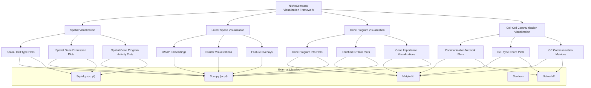
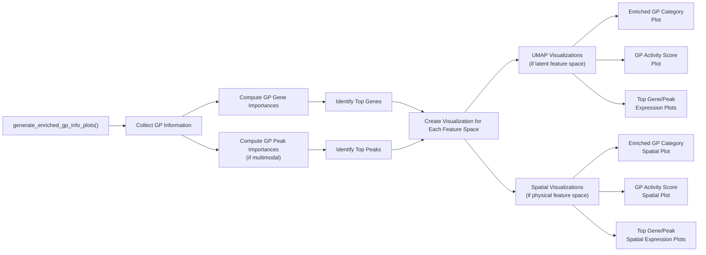
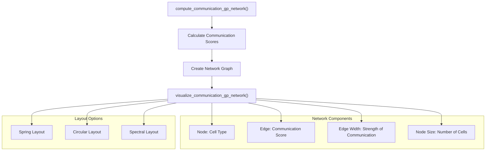
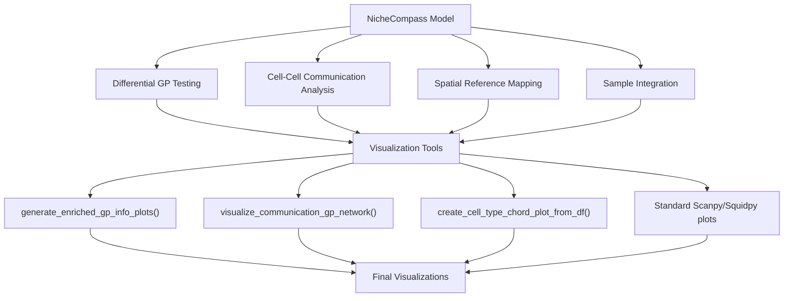

# Visualization Tools

<details>
<summary>Relevant source files</summary>

The following files were used as context for generating this wiki page:

- [.readthedocs.yaml](.readthedocs.yaml)
- [docs/index.md](docs/index.md)
- [docs/installation.md](docs/installation.md)
- [docs/release_notes/index.md](docs/release_notes/index.md)
- [docs/tutorials/notebooks/mouse_brain_multimodal.ipynb](docs/tutorials/notebooks/mouse_brain_multimodal.ipynb)
- [docs/tutorials/notebooks/mouse_cns_sample_integration.ipynb](docs/tutorials/notebooks/mouse_cns_sample_integration.ipynb)
- [docs/tutorials/notebooks/mouse_cns_single_sample.ipynb](docs/tutorials/notebooks/mouse_cns_single_sample.ipynb)
- [docs/tutorials/notebooks/mouse_cns_spatial_reference_mapping.ipynb](docs/tutorials/notebooks/mouse_cns_spatial_reference_mapping.ipynb)
- [docs/user_guide/index.md](docs/user_guide/index.md)
- [pyproject.toml](pyproject.toml)
- [src/nichecompass/utils/analysis.py](src/nichecompass/utils/analysis.py)

</details>


NicheCompass provides a comprehensive suite of visualization tools designed to help researchers interpret the results of spatial multi-omics analyses. These tools enable the visualization of data in both physical and latent spaces, exploration of gene programs, and analysis of cell-cell communication patterns. This page describes the primary visualization tools available in NicheCompass and how to use them effectively.

For information about cell-cell communication analysis methods, see [Cell-Cell Communication Analysis](#5.1).

## Visualization Framework Overview

NicheCompass visualization tools leverage several Python libraries, including Matplotlib, Scanpy, Squidpy, Seaborn, and NetworkX. The visualization utilities are primarily accessed through functions in the `nichecompass.utils` module.



Sources: [src/nichecompass/utils/analysis.py](), [docs/tutorials/notebooks/mouse_brain_multimodal.ipynb](), [docs/tutorials/notebooks/mouse_cns_single_sample.ipynb]()

## Spatial Data Visualization

Spatial visualizations in NicheCompass enable the display of data in the physical coordinates of the sample. These visualizations help identify spatial patterns of gene expression, cell types, and gene program activities.

### Spatial Cell Type Visualization

The most basic spatial visualization displays cell types or clusters in physical space:

```python
# Visualize cell-level annotated data in physical space
sc.pl.spatial(adata,
              color=cell_type_key,
              palette=cell_type_colors,
              spot_size=spot_size)
```

### Spatial Gene Program Activity Visualization

Gene program activities can be visualized in spatial coordinates to reveal spatial patterns of gene program activation:

```python
# Visualize gene program activities in physical space
sc.pl.spatial(adata=adata,
              color=gp_name,
              color_map="RdBu",
              spot_size=spot_size,
              title=f"{gp_name}: Gene Program Activity",
              colorbar_loc="bottom")
```

Sources: [docs/tutorials/notebooks/mouse_cns_single_sample.ipynb:515-522](), [docs/tutorials/notebooks/mouse_brain_multimodal.ipynb:748-753]()

## Latent Space Visualization

NicheCompass creates interpretable latent representations of cells or spots. These embeddings can be visualized using dimensionality reduction techniques like UMAP to reveal relationships and patterns that may not be apparent in physical space.

### UMAP Embeddings

After training a NicheCompass model, UMAP embeddings can be generated and visualized:

```python
# Compute latent neighbor graph
sc.pp.neighbors(model.adata,
                use_rep=latent_key,
                key_added=latent_key)

# Compute UMAP embedding
sc.tl.umap(model.adata,
           neighbors_key=latent_key)

# Visualize UMAP embedding
sc.pl.umap(model.adata,
           color=cell_type_key,
           palette=cell_type_colors)
```

### Latent Space Clustering

Clustering can be performed on the latent representation to identify cell niches:

```python
# Perform Leiden clustering on latent representation
sc.tl.leiden(model.adata,
             resolution=latent_leiden_resolution,
             key_added=latent_cluster_key,
             neighbors_key=latent_key)

# Visualize clusters in latent space
sc.pl.umap(model.adata,
           color=latent_cluster_key)
```

Sources: [docs/tutorials/notebooks/mouse_cns_single_sample.ipynb:589-597](), [docs/tutorials/notebooks/mouse_brain_multimodal.ipynb:823-831]()

## Gene Program Visualization

NicheCompass includes specialized tools for visualizing gene programs, their activities, and importance scores. These visualizations help interpret the biological meaning of gene programs and their roles in cell niches.

### Gene Program Info Plots

The `generate_enriched_gp_info_plots` function creates comprehensive visualizations of gene programs, showing their enrichment in specific categories, activities, and the expression patterns of top genes:



The resulting plots include:
1. The enriched category visualization
2. Gene program activity scores
3. Expression patterns of top source and target genes
4. Expression patterns of top source and target peaks (for multimodal data)

Sources: [src/nichecompass/utils/analysis.py:212-405](), [docs/tutorials/notebooks/mouse_brain_multimodal.ipynb:1107-1120]()

### Example Usage

```python
# Generate enriched GP info plots
generate_enriched_gp_info_plots(
    plot_label="cell_type_enriched",
    model=model,
    sample_key=sample_key,
    differential_gp_test_results_key=differential_gp_test_results_key,
    cat_key=cell_type_key,
    cat_palette=cell_type_colors,
    n_top_enriched_gp_start_idx=0,
    n_top_enriched_gp_end_idx=10,
    feature_spaces=["latent", "batch1"],
    n_top_genes_per_gp=3,
    n_top_peaks_per_gp=0,
    scale_omics_ft=False,
    save_figs=True,
    figure_folder_path=figure_folder_path,
    file_format="png",
    spot_size=spot_size)
```

Sources: [docs/tutorials/notebooks/mouse_cns_single_sample.ipynb](), [src/nichecompass/utils/analysis.py:212-277]()

## Cell-Cell Communication Visualization

NicheCompass provides tools for visualizing cell-cell communication patterns based on gene program activities and spatial relationships.

### Communication Network Visualization

The `compute_communication_gp_network` and `visualize_communication_gp_network` functions enable the computation and visualization of cell-cell communication networks:



### Cell Type Chord Plots

The `create_cell_type_chord_plot_from_df` function creates chord diagrams to visualize interactions between cell types:

```python
# Create cell type chord plot
create_cell_type_chord_plot_from_df(
    adata=model.adata,
    df=cell_type_agg_df,
    link_threshold=0.01,
    cell_type_key=cell_type_key,
    group_key=sample_key,
    groups="all",
    plot_label="Cell-Cell Communication",
    save_fig=True,
    file_path=f"{figure_folder_path}/cell_type_chord_plot.png")
```

Sources: [src/nichecompass/utils/analysis.py:105-210](), [docs/tutorials/notebooks/mouse_cns_single_sample.ipynb]()

## Multimodal Data Visualization

For multimodal analyses (e.g., combined RNA-seq and ATAC-seq), NicheCompass provides tools to visualize relationships between different modalities.

### RNA and ATAC Correlation Visualization

When working with multimodal data, correlations between RNA expression and chromatin accessibility can be visualized:

```python
# Visualize correlation between RNA expression and chromatin accessibility
generate_enriched_gp_info_plots(
    plot_label="multimodal_analysis",
    model=model,
    sample_key=sample_key,
    differential_gp_test_results_key=differential_gp_test_results_key,
    cat_key=cell_type_key,
    cat_palette=cell_type_colors,
    n_top_enriched_gp_start_idx=0,
    n_top_enriched_gp_end_idx=5,
    feature_spaces=["latent"],
    n_top_genes_per_gp=2,
    n_top_peaks_per_gp=2,
    scale_omics_ft=True)
```

Sources: [docs/tutorials/notebooks/mouse_brain_multimodal.ipynb](), [src/nichecompass/utils/analysis.py:286-295]()

## Customization and Best Practices

### Color Customization

NicheCompass provides a default color dictionary but also allows custom color palettes:

```python
# Create custom color dictionary for cell types
cell_type_colors = create_new_color_dict(
    adata=model.adata,
    cat_key=cell_type_key)
```

### Save Figure Configurations

Most visualization functions accept parameters for saving figures:

```python
# Common parameters for saving figures
save_figs = True
figure_folder_path = f"../figures/{current_timestamp}"
file_format = "png"
```

### Visualization Best Practices

1. **Spatial Resolution**: Adjust `spot_size` based on your data's spatial resolution (smaller for single-cell, larger for spot-based)
2. **Feature Selection**: Limit the number of features (genes/peaks) to display for clearer visualizations
3. **Consistent Color Schemes**: Use the same color scheme across different visualizations for consistency
4. **Multiple Feature Spaces**: Generate visualizations in both latent and physical spaces for comprehensive interpretation
5. **Clear Titles and Labels**: Use informative titles and labels to make visualizations self-explanatory

Sources: [docs/tutorials/notebooks/mouse_brain_multimodal.ipynb:732-735](), [docs/tutorials/notebooks/mouse_cns_single_sample.ipynb:502-504]()

## Integration with Other Analysis Tools

NicheCompass visualization tools are designed to work seamlessly with analysis results, enabling the direct visualization of:

1. Differential gene program testing results
2. Cell-cell communication networks
3. Spatial reference mapping results
4. Sample integration analyses



Sources: [docs/tutorials/notebooks/mouse_cns_sample_integration.ipynb](), [docs/tutorials/notebooks/mouse_cns_spatial_reference_mapping.ipynb]()

---