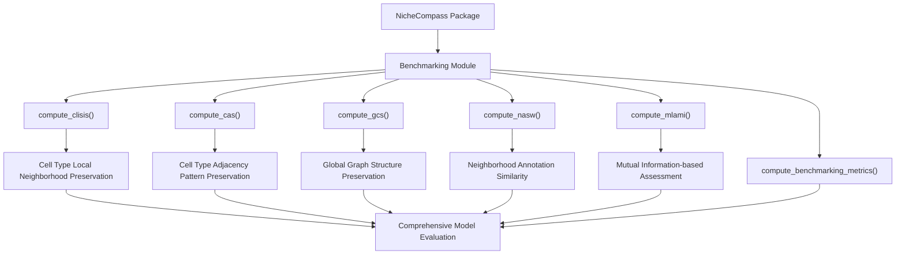
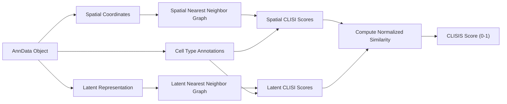
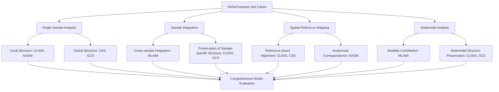
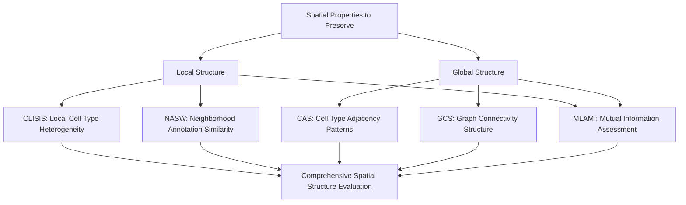

# Benchmarking Tools

<details>
<summary>Relevant source files</summary>

The following files were used as context for generating this wiki page:

- [.readthedocs.yaml](.readthedocs.yaml)
- [docs/installation.md](docs/installation.md)
- [docs/tutorials/notebooks/mouse_brain_multimodal.ipynb](docs/tutorials/notebooks/mouse_brain_multimodal.ipynb)
- [docs/tutorials/notebooks/mouse_cns_sample_integration.ipynb](docs/tutorials/notebooks/mouse_cns_sample_integration.ipynb)
- [docs/tutorials/notebooks/mouse_cns_single_sample.ipynb](docs/tutorials/notebooks/mouse_cns_single_sample.ipynb)
- [docs/tutorials/notebooks/mouse_cns_spatial_reference_mapping.ipynb](docs/tutorials/notebooks/mouse_cns_spatial_reference_mapping.ipynb)
- [environment.yaml](environment.yaml)
- [src/nichecompass/__init__.py](src/nichecompass/__init__.py)
- [src/nichecompass/benchmarking/__init__.py](src/nichecompass/benchmarking/__init__.py)
- [src/nichecompass/benchmarking/clisis.py](src/nichecompass/benchmarking/clisis.py)
- [src/nichecompass/data/__init__.py](src/nichecompass/data/__init__.py)
- [src/nichecompass/models/nichecompass.py](src/nichecompass/models/nichecompass.py)
- [src/nichecompass/train/trainer.py](src/nichecompass/train/trainer.py)
- [src/nichecompass/utils/__init__.py](src/nichecompass/utils/__init__.py)
- [src/nichecompass/utils/gene_programs.py](src/nichecompass/utils/gene_programs.py)
- [src/nichecompass/utils/utils.py](src/nichecompass/utils/utils.py)

</details>


The NicheCompass benchmarking tools provide quantitative metrics to evaluate how well the model preserves spatial structures and biological relationships in its latent representations. These tools are essential for assessing model performance, comparing different model configurations, and validating results across various spatial multi-omics analysis workflows.

## Overview of Benchmarking Metrics

NicheCompass includes several specialized metrics to evaluate different aspects of spatial structure preservation:

| Metric | Description | Range | Interpretation |
|--------|-------------|-------|----------------|
| CLISIS | Cell Type Local Inverse Simpson's Index Similarity - measures preservation of local neighborhood cell type heterogeneity | 0-1 | Higher is better |
| CAS | Cell type Adjacency Score - evaluates preservation of cell type adjacency patterns | 0-1 | Higher is better |
| GCS | Graph Connectivity Score - assesses preservation of global graph structure | 0-1 | Higher is better |
| NASW | Neighborhood Annotation Similarity Welch - measures similarity of neighborhood annotations | 0-1 | Higher is better |
| MLAMI | Mutual Local Ancestry Membership Index - evaluates preservation using mutual information | 0-1 | Higher is better |

Sources: [src/nichecompass/benchmarking/__init__.py]()

## Benchmarking Module Architecture

The benchmarking tools are organized as a dedicated module within the NicheCompass package:



Sources: [src/nichecompass/benchmarking/__init__.py](), [src/nichecompass/benchmarking/clisis.py]()

## CLISIS: Cell Type Local Inverse Simpson's Index Similarity

The CLISIS metric is particularly important for evaluating how well a model preserves local cellular neighborhoods.

### Implementation Details

CLISIS measures how accurately the latent nearest neighbor graph preserves local neighborhood cell type heterogeneity from the spatial nearest neighbor graph. It is implemented in [src/nichecompass/benchmarking/clisis.py]() and computes:

1. The Cell Type Local Inverse Simpson's Index (CLISI) for both spatial and latent representations
2. The similarity between these indices normalized to a value between 0 and 1



Sources: [src/nichecompass/benchmarking/clisis.py:18-216]()

The CLISIS implementation supports:
- Using precomputed nearest neighbor graphs or computing them on the fly
- Single-batch and multi-batch analyses
- Parallel computation with the `n_jobs` parameter

The CLISI itself measures the effective number of different cell types in each cell's local neighborhood, with higher values indicating more diverse neighborhoods.

## Using Benchmarking Tools

### Basic Usage

Each metric can be calculated individually:

```python
from nichecompass.benchmarking import compute_clisis, compute_cas, compute_gcs

# Compute CLISIS metric
clisis_score = compute_clisis(
    adata, 
    cell_type_key='cell_type', 
    latent_key='nichecompass_latent'
)

# Compute CAS metric
cas_score = compute_cas(
    adata, 
    cell_type_key='cell_type', 
    latent_key='nichecompass_latent'
)
```

### Computing All Metrics

You can calculate multiple metrics at once using the comprehensive evaluation function:

```python
from nichecompass.benchmarking import compute_benchmarking_metrics

metrics = compute_benchmarking_metrics(
    adata, 
    cell_type_key='cell_type', 
    latent_key='nichecompass_latent'
)
```

Sources: [src/nichecompass/benchmarking/__init__.py:8-14]()

## Benchmarking Across Different Use Cases

Different benchmarking metrics are particularly useful for specific NicheCompass use cases:



Sources: [docs/tutorials/notebooks/mouse_brain_multimodal.ipynb](), [docs/tutorials/notebooks/mouse_cns_single_sample.ipynb](), [docs/tutorials/notebooks/mouse_cns_spatial_reference_mapping.ipynb](), [docs/tutorials/notebooks/mouse_cns_sample_integration.ipynb]()

### Single Sample Analysis
In single sample analysis, benchmarking metrics evaluate how well the model captures spatial relationships within a single tissue section. CLISIS is particularly useful for assessing preservation of local cellular neighborhoods.

### Sample Integration
For sample integration, benchmarking metrics assess whether spatial characteristics are preserved while enabling meaningful comparison across samples.

### Spatial Reference Mapping
In spatial reference mapping, benchmarking tools evaluate how accurately spatial relationships are maintained when mapping query samples to reference space.

### Multimodal Analysis
For multimodal analysis (e.g., RNA-seq and ATAC-seq integration), benchmarking tools assess whether the integration preserves or enhances spatial structure representation.

## Relationship to Spatial Properties

The benchmarking metrics in NicheCompass are designed to evaluate different aspects of spatial structure preservation:



Sources: [src/nichecompass/benchmarking/clisis.py](), [src/nichecompass/benchmarking/__init__.py]()

## Conclusion

The benchmarking tools in NicheCompass provide a robust framework for evaluating how well models preserve various aspects of spatial structure. By using these metrics, researchers can select optimal models and parameters for their specific spatial multi-omics analysis tasks and ensure that the biological relationships in the data are accurately represented in the model's latent space.

---