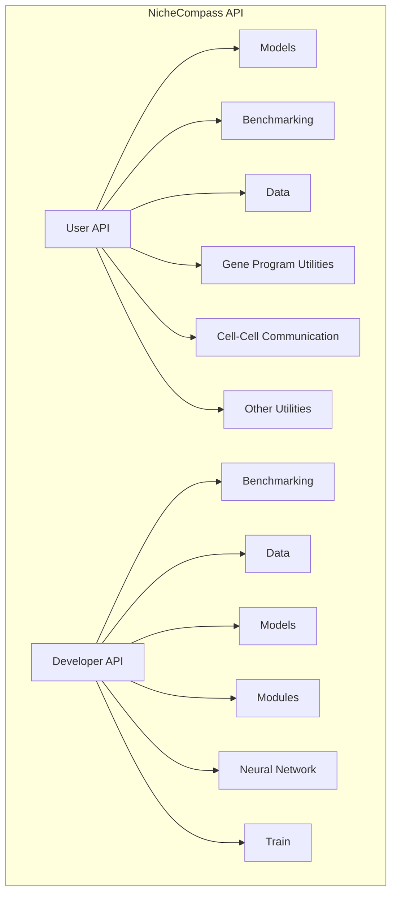
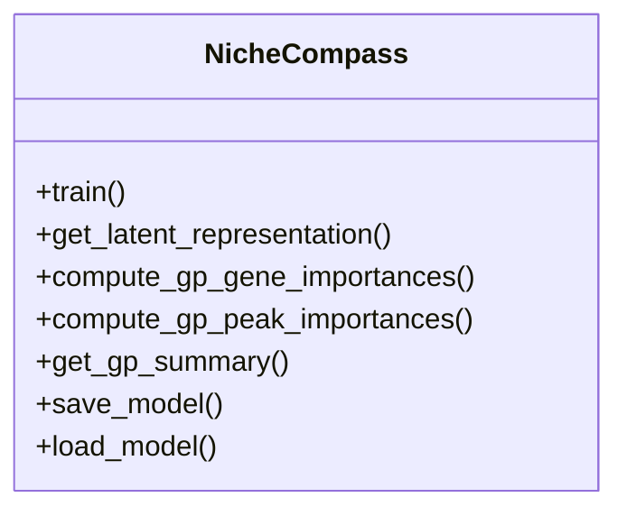
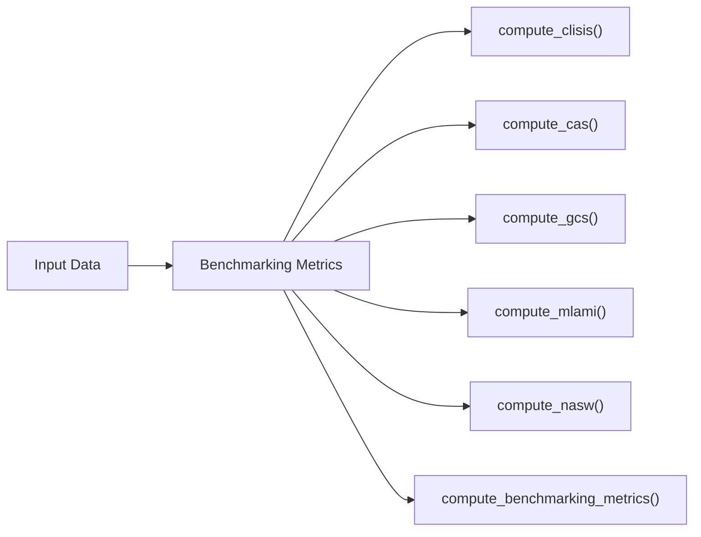
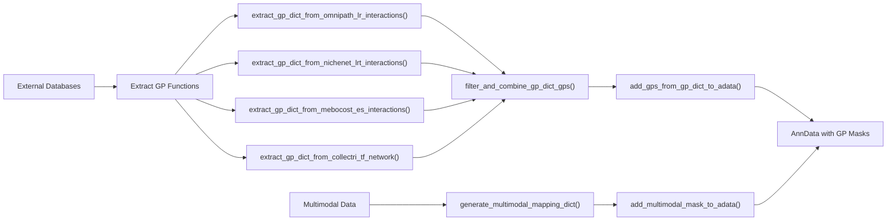
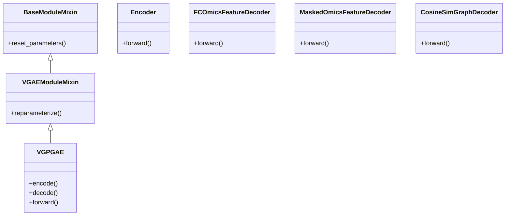
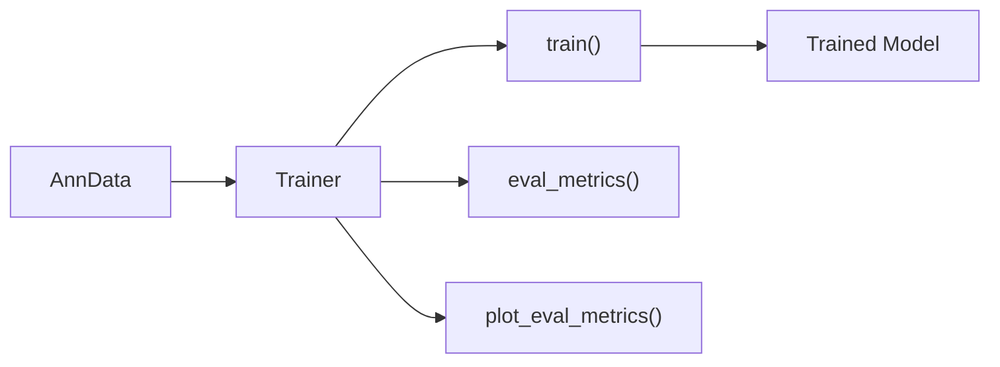
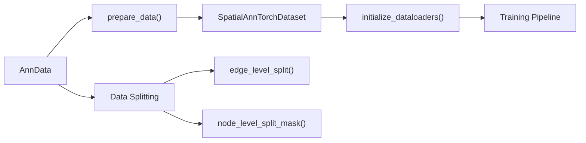
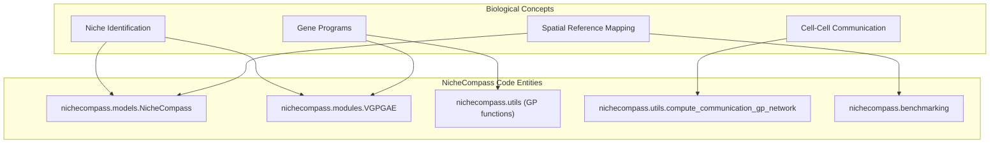

# API Reference

<details>
<summary>Relevant source files</summary>

The following files were used as context for generating this wiki page:

- [docs/api/developer.md](docs/api/developer.md)
- [docs/api/index.md](docs/api/index.md)
- [docs/api/user.md](docs/api/user.md)
- [docs/index.md](docs/index.md)
- [docs/release_notes/index.md](docs/release_notes/index.md)
- [docs/tutorials/index.md](docs/tutorials/index.md)
- [docs/user_guide/index.md](docs/user_guide/index.md)
- [pyproject.toml](pyproject.toml)
- [src/nichecompass/utils/analysis.py](src/nichecompass/utils/analysis.py)

</details>


This page provides a comprehensive reference to the NicheCompass API, outlining the available modules, classes, and functions that users and developers can utilize. For practical application examples, refer to the [Tutorials](#4) section. For best practices in using NicheCompass on your data, see the [User Guide](#5).

## API Structure Overview

The NicheCompass API is organized into two main categories:

1. **User API**: High-level interfaces designed for end-users performing spatial multi-omics analyses
2. **Developer API**: Lower-level components for those extending or modifying NicheCompass functionality



Sources: [docs/api/index.md:1-14](), [docs/api/user.md:1-87](), [docs/api/developer.md:1-97]()

## Import Pattern

NicheCompass is imported as follows:

```python
import nichecompass
```

For more specific imports, you can access individual modules:

```python
from nichecompass.models import NicheCompass
from nichecompass.utils import add_gps_from_gp_dict_to_adata
```

Sources: [docs/api/index.md:3-7]()

## User API

The User API provides high-level interfaces for analyzing spatial multi-omics data, focusing on ease of use while still maintaining flexibility.

### Core Model



The `NicheCompass` class is the central component of the API, providing methods for model training, inference, and analysis.

Sources: [docs/api/user.md:32-41]()

### Benchmarking

The benchmarking utilities allow you to evaluate NicheCompass models using various metrics:



Benchmarking functions evaluate the model's performance in preserving cell-type adjacency (`compute_cas`), graph connectivity (`compute_gcs`), and other spatial characteristics.

Sources: [docs/api/user.md:5-18]()

### Data Utilities

Data utilities help with loading and preprocessing spatial multi-omics data:

```python
from nichecompass.data import load_spatial_adata_from_csv
```

Sources: [docs/api/user.md:20-29]()

### Gene Program Utilities

Gene Program Utilities allow you to extract, filter, and add gene programs to your AnnData object:



These utilities help create and manage gene programs from various sources like OmniPath, NicheNet, MEBOCOST, and CollecTRI.

Sources: [docs/api/user.md:44-63]()

### Cell-Cell Communication Utilities

Utilities for analyzing cell-cell communication from the model results:

```python
from nichecompass.utils import compute_communication_gp_network, visualize_communication_gp_network
```

The `compute_communication_gp_network` function computes a network of category-aggregated cell-pair communication strengths, while `visualize_communication_gp_network` creates visualizations of these networks.

Sources: [docs/api/user.md:65-76](), [src/nichecompass/utils/analysis.py:871-1051]()

### Other Utilities

Additional utility functions for visualization and analysis:

```python
from nichecompass.utils import create_new_color_dict, generate_enriched_gp_info_plots
```

Sources: [docs/api/user.md:78-87](), [src/nichecompass/utils/analysis.py:212-405](), [src/nichecompass/utils/analysis.py:734-848]()

## Developer API

The Developer API provides access to lower-level components that power the NicheCompass framework, intended for those extending or customizing the functionality.

### Modules and Core Architecture



The core architecture consists of encoder-decoder models for processing spatial multi-omics data, with the main model being the Variational Gene Program Graph Autoencoder (`VGPGAE`).

Sources: [docs/api/developer.md:45-83]()

### Training



The `Trainer` class handles the training process for NicheCompass models, including evaluation and metric tracking.

Sources: [docs/api/developer.md:85-97]()

### Data Processing



The data processing components handle loading, transforming, and splitting spatial multi-omics data for model training.

Sources: [docs/api/developer.md:15-29]()

### Neural Network Components

NicheCompass includes several neural network components for processing spatial data and gene programs:

- Node label aggregators (`OneHopAttentionNodeLabelAggregator`, `OneHopGCNNormNodeLabelAggregator`, `OneHopSumNodeLabelAggregator`)
- Graph decoders (`CosineSimGraphDecoder`)
- Omics feature decoders (`FCOmicsFeatureDecoder`, `MaskedOmicsFeatureDecoder`)
- Encoder networks (`Encoder`)
- Masked layers (`MaskedLinear`, `AddOnMaskedLayer`)

Sources: [docs/api/developer.md:65-83]()

## Code to API Map

Below is a diagram mapping the natural language concepts to the specific code entities in NicheCompass:



Sources: [docs/api/user.md:32-41](), [docs/api/developer.md:45-62](), [docs/api/user.md:44-63](), [docs/api/user.md:65-76]()

## Version and Dependencies

NicheCompass is currently at version 0.2.3 and requires Python ≥ 3.9. Core dependencies include:

- mlflow ≥ 1.28.0
- pyreadr ≥ 0.4.6
- scanpy ≥ 1.9.3, < 1.10.0
- torch-geometric ≥ 2.2.0
- omnipath ≥ 1.0.7
- decoupler ≥ 1.4.0
- numpy < 2

Optional dependencies are available for benchmarking, multimodal analysis, and tutorials.

Sources: [pyproject.toml:5-81](), [docs/release_notes/index.md:7-10]()

## Function Categories and Their Uses

| Category | Main Functions | Purpose |
|----------|---------------|---------|
| **Models** | `NicheCompass` | Core model for spatial multi-omics analysis |
| **Gene Programs** | `extract_gp_dict_from_omnipath_lr_interactions`, `filter_and_combine_gp_dict_gps` | Creating and managing gene programs |
| **Cell-Cell Communication** | `compute_communication_gp_network`, `visualize_communication_gp_network` | Analyzing cell-cell interactions |
| **Benchmarking** | `compute_clisis`, `compute_cas`, `compute_benchmarking_metrics` | Evaluating model performance |
| **Visualization** | `generate_enriched_gp_info_plots`, `create_cell_type_chord_plot_from_df` | Creating visualizations of model results |
| **Data Processing** | `load_spatial_adata_from_csv`, `prepare_data` | Loading and preparing data |
| **Multimodal** | `add_multimodal_mask_to_adata`, `generate_multimodal_mapping_dict` | Working with multimodal data |

Sources: [docs/api/user.md:5-87](), [docs/api/developer.md:15-97](), [src/nichecompass/utils/analysis.py:212-405](), [src/nichecompass/utils/analysis.py:871-1051]()

---