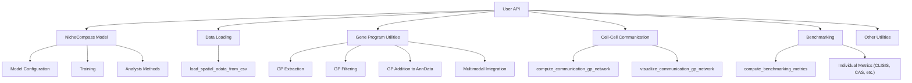
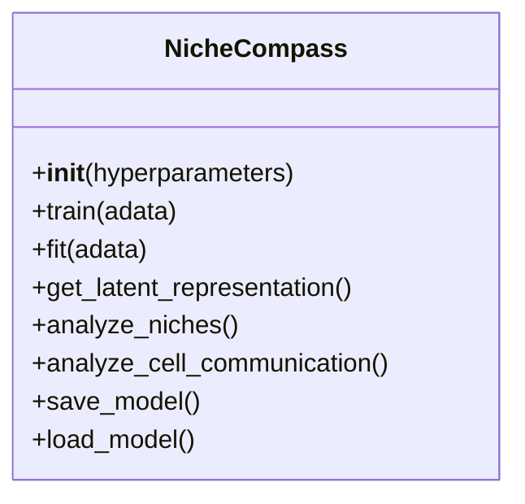
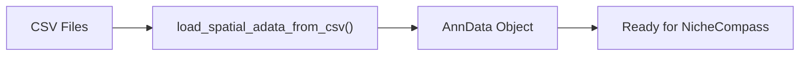
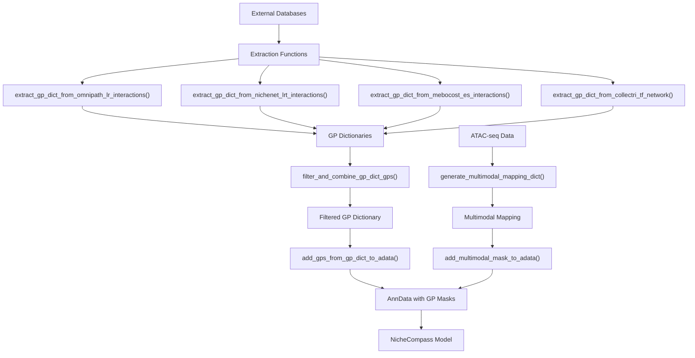
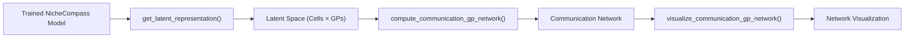
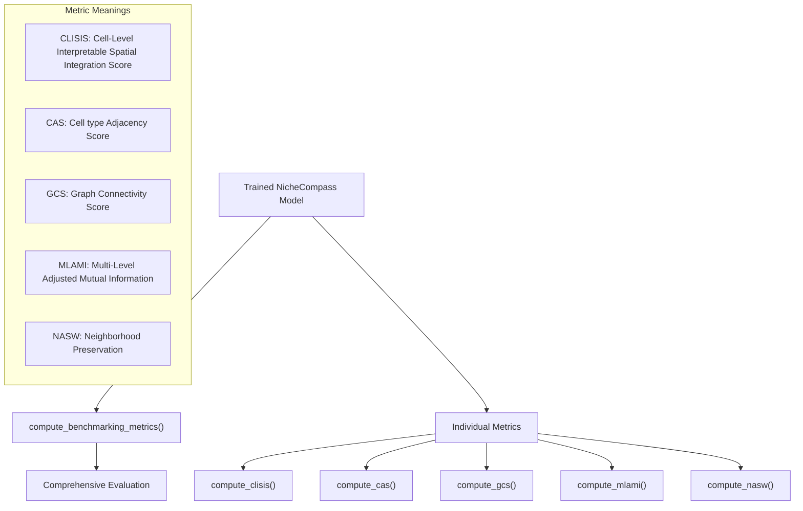
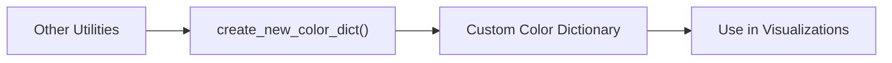
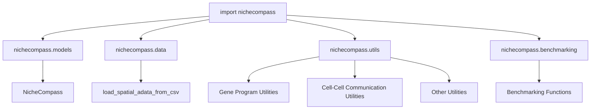
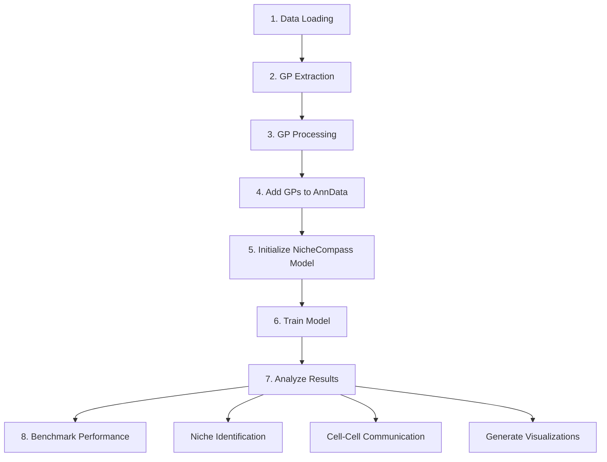

# User API

Relevant source files

The following files were used as context for generating this wiki page:

- [docs/api/developer.md](docs/api/developer.md)
- [docs/api/index.md](docs/api/index.md)
- [docs/api/user.md](docs/api/user.md)
- [docs/tutorials/index.md](docs/tutorials/index.md)

## Purpose and Scope

The User API provides the public interfaces for researchers and analysts to use NicheCompass for spatial multi-omics data analysis without needing to understand the internal implementation details. This documentation covers the user-facing functions and classes that most users will interact with directly. For information about lower-level components and implementation details, see [Developer API](#6.2).

## User API Overview

The NicheCompass User API consists of several key components organized by functionality:

Sources: [docs/api/user.md:1-88]()

## NicheCompass Model

The core of the User API is the `NicheCompass` class, which provides a high-level interface for model configuration, training, and analysis.

The `NicheCompass` class serves as the primary entry point for:
- Configuring model parameters
- Training on spatial multi-omics data
- Extracting latent representations
- Performing downstream analyses such as niche identification and cell-cell communication inference

Sources: [docs/api/user.md:32-41]()

## Data Loading Utilities

NicheCompass provides a utility function for loading spatial data from CSV files:

The `load_spatial_adata_from_csv` function processes spatial coordinates and gene expression data to create an AnnData object properly structured for use with NicheCompass.

Sources: [docs/api/user.md:20-29]()

## Gene Program Utilities

Gene Program (GP) utilities form a significant part of the User API, allowing users to extract biological knowledge from various databases, process it, and incorporate it into the analysis workflow.

The Gene Program utilities provide:
- Functions to extract gene programs from different biological interaction databases
- Tools to filter and combine gene programs
- Methods to add gene program masks to AnnData objects
- Support for multimodal integration (RNA-seq and ATAC-seq)

Sources: [docs/api/user.md:43-63]()

## Cell-Cell Communication Utilities

NicheCompass provides tools for analyzing and visualizing cell-cell communication based on the model's latent representation:

These utilities help analyze how different cell types communicate with each other through various gene programs, providing insights into spatial cellular interactions.

Sources: [docs/api/user.md:65-76]()

## Benchmarking Utilities

The User API includes several benchmarking functions to evaluate model performance:

The benchmarking utilities provide:
- A comprehensive function to compute multiple metrics at once
- Individual functions for specific metrics
- Tools to evaluate spatial properties, cell type distribution, and neighborhood preservation

Sources: [docs/api/user.md:3-18]()

## Other Utilities

The User API also includes additional utility functions:

These additional utilities support visualization and other ancillary tasks when using NicheCompass.

Sources: [docs/api/user.md:78-87]()

## Code Organization and Imports

The NicheCompass User API is organized into several modules that users can import as needed:

Users will typically import specific functions as needed, for example:

- `from nichecompass.models import NicheCompass`
- `from nichecompass.data import load_spatial_adata_from_csv`
- `from nichecompass.utils import extract_gp_dict_from_omnipath_lr_interactions`
- `from nichecompass.benchmarking import compute_clisis`

Sources: [docs/api/index.md:1-14](), [docs/api/user.md:1-88]()

## Typical Analysis Workflow

A typical analysis workflow using the NicheCompass User API follows these steps:

For more detailed examples of using these APIs in specific analysis scenarios, refer to the [Tutorials](#4) section.

Sources: [docs/tutorials/index.md:1-12]()

---